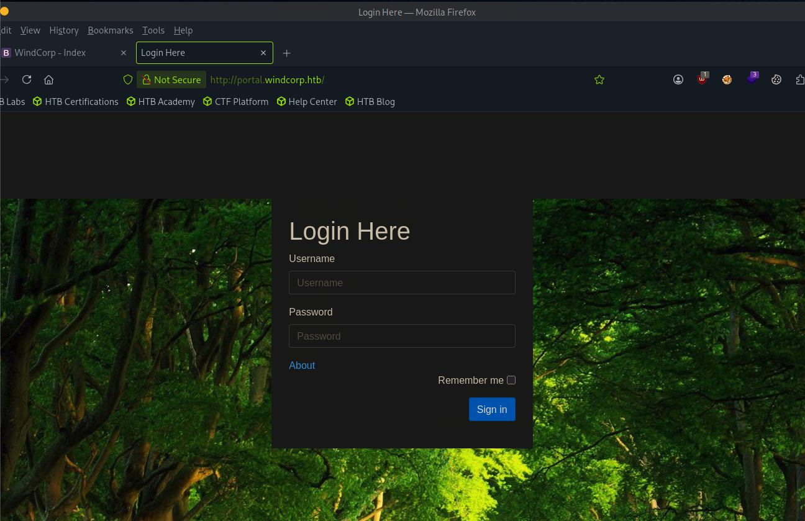

# Sekhmet

sudo nmap -sCV 10.129.21.250
Starting Nmap 7.95 ( [https://nmap.org](https://nmap.org/) ) at 2026-06-30 19:52 EDT
Nmap scan report for 10.129.21.250
Host is up (0.013s latency).
Not shown: 998 filtered tcp ports (no-response)
PORT   STATE SERVICE VERSION
22/tcp open  ssh     OpenSSH 8.4p1 Debian 5+deb11u1 (protocol 2.0)
| ssh-hostkey:
|   3072 8c:71:55:df:97:27:5e:d5:37:5a:8d:e2:92:3b:f3:6e (RSA)
|   256 b2:32:f5:88:9b:fb:58:fa:35:b0:71:0c:9a:bd:3c:ef (ECDSA)
|_  256 eb:73:c0:93:6e:40:c8:f6:b0:a8:28:93:7d:18:47:4c (ED25519)
80/tcp open  http    nginx 1.18.0
|_http-title: 403 Forbidden
|_http-server-header: nginx/1.18.0
Service Info: OS: Linux; CPE: cpe:/o:linux:linux_kernel

cat /etc/hosts

10.129.21.250 windcorp.htb www.windcorp.htb

gobuster vhost -w /usr/share/dnsrecon/dnsrecon/data/subdomains-top1mil.txt -u [http://windcorp.htb](http://windcorp.htb/) --append-domain

Found: portal.windcorp.htb Status: 403 [Size: 2436]

admin:admin

